# Results: 2026-10-12

## ASD session-type-1 RTDs: all signed ILDs pooled

Three images use the same panel layouts as the psychometrics, with **all ten
signed ILDs ±1/±2/±4/±8/±16 pooled within each ABL**. Select **correct/error
trials (`success in {1, -1}`)** and finite recorded **`timed_rt` in inclusive
[0,1] s**, relative to stimulus onset. Retain session type 1, training level 16,
and the confirmed next-trial repeat rule with CNP/Fixation exceptions. The
cleaned prepared CSV has 807 short-sound rows removed; zero additional plot
exclusions apply, and all **53 animals**, including ASD0026/ASD0045, contribute.
Map ABL 59→60 and retain **ABL 20/40/60**.

Each view has **466,978 RTs** from 471,416 eligible correct/error choices;
2,188 missing/nonfinite RTs and 2,250 finite RTs outside [0,1] s are omitted.
Pool raw trials directly across ILDs, animals, and sessions within each group
and ABL, giving more weight to animals and conditions with more eligible RTs.
**20 = blue, 40 = orange, 60 = green**, as solid, unfilled step curves with
**20 ms bins**. Normalize each curve by
`bin_count / (curve_window_n × 0.020 s)` for unit area over [0,1] s. Display
**0–0.6 s** as a display zoom without renormalizing. The histograms, densities,
and printed sample counts still use **[0,1] s**; the visible portion can have
area less than 1. Bins include their left endpoint; only the last bin
includes its right endpoint. Legends give each curve's normalization count;
titles give contributing animals and pooled RTs. All panels share the same
y scale across the three views. No averaging of animal/condition densities
or deduplication is applied.

### All-ILD RTDs: filename + genotype

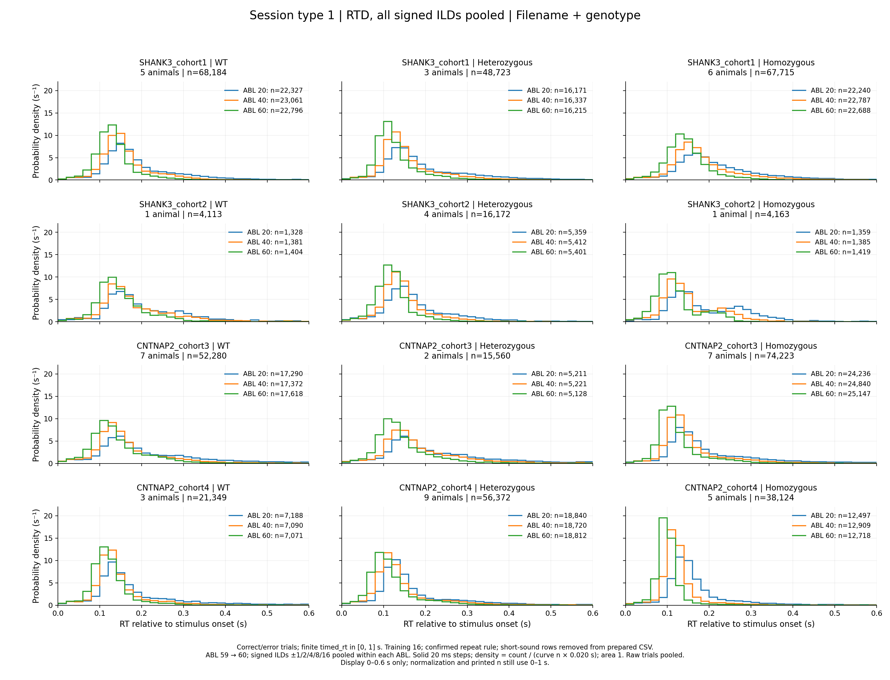

*Four cohort rows (SHANK3 cohorts 1/2 and CNTNAP2 cohorts 3/4) and three genotype
columns (WT, heterozygous, homozygous). Animals are pooled within each filename
and genotype. All signed ILDs are pooled separately for each of the three ABL
curves, using the correct/error, finite 0–1 s selection and 20 ms normalization
above. Twelve panels cover 53 animals and 466,978 RTs.*

Source: `asd_analysis/plot_session_type_1_ild_pooled_rtds.py`.
Figure: `docs/assets/results/2026-10-12/ASD_session_type_1_filename_genotype_ild_pooled_rtds.png`.

### All-ILD RTDs: genotype with both families combined

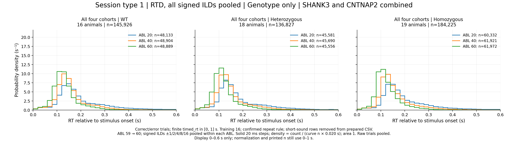

*WT, heterozygous, and homozygous panels combine SHANK3 and CNTNAP2 across all
four cohorts. Each panel overlays three ABL curves pooling all signed ILDs,
using the selection and normalization above. The groups contain 16/18/19
animals and 145,926/136,827/184,225 RTs, respectively; total 466,978 RTs.*

Source: `asd_analysis/plot_session_type_1_ild_pooled_rtds.py`.
Figure: `docs/assets/results/2026-10-12/ASD_session_type_1_genotype_ild_pooled_rtds.png`.

### All-ILD RTDs: SHANK3 and CNTNAP2 separately by genotype

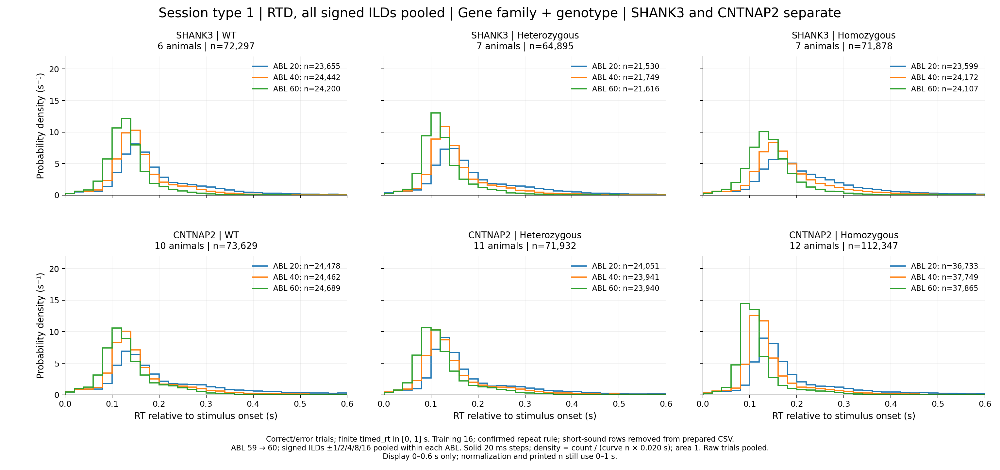

*SHANK3 above CNTNAP2, with WT, heterozygous, and homozygous columns. Pool cohorts
within each family and genotype; the families remain separate. All signed ILDs
are pooled within each of the three ABL curves using the selection and
normalization above. Six panels cover the same 53 animals and 466,978 RTs.*

Source: `asd_analysis/plot_session_type_1_ild_pooled_rtds.py`.
Figure: `docs/assets/results/2026-10-12/ASD_session_type_1_family_genotype_ild_pooled_rtds.png`.

All **3,150 histogram bins across 63 curves** match sums of the existing
animal/|ILD| bin counts. The coarser views reproduce summed filename/genotype
counts. Counts, densities, unit areas, bin widths, colors, display limits,
animal membership, and three single-page PDF exports passed validation; all
three images were visually inspected. Existing psychometric and RTD figures
and the input CSV are unchanged.

[Plotting script](../assets/results/2026-10-12/plot_session_type_1_ild_pooled_rtds.py) ·
[Histogram bins](../assets/results/2026-10-12/ild_pooled_rtd_histogram_bins.csv) ·
[Curve counts](../assets/results/2026-10-12/ild_pooled_rtd_curve_counts.csv) ·
[Group counts](../assets/results/2026-10-12/ild_pooled_rtd_group_counts.csv) ·
[Group membership](../assets/results/2026-10-12/ild_pooled_rtd_group_membership.csv) ·
[Validation](../assets/results/2026-10-12/ild_pooled_rtd_validation.json) ·
[Independent validation](../assets/results/2026-10-12/ild_pooled_rtd_independent_validation.json)

Matching PDFs:
[filename + genotype](../assets/results/2026-10-12/ASD_session_type_1_filename_genotype_ild_pooled_rtds.pdf) ·
[genotype with both families combined](../assets/results/2026-10-12/ASD_session_type_1_genotype_ild_pooled_rtds.pdf) ·
[families separately by genotype](../assets/results/2026-10-12/ASD_session_type_1_family_genotype_ild_pooled_rtds.pdf).

## ASD session-type-1 RTDs and psychometrics: cleaned prepared CSV

**Psychometric images (PNG):**

- [Filename + genotype: full-size image, 12 panels](../assets/results/2026-10-12/ASD_session_type_1_filename_genotype_psychometrics.png)
- [Genotype only: full-size image, three panels](../assets/results/2026-10-12/ASD_session_type_1_genotype_psychometrics.png)
- [Gene family + genotype: full-size image, SHANK3 and CNTNAP2 separate](../assets/results/2026-10-12/ASD_session_type_1_family_genotype_psychometrics.png)

All three images are displayed below:
[filename + genotype](#filename-genotype-12-panels),
[genotype with both families combined](#genotype-only-both-gene-families-combined),
and [SHANK3/CNTNAP2 separately by genotype](#gene-family-genotype-shank3-and-cntnap2-separate).

**Download the updated PDFs:**

- [Psychometrics: filename + genotype, 12 panels](../assets/results/2026-10-12/ASD_session_type_1_filename_genotype_psychometrics.pdf)
- [Psychometrics: genotype only, three panels](../assets/results/2026-10-12/ASD_session_type_1_genotype_psychometrics.pdf)
- [Psychometrics: gene family + genotype, six panels](../assets/results/2026-10-12/ASD_session_type_1_family_genotype_psychometrics.pdf)

- [Individual animals: 53 rows, eight pages](../assets/results/2026-10-12/ASD_session_type_1_rtds.pdf)
- [Filename + genotype: 12 rows, two pages](../assets/results/2026-10-12/ASD_session_type_1_filename_genotype_rtds.pdf)
- [Gene family + genotype: six rows, one page](../assets/results/2026-10-12/ASD_session_type_1_family_genotype_rtds.pdf)

[Animal plotting script](../assets/results/2026-10-12/plot_session_type_1_rtds.py) ·
[Genotype plotting script](../assets/results/2026-10-12/plot_session_type_1_genotype_rtds.py)

**Prepared CSV cleaned:** removed only rows with **`session_type == 1` and
`is_short_sound == 1`**, shortening the file from **643,177 to 642,370 rows**.
The actual Boolean column is `is_short_sound`; the removed rows have positive
`short_duration` of 8, 16, 32, or 64 ms. **807 rows** were removed: 330 ASD0026
and 477 ASD0045. **All 53 animals remain**, including both animals with their
standard-sound trials. The original cohorts and session-type-2/23 CSVs are
unchanged; no session types were reassigned.

The previous prepared CSV, manifests, and removed records are archived in
`asd_analysis/session_type_csvs/archive/pre_short_sound_cleanup/`. Retained
cells, columns, and row order were preserved. Plotting applies **zero additional
short-sound exclusions**. The CSV generator and independent verifier now include
this rule, with repeat eligibility still derived on all original source trials.

Input: `asd_analysis/session_type_csvs/ASD_session_type_1.csv`.
Animal source: `asd_analysis/plot_session_type_1_rtds.py`.
Pooled sources: `asd_analysis/plot_session_type_1_genotype_rtds.py`.
Original outputs: `asd_analysis/session_type_1_rtds/` and
`asd_analysis/session_type_1_genotype_rtds/`.

### Selection, timing, normalization, and grouping for the original three RTD PDFs

The prepared input retains **session type 1**, **training level 16**, and
**`abort_type == 'Fixation'` or `success in {1, -1}`**. Its confirmed repeat rule
removes the trial following `repeated_trial=True`, except after CNP or fixation
aborts. The builder determines the next distinct chronological trial by
`trial_start` within the same cohort CSV, animal, `source_file`, and session,
before applying training/session/outcome filters. The derived `trial_is_repeat`
is False in all prepared rows; a current row's raw True flag does not itself
exclude that row. Plotting uses these prepared rules directly.

Read the cleaned prepared CSV, then map **ABL 59 to 60 for plotting
only** (10,256 selected rows). Retain **ABL 20, 40, 60 dB × absolute ILD 1, 2, 4,
8, 16 dB**. Conditions outside this domain are excluded from every panel,
including the sixth. All genotypes are included: **WT (`wt`), heterozygous
(`het`), homozygous (`hom`)**, in that order in the pooled views.

The first five columns show **correct/error trials**, `success in {1, -1}`,
with finite recorded **`timed_rt` in inclusive [0, 1] s**. Curves are solid,
unfilled steps: **ABL 20 = blue, 40 = orange, 60 = green**. Positive and negative
ILDs are pooled; the five panels share the y scale within each row.

The sixth column is a **black** solid, unfilled step curve for **correct/error
trials plus fixation aborts**, with finite **`timed_rt` in inclusive [−1, 1] s**,
pooling trials directly across the same displayed stimulus conditions. Its
y scale is independent. Recorded `timed_rt` is used in seconds relative to
stimulus onset without recomputing timing; negative fixation-abort times refer
to the scheduled stimulus onset, which may not have occurred.

**20 ms bins throughout.** For each curve,
`density = bin_count / (trials in that curve's original window × 0.020 s)`.
Each nonempty curve has area 1 over its original normalization window.
Missing/nonfinite times and times outside that window do not enter its
denominator. Bins are left-inclusive/right-exclusive, except the final bin
includes its right endpoint. Printed **n** is the original window's count.

**Display zoom:** first five panels show **0–0.6 s**; the sixth shows
**−0.6–0.6 s**. Normalization and printed n retain **[0, 1] / [−1, 1] s**;
the visible portion is not renormalized and can have area less than 1.

The animal view groups **filename + animal**. The first pooled view combines
animals within **filename + genotype**; the second also combines cohorts
within **gene family + genotype**. Histograms are calculated from combined raw
trials, so animals with more eligible trials contribute more weight. Signed
ILDs and sessions contribute observed trials; the sixth column also pools
conditions directly. There is no averaging of animal or condition densities
and no deduplication. Row labels show genotype and, in pooled views, distinct
contributing animal counts. `filename` identifies the cohort CSV; `source_file`
preserves daily-file provenance.

### Revised counts

All three views cover the same selected records; regrouping does not change
the trial totals.

| Quantity | Verified count |
| --- | ---: |
| Archived prepared session-type-1 rows before cleanup | 643,177 |
| Short-sound rows removed during preparation | 807 |
| Current prepared rows before stimulus selection | 642,370 |
| Remaining short-sound flags / additional plotting exclusions | 0 / 0 |
| Selected rows in the displayed stimulus domain | 610,234 |
| Selected rows with finite `timed_rt` | 607,207 |
| Selected rows with missing/nonfinite `timed_rt` | 3,027 |
| Correct/error trials in [0, 1] s | 466,978 |
| Correct/error + fixation trials in [−1, 1] s | 598,864 |
| Animals in each view | 53 |

| Restored animal | Genotype | Flagged prepared rows removed | Selected remaining rows | Correct/error [0, 1] s | Pooled [−1, 1] s |
| --- | --- | ---: | ---: | ---: | ---: |
| ASD0026 | WT | 330 | 10,052 | 7,995 | 9,977 |
| ASD0045 | Homozygous | 477 | 12,779 | 10,446 | 12,591 |

Compared with the earlier whole-animal exclusions, this restores **22,831
selected rows**, **18,441 correct/error window trials**, and **22,568 pooled
window trials**. The other 51 animals' histogram counts and densities are
unchanged.

| Cohort CSV | Animals | Animal PDF pages |
| --- | ---: | --- |
| `SHANK3_cohort1.csv` | 14 | 1–2 |
| `SHANK3_cohort2.csv` | 6 | 3 |
| `CNTNAP2_cohort3.csv` | 16 | 4–5 |
| `CNTNAP2_cohort4.csv` | 17 | 6–8 |

### Contributing animals in the pooled views

| Group | WT | Heterozygous | Homozygous |
| --- | ---: | ---: | ---: |
| `SHANK3_cohort1.csv` | 5 | 3 | 6 |
| `SHANK3_cohort2.csv` | 1 | 4 | 1 |
| `CNTNAP2_cohort3.csv` | 7 | 2 | 7 |
| `CNTNAP2_cohort4.csv` | 3 | 9 | 5 |
| SHANK3 family, cohorts combined | 6 | 7 | 7 |
| CNTNAP2 family, cohorts combined | 10 | 11 | 12 |

### Exact records behind the short-sound row exclusion

[807 excluded prepared rows](../assets/results/2026-10-12/excluded_prepared_short_sound_rows.csv) ·
[Complete original and archived prepared flagged-row locations](../assets/results/2026-10-12/flagged_row_locations.csv) ·
[Flagged-row summary](../assets/results/2026-10-12/flagged_row_summary.csv)

CSV row numbers count the **header as row 1**. Flagged rows are interleaved:
**the entire span is not excluded**. The complete location audit contains
836 original flagged records and 807 archived prepared flagged records, including those
outside the displayed stimulus domain, with filenames, CSV row numbers, animal
and trial IDs, daily source files, dates, duration flags and values, stimuli,
outcomes, and inclusion in the displayed domain. The separate prepared-row
download lists exactly the 807 rows removed during CSV cleanup. Historical
prepared CSV row numbers refer to the archived pre-cleanup file, not the current
shortened CSV; `csv_kind=archived_prepared` and `csv_path` identify that archive.

All flagged records have `training_level=16`, `session_type=1`,
`is_short_sound=1`, and positive `short_duration`. Both source sessions are
dated **2026-04-29**.

| Animal | CSV | Flagged records | CSV row span |
| --- | --- | ---: | --- |
| ASD0026 | Original `CNTNAP2_cohort3.csv` | 354 | 117123–117710 |
| ASD0045 | Original `SHANK3_cohort1.csv` | 482 | 795362–796126 |
| ASD0026 | Archived pre-cleanup `ASD_session_type_1.csv` | 330 | 302942–303496 |
| ASD0045 | Archived pre-cleanup `ASD_session_type_1.csv` | 477 | 175231–175987 |

Original example rows are 117123–117126 for ASD0026 and 795364–795369 for
ASD0045. Of the 807 excluded prepared rows, **763** are in the displayed
stimulus domain (312 ASD0026 + 451 ASD0045); the other 44 already lie outside
that domain. Their remaining standard-sound trials are retained.

## Psychometric scatter plots: all correct/error choices

[Filename + genotype PDF](../assets/results/2026-10-12/ASD_session_type_1_filename_genotype_psychometrics.pdf) ·
[Genotype-only PDF](../assets/results/2026-10-12/ASD_session_type_1_genotype_psychometrics.pdf) ·
[Separate-family PDF](../assets/results/2026-10-12/ASD_session_type_1_family_genotype_psychometrics.pdf) ·
[Filename/genotype and combined-genotype plotting script](../assets/results/2026-10-12/plot_session_type_1_psychometrics.py) ·
[Separate-family plotting script](../assets/results/2026-10-12/plot_session_type_1_family_psychometrics.py)

Sources: `asd_analysis/plot_session_type_1_psychometrics.py` and
`asd_analysis/plot_session_type_1_family_psychometrics.py`.
Outputs: `asd_analysis/session_type_1_psychometrics/`.

These figures use **all correct/error choices, `success in {1, -1}`, without an
RT restriction**, as confirmed. The cleaned input retains session type 1,
training level 16, and the documented next-trial repeat rule with CNP/Fixation
exceptions. No short-sound rows remain; all 53 animals are included.
Map ABL 59→60 and select **ABL 20/40/60 × signed ILD ±1/±2/±4/±8/±16**.
Unlike the RTD's absolute-ILD panels, negative and positive ILDs remain separate
on the psychometric x axis.

**P(right) = right choices / all right-or-left choices** at that group's mapped
ABL and signed ILD. `response_poke=1` is right and `-1` is left. All **471,416**
selected trials have a recorded side: **241,539 right**, **229,877 left**.
This includes **2,188 trials with missing RT**; timing is not needed to measure
choice probability. The 0–1 s RTD window would retain 466,978 trials, so it is
not applied here. Each scatter point's exact numerator and denominator are
saved in the point audit.

Raw trials are pooled directly; animals with more eligible trials contribute
more weight. There is no averaging of animal probabilities and no deduplication.
WT, heterozygous, and homozygous appear in that order. Each panel contains all
three ABL scatter series, **20 blue circles, 40 orange squares, 60 green triangles**,
with no connecting lines, fitted curves, or error bars. Titles give the group's
distinct contributing animals and total eligible choices. The y axis spans 0–1.

| Genotype-only group | Animals | Trials |
| --- | ---: | ---: |
| WT | 16 | 148,801 |
| Heterozygous | 18 | 137,413 |
| Homozygous | 19 | 185,202 |

### Filename + genotype: 12 panels

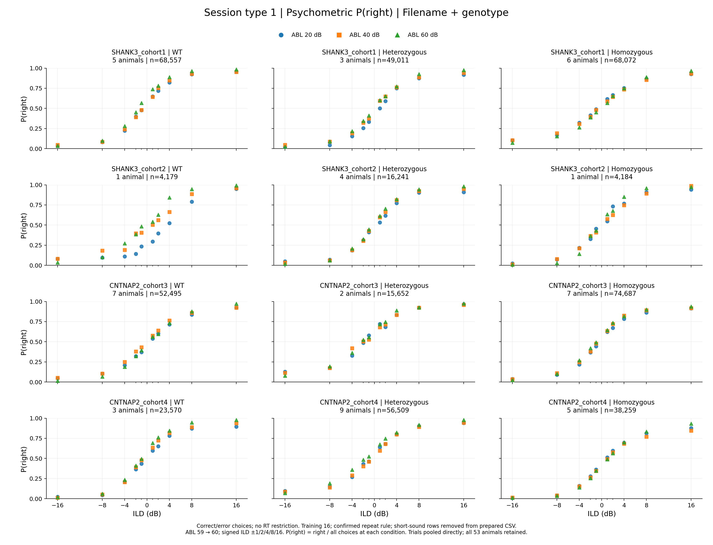

[Download the full-size PNG image](../assets/results/2026-10-12/ASD_session_type_1_filename_genotype_psychometrics.png)

*Four cohort rows (SHANK3 cohorts 1/2, CNTNAP2 cohorts 3/4) and three genotype
columns (WT, heterozygous, homozygous), pooling animals within each filename and
genotype. Session type 1, training level 16, confirmed next-trial repeat rule;
807 short-sound rows removed from the prepared CSV, zero additional plot
exclusions, all 53 animals retained. Correct/error choices only, no RT restriction.
ABL 59→60; ABL 20/40/60, blue/orange/green scatter series at signed ILD
±1/2/4/8/16. Each point is recorded right choices divided by all recorded
right/left choices at its condition. Raw trials are pooled, giving more weight
to animals with more trials; no fitted curves or probability averaging. Titles
show animals and trial counts. This view has 360 points and 471,416 trials.*

Source: `asd_analysis/plot_session_type_1_psychometrics.py`.
Figure: `docs/assets/results/2026-10-12/ASD_session_type_1_filename_genotype_psychometrics.png`.

### Genotype only: both gene families combined

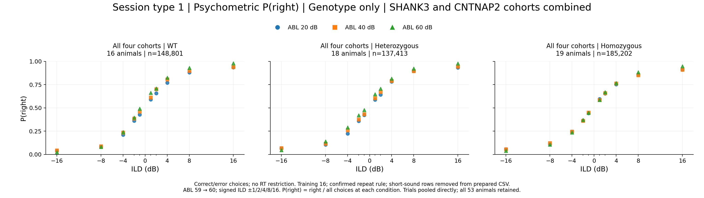

[Download the full-size PNG image](../assets/results/2026-10-12/ASD_session_type_1_genotype_psychometrics.png)

*Three panels (WT, heterozygous, homozygous), combining SHANK3 and CNTNAP2 across
all four cohort files. This combined view is retained for comparison alongside
the separate-family view below. Session type 1, training level 16, confirmed
next-trial repeat rule; short-sound rows removed during preparation, zero additional
plot exclusions, all 53 animals retained. Correct/error choices only, no RT
restriction. ABL 59→60; ABL 20/40/60, blue/orange/green scatter series at signed
ILD ±1/2/4/8/16. P(right) is summed right choices divided by summed right/left
choices at each condition. Animals contribute their observed trials; no
equal-animal averages, fitted curves, or connecting lines. Titles show animal
and trial counts. This view has 90 points and the same 471,416 trials.*

Source: `asd_analysis/plot_session_type_1_psychometrics.py`.
Figure: `docs/assets/results/2026-10-12/ASD_session_type_1_genotype_psychometrics.png`.

All 450 point numerators, denominators, and probabilities passed an independent
standard-library CSV-parser check. Genotype-only condition counts equal summed
filename/genotype counts. Colors, limits, labels, group membership, and two
single-page PDF exports passed validation; both figures were visually inspected.

[Point-count audit](../assets/results/2026-10-12/psychometric_points.csv) ·
[Group counts](../assets/results/2026-10-12/psychometric_group_counts.csv) ·
[Group membership](../assets/results/2026-10-12/psychometric_group_membership.csv) ·
[Selection and validation](../assets/results/2026-10-12/psychometric_validation.json) ·
[Independent validation](../assets/results/2026-10-12/psychometric_independent_validation.json)

### Gene family + genotype: SHANK3 and CNTNAP2 separate

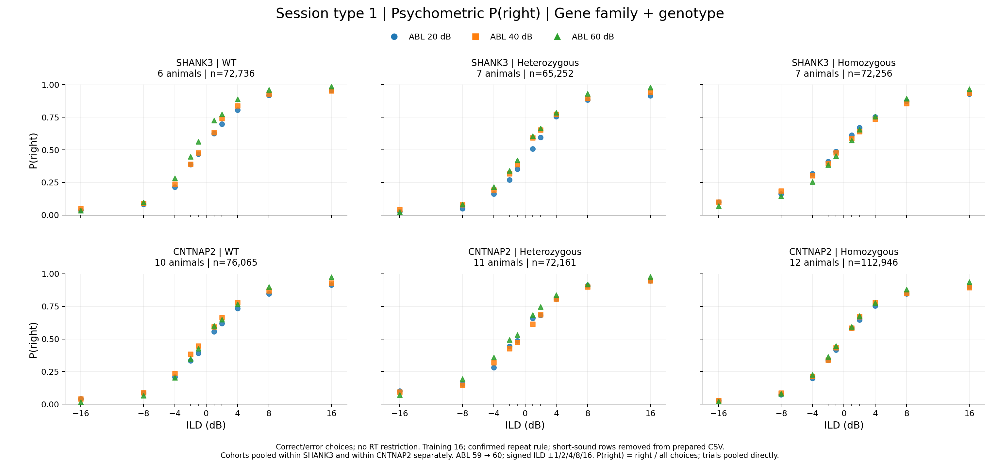

[Download the full-size PNG image](../assets/results/2026-10-12/ASD_session_type_1_family_genotype_psychometrics.png) ·
[Download the single-page PDF](../assets/results/2026-10-12/ASD_session_type_1_family_genotype_psychometrics.pdf) ·
[Plotting script](../assets/results/2026-10-12/plot_session_type_1_family_psychometrics.py)

*Two gene-family rows (SHANK3 above CNTNAP2) and three genotype columns (WT,
heterozygous, homozygous). Cohorts and animals are pooled within each family and
genotype; the families remain separate. Session type 1, training level 16,
confirmed next-trial repeat rule with CNP/Fixation exceptions. The prepared CSV
has 807 short-sound rows removed, zero additional plot exclusions, and all 53
animals retained, including ASD0026 and ASD0045 with their remaining trials.
Select `success in {1, -1}` with no RT restriction; map ABL 59→60 and retain
ABL 20/40/60 × signed ILD ±1/2/4/8/16. Blue circles, orange squares, and green
triangles show the three ABLs. Each point is right choices (`response_poke=1`)
divided by all recorded right/left choices at that family's genotype, ABL, and
signed ILD. Pool raw trials directly, so animals with more eligible trials
contribute more weight; no averaging of animal probabilities, fitted curves,
connecting lines, or error bars. Titles show contributing animals and trials.
This view has 180 points and the same 471,416 choices: 241,539 right and 229,877
left, including 2,188 with missing RT.*

| Family | Genotype | Animals | Trials |
| --- | --- | ---: | ---: |
| SHANK3 | WT | 6 | 72,736 |
| SHANK3 | Heterozygous | 7 | 65,252 |
| SHANK3 | Homozygous | 7 | 72,256 |
| CNTNAP2 | WT | 10 | 76,065 |
| CNTNAP2 | Heterozygous | 11 | 72,161 |
| CNTNAP2 | Homozygous | 12 | 112,946 |

Source: `asd_analysis/plot_session_type_1_family_psychometrics.py`.
Figure: `docs/assets/results/2026-10-12/ASD_session_type_1_family_genotype_psychometrics.png`.

All 180 point counts match sums of the independently verified filename/genotype
counts. Summing the two families reproduces every condition count in the
preserved combined-genotype view. Probabilities, group membership, colors,
limits, sample labels, and the single-page PDF passed validation; the image was
visually inspected. The two earlier psychometric figures and their audits are
unchanged.

[Point-count audit](../assets/results/2026-10-12/family_psychometric_points.csv) ·
[Group counts](../assets/results/2026-10-12/family_psychometric_group_counts.csv) ·
[Group membership](../assets/results/2026-10-12/family_psychometric_group_membership.csv) ·
[Selection and validation](../assets/results/2026-10-12/family_psychometric_validation.json) ·
[Independent validation](../assets/results/2026-10-12/family_psychometric_independent_validation.json)

## Individual-animal PDF pages

Eight pages, one filename + animal per row, up to eight animals per page.
All pages follow the common selection and normalization rules above.

### PDF page 1: SHANK3_cohort1, cohort page 1/2

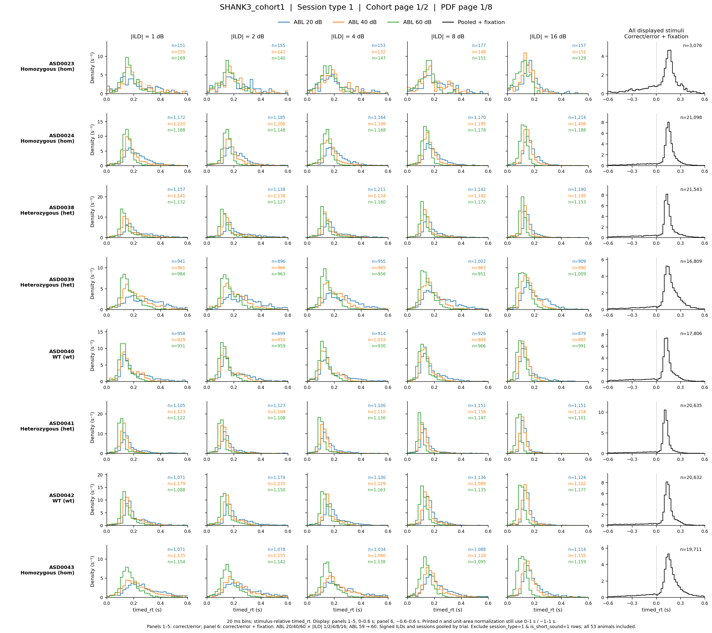

*8 animals: ASD0023, ASD0024, ASD0038, ASD0039, ASD0040, ASD0041, ASD0042, ASD0043. Rows label animal and genotype. Session type 1, training level 16, confirmed next-trial repeat rule with CNP/Fixation exceptions; session_type=1 & is_short_sound=1 rows were removed during preparation; zero additional plot exclusions; retain all animals, including ASD0026/ASD0045. ABL 59→60; ABL 20/40/60 × |ILD| 1/2/4/8/16 only. Columns 1–5: correct/error, finite recorded timed_rt in [0,1] s, blue/orange/green ABL curves, shared row y scale. Column 6: correct/error plus fixation, finite timed_rt in [−1,1] s, black, same stimulus domain. Solid unfilled 20 ms steps; density = bin count / (original-window n × 0.020 s), area 1 over the original windows. Display 0–0.6 / −0.6–0.6 s without renormalizing; printed n uses the original window. Signed ILDs and sessions are pooled by observed trials; column 6 also pools conditions directly. No deduplication or averaging of densities.*

Source: `asd_analysis/plot_session_type_1_rtds.py`.
Figure: `docs/assets/results/2026-10-12/SHANK3_cohort1_rtds_page_01.png`.

### PDF page 2: SHANK3_cohort1, cohort page 2/2

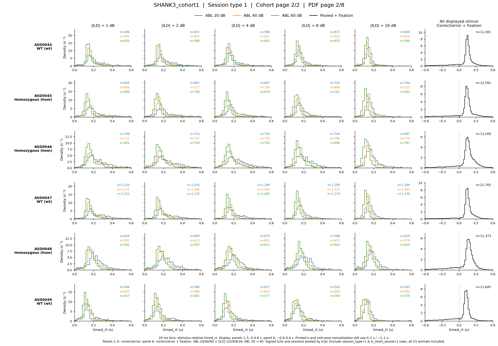

*6 animals: ASD0044, ASD0045, ASD0046, ASD0047, ASD0048, ASD0049. Rows label animal and genotype. Session type 1, training level 16, confirmed next-trial repeat rule with CNP/Fixation exceptions; session_type=1 & is_short_sound=1 rows were removed during preparation; zero additional plot exclusions; retain all animals, including ASD0026/ASD0045. ABL 59→60; ABL 20/40/60 × |ILD| 1/2/4/8/16 only. Columns 1–5: correct/error, finite recorded timed_rt in [0,1] s, blue/orange/green ABL curves, shared row y scale. Column 6: correct/error plus fixation, finite timed_rt in [−1,1] s, black, same stimulus domain. Solid unfilled 20 ms steps; density = bin count / (original-window n × 0.020 s), area 1 over the original windows. Display 0–0.6 / −0.6–0.6 s without renormalizing; printed n uses the original window. Signed ILDs and sessions are pooled by observed trials; column 6 also pools conditions directly. No deduplication or averaging of densities.*

Source: `asd_analysis/plot_session_type_1_rtds.py`.
Figure: `docs/assets/results/2026-10-12/SHANK3_cohort1_rtds_page_02.png`.

### PDF page 3: SHANK3_cohort2, cohort page 1/1

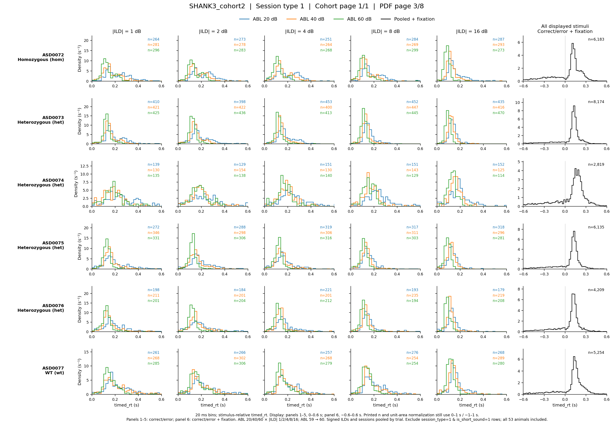

*6 animals: ASD0072, ASD0073, ASD0074, ASD0075, ASD0076, ASD0077. Rows label animal and genotype. Session type 1, training level 16, confirmed next-trial repeat rule with CNP/Fixation exceptions; session_type=1 & is_short_sound=1 rows were removed during preparation; zero additional plot exclusions; retain all animals, including ASD0026/ASD0045. ABL 59→60; ABL 20/40/60 × |ILD| 1/2/4/8/16 only. Columns 1–5: correct/error, finite recorded timed_rt in [0,1] s, blue/orange/green ABL curves, shared row y scale. Column 6: correct/error plus fixation, finite timed_rt in [−1,1] s, black, same stimulus domain. Solid unfilled 20 ms steps; density = bin count / (original-window n × 0.020 s), area 1 over the original windows. Display 0–0.6 / −0.6–0.6 s without renormalizing; printed n uses the original window. Signed ILDs and sessions are pooled by observed trials; column 6 also pools conditions directly. No deduplication or averaging of densities.*

Source: `asd_analysis/plot_session_type_1_rtds.py`.
Figure: `docs/assets/results/2026-10-12/SHANK3_cohort2_rtds_page_01.png`.

### PDF page 4: CNTNAP2_cohort3, cohort page 1/2

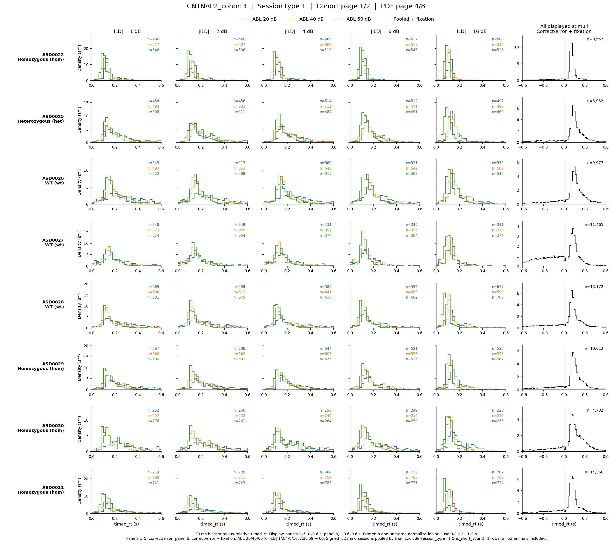

*8 animals: ASD0022, ASD0025, ASD0026, ASD0027, ASD0028, ASD0029, ASD0030, ASD0031. Rows label animal and genotype. Session type 1, training level 16, confirmed next-trial repeat rule with CNP/Fixation exceptions; session_type=1 & is_short_sound=1 rows were removed during preparation; zero additional plot exclusions; retain all animals, including ASD0026/ASD0045. ABL 59→60; ABL 20/40/60 × |ILD| 1/2/4/8/16 only. Columns 1–5: correct/error, finite recorded timed_rt in [0,1] s, blue/orange/green ABL curves, shared row y scale. Column 6: correct/error plus fixation, finite timed_rt in [−1,1] s, black, same stimulus domain. Solid unfilled 20 ms steps; density = bin count / (original-window n × 0.020 s), area 1 over the original windows. Display 0–0.6 / −0.6–0.6 s without renormalizing; printed n uses the original window. Signed ILDs and sessions are pooled by observed trials; column 6 also pools conditions directly. No deduplication or averaging of densities.*

Source: `asd_analysis/plot_session_type_1_rtds.py`.
Figure: `docs/assets/results/2026-10-12/CNTNAP2_cohort3_rtds_page_01.png`.

### PDF page 5: CNTNAP2_cohort3, cohort page 2/2

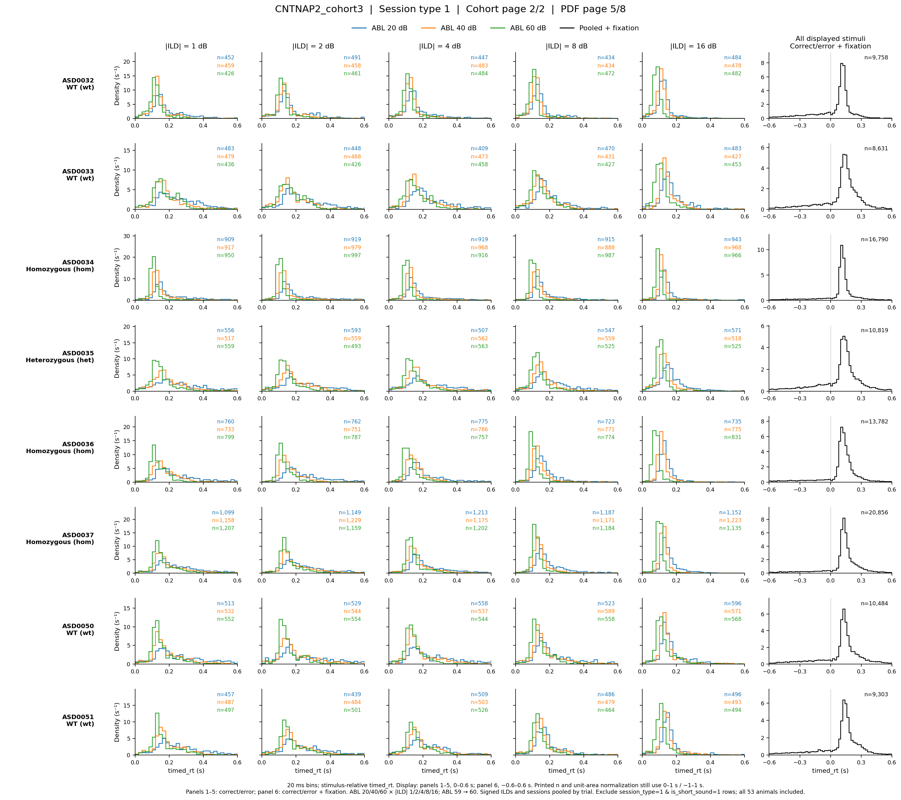

*8 animals: ASD0032, ASD0033, ASD0034, ASD0035, ASD0036, ASD0037, ASD0050, ASD0051. Rows label animal and genotype. Session type 1, training level 16, confirmed next-trial repeat rule with CNP/Fixation exceptions; session_type=1 & is_short_sound=1 rows were removed during preparation; zero additional plot exclusions; retain all animals, including ASD0026/ASD0045. ABL 59→60; ABL 20/40/60 × |ILD| 1/2/4/8/16 only. Columns 1–5: correct/error, finite recorded timed_rt in [0,1] s, blue/orange/green ABL curves, shared row y scale. Column 6: correct/error plus fixation, finite timed_rt in [−1,1] s, black, same stimulus domain. Solid unfilled 20 ms steps; density = bin count / (original-window n × 0.020 s), area 1 over the original windows. Display 0–0.6 / −0.6–0.6 s without renormalizing; printed n uses the original window. Signed ILDs and sessions are pooled by observed trials; column 6 also pools conditions directly. No deduplication or averaging of densities.*

Source: `asd_analysis/plot_session_type_1_rtds.py`.
Figure: `docs/assets/results/2026-10-12/CNTNAP2_cohort3_rtds_page_02.png`.

### PDF page 6: CNTNAP2_cohort4, cohort page 1/3

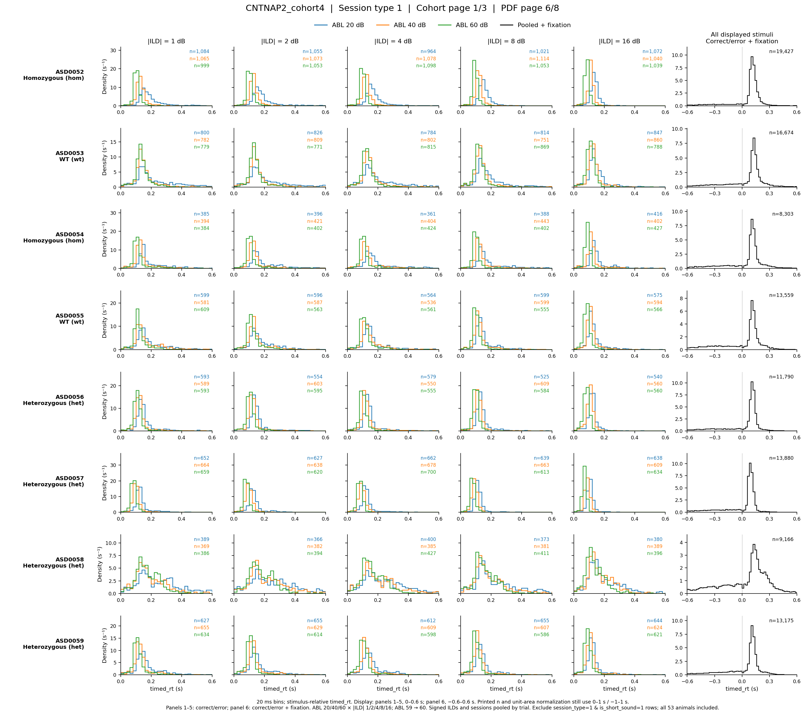

*8 animals: ASD0052, ASD0053, ASD0054, ASD0055, ASD0056, ASD0057, ASD0058, ASD0059. Rows label animal and genotype. Session type 1, training level 16, confirmed next-trial repeat rule with CNP/Fixation exceptions; session_type=1 & is_short_sound=1 rows were removed during preparation; zero additional plot exclusions; retain all animals, including ASD0026/ASD0045. ABL 59→60; ABL 20/40/60 × |ILD| 1/2/4/8/16 only. Columns 1–5: correct/error, finite recorded timed_rt in [0,1] s, blue/orange/green ABL curves, shared row y scale. Column 6: correct/error plus fixation, finite timed_rt in [−1,1] s, black, same stimulus domain. Solid unfilled 20 ms steps; density = bin count / (original-window n × 0.020 s), area 1 over the original windows. Display 0–0.6 / −0.6–0.6 s without renormalizing; printed n uses the original window. Signed ILDs and sessions are pooled by observed trials; column 6 also pools conditions directly. No deduplication or averaging of densities.*

Source: `asd_analysis/plot_session_type_1_rtds.py`.
Figure: `docs/assets/results/2026-10-12/CNTNAP2_cohort4_rtds_page_01.png`.

### PDF page 7: CNTNAP2_cohort4, cohort page 2/3

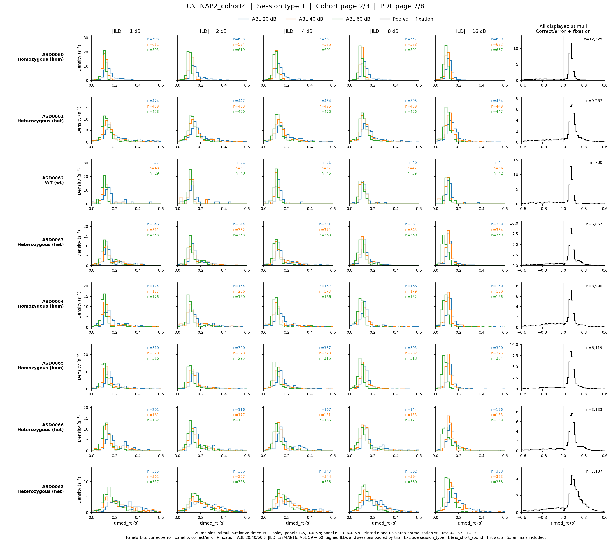

*8 animals: ASD0060, ASD0061, ASD0062, ASD0063, ASD0064, ASD0065, ASD0066, ASD0068. Rows label animal and genotype. Session type 1, training level 16, confirmed next-trial repeat rule with CNP/Fixation exceptions; session_type=1 & is_short_sound=1 rows were removed during preparation; zero additional plot exclusions; retain all animals, including ASD0026/ASD0045. ABL 59→60; ABL 20/40/60 × |ILD| 1/2/4/8/16 only. Columns 1–5: correct/error, finite recorded timed_rt in [0,1] s, blue/orange/green ABL curves, shared row y scale. Column 6: correct/error plus fixation, finite timed_rt in [−1,1] s, black, same stimulus domain. Solid unfilled 20 ms steps; density = bin count / (original-window n × 0.020 s), area 1 over the original windows. Display 0–0.6 / −0.6–0.6 s without renormalizing; printed n uses the original window. Signed ILDs and sessions are pooled by observed trials; column 6 also pools conditions directly. No deduplication or averaging of densities.*

Source: `asd_analysis/plot_session_type_1_rtds.py`.
Figure: `docs/assets/results/2026-10-12/CNTNAP2_cohort4_rtds_page_02.png`.

### PDF page 8: CNTNAP2_cohort4, cohort page 3/3

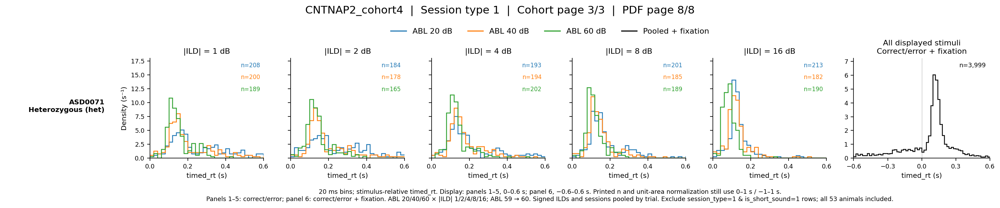

*1 animals: ASD0071. Rows label animal and genotype. Session type 1, training level 16, confirmed next-trial repeat rule with CNP/Fixation exceptions; session_type=1 & is_short_sound=1 rows were removed during preparation; zero additional plot exclusions; retain all animals, including ASD0026/ASD0045. ABL 59→60; ABL 20/40/60 × |ILD| 1/2/4/8/16 only. Columns 1–5: correct/error, finite recorded timed_rt in [0,1] s, blue/orange/green ABL curves, shared row y scale. Column 6: correct/error plus fixation, finite timed_rt in [−1,1] s, black, same stimulus domain. Solid unfilled 20 ms steps; density = bin count / (original-window n × 0.020 s), area 1 over the original windows. Display 0–0.6 / −0.6–0.6 s without renormalizing; printed n uses the original window. Signed ILDs and sessions are pooled by observed trials; column 6 also pools conditions directly. No deduplication or averaging of densities.*

Source: `asd_analysis/plot_session_type_1_rtds.py`.
Figure: `docs/assets/results/2026-10-12/CNTNAP2_cohort4_rtds_page_03.png`.

## Filename + genotype PDF pages

[Download the two-page filename + genotype PDF](../assets/results/2026-10-12/ASD_session_type_1_filename_genotype_rtds.pdf).
Twelve rows: six SHANK3 cohort/genotype groups on page 1, six CNTNAP2 groups on
page 2. Within each filename, order WT, heterozygous, homozygous.

### Filename + genotype: page 1

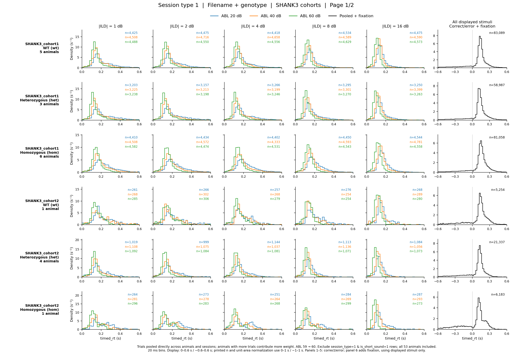

*Six group/genotype rows: SHANK3_cohort1.csv/wt, SHANK3_cohort1.csv/het, SHANK3_cohort1.csv/hom, SHANK3_cohort2.csv/wt, SHANK3_cohort2.csv/het, SHANK3_cohort2.csv/hom. Rows label group, genotype, and contributing animal count. Raw eligible trials are combined before histogramming; animals with more eligible trials contribute more weight. Session type 1, training level 16, confirmed next-trial repeat rule with CNP/Fixation exceptions; session_type=1 & is_short_sound=1 rows were removed during preparation; zero additional plot exclusions; retain all animals, including ASD0026/ASD0045. ABL 59→60; ABL 20/40/60 × |ILD| 1/2/4/8/16 only. Columns 1–5: correct/error, finite recorded timed_rt in [0,1] s, blue/orange/green ABL curves, shared row y scale. Column 6: correct/error plus fixation, finite timed_rt in [−1,1] s, black, same stimulus domain. Solid unfilled 20 ms steps; density = bin count / (original-window n × 0.020 s), area 1 over the original windows. Display 0–0.6 / −0.6–0.6 s without renormalizing; printed n uses the original window. Signed ILDs and sessions are pooled by observed trials; column 6 also pools conditions directly. No deduplication or averaging of densities.*

Source: `asd_analysis/plot_session_type_1_genotype_rtds.py`.
Figure: `docs/assets/results/2026-10-12/ASD_session_type_1_filename_genotype_rtds_page_01.png`.

### Filename + genotype: page 2

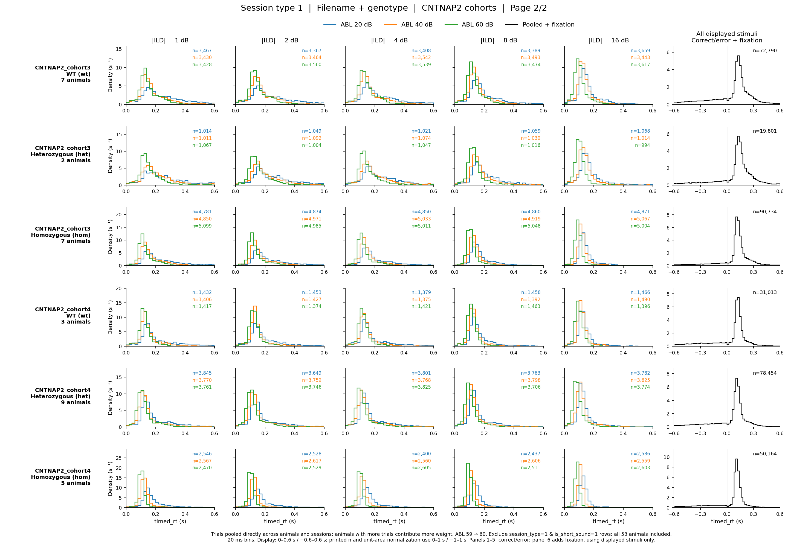

*Six group/genotype rows: CNTNAP2_cohort3.csv/wt, CNTNAP2_cohort3.csv/het, CNTNAP2_cohort3.csv/hom, CNTNAP2_cohort4.csv/wt, CNTNAP2_cohort4.csv/het, CNTNAP2_cohort4.csv/hom. Rows label group, genotype, and contributing animal count. Raw eligible trials are combined before histogramming; animals with more eligible trials contribute more weight. Session type 1, training level 16, confirmed next-trial repeat rule with CNP/Fixation exceptions; session_type=1 & is_short_sound=1 rows were removed during preparation; zero additional plot exclusions; retain all animals, including ASD0026/ASD0045. ABL 59→60; ABL 20/40/60 × |ILD| 1/2/4/8/16 only. Columns 1–5: correct/error, finite recorded timed_rt in [0,1] s, blue/orange/green ABL curves, shared row y scale. Column 6: correct/error plus fixation, finite timed_rt in [−1,1] s, black, same stimulus domain. Solid unfilled 20 ms steps; density = bin count / (original-window n × 0.020 s), area 1 over the original windows. Display 0–0.6 / −0.6–0.6 s without renormalizing; printed n uses the original window. Signed ILDs and sessions are pooled by observed trials; column 6 also pools conditions directly. No deduplication or averaging of densities.*

Source: `asd_analysis/plot_session_type_1_genotype_rtds.py`.
Figure: `docs/assets/results/2026-10-12/ASD_session_type_1_filename_genotype_rtds_page_02.png`.

## Gene family + genotype PDF page

[Download the one-page gene family + genotype PDF](../assets/results/2026-10-12/ASD_session_type_1_family_genotype_rtds.pdf).
Six rows, combining cohorts within SHANK3 and within CNTNAP2, ordered WT,
heterozygous, homozygous within each family.

### Gene family + genotype: page 1

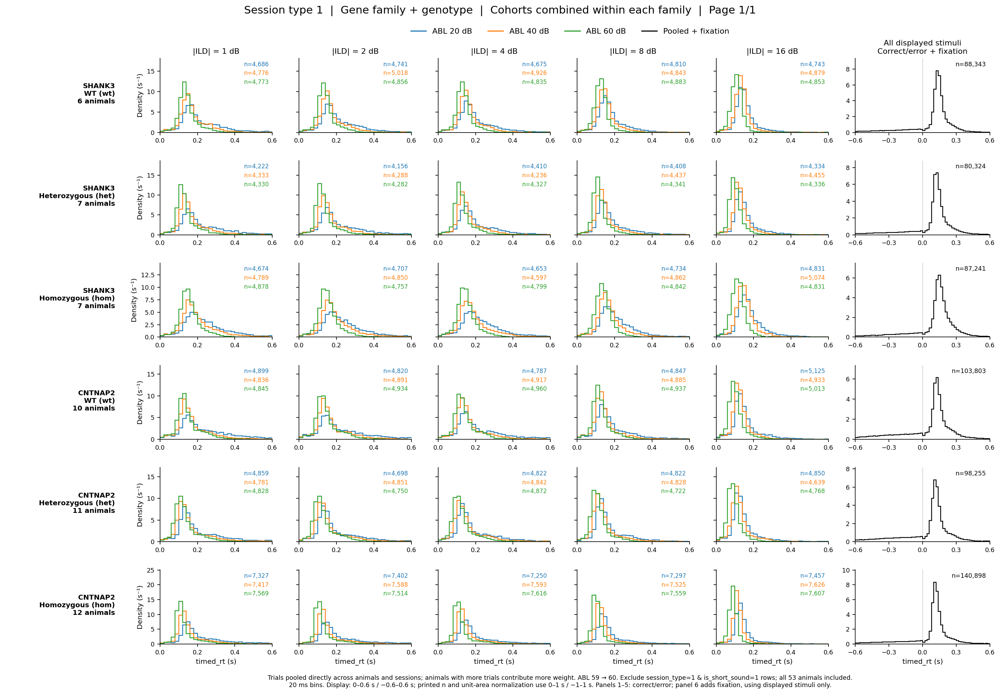

*Six group/genotype rows: SHANK3/wt, SHANK3/het, SHANK3/hom, CNTNAP2/wt, CNTNAP2/het, CNTNAP2/hom. Rows label group, genotype, and contributing animal count. Raw eligible trials are combined before histogramming; animals with more eligible trials contribute more weight. Session type 1, training level 16, confirmed next-trial repeat rule with CNP/Fixation exceptions; session_type=1 & is_short_sound=1 rows were removed during preparation; zero additional plot exclusions; retain all animals, including ASD0026/ASD0045. ABL 59→60; ABL 20/40/60 × |ILD| 1/2/4/8/16 only. Columns 1–5: correct/error, finite recorded timed_rt in [0,1] s, blue/orange/green ABL curves, shared row y scale. Column 6: correct/error plus fixation, finite timed_rt in [−1,1] s, black, same stimulus domain. Solid unfilled 20 ms steps; density = bin count / (original-window n × 0.020 s), area 1 over the original windows. Display 0–0.6 / −0.6–0.6 s without renormalizing; printed n uses the original window. Signed ILDs and sessions are pooled by observed trials; column 6 also pools conditions directly. No deduplication or averaging of densities.*

Source: `asd_analysis/plot_session_type_1_genotype_rtds.py`.
Figure: `docs/assets/results/2026-10-12/ASD_session_type_1_family_genotype_rtds_page_01.png`.

## Audits and validation

The animal view has **848 curves and 45,050 histogram bins**. Both pooled views
contain **288 curves and 15,300 bins**: 12 filename/genotype groups and six
family/genotype groups, each covering the same 53 animals and trial totals.
Every pooled histogram bin and curve count matches the sum of the updated
animal audits; all 5,100 family bins also match the sum of cohort bins. The
18 pooled groups have unchanged histogram counts and densities after the CSV
cleanup; every animal histogram and all 11 RTD PNGs are also unchanged.

Counts, 20 ms widths, density denominators, unit areas over the original
windows, colors, solid/unfilled steps, shared row y scales, display limits,
animal membership, and PDF page counts **8 / 2 / 1** passed validation.
All **11 PNG pages were visually inspected** for readable labels/counts and
clipping; the refreshed PNGs and PDF page renders are identical to those
previously inspected. The prepared CSV hash and row count now reflect the
cleanup; original cohort and session-type-2/23 file hashes, sizes, and modification
times are unchanged. Navigation includes this date and the strict MkDocs build
passed.

Animal audits:
[Animal counts](../assets/results/2026-10-12/animal_counts.csv) ·
[Curve counts](../assets/results/2026-10-12/curve_counts.csv) ·
[Histogram bins](../assets/results/2026-10-12/histogram_bins.csv) ·
[Page inventory](../assets/results/2026-10-12/pages.csv) ·
[Validation manifest](../assets/results/2026-10-12/validation.json) ·
[Independent numerical validation](../assets/results/2026-10-12/independent_validation.json)

Pooled audits:
[Group membership](../assets/results/2026-10-12/genotype_rtd_group_membership.csv) ·
[Group counts](../assets/results/2026-10-12/genotype_rtd_group_counts.csv) ·
[Curve counts](../assets/results/2026-10-12/genotype_rtd_curve_counts.csv) ·
[Histogram bins](../assets/results/2026-10-12/genotype_rtd_histogram_bins.csv) ·
[Page inventory](../assets/results/2026-10-12/genotype_rtd_pages.csv) ·
[Combined validation manifest](../assets/results/2026-10-12/genotype_rtd_validation.json) ·
[Filename/genotype validation](../assets/results/2026-10-12/ASD_session_type_1_filename_genotype_rtds_validation.json) ·
[Family/genotype validation](../assets/results/2026-10-12/ASD_session_type_1_family_genotype_rtds_validation.json) ·
[Independent and visual validation](../assets/results/2026-10-12/genotype_rtd_independent_validation.json)

### Prepared CSV cleanup and independent verification

[Cleanup manifest: archive paths, hashes, and retained-cell/order checks](../assets/results/2026-10-12/short_sound_cleanup.json) ·
[Updated preparation manifest](../assets/results/2026-10-12/filter_manifest.json) ·
[Independent verification of all three prepared CSVs](../assets/results/2026-10-12/session_type_csv_verification.json) ·
[Cleanup source](../assets/results/2026-10-12/clean_session_type_1_csv.py) ·
[CSV generator](../assets/results/2026-10-12/build_session_type_csvs.py) ·
[CSV verifier](../assets/results/2026-10-12/verify_session_type_csvs.py)

All **1,875,153 retained records and 109 columns** passed the independent
source-cell, repeat-rule, short-sound exclusion, genotype, provenance, and row-order
checks. The session-type-1 file has 642,370 rows, including 146,059 fixation aborts;
session types 2 and 23 remain at 547,720 and 685,063 rows. Historical prepared row
numbers belong to the archived pre-cleanup CSV; the cleaned CSV contains none of
the 807 flagged rows.
