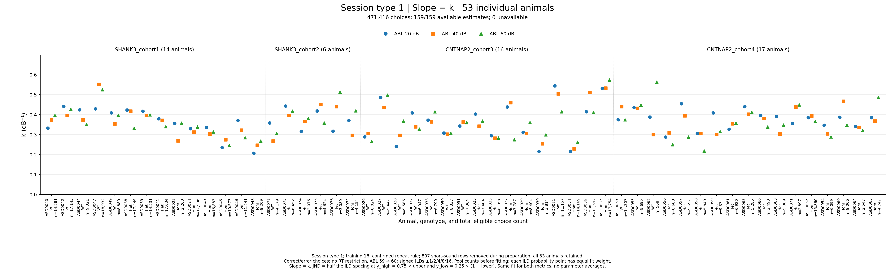
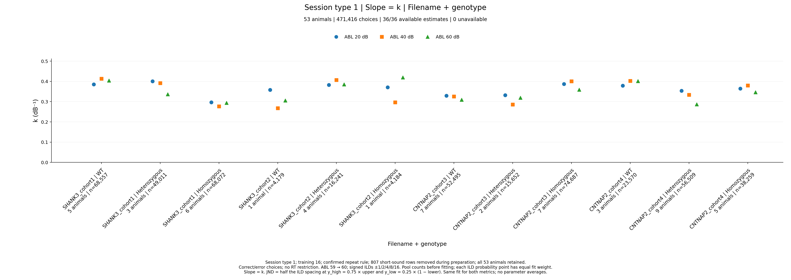
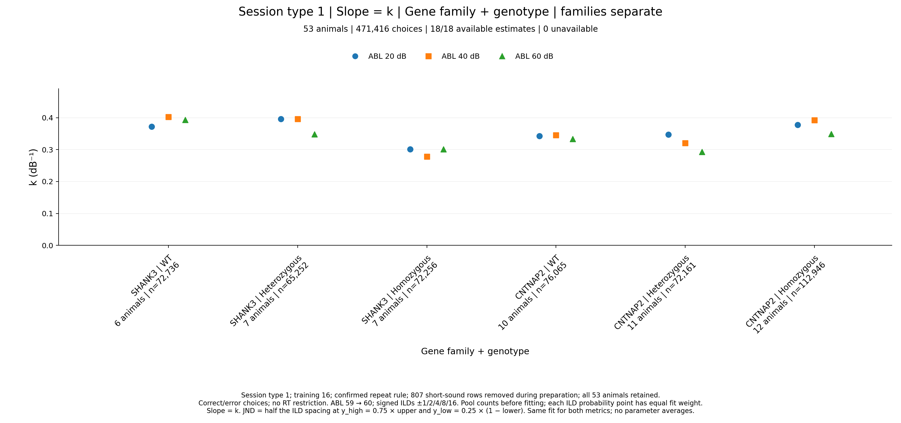
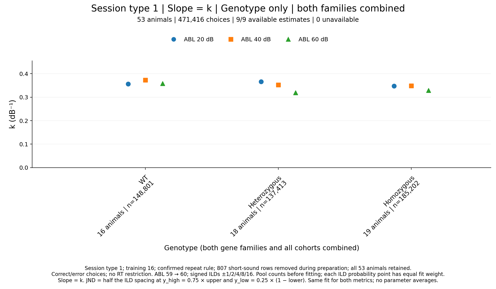
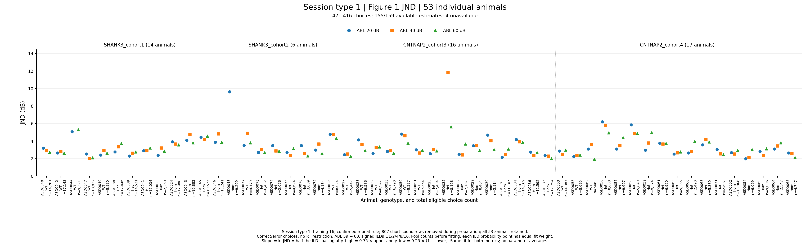
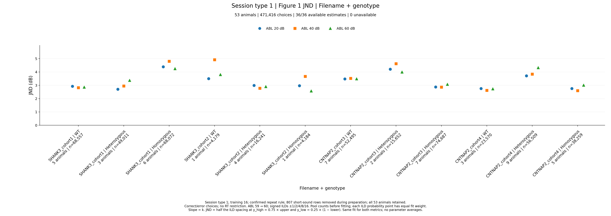
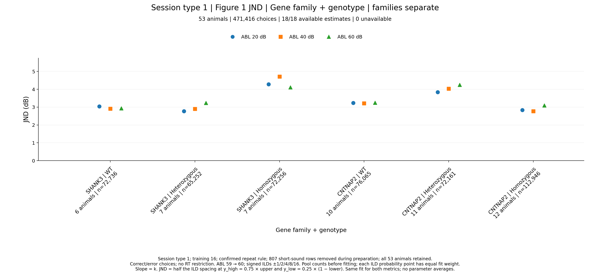
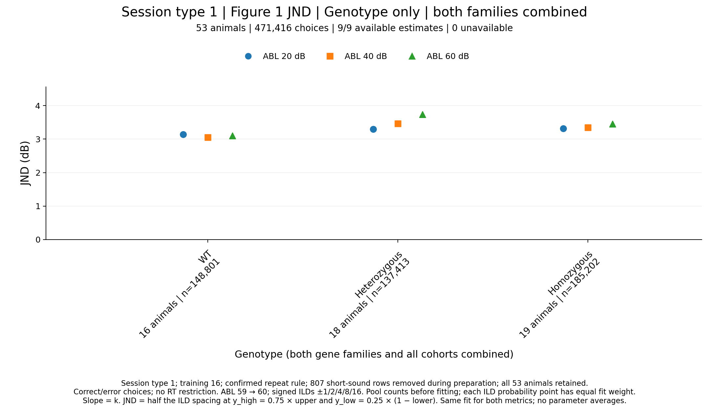

# Results: 2026-10-13

## ASD session-type-1 sigmoid slope k and Figure 1 JND

Eight scatter images show **slope = the fitted parameter k** and **JND from
the same four-parameter sigmoid fit**, each in four views: individual animals,
filename + genotype, gene family + genotype, and genotype only. The empirical
psychometrics and RTDs remain in the [October 12 entry](2026-10-12.md).
All images are displayed directly below, with matching PDF downloads.

### Choice selection and fitting

Read the cleaned `asd_analysis/session_type_csvs/ASD_session_type_1.csv`
(642,370 rows). Retain **session type 1**, **training level 16**, and the
confirmed repeat rule: remove the next chronological trial after a
`repeated_trial=True` trial, except after CNP/Fixation aborts, within the same
cohort CSV, animal, daily source file, and session. Repeat eligibility was
calculated on all original trials before preparation filters. The **807
`session_type == 1 AND is_short_sound == 1` rows were removed during CSV
preparation**; these plots apply zero additional animal/short-sound exclusions.
All **53 animals**, including ASD0026 and ASD0045 with their remaining trials,
contribute.

Select **`success in {1, -1}` with no RT restriction**. Map **ABL 59→60**,
retain **ABL 20/40/60**, and use the ten signed ILDs
**−16, −8, −4, −2, −1, +1, +2, +4, +8, +16 dB**. Each view covers the same
**471,416 choices: 241,539 right and 229,877 left**, including 2,188 choices
with nonfinite RT. At each group, ABL, and signed ILD,
**P(right) = right choices (`response_poke == 1`) / all recorded right-or-left
choices**; left is `response_poke == -1`.

Fit the Figure 1 sigmoid separately at each group and ABL:

```text
P(right | ILD) = lower + (upper - lower) / (1 + exp(-k * (ILD - x0)))
parameter order: [upper, lower, x0, k]
initial guess: [max(Pright), min(Pright), median(ILD), 0.1]
bounds: upper/lower in [0,1], x0 unrestricted, k >= 0
unweighted scipy.optimize.curve_fit; maxfev = 10000
```

Each fit gives **equal weight to all ten ILD probability points**. In pooled
views, sum raw right/left trial counts within each ILD and ABL before computing
P(right) and fitting. Animals with more eligible trials contribute more to each
pooled probability. Animal probabilities and fitted parameters are not averaged.
The sigmoid and initial guesses follow
`fit_animal_by_animal/aggregate_psychometric_by_abl_for_paper_fig1.py`.

**Slope is k (dB⁻¹)**. The Figure 1 JND follows
`fit_animal_by_animal/plot_JND_ratios_histograms.py`:

```text
y_high = 0.75 * upper
y_low  = 0.25 * (1 - lower)
inverse_sigmoid(y) = x0 - log((upper - lower) / (y - lower) - 1) / k
JND = (inverse_sigmoid(y_high) - inverse_sigmoid(y_low)) / 2
```

Require an increasing fit, `lower < y_low < y_high < upper`, and finite positive
crossing spacing. Undefined JNDs are recorded as unavailable, while their valid
k estimates and individually available crossings are retained. With zero
lapses (`upper=1`, `lower=0`), **JND = ln(3)/k**.

**ABL 20 = blue circles, 40 = orange squares, 60 = green triangles.** All
figures use scatter points without connecting lines, fitted curves, error bars,
or mean markers. Genotype order is **WT, heterozygous, homozygous**. Every image
uses one categorical x-axis and shows the full range of valid estimates.
Labels give contributing animal/trial counts and unavailable-estimate counts.
The three pooled views have **12/6/3 group positions**, with three slightly
offset ABL dots at each position. Their category labels are rotated **45°**
and spaced apart for readability. The individual-animal layout is unchanged.

| View | Groups | Fits | Available k | Available JND |
| --- | ---: | ---: | ---: | ---: |
| Individual animals | 53 | 159 | 159 | 155 |
| Filename + genotype | 12 | 36 | 36 | 36 |
| Gene family + genotype | 6 | 18 | 18 | 18 |
| Genotype only | 3 | 9 | 9 | 9 |
| Total across the four views | 74 | 222 | 222 | 218 |

### Slope k: individual animals



*One wide axis contains all 53 animal IDs, ordered by cohort, genotype, then ID;
cohort boundaries are marked. Three offset ABL dots per animal show fitted k
in dB⁻¹. All 159 estimates are available. Animal labels show genotype and total
eligible choices; the four cohorts contain 14/6/16/17 animals. Uses the
correct/error selection with no RT restriction and unweighted ten-ILD fits above.*

[Download individual-animal slope PDF](../assets/results/2026-10-13/ASD_session_type_1_animal_slope.pdf) ·
[Source: asd_analysis/plot_session_type_1_slope_jnd.py](../assets/results/2026-10-13/plot_session_type_1_slope_jnd.py)

### Slope k: filename + genotype



*One axis has 12 filename + genotype positions: SHANK3 cohorts 1/2, then CNTNAP2
cohorts 3/4, each ordered WT/heterozygous/homozygous. Pool choice counts within
each filename/genotype before fitting each
ABL. All 36 k estimates are available; 12 groups cover the same 53 animals and
471,416 choices. Each position has three offset ABL dots; its 45° label gives
the filename, genotype, contributing animals, and total choices. Per-ABL trial
counts remain in the audits. Selection and equal-ILD fit weighting are as above.*

[Download filename + genotype slope PDF](../assets/results/2026-10-13/ASD_session_type_1_filename_genotype_slope.pdf) ·
[Source: asd_analysis/plot_session_type_1_slope_jnd.py](../assets/results/2026-10-13/plot_session_type_1_slope_jnd.py)

### Slope k: SHANK3 and CNTNAP2 separately by genotype



*One axis has six family + genotype positions: SHANK3 WT/heterozygous/homozygous,
then CNTNAP2 WT/heterozygous/homozygous. Category labels are spaced apart and
rotated 45°, with three offset ABL dots at each position. Pool cohorts
within each gene family and genotype before fitting each ABL; the two families
remain separate. All 18 k estimates are available. Six groups cover the same
53 animals and 471,416 choices, with no RT restriction and ten equally weighted
ILD probability points per fit.*

[Download gene family + genotype slope PDF](../assets/results/2026-10-13/ASD_session_type_1_family_genotype_slope.pdf) ·
[Source: asd_analysis/plot_session_type_1_slope_jnd.py](../assets/results/2026-10-13/plot_session_type_1_slope_jnd.py)

### Slope k: genotype with both families combined



*One axis has three genotype positions, each with three offset ABL dots and a
45° label. Combine both gene families and all cohorts within genotype.
WT/heterozygous/homozygous groups contain 16/18/19 animals and
148,801/137,413/185,202 eligible choices. Pool condition counts before fitting;
all nine k estimates are available. The no-RT selection, ABL colors, and equal
weight for each of the ten ILD probabilities match the other views.*

[Download combined-genotype slope PDF](../assets/results/2026-10-13/ASD_session_type_1_genotype_slope.pdf) ·
[Source: asd_analysis/plot_session_type_1_slope_jnd.py](../assets/results/2026-10-13/plot_session_type_1_slope_jnd.py)

### JND: individual animals



*Same 53 animal positions, cohort/genotype order, counts, selection, and fits as
the individual k image. Dots show JND in dB, calculated from the paper's two
threshold crossings; 155/159 estimates are available. Four unavailable JNDs
leave gaps without removing animals or replacing them with zero values. The
full valid range, including the largest JND of 11.846 dB, remains visible.*

[Download individual-animal JND PDF](../assets/results/2026-10-13/ASD_session_type_1_animal_jnd.pdf) ·
[Source: asd_analysis/plot_session_type_1_slope_jnd.py](../assets/results/2026-10-13/plot_session_type_1_slope_jnd.py)

### JND: filename + genotype



*One axis has 12 filename + genotype positions, matching the k image's order,
spacing, and 45° labels, with three offset ABL dots per position. Each JND uses the same pooled
condition-count fit as its corresponding k estimate, with the exact Figure 1
thresholds above. All 36 JNDs are available across 12 groups, 53 animals, and
471,416 choices. No RT restriction or animal-parameter averaging is applied.*

[Download filename + genotype JND PDF](../assets/results/2026-10-13/ASD_session_type_1_filename_genotype_jnd.pdf) ·
[Source: asd_analysis/plot_session_type_1_slope_jnd.py](../assets/results/2026-10-13/plot_session_type_1_slope_jnd.py)

### JND: SHANK3 and CNTNAP2 separately by genotype



*One axis has six family + genotype positions, matching the k image's order,
spacing, and 45° labels, with three offset ABL dots per position. Pool cohorts within
each family/genotype and use the same ABL-specific fits as the matching k image.
All 18 JNDs are available. Six groups cover the same 53 animals and 471,416
choices; families remain separate and each ILD probability has equal fit weight.*

[Download gene family + genotype JND PDF](../assets/results/2026-10-13/ASD_session_type_1_family_genotype_jnd.pdf) ·
[Source: asd_analysis/plot_session_type_1_slope_jnd.py](../assets/results/2026-10-13/plot_session_type_1_slope_jnd.py)

### JND: genotype with both families combined



*One axis has three widely spaced genotype positions with 45° labels and three
offset ABL dots per position. Both families and all cohorts are pooled within
WT, heterozygous, or homozygous.
Use the same pooled ABL-specific fits as the combined-genotype k image; all
nine JNDs are available. The three groups retain all 53 animals and 471,416
choices. JND uses the stated paper thresholds and full signed-ILD fit selection.*

[Download combined-genotype JND PDF](../assets/results/2026-10-13/ASD_session_type_1_genotype_jnd.pdf) ·
[Source: asd_analysis/plot_session_type_1_slope_jnd.py](../assets/results/2026-10-13/plot_session_type_1_slope_jnd.py)

### Unavailable JNDs and validation

All 222 fits are increasing and give valid k. For these four individual fits,
`y_low` is below the fitted lower asymptote, so its inverse crossing and JND
are undefined. Their valid k and high-threshold crossing remain in the audit.

| Animal | Cohort | Genotype | ABL (dB) | Lower asymptote | y_low |
| --- | --- | --- | ---: | ---: | ---: |
| ASD0035 | CNTNAP2 cohort 3 | Heterozygous | 20 | 0.210589 | 0.197353 |
| ASD0044 | SHANK3 cohort 1 | WT | 40 | 0.203980 | 0.199005 |
| ASD0048 | SHANK3 cohort 1 | Homozygous | 40 | 0.230991 | 0.192252 |
| ASD0048 | SHANK3 cohort 1 | Homozygous | 60 | 0.220164 | 0.194959 |

Independent CSV parsing verified all **2,220 condition points**, **212
membership records**, **53/12/6/3 groups**, and **159/36/18/9 attempted fits**.
Each view covers the same 53 animals and 471,416 choices, and pooled counts
match the existing psychometric audits. Independent numerical root finding
verified **440 available crossings and 218 JNDs**. Checks confirm slope=k,
unweighted residual sums, initial guesses/bounds, the zero-lapse identity,
and valid-k retention when JND is unavailable. Synthetic checks exercise
optimizer failure, zero-k/non-increasing rejection, and invalid thresholds.

All eight images were visually inspected. The saved PDFs have one page each;
their colored marker counts match the available estimates and the PNG/PDF
layouts retain all valid values. Original cohort CSVs, prepared CSVs, existing
October 12 figures/audits, and that result-book page are unchanged by SHA-256.
The six pooled images were revised to single-axis categorical plots; the fitted
parameters, condition/membership/count audits, and individual-animal images
remain unchanged.

Output directory: `asd_analysis/session_type_1_slope_jnd/`.

[Plotting script](../assets/results/2026-10-13/plot_session_type_1_slope_jnd.py) ·
[Independent verifier](../assets/results/2026-10-13/verify_session_type_1_slope_jnd.py) ·
[Condition counts and fitted probabilities](../assets/results/2026-10-13/slope_jnd_condition_counts.csv) ·
[Group counts](../assets/results/2026-10-13/slope_jnd_group_counts.csv) ·
[Group membership](../assets/results/2026-10-13/slope_jnd_group_membership.csv) ·
[Parameters, thresholds, crossings, and fit status](../assets/results/2026-10-13/slope_jnd_fits.csv) ·
[Fit-status counts](../assets/results/2026-10-13/slope_jnd_fit_status_counts.csv) ·
[Validation manifest](../assets/results/2026-10-13/slope_jnd_validation.json) ·
[Independent validation](../assets/results/2026-10-13/slope_jnd_independent_validation.json)
