# Results: 2026-10-14

## ASD psychometrics: WT, HET, and HOM overlaid after combining ABLs

Six figures compare genotypes in the same subplot, using **WT = blue circles**,
**HET = orange squares**, and **HOM = green triangles**, with smooth solid
four-parameter sigmoid fits. Each method has a **2×2 cohort figure**, a
**1×2 gene-family figure**, and **one subplot combining both families and all
cohorts**. Colors identify genotype; there are no separate ABL curves.

The previous [ABL-specific psychometrics and RTDs](2026-10-12.md) and
[slope/JND comparisons](2026-10-13.md) are preserved. The new images are
embedded directly below, with matching PDF downloads.

### Selection and the two ABL-combination methods

Read the cleaned prepared `asd_analysis/session_type_csvs/ASD_session_type_1.csv`
(642,370 rows). Keep **session type 1**, **training level 16**, and the confirmed
next-trial repeat rule: remove the next chronological trial after a
`repeated_trial=True` trial, except after CNP/Fixation aborts, within the same
cohort CSV, animal, daily source file, and session. Preparation computed repeat
eligibility on all original trials before filtering.

The prepared CSV already excludes **807 `session_type == 1 AND is_short_sound == 1`
records**. These plots apply no additional animal/short-sound exclusions; all
**53 animals**, including ASD0026 and ASD0045 with their remaining trials,
contribute. Select **`success in {1, -1}` with no RT restriction**, map **ABL 59→60**,
and retain **ABL 20/40/60** and signed ILDs
**−16, −8, −4, −2, −1, +1, +2, +4, +8, +16 dB**.

Every view and method uses the same **471,416 choices**, comprising **241,539
right and 229,877 left**. Right is `response_poke == 1`; left is
`response_poke == -1`. All 2,188 choices with nonfinite RT remain eligible.
Within each group/genotype/ILD, let `R_a` be right choices and `N_a` all
recorded right-or-left choices at ABL `a`:

| Method | Scatter probability at each ILD | ABL weighting |
| --- | --- | --- |
| A: pool trials | `(R_20 + R_40 + R_60) / (N_20 + N_40 + N_60)` | Proportional to eligible trials at that ILD |
| B: average measured probabilities | `(R_20/N_20 + R_40/N_40 + R_60/N_60) / 3` | Equal weight, one-third per ABL |

For method B, **average first, show the ten averaged scatter points, then fit**.
Each point corresponds to one signed ILD. It is an average of measured
probabilities, not fitted curves or parameters. Raw trials are pooled across
animals and sessions within each ABL, so animals with more trials contribute
more within that ABL; neither method averages animals equally.

Plot labels report raw eligible animal/choice counts. For method B, those
choice counts are descriptive: the plotted probability uses three separate
ABL denominators and equal weights. For example, SHANK3 cohort 2 WT at ILD −2
has **0.318907** under trial pooling and **0.308059** under equal ABL averaging,
the largest pointwise difference (**0.010848**, about 1.085 percentage points).

### Sigmoid fitting

Fit each genotype separately after combining ABLs, using the same paper
procedure as the October 13 analysis:

```text
P(right | ILD) = lower + (upper - lower) / (1 + exp(-k * (ILD - x0)))
parameter order: [upper, lower, x0, k]
initial guess: [max(P), min(P), median(ILD), 0.1]
bounds: upper/lower in [0,1], x0 unrestricted, k >= 0
unweighted scipy.optimize.curve_fit on ten ILD probability points
maxfev = 10000
```

Every ILD probability receives equal fit weight in both methods. Scatter
points stay at their measured signed ILDs; solid lines are fitted sigmoids,
not point-to-point connections. All panels use **−18–18 dB** and **P(right) 0–1**
limits. Failed or non-increasing fits would retain their measured points and
be marked unavailable; **all 42 current fits are increasing and available**.

## Method A: pool all eligible trials across ABLs

### Four cohorts separately

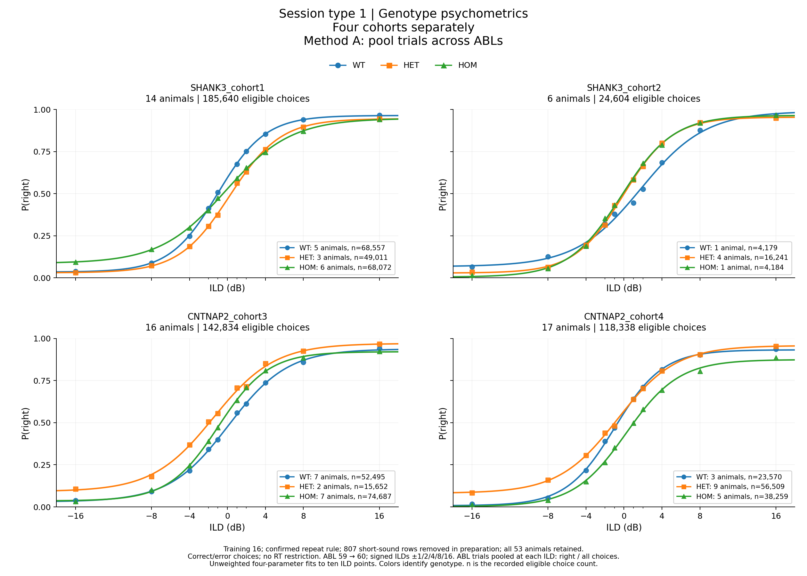

*SHANK3 cohorts 1/2 above CNTNAP2 cohorts 3/4 in a 2×2 grid. Each subplot
overlays WT/HET/HOM using pooled right/all-choice fractions across ABLs at
each signed ILD, then fits each genotype's ten points. The four panels contain
14/6/16/17 animals and 185,640/24,604/142,834/118,338 choices. All 12 fits are
available; no RT restriction applies. Legends show per-genotype animals and n.*

[Download cohort trial-pooled PDF](../assets/results/2026-10-14/ASD_session_type_1_filename_genotype_trial_pooled_genotype_overlay_psychometrics.pdf) ·
[Source: asd_analysis/plot_session_type_1_genotype_overlay_psychometrics.py](../assets/results/2026-10-14/plot_session_type_1_genotype_overlay_psychometrics.py)

### SHANK3 and CNTNAP2 separately


*Pool cohorts within each family and genotype, keeping SHANK3 and CNTNAP2
separate in two side-by-side panels. SHANK3 has 20 animals and 210,244 choices;
CNTNAP2 has 33 animals and 261,172 choices. WT/HET/HOM share each subplot,
using trial-weighted ABL pooling followed by unweighted ten-ILD fitting. All
six fits are available; selection and colors match the cohort view.*

[Download family trial-pooled PDF](../assets/results/2026-10-14/ASD_session_type_1_family_genotype_trial_pooled_genotype_overlay_psychometrics.pdf) ·
[Source: asd_analysis/plot_session_type_1_genotype_overlay_psychometrics.py](../assets/results/2026-10-14/plot_session_type_1_genotype_overlay_psychometrics.py)

### Both families and all cohorts combined

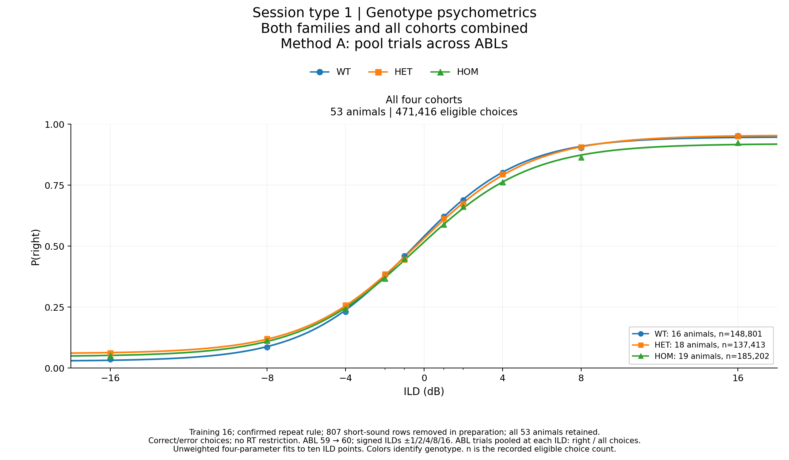

*One subplot combines both families and all cohorts within genotype. WT/HET/HOM
contain 16/18/19 animals and 148,801/137,413/185,202 choices, respectively.
Pool raw choices across ABLs at each ILD before computing probabilities and
fitting. All three fits are available; the total remains 53 animals and
471,416 choices without an RT restriction.*

[Download combined-genotype trial-pooled PDF](../assets/results/2026-10-14/ASD_session_type_1_genotype_trial_pooled_genotype_overlay_psychometrics.pdf) ·
[Source: asd_analysis/plot_session_type_1_genotype_overlay_psychometrics.py](../assets/results/2026-10-14/plot_session_type_1_genotype_overlay_psychometrics.py)

## Method B: average measured ABL probabilities, then fit

### Four cohorts separately

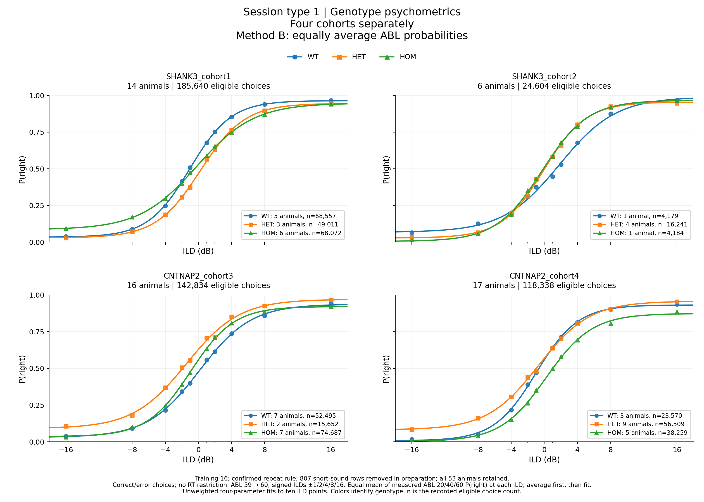

*Same 2×2 cohort layout, genotypes, animals, and eligible choices as method A.
At each genotype/ILD, equally average the measured P(right) values for ABL
20/40/60; each ABL gets one-third weight. Plot the ten averages, then fit one
sigmoid per genotype. All 12 fits are available. The displayed n values count
recorded eligible choices and do not define the equal-ABL denominator.*

[Download cohort equal-ABL-average PDF](../assets/results/2026-10-14/ASD_session_type_1_filename_genotype_equal_abl_average_genotype_overlay_psychometrics.pdf) ·
[Source: asd_analysis/plot_session_type_1_genotype_overlay_psychometrics.py](../assets/results/2026-10-14/plot_session_type_1_genotype_overlay_psychometrics.py)

### SHANK3 and CNTNAP2 separately

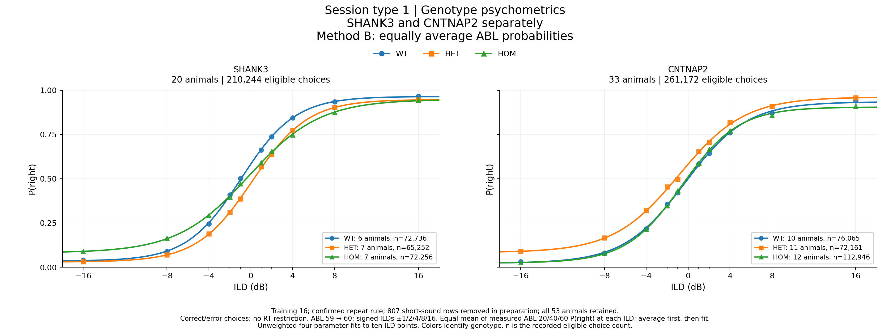

*Two family panels preserve separate SHANK3/CNTNAP2 populations. Pool raw
choices across cohorts within each family/genotype/ABL/ILD, compute each
ABL probability, then take their equal mean before fitting. WT/HET/HOM share
each subplot, with all six fits available. The selection remains 53 animals
and 471,416 correct/error choices across the two panels, without an RT filter.*

[Download family equal-ABL-average PDF](../assets/results/2026-10-14/ASD_session_type_1_family_genotype_equal_abl_average_genotype_overlay_psychometrics.pdf) ·
[Source: asd_analysis/plot_session_type_1_genotype_overlay_psychometrics.py](../assets/results/2026-10-14/plot_session_type_1_genotype_overlay_psychometrics.py)

### Both families and all cohorts combined

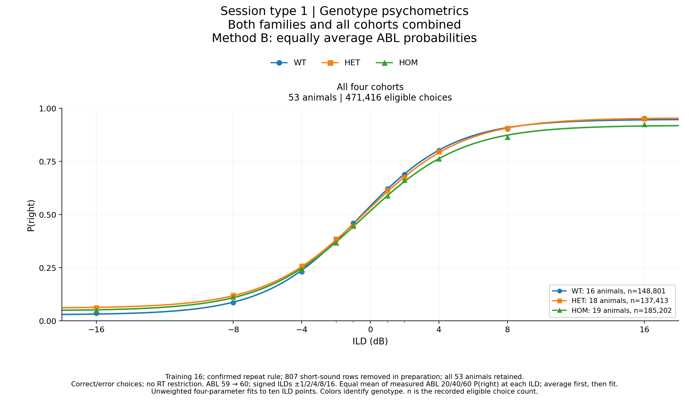

*One subplot combines both gene families and all cohorts within genotype.
The three measured ABL probabilities are equally averaged at each signed ILD
before fitting the ten-point genotype psychometric. All three fits are
available. WT/HET/HOM retain the same 16/18/19 animals and eligible choice
counts as method A; averaging probabilities changes the weighting, not the
selected trials.*

[Download combined-genotype equal-ABL-average PDF](../assets/results/2026-10-14/ASD_session_type_1_genotype_equal_abl_average_genotype_overlay_psychometrics.pdf) ·
[Source: asd_analysis/plot_session_type_1_genotype_overlay_psychometrics.py](../assets/results/2026-10-14/plot_session_type_1_genotype_overlay_psychometrics.py)

## Audits and validation

Each method has **21 genotype curves and 210 scatter points**: 12/6/3 curves
across the cohort/family/combined views. Across both methods, there are **42
attempted fits and 420 scatter points**, with zero unavailable fits.

All **630 underlying ABL conditions** and **159 group membership records**
match the existing psychometric audits. Independent raw CSV parsing verified
every ABL count, both combined probabilities, their per-ABL weights, group
memberships, and totals. Each view/method contains all 53 animals and the
same 471,416 choices. Checks also verify initial guesses/bounds, unweighted
fit residuals, and the saved PDF colors, scatter-marker counts, and fitted-line
counts. Every PDF has one page. Synthetic checks exercise unequal ABL
weighting, parameter recovery, optimizer failure, and non-increasing fits.

All six images were visually inspected. Source and prepared CSVs, archived
CSV records, previous analysis outputs, and October 12/13 result-book assets
and pages are unchanged by SHA-256. Output directory:
`asd_analysis/session_type_1_genotype_overlay_psychometrics/`.

[Plotting script](../assets/results/2026-10-14/plot_session_type_1_genotype_overlay_psychometrics.py) ·
[Independent verifier](../assets/results/2026-10-14/verify_session_type_1_genotype_overlay_psychometrics.py) ·
[ABL condition counts](../assets/results/2026-10-14/overlay_abl_counts.csv) ·
[Combined points, ABL weights, and fitted probabilities](../assets/results/2026-10-14/overlay_combined_points.csv) ·
[Group counts](../assets/results/2026-10-14/overlay_group_counts.csv) ·
[Group membership](../assets/results/2026-10-14/overlay_group_membership.csv) ·
[Fitted parameters and status](../assets/results/2026-10-14/overlay_fits.csv) ·
[Fit-status counts](../assets/results/2026-10-14/overlay_fit_status_counts.csv) ·
[Validation manifest](../assets/results/2026-10-14/overlay_validation.json) ·
[Independent validation](../assets/results/2026-10-14/overlay_independent_validation.json)

## Trial-pooled psychometrics with measured RT in [0, 1] seconds

Three additional figures impose the confirmed **finite measured `timed_rt`
in inclusive [0,1] seconds** restriction and use **trial pooling only**.
The requested `max_rt == 1` referred to a different column: `max_rt` is the
task's maximum-RT setting, and it is **10 seconds for every prepared row**.
Literal `max_rt == 1` would retain zero trials. These figures apply the
measured-RT window clarified with the user; `max_rt` is not filtered.

Keep the same cleaned session-type-1 CSV, training level 16, confirmed repeat
rule, `success in {1,-1}`, ABL 59→60, ABL 20/40/60, and ten signed ILDs
±1/2/4/8/16. This selects **466,978 choices: 239,331 right and 227,647 left**
from the original 471,416 eligible choices. It excludes **2,188
missing/nonfinite RTs**, **2,250 RTs above 1 second**, and zero RTs below zero.
The window includes both endpoints; the restriction affects the plotted
choice sample, without removing any rows from the prepared CSV.

**All 53 animals remain. No SHANK3 cohort 2 animal was removed from the CSV
or these plots:** ASD0072 (HOM), ASD0073/ASD0074/ASD0075/ASD0076 (HET),
and ASD0077 (WT) all contribute. The historical 807-row short-sound cleanup
involved ASD0045 in SHANK3 cohort 1 and ASD0026 in CNTNAP2 cohort 3, retaining
their remaining trials and both animals.

At each group/genotype/signed ILD, sum raw right/left choices across all three
ABLs and calculate **right / all RT-window choices**. Fit each genotype's
ten pooled probability points with the same unweighted four-parameter
sigmoid, initial guesses, bounds, and `maxfev=10000` described above.
No equal-ABL probability averaging is applied. **WT = blue, HET = orange,
HOM = green**, with scatter points and smooth solid fitted curves.
All plots retain −18–18 dB and P(right) 0–1 display limits; legends give
contributing animals and RT-window sample counts.

### RT-restricted: four cohorts separately

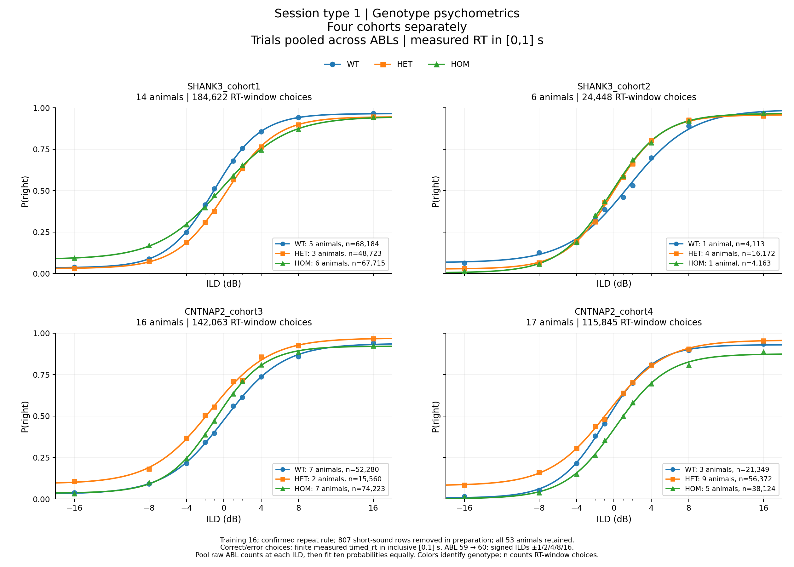

*Four cohorts in a 2×2 grid, with WT/HET/HOM overlaid in each subplot. Cohorts
1/2/3/4 contain 14/6/16/17 animals and 184,622/24,448/142,063/115,845
RT-window choices. Pool ABL trial counts before computing P(right) and fitting
the ten signed-ILD points. All 12 fits are available; all six cohort 2 animals
remain included.*

[Download RT-restricted cohort PDF](../assets/results/2026-10-14/ASD_session_type_1_filename_genotype_trial_pooled_rt_0_to_1_genotype_overlay_psychometrics.pdf) ·
[Source: asd_analysis/plot_session_type_1_genotype_overlay_psychometrics_rt_0_to_1.py](../assets/results/2026-10-14/plot_session_type_1_genotype_overlay_psychometrics_rt_0_to_1.py)

### RT-restricted: SHANK3 and CNTNAP2 separately

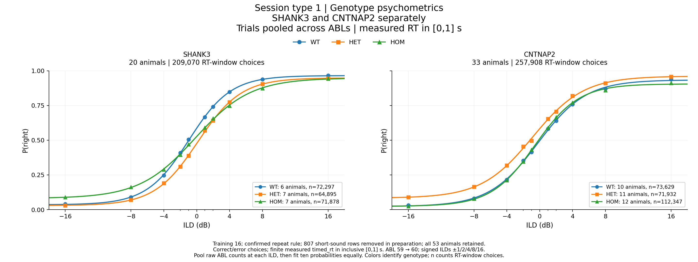

*Two family panels keep SHANK3 and CNTNAP2 separate while pooling their cohorts
within genotype. SHANK3 contributes 20 animals and 209,070 choices; CNTNAP2
contributes 33 animals and 257,908 choices. Each subplot overlays three
genotypes using the finite [0,1] s measured-RT selection and raw ABL trial
pooling. All six fits are available.*

[Download RT-restricted family PDF](../assets/results/2026-10-14/ASD_session_type_1_family_genotype_trial_pooled_rt_0_to_1_genotype_overlay_psychometrics.pdf) ·
[Source: asd_analysis/plot_session_type_1_genotype_overlay_psychometrics_rt_0_to_1.py](../assets/results/2026-10-14/plot_session_type_1_genotype_overlay_psychometrics_rt_0_to_1.py)

### RT-restricted: both families and all cohorts combined

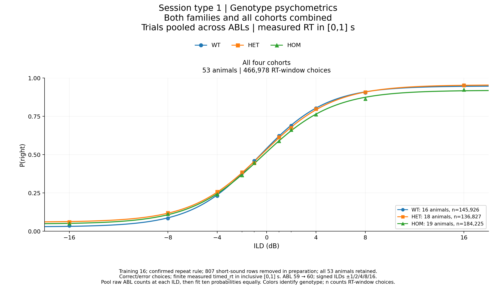

*One subplot overlays WT/HET/HOM after combining both families and all cohorts.
The groups retain 16/18/19 animals and 145,926/136,827/184,225 RT-window
choices. Sum raw counts across ABLs at each ILD before calculating P(right)
and fitting. All three fits are available; the total remains 53 animals and
466,978 choices.*

[Download RT-restricted combined-genotype PDF](../assets/results/2026-10-14/ASD_session_type_1_genotype_trial_pooled_rt_0_to_1_genotype_overlay_psychometrics.pdf) ·
[Source: asd_analysis/plot_session_type_1_genotype_overlay_psychometrics_rt_0_to_1.py](../assets/results/2026-10-14/plot_session_type_1_genotype_overlay_psychometrics_rt_0_to_1.py)

The three figures contain **210 scatter points and 21 available fits** across
12/6/3 genotype groups. Their 630 ABL-condition counts match the existing
RTD normalization samples. Independent raw CSV parsing verifies the RT
selection, all probabilities/counts, memberships, retained animals, fit
residuals, and saved PDF marker/curve counts and colors. Each PDF has one
page, and all three images were visually inspected. Previous figures, their
audits, and every source/prepared CSV remain unchanged by SHA-256.

Output directory:
`asd_analysis/session_type_1_genotype_overlay_psychometrics_rt_0_to_1/`.

[Plotting script](../assets/results/2026-10-14/plot_session_type_1_genotype_overlay_psychometrics_rt_0_to_1.py) ·
[Independent verifier](../assets/results/2026-10-14/verify_session_type_1_genotype_overlay_psychometrics_rt_0_to_1.py) ·
[ABL counts](../assets/results/2026-10-14/rt_window_abl_counts.csv) ·
[Pooled probabilities and predictions](../assets/results/2026-10-14/rt_window_points.csv) ·
[Group counts](../assets/results/2026-10-14/rt_window_group_counts.csv) ·
[Animal membership](../assets/results/2026-10-14/rt_window_membership.csv) ·
[Fitted parameters/status](../assets/results/2026-10-14/rt_window_fits.csv) ·
[Fit-status counts](../assets/results/2026-10-14/rt_window_fit_status_counts.csv) ·
[Validation](../assets/results/2026-10-14/rt_window_validation.json) ·
[Independent validation](../assets/results/2026-10-14/rt_window_independent_validation.json)

## All 53 animals: psychometric, RTD, and chronometric

[Download the three-column 11-page PDF](../assets/results/2026-10-14/ASD_session_type_1_all_animals_psychometric_rtd_chronometric.pdf).
Each animal occupies one row with **psychometric on the left, RTDs in the
middle, and chronometric on the right**. There are **five animals per page**,
with three on the final page. Pages are **18.24 inches wide**, with compact
**square chronometric plotting areas of approximately 1.76 × 1.76 inches**,
at **28% of the width** of the other two columns. Both width and height are
reduced to keep the plotting area square and neighboring |ILD| points close.
The psychometric and RTD panel
widths and original row heights are retained. This is a visual adjustment;
trial selection, means, SEMs, fits, and densities are unchanged.

[Original two-column PDF](../assets/results/2026-10-14/ASD_session_type_1_all_animals_psychometric_and_full_rt_rtd.pdf)
and its numerical/image exports are preserved.

Order is SHANK3 cohorts 1/2, CNTNAP2 cohorts 3/4, then WT/heterozygous/homozygous
and animal ID. PDF bookmarks and the [animal/page index](../assets/results/2026-10-14/three_panel_animal_pages.csv)
help locate individual animals; **ASD0054 is on page 10, row 5**.

### Selection, fits, and full-RT normalization

All three panels use the cleaned session-type-1 CSV, training level 16,
**`success in {1,-1}`**, ABL **20/40/60** after mapping **59→60**, and signed
ILDs **±1/2/4/8/16 dB**. All **53 animals**, including ASD0026 and ASD0045,
remain. The prepared CSV already excludes the next chronological trial after
`repeated_trial=True`, except after CNP or Fixation aborts, and removes the
807 flagged short-sound rows. The repeat rule is **not applied again** to the
shortened CSV. These figures apply **no measured-RT selection window**.

**Psychometric:** P(right) is recorded right choices (`response_poke=1`)
divided by all recorded left/right choices at each signed ILD and ABL. Keep
**471,416 choices: 241,539 right and 229,877 left**, including choices with
missing RT. Each panel overlays the ten measured points and the same
four-parameter sigmoid fits used in the October 13 animal analysis:
`lower + (upper - lower) / (1 + exp(-k * (ILD - x0)))`.
The **159 existing animal/ABL fits** are reused after verifying exact condition
counts. They used unweighted `curve_fit` on ten ILD probabilities, parameter
order `[upper,lower,x0,k]`, initial `[max(P),min(P),median(ILD),0.1]`, asymptotes
bounded to 0–1, unrestricted x0, nonnegative k, and `maxfev=10000`.
All 159 fits are available; every measured point is retained.

**RTD:** Pool raw trials across all ten selected signed ILDs and sessions
within each animal and ABL. Use **every finite measured `timed_rt`**:
**469,228 RTs**, including **2,250 above 1 second**. The **2,188 missing RTs**
remain in the psychometric sample but cannot enter an RT histogram. Use
**20 ms bins** extending through each animal's full observed RT range and
normalize each curve as **bin count / (all finite RTs for that animal/ABL ×
0.020 seconds)**. Each full histogram has area 1. The **0–0.6 s x-axis is a
display zoom only**; the visible portion is not renormalized. This differs
from the earlier RTDs normalized over the 0–1 s window; those exports are
preserved.

**Chronometric:** For each animal, ABL, and **|ILD| = 1, 2, 4, 8, 16**,
combine the actual **+ILD and −ILD trials across sessions** before calculating
the arithmetic mean RT. Their observed trial counts determine their weights.
Use every finite correct/error `timed_rt`, including values above 1 second.
Calculate **SEM = sample SD (`ddof=1`) / √n**, where `n` is the combined
finite-RT count in that animal/ABL/|ILD| condition. There are **795 points**,
covering the same **469,228 finite RTs** as the RTDs. The minimum condition
count is **29 trials**.

Draw **filled circular dots and ±SEM error bars**, without connecting lines
or fits. The x-axis uses **equally spaced categories labeled 1, 2, 4, 8, 16
dB**, with ABL 20/40/60 offset by −0.10/0/+0.10 category units. All 53
chronometric panels share **0–0.45 s** on y; every error bar fits inside that
range, with maximum mean + SEM **0.3994 s**. Axes are labeled **|ILD| (dB)**
and **Mean RT ± SEM (s)**. The condition audit records both signed-ILD trial
counts, missing RTs, means, sample SDs, and SEMs.

In all three panels **ABL 20 = blue, 40 = orange, 60 = green**. Psychometrics use
colored scatter points and solid fitted curves; RTDs use solid, unfilled step
curves; chronometrics use mean/SEM dots and bars. Psychometric legends give
each ABL's valid-choice total; RTD legends give each ABL's finite-RT total
across |ILD| values, also applicable to the neighboring chronometric panel.
Chronometric colors use the shared page legend, leaving the compact plotting
area clear. Per-|ILD| counts are in the condition
audit. Row titles identify the animal, cohort, genotype, and missing-RT count.

Source: `asd_analysis/plot_all_animals_psychometric_rtd_chronometric.py`.
Fit source: `asd_analysis/session_type_1_slope_jnd/slope_jnd_fits.csv`.
Output directory: `asd_analysis/session_type_1_all_animals_psychometric_rtd_chronometric/`.

### Page 1

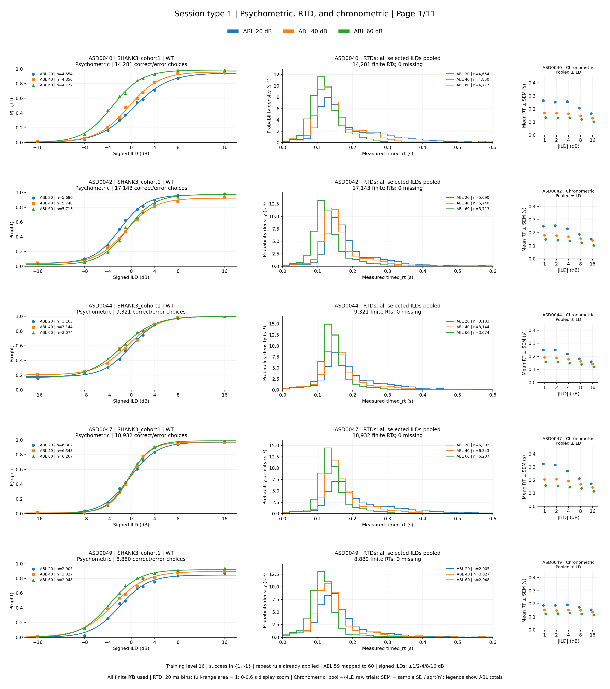

*ASD0040, ASD0042, ASD0044, ASD0047, ASD0049. Selection and full-RT normalization follow the rules above.*

### Page 2

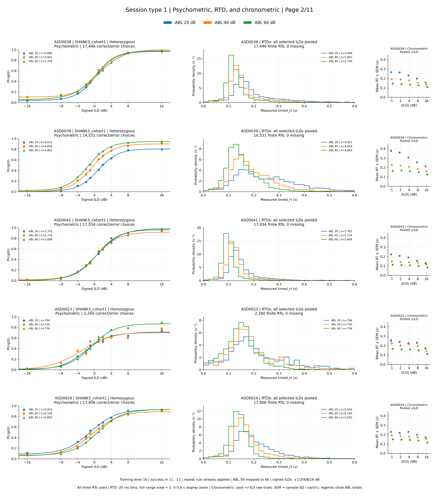

*ASD0038, ASD0039, ASD0041, ASD0023, ASD0024. Three ABL curves per animal in each panel.*

### Page 3

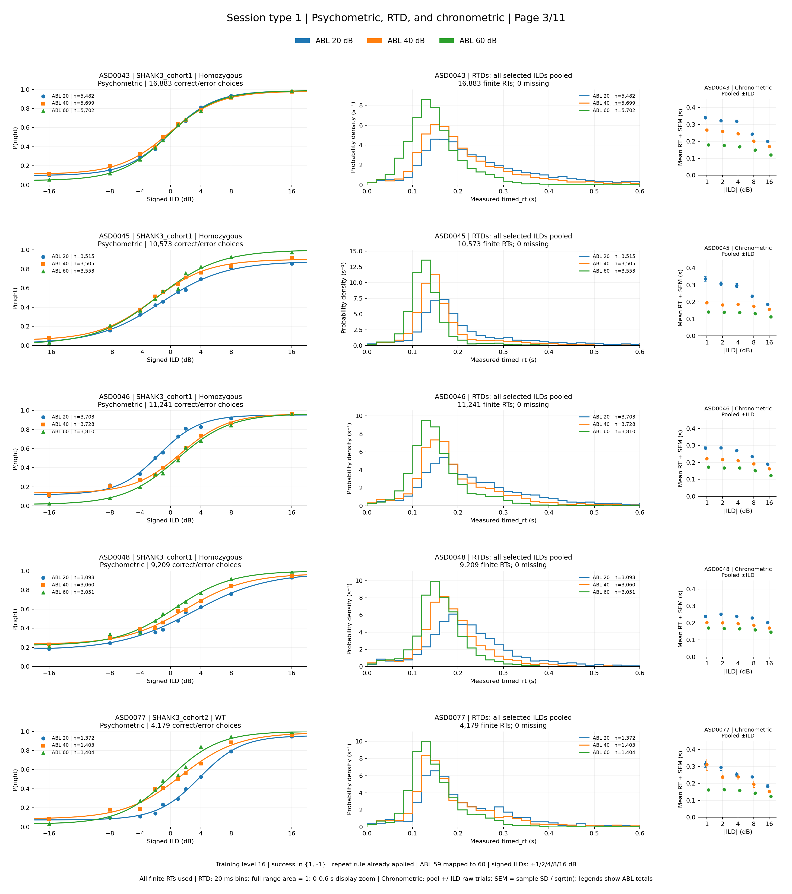

*ASD0043, ASD0045, ASD0046, ASD0048, ASD0077. ASD0045 contributes its remaining standard-sound trials.*

### Page 4

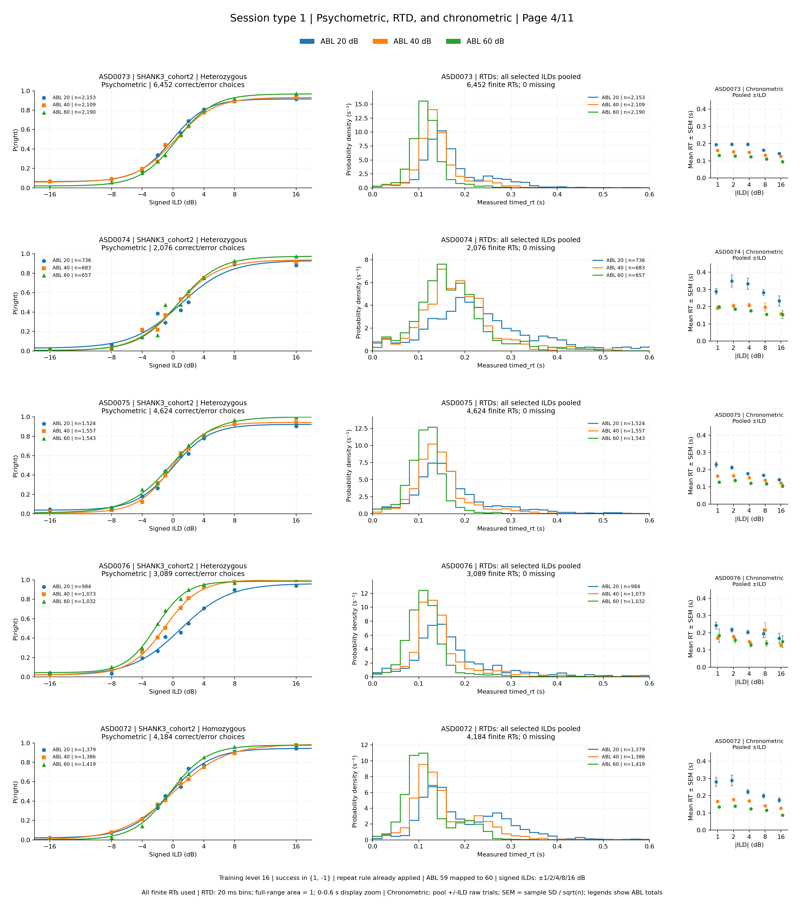

*ASD0073, ASD0074, ASD0075, ASD0076, ASD0072. All six SHANK3 cohort 2 animals remain, with ASD0077 on page 3.*

### Page 5

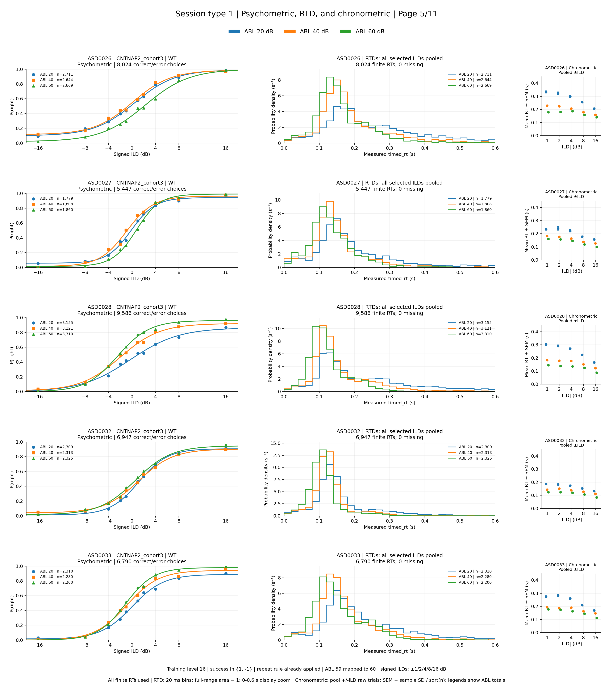

*ASD0026, ASD0027, ASD0028, ASD0032, ASD0033. ASD0026 contributes its remaining standard-sound trials.*

### Page 6

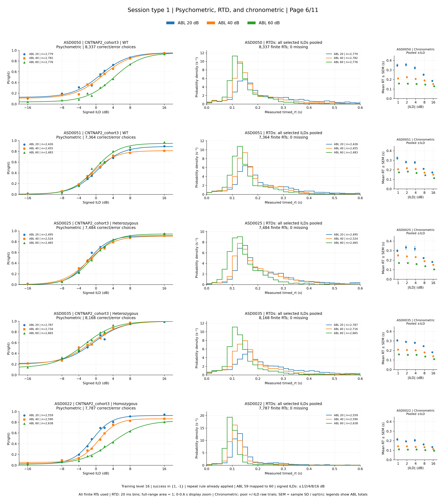

*ASD0050, ASD0051, ASD0025, ASD0035, ASD0022. Correct/error choices are retained regardless of RT.*

### Page 7

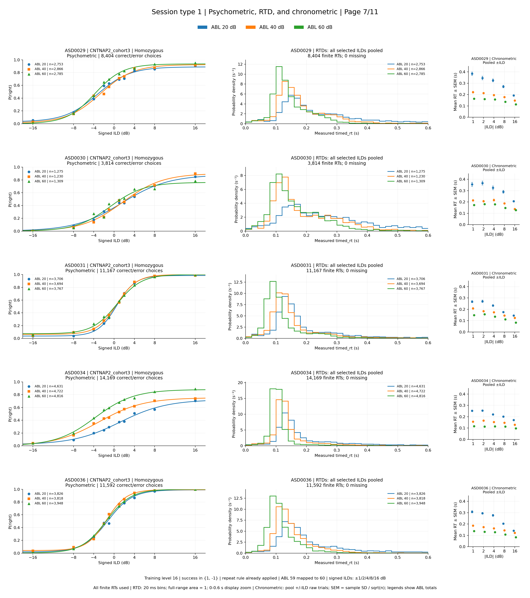

*ASD0029, ASD0030, ASD0031, ASD0034, ASD0036. RTDs pool signed ILDs directly by observed trial counts.*

### Page 8

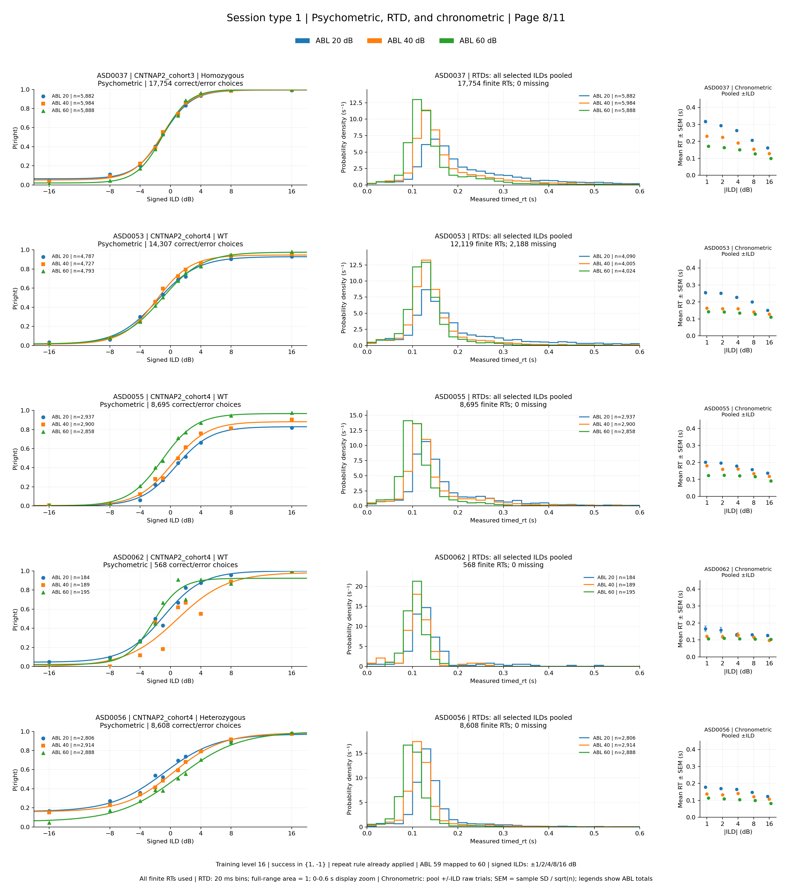

*ASD0037, ASD0053, ASD0055, ASD0062, ASD0056. ASD0053's 2,188 missing RTs contribute to its psychometric but not its RTD; the separate sample counts are printed.*

### Page 9

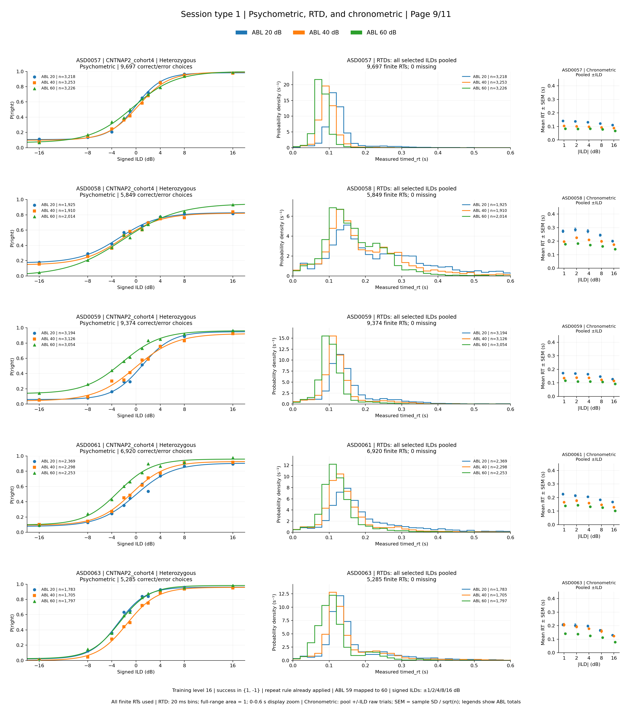

*ASD0057, ASD0058, ASD0059, ASD0061, ASD0063. The RT display is 0–0.6 s; all finite RTs determine normalization.*

### Page 10

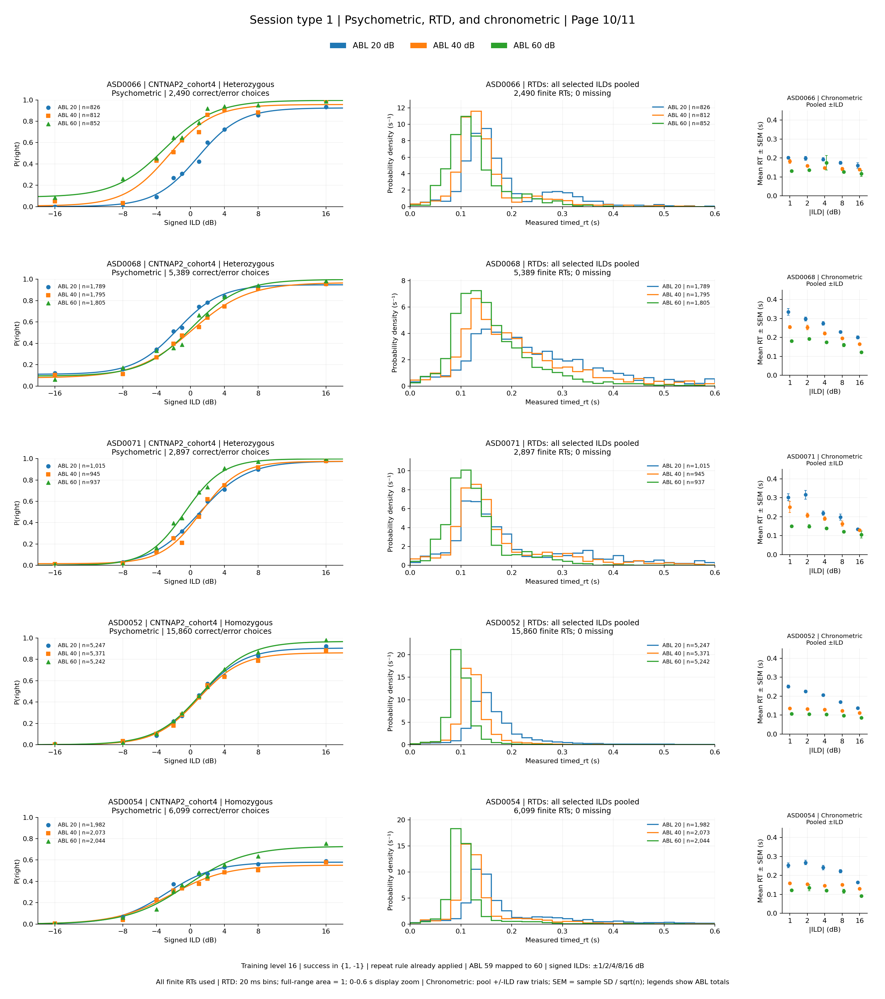

*ASD0066, ASD0068, ASD0071, ASD0052, ASD0054. ASD0054 uses the same 6,099 choices and full-RT histogram counts as its earlier two-panel figure.*

### Page 11

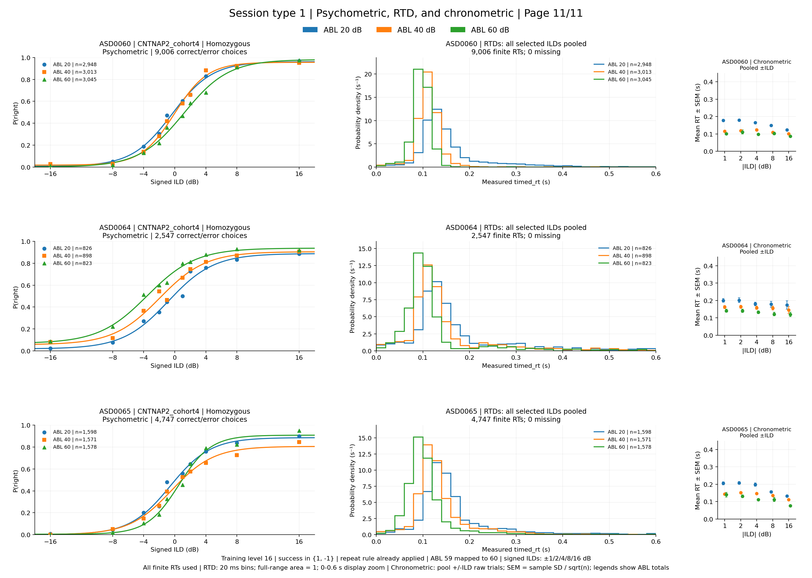

*ASD0060, ASD0064, ASD0065. The final page contains the remaining three animals.*

### Animal PDF audits and validation

Independent standard-library CSV parsing verifies all **53 memberships**,
**1,590 probability points**, the **159 reused fits**, and **159 full-RT
histograms**, including bin counts, 20 ms widths, normalizers, and unit areas.
The preserved psychometric points/fits, RTD histograms/densities, and page
assignments are reused byte-for-byte from the two-column export. Independent
Python mean/sample-SD calculations check **all 795 chronometric means and
SEMs**, including positive/negative trial counts and weighted agreement with
the existing animal/ABL RT means. Every chronometric dot and both SEM
endpoints were located at their expected physical coordinates in the saved
PDF. All 11 pages have the expected animals, colors, offsets, fitted curves,
and 53 original animal bookmarks. Every PNG page was visually inspected.
The prepared CSV and original native/published two-column exports are
unchanged by SHA-256.

[Three-column PDF](../assets/results/2026-10-14/ASD_session_type_1_all_animals_psychometric_rtd_chronometric.pdf) ·
[Original two-column PDF](../assets/results/2026-10-14/ASD_session_type_1_all_animals_psychometric_and_full_rt_rtd.pdf) ·
[Plotting script](../assets/results/2026-10-14/plot_all_animals_psychometric_rtd_chronometric.py) ·
[Independent verifier](../assets/results/2026-10-14/verify_all_animals_psychometric_rtd_chronometric.py) ·
[Animal/page index](../assets/results/2026-10-14/three_panel_animal_pages.csv) ·
[Chronometric counts, means, SDs, and SEMs](../assets/results/2026-10-14/three_panel_chronometric_points.csv) ·
[Chronometric plotted coordinates and error bounds](../assets/results/2026-10-14/three_panel_chronometric_plotted_points.csv) ·
[ABL sample counts](../assets/results/2026-10-14/three_panel_abl_counts.csv) ·
[Psychometric counts and probabilities](../assets/results/2026-10-14/three_panel_psychometric_points.csv) ·
[Reused fit parameters/status](../assets/results/2026-10-14/three_panel_psychometric_fits.csv) ·
[Full-RT histogram bins](../assets/results/2026-10-14/three_panel_rtd_histogram_bins.csv) ·
[Validation manifest](../assets/results/2026-10-14/three_panel_validation.json) ·
[Independent validation](../assets/results/2026-10-14/three_panel_independent_validation.json)

## All 53 animals: valid-trial RT summaries

Three figures use the same wide, single-axis animal layout as the slope
comparison: **three slightly offset colored points per animal**, with error
bars. **ABL 20 = blue circles, 40 = orange squares, 60 = green triangles.**
Animals are ordered by cohort, WT/Het/Hom, then ID. Cohort boundaries are
labeled, and each x-axis label gives the animal, genotype, and **total finite
RT count across all three ABLs**. Per-ABL counts are in the downloadable audit.

Use the cleaned session-type-1 CSV, training level 16, **valid correct/error
trials (`success in {1,-1}`)**, ABL 20/40/60 after **59→60**, and signed ILDs
**±1/2/4/8/16 dB**. Pool observed trials across all selected signed ILDs and
sessions within each animal and ABL. Keep **all finite measured `timed_rt`
values**, including values above 1 second; there is **no RT cutoff**.
The confirmed repeat rule and 807-row short-sound cleanup are already applied
in the CSV, and the repeat filter is not applied again. All **53 animals**
remain, including ASD0026 and ASD0045.

The 471,416 eligible valid choices provide **469,228 finite RTs**. Omit
**2,188 missing RTs** and retain **2,250 RTs above 1 s**. Each image contains
**159 animal–ABL estimates and 159 error bars**. All statistics and displayed
RT values are in **seconds**.

- **Mean with SD:** arithmetic mean ± sample standard deviation, using
  `ddof=1`. SD describes trial spread. The full bounds are shown; 19
  mean-minus-SD bounds are below zero because of large trial variability.
  The observed valid-trial RTs themselves are positive.
- **Mean with SEM:** arithmetic mean ± `sample SD / sqrt(n)`, where `n`
  is the finite RT count for that animal and ABL. These bars show one
  standard error of the mean.
- **Median with 95% CI:** sample median and a non-interpolated
  binomial/order-statistic interval, with **pointwise coverage at least 95%**.
  For sorted RTs `X_(1), ..., X_(n)`, choose
  `r = Binomial(n,0.5).ppf(0.025)` and endpoints
  `[X_(r), X_(n-r+1)]`. Coverage is
  `1 - 2 * Binomial(n,0.5).cdf(r-1)`; the observed groups have coverage
  **95.0003–95.8604%**. This trial-level interval assumes independent
  sampling. The construction uses the binomial ranks described in
  [NIST's median confidence-limit documentation](https://itl.nist.gov/div898/software/dataplot/refman1/auxillar/mediancl.htm),
  without interpolation between observations.

Source: `asd_analysis/plot_session_type_1_animal_rt_summary.py`.
Output directory: `asd_analysis/session_type_1_animal_rt_summary/`.

## Animal RT summary: mean with SD


*All 53 animals, with three ABL-colored points and mean plus/minus sample SD error bars per animal. Pool signed ILDs and sessions within animal/ABL, using all 469,228 finite correct/error RTs without an RT cutoff. SD uses ddof=1 and describes trial spread; full bounds, including negative mean-minus-SD bounds, are displayed.*

Source: `asd_analysis/plot_session_type_1_animal_rt_summary.py`
Figure: `docs/assets/results/2026-10-14/ASD_session_type_1_all_animals_rt_mean_sd.png`

[Download PDF](../assets/results/2026-10-14/ASD_session_type_1_all_animals_rt_mean_sd.pdf) · [Plotting script](../assets/results/2026-10-14/plot_session_type_1_animal_rt_summary.py)

## Animal RT summary: mean with SEM


*All 53 animals and the same RT sample. Points show arithmetic means; error bars show one SEM, calculated as sample SD divided by the square root of the finite RT count for that animal and ABL. ABL 20/40/60 are blue/orange/green. All finite correct/error RTs are retained, including values above one second.*

Source: `asd_analysis/plot_session_type_1_animal_rt_summary.py`
Figure: `docs/assets/results/2026-10-14/ASD_session_type_1_all_animals_rt_mean_sem.png`

[Download PDF](../assets/results/2026-10-14/ASD_session_type_1_all_animals_rt_mean_sem.pdf) · [Plotting script](../assets/results/2026-10-14/plot_session_type_1_animal_rt_summary.py)

## Animal RT summary: median with 95% CI


*All 53 animals and the same RT sample. Points show sample medians; asymmetric bars show pointwise binomial/order-statistic confidence intervals with at least 95% coverage. ABL 20/40/60 are blue/orange/green. Signed ILDs and sessions are pooled within animal/ABL; all finite valid-trial RTs contribute.*

Source: `asd_analysis/plot_session_type_1_animal_rt_summary.py`
Figure: `docs/assets/results/2026-10-14/ASD_session_type_1_all_animals_rt_median_ci95.png`

[Download PDF](../assets/results/2026-10-14/ASD_session_type_1_all_animals_rt_median_ci95.pdf) · [Plotting script](../assets/results/2026-10-14/plot_session_type_1_animal_rt_summary.py)

### RT summary audits and validation

Independent standard-library CSV parsing and Python sample statistics verify
every mean, sample SD, SEM, median, and CI endpoint. Each median interval's
binomial coverage is at least 95%, and the next narrower symmetric rank
interval would have coverage below 95%. Checks verify all 53 memberships,
159 animal/ABL groups, and 477 plotted estimates and error bars. Every saved
PDF has one page, the expected animal labels/colors, and all 159 data dots
and vertical error bars. All three PNGs were visually inspected; all error
bounds are displayed. The prepared CSV and previous animal RTD exports are
unchanged by SHA-256.

[Statistics, per-ABL counts, and CI ranks](../assets/results/2026-10-14/animal_rt_summary_rt_statistics.csv) ·
[Animal membership/order](../assets/results/2026-10-14/animal_rt_summary_animal_membership.csv) ·
[Plotted estimates and bounds](../assets/results/2026-10-14/animal_rt_summary_plotted_points.csv) ·
[Validation manifest](../assets/results/2026-10-14/animal_rt_summary_validation.json) ·
[Independent validation](../assets/results/2026-10-14/animal_rt_summary_independent_validation.json) ·
[Independent verifier](../assets/results/2026-10-14/verify_session_type_1_animal_rt_summary.py)

## ASD valid-trial accuracy versus mean RT

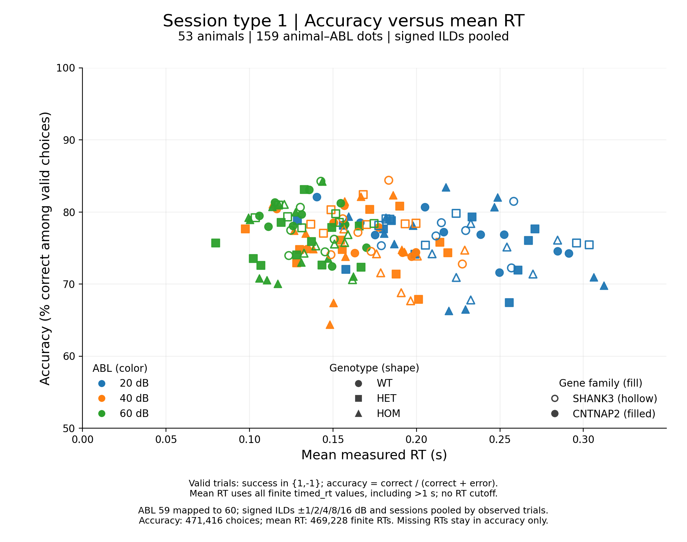

*One dot per animal and ABL: 159 dots from 53 animals. ABL determines color: 20 blue, 40 orange, 60 green. Gene family determines fill: SHANK3 hollow, CNTNAP2 filled. Genotype determines shape: WT circle, HET square, HOM triangle. Both axes use valid trials only: success in {1,-1}. X is arithmetic mean finite timed_rt in seconds; Y is accuracy, 100 times success=1 choices divided by all correct/error choices. Pool observed trials across selected signed ILDs and sessions within animal/ABL. All finite RTs are used, including values above one second; no RT cutoff.*

The three visual keys have separate legends. Each ABL has **20 hollow SHANK3
and 33 filled CNTNAP2 dots**, with **16 WT circles, 18 HET squares, and 19 HOM
triangles**. All numerical coordinates and trial counts are exactly unchanged
from the original scatter; only the visual encoding was updated.

Source: `asd_analysis/plot_session_type_1_accuracy_vs_mean_rt.py`
Figure: `docs/assets/results/2026-10-14/ASD_session_type_1_accuracy_vs_mean_rt.png`

Selection is the cleaned **session-type-1**, **training-level-16** CSV, with
**`success in {1,-1}` only**, ABL **20/40/60** after mapping **59→60**, and
signed ILDs **±1/2/4/8/16 dB**. The repeat rule and short-sound cleanup are
already applied in preparation. All 53 animals remain, and observed trials
are pooled across the selected ILDs and sessions within each animal/ABL.

**Accuracy includes all 471,416 valid choices**, comprising **361,586 correct
(`success=1`) and 109,830 errors (`success=-1`)**. **Mean RT uses all 469,228
finite RTs from those valid choices**, including the 2,250 above 1 second.
There is no RT cutoff. The 2,188 choices with missing RT still contribute to
accuracy. They belong to ASD0053, whose three points therefore have different
accuracy and RT sample sizes. The point audit records both denominators, each
animal/cohort/genotype/ABL identity, and an additional finite-RT-only accuracy
for comparison; the plotted accuracy uses all valid choices.

Independent CSV parsing explicitly excludes every success outside {1,-1}
and checks all 159 accuracy numerators/denominators and arithmetic RT means.
RT means/counts match the previous all-finite-RT summaries; correct/error
counts match the existing psychometric audits. The one-page PDF contains
53 colored data markers per ABL, with the expected 20 hollow and 33 filled
markers. Genotype shape assignments are checked against the point identities,
and the PNG was visually inspected.
The prepared CSV and prior RT-summary images/PDFs are unchanged by SHA-256.

[Download PDF](../assets/results/2026-10-14/ASD_session_type_1_accuracy_vs_mean_rt.pdf) ·
[Plotting script](../assets/results/2026-10-14/plot_session_type_1_accuracy_vs_mean_rt.py) ·
[Animal/ABL coordinates, counts, and accuracy denominators](../assets/results/2026-10-14/accuracy_vs_mean_rt_animal_abl_points.csv) ·
[Validation manifest](../assets/results/2026-10-14/accuracy_vs_mean_rt_validation.json) ·
[Independent validation](../assets/results/2026-10-14/accuracy_vs_mean_rt_independent_validation.json)
