# Results — 2026-10-15

> **Dataset update (2026-10-17):** The ASD figures and fits on this page retain
> their original data. The active CSVs now exclude CNTNAP2 cohort 4 numeric
> sessions below 13 because of speaker calibration: 96,082 source rows and
> 31,767 prepared session-type-1 rows were removed; all 53 analyzed animals remain.
> These figures have not been recomputed. Their pre-change CSVs and manifests
> are archived in `asd_analysis/session_type_csvs/archive/pre_cntnap2_cohort4_session13_cleanup/`.
> Earlier row numbers for either shortened CSV refer to that archived version.

The [updated individual-animal JND/signed-ΔJND and k/signed-Δk figures,
with before/after comparisons](2026-10-17.md), now use the cleaned CSV.
The figures below preserve the original pre-exclusion results.

A [two-page genotype-pooled version of the extended PDF](2026-10-19.md),
with SHANK3 and CNTNAP2 separate, now uses the cleaned data and recomputes
all panels within family/genotype. The individual-animal PDF below is retained.

## Psychometrics for animals with the smallest changes across ABL

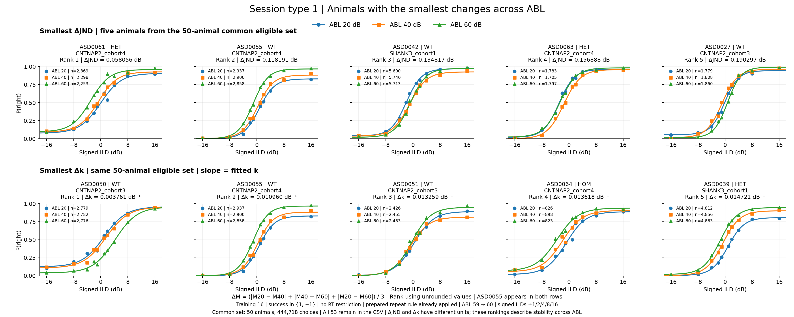

*Top row: the five smallest ΔJND values. Bottom row: the five smallest Δk
values, where slope means the fitted sigmoid parameter k. Both rankings use
the same 50 JND-eligible animals. Each panel shows the measured P(right)
points and existing fitted curves at ABL 20 (blue), 40 (orange), and 60
(green). Animal, cohort, genotype, rank, delta value, and per-ABL choice
counts are labeled. ASD0055 appears in both rows. Axes share −18–18 dB and
P(right) 0–1.*

[Download the single-page PDF](../assets/results/2026-10-15/ASD_session_type_1_low_delta_jnd_slope_psychometrics.pdf) ·
[Full-size PNG](../assets/results/2026-10-15/ASD_session_type_1_low_delta_jnd_slope_psychometrics.png)

This comparison reuses the verified individual-animal fits and measured
probabilities from the [October 13 slope/JND entry](2026-10-13.md).
It measures **stability across ABL**. ΔJND is in dB and Δk is in dB⁻¹;
their raw numerical sizes cannot be compared directly to decide which metric
better describes Weber's law. Small differences in JND or k do not require
the entire curves to overlap: fitted bias and asymptotes may also vary.

### Selection and common eligibility

Preserve the cleaned prepared session-type-1 selection: **training level 16**,
**`success in {1,-1}`**, **no measured-RT restriction**, ABL **20/40/60** after
mapping **59→60**, and signed ILDs **±1/2/4/8/16 dB**. The prepared CSV already
applies the confirmed next-trial repeat rule, with CNP/Fixation exceptions,
and removes the 807 flagged short-sound rows. Neither rule is applied again.
No new fitting or filtering of the CSV is performed.

The full sample remains **53 animals and 471,416 choices**, comprising
241,539 right and 229,877 left choices. Both rankings are restricted to
animals with **all three paper-defined JNDs available**. This common set
contains **50 animals and 444,718 choices**. The following animals are kept
in the CSV and 53-animal audit, but are ineligible for **both rankings**:

| Animal | ABL with unavailable JND | Reason |
| --- | --- | --- |
| ASD0035 | 20 | Lower JND target falls below the fitted lower asymptote |
| ASD0044 | 40 | Lower JND target falls below the fitted lower asymptote |
| ASD0048 | 40, 60 | Lower JND target falls below the fitted lower asymptote |

Their fitted k values remain available in the audit. An incomplete set of
JNDs is not filled or averaged over fewer ABLs.

### Delta calculation and selected animals

For each eligible animal, use the three fitted values at ABL 20, 40, and 60:

\[
\Delta M = \frac{|M_{20}-M_{40}|+|M_{40}-M_{60}|+|M_{20}-M_{60}|}{3},
\]

where M is either JND or k. This is also **two-thirds of the range** of the
three values. Rank each metric independently in ascending order, using
unrounded values and animal ID to break exact ties. The displayed values
below are rounded only for presentation.

| Rank | Smallest ΔJND: animal | ΔJND (dB) | Smallest Δk: animal | Δk (dB⁻¹) |
| ---: | --- | ---: | --- | ---: |
| 1 | ASD0061 | 0.058056 | ASD0050 | 0.003761 |
| 2 | ASD0055 | 0.118191 | ASD0055 | 0.010960 |
| 3 | ASD0042 | 0.134817 | ASD0051 | 0.013259 |
| 4 | ASD0063 | 0.156888 | ASD0064 | 0.013618 |
| 5 | ASD0027 | 0.190297 | ASD0039 | 0.014721 |

The top row contains **43,490 choices**; the bottom row contains **41,474**.
These are row totals, with ASD0055 contributing to both rows. The ten panels
represent nine distinct animals, **30 fitted curves and 300 measured points**.

### Reused psychometric fits and JND definition

P(right) is recorded right choices (`response_poke=1`) divided by all recorded
left/right choices at each signed ILD and ABL. Reuse the saved four-parameter
sigmoid:

```text
lower + (upper - lower) / (1 + exp(-k * (ILD - x0)))
```

The original fits used unweighted `curve_fit` on the ten ILD probability
points, parameter order `[upper,lower,x0,k]`, initial
`[max(P),min(P),median(ILD),0.1]`, asymptotes bounded to 0–1, unrestricted x0,
nonnegative k, and `maxfev=10000`. All displayed points and parameters are
reused without refitting.

Keep the existing paper-based JND definition:

```text
y_high = 0.75 * upper
y_low = 0.25 * (1 - lower)
JND = (inverse_sigmoid(y_high) - inverse_sigmoid(y_low)) / 2
```

Both thresholds must lie strictly within the fitted asymptotes. The lower
target is not changed to a fraction of the fitted dynamic range.

### Sources, audits, and validation

Source: `asd_analysis/plot_session_type_1_low_delta_psychometrics.py`.
Outputs: `asd_analysis/session_type_1_low_delta_psychometrics/`.

[Plotting script](../assets/results/2026-10-15/plot_session_type_1_low_delta_psychometrics.py) ·
[Independent verifier](../assets/results/2026-10-15/verify_session_type_1_low_delta_psychometrics.py) ·
[53-animal eligibility and metrics](../assets/results/2026-10-15/animal_eligibility_metrics.csv) ·
[Complete JND ranking](../assets/results/2026-10-15/jnd_ranking.csv) ·
[Complete k ranking](../assets/results/2026-10-15/k_ranking.csv) ·
[Selected-panel counts](../assets/results/2026-10-15/selected_panel_counts.csv) ·
[Measured points](../assets/results/2026-10-15/selected_psychometric_points.csv) ·
[Reused parameters and JND crossings](../assets/results/2026-10-15/selected_psychometric_fits.csv) ·
[Smooth fitted curves](../assets/results/2026-10-15/selected_sigmoid_curves.csv) ·
[Validation manifest](../assets/results/2026-10-15/validation.json) ·
[Independent validation](../assets/results/2026-10-15/independent_validation.json)

Independent checks reconstruct every pairwise difference and both rankings
from the saved source fits, verify the two-thirds-range identity, common
eligibility, all condition counts and probabilities, and exact reuse of
parameters. The exported PDF contains one 20 × 8-inch page, 300 measured
markers and 30 fitted curves with the specified colors; its matching PNG is
3600 × 1440 pixels. The figure was visually inspected. Hash checks preserve
the original/prepared CSVs, previous fits, figures, audits, and October
12–14 result entries. The direct image embed, PDF/audit downloads, navigation,
and strict MkDocs build were checked.

## All 53 animals: CDF thresholds and quantile scaling

[Download the latest extended 11-page PDF](../assets/results/2026-10-15/ASD_session_type_1_all_animals_psychometric_rtd_chronometric_scaling.pdf) ·
[Download the complete audit bundle](../assets/results/2026-10-15/ASD_session_type_1_cdf_quantile_scaling_audits.zip)

Each animal now occupies **two rows**. The upper row retains the existing
psychometric, full-RT RTD, and compact square chronometric panels. The lower
row contains **six panels**, left to right: **CDFs; mean absolute ΔCDF with
cutoff markers; raw quantiles at ABL 20, 40, and 60; and the rescaled overlay**.
Keep five animals per page, with three on the final page, in the same order
and with the same PDF bookmarks. Pages remain **18.24 inches wide** and are
taller (35.2 inches for five animals; 22 inches for three), allocating
6.6 inches to each two-row animal block.

This is an extension of the [October 14 animal PDF](2026-10-14.md#all-53-animals-psychometric-rtd-and-chronometric).
The [previous three-column PDF](../assets/results/2026-10-14/ASD_session_type_1_all_animals_psychometric_rtd_chronometric.pdf)
and [original two-column PDF](../assets/results/2026-10-14/ASD_session_type_1_all_animals_psychometric_and_full_rt_rtd.pdf)
remain available. All previous PNGs, numerical audits, and input CSVs are
preserved. **All 53 animals are included**, including animals with undefined
JNDs; the 50-animal eligibility rule in the preceding ranking figure does
not apply here. ASD0054 remains on page 10, animal block 5.

### Trial selection and distributions

Use the cleaned prepared CSV: session type 1, training level 16,
**`success in {1,-1}`**, ABL **20/40/60** after **59→60**, and signed ILDs
**±1/2/4/8/16 dB**. Pool the actual positive and negative ILD trials across
sessions within each animal/ABL/|ILD| before computing the new distributions
and quantiles. The prepared repeat rule and short-sound cleanup are already
applied; they are not applied again.

The upper row's definitions and values are unchanged: psychometrics use
**471,416 choices**, including missing RTs, while RTDs and chronometrics use
**469,228 finite RTs**, including **2,250 above 1 second**. RTDs retain
20 ms bins, full-range area-one normalization, and the 0–0.6 s display zoom.
Chronometrics retain mean ± sample SEM and the common 0–0.45 s y-range.

**Only the new lower row** uses finite measured **`timed_rt` in inclusive
[0,1] seconds**, matching the original Figure 1 window. This gives
**466,978 RTs**, excluding 2,250 RTs above 1 s and 2,188 missing RTs from the
valid-choice population. This is a measured-RT window, not `max_rt == 1`.
There are **795 animal/ABL/|ILD| conditions**, with at least **29 RTs** each.

Construct 1 ms histograms over [0,1] and calculate each CDF as cumulative
bin count divided by that condition's window count. Every full CDF ends at
1. Both CDF displays show **0–0.15 s** without renormalizing the visible
part. The first new panel overlays 15 CDFs: ABL is blue/orange/green and
|ILD| uses five line styles identified in the page legend.

### Per-animal ΔCDF cutoffs

For each animal and |ILD|, calculate:

\[
D(t)=\frac{|F_{20}(t)-F_{40}(t)|+|F_{40}(t)-F_{60}(t)|+|F_{20}(t)-F_{60}(t)|}{3}.
\]

Match the original Figure 1 moving-window onset rule: at bin index `i`,
compare **the mean of the next ten bins**, `D[i+1:i+11]`, with **the mean
of the preceding ten bins**, `D[i-10:i]`. Exclude the current bin. The first
index with a rise **≥0.005** supplies the cutoff, at that bin's center.
This is a rise between two window means, rather than a direct crossing of
`D(t)=0.005`. The two windows are each 10 ms wide.

All **265 freshly calculated per-animal/|ILD| cutoffs** are available, ranging
from **10.5 to 104.5 ms**. These replace the original paper's hard-coded
across-animal cutoffs for this extension only. The ΔCDF panel overlays the
five |ILD|-colored curves and matching dashed cutoff markers; its title lists
all five cutoff times in **milliseconds**. Cutoff markers appear only in this
second column.

### Empirical quantiles and Figure 1 rescaling

Display **10%, 30%, 50%, 70%, and 90%** empirical RT quantiles using linear
interpolation, against |ILD| **1/2/4/8/16** with logarithmic x spacing. The
three raw ABL panels use consistent quantile colors and marker shapes.
The scaled overlay uses ABL colors and the same quantile marker shapes.
Points are connected across |ILD|; no animal averaging or quantile SEMs are
introduced. The four quantile panels share a y-range within each animal,
covering all raw and scaled values without clipping.

For every animal/|ILD|, use **ABL 60 as reference** and fine quantiles from
**1% through 99%** to obtain the ABL-20 and ABL-40 factors. The fitting mask
includes reference ABL-60 quantiles between the detected cutoff `t0` and
**0.3 s**. The source Figure 1 calculation is preserved:

```text
x = Q60 - t0
y = Qabl - Q60
m = sum(x * (y - y_first)) / sum(x * x)
factor = 1 + m
```

`y_first` is the first difference within the fitting mask. The parameter
`m` here is a quantile-scaling fit coefficient, distinct from psychometric
slope `k`. For plotting quantiles above the cutoff:

\[
Q_{\mathrm{scaled}}=t_0+\frac{Q-t_0}{1+m}.
\]

Quantiles at or below the cutoff are unchanged; all ABL-60 quantiles remain
unchanged. All **530 scaling fits** are valid, with factors from approximately
**0.964 to 4.360**. An unavailable cutoff or nonfinite/nonpositive factor
would be recorded explicitly and omit the affected scaled values; an
unsuccessful fit is never silently displayed as unchanged successful scaling.

### Sources and audits

Source: `asd_analysis/plot_all_animals_psychometric_rtd_chronometric_scaling.py`.
Output folder: `asd_analysis/session_type_1_all_animals_psychometric_rtd_chronometric_scaling/`.
Original methods:
[CDF onset code](../assets/results/2026-10-15/figure1_cdf_onset_reference.py) and
[quantile rescaling code](../assets/results/2026-10-15/figure1_quantile_scaling_reference.py).

[Plotting script](../assets/results/2026-10-15/plot_all_animals_psychometric_rtd_chronometric_scaling.py) ·
[Independent verifier](../assets/results/2026-10-15/verify_all_animals_psychometric_rtd_chronometric_scaling.py) ·
[Condition and signed-trial counts](../assets/results/2026-10-15/extended_condition_counts.csv) ·
[Histogram/CDF bins, CSV.gz](../assets/results/2026-10-15/extended_histogram_cdf_bins.csv.gz) ·
[ΔCDF curves and window means, CSV.gz](../assets/results/2026-10-15/extended_delta_cdf_curves.csv.gz) ·
[265 cutoff detections](../assets/results/2026-10-15/extended_thresholds.csv) ·
[Five raw quantiles](../assets/results/2026-10-15/extended_raw_quantiles.csv) ·
[99 fitting quantiles, CSV.gz](../assets/results/2026-10-15/extended_fine_quantiles.csv.gz) ·
[530 scaling fits](../assets/results/2026-10-15/extended_scaling_fits.csv) ·
[Complete fit inputs, CSV.gz](../assets/results/2026-10-15/extended_scaling_fit_inputs.csv.gz) ·
[Scaled quantiles](../assets/results/2026-10-15/extended_scaled_quantiles.csv) ·
[Panel layout](../assets/results/2026-10-15/extended_panel_layout.csv) ·
[Plotted cutoff positions](../assets/results/2026-10-15/extended_plotted_thresholds.csv) ·
[Validation manifest](../assets/results/2026-10-15/extended_validation.json) ·
[Independent validation](../assets/results/2026-10-15/extended_independent_validation.json)

The complete audit ZIP also contains the unchanged reference psychometric,
RTD, chronometric, count, and animal/page tables. Large bin and fine-quantile
tables use compressed CSVs; all numerical values are retained.

Independent checks parse the prepared CSV, reconstruct signed-trial counts,
histograms with bisect-based binning, complete CDFs, all pairwise differences
and onset detections, and raw/fine quantiles from sorted order statistics.
Scalar fits and rescaling reproduce all 530 factors and 3,975 transformed
points. Synthetic cases test absent onsets, insufficient fitting points,
and invalid factors. Original numerical tables are byte-identical; all
previous input and figure hashes are preserved. Saved-PDF checks locate
all 265 cutoff markers and 795 existing chronometric dots/SEM bars, verify
all 53 identities, 11 pages, original bookmarks, visible limits, and page
dimensions. All pages and new animal rows were visually inspected; direct
image embeds, downloads, navigation, and the strict MkDocs build were checked.

### Extended PDF pages

#### Page 1: ASD0040, ASD0042, ASD0044, ASD0047, ASD0049

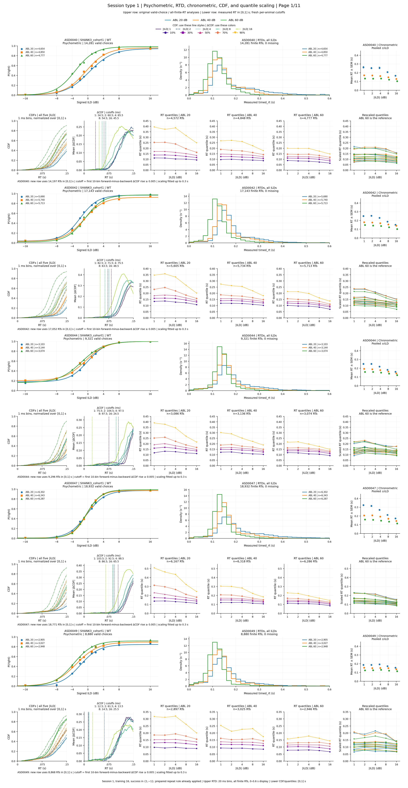

*Five animals per page, except the three-animal final page. Each animal has the original three panels above the six new CDF/quantile panels; only the new row uses RT in [0,1] seconds.*

#### Page 2: ASD0038, ASD0039, ASD0041, ASD0023, ASD0024

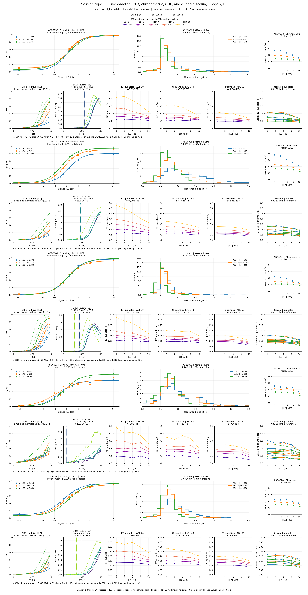

*Five animals per page, except the three-animal final page. Each animal has the original three panels above the six new CDF/quantile panels; only the new row uses RT in [0,1] seconds.*

#### Page 3: ASD0043, ASD0045, ASD0046, ASD0048, ASD0077

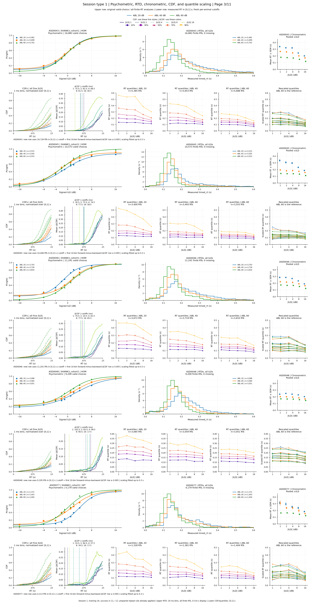

*Five animals per page, except the three-animal final page. Each animal has the original three panels above the six new CDF/quantile panels; only the new row uses RT in [0,1] seconds.*

#### Page 4: ASD0073, ASD0074, ASD0075, ASD0076, ASD0072

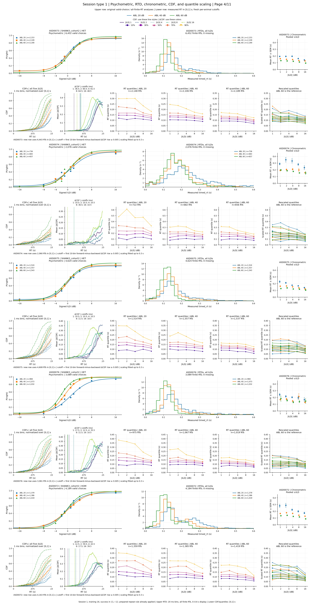

*Five animals per page, except the three-animal final page. Each animal has the original three panels above the six new CDF/quantile panels; only the new row uses RT in [0,1] seconds.*

#### Page 5: ASD0026, ASD0027, ASD0028, ASD0032, ASD0033

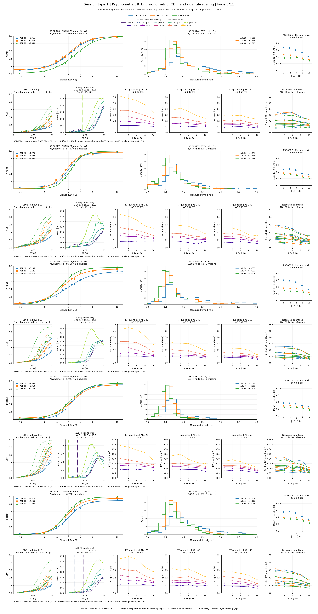

*Five animals per page, except the three-animal final page. Each animal has the original three panels above the six new CDF/quantile panels; only the new row uses RT in [0,1] seconds.*

#### Page 6: ASD0050, ASD0051, ASD0025, ASD0035, ASD0022

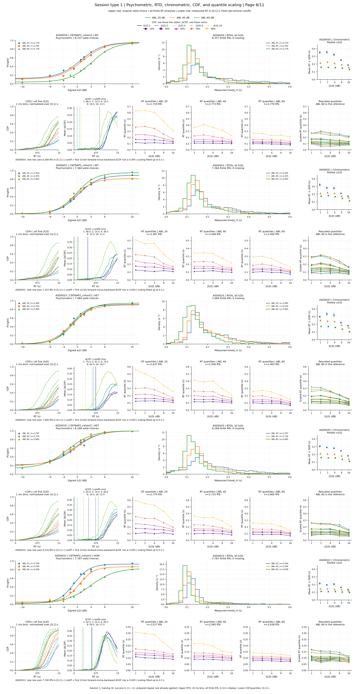

*Five animals per page, except the three-animal final page. Each animal has the original three panels above the six new CDF/quantile panels; only the new row uses RT in [0,1] seconds.*

#### Page 7: ASD0029, ASD0030, ASD0031, ASD0034, ASD0036

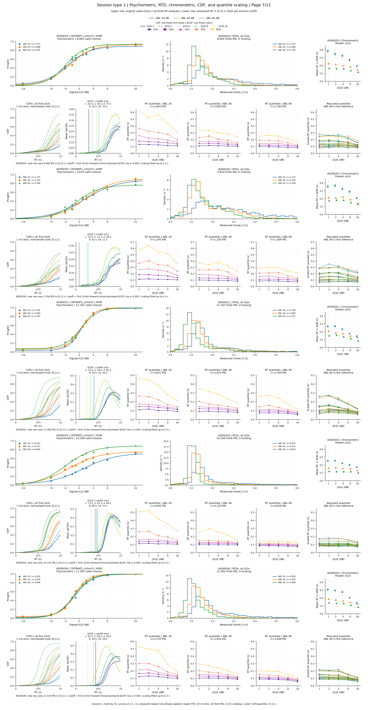

*Five animals per page, except the three-animal final page. Each animal has the original three panels above the six new CDF/quantile panels; only the new row uses RT in [0,1] seconds.*

#### Page 8: ASD0037, ASD0053, ASD0055, ASD0062, ASD0056

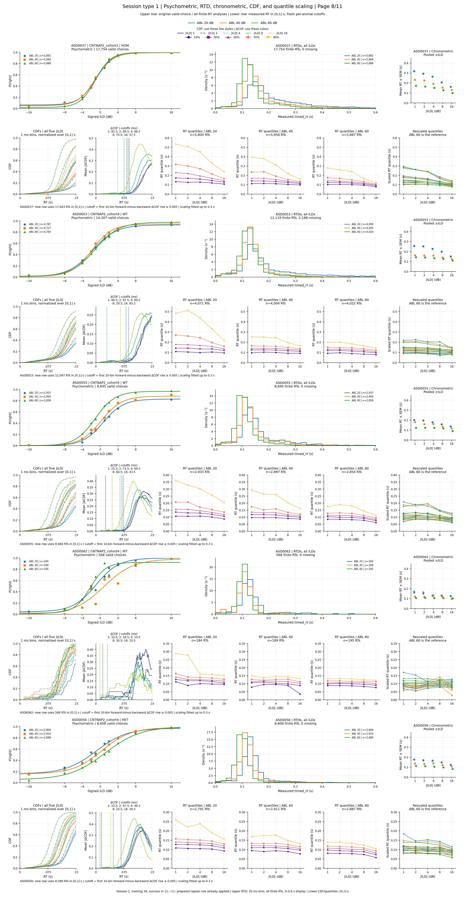

*Five animals per page, except the three-animal final page. Each animal has the original three panels above the six new CDF/quantile panels; only the new row uses RT in [0,1] seconds.*

#### Page 9: ASD0057, ASD0058, ASD0059, ASD0061, ASD0063

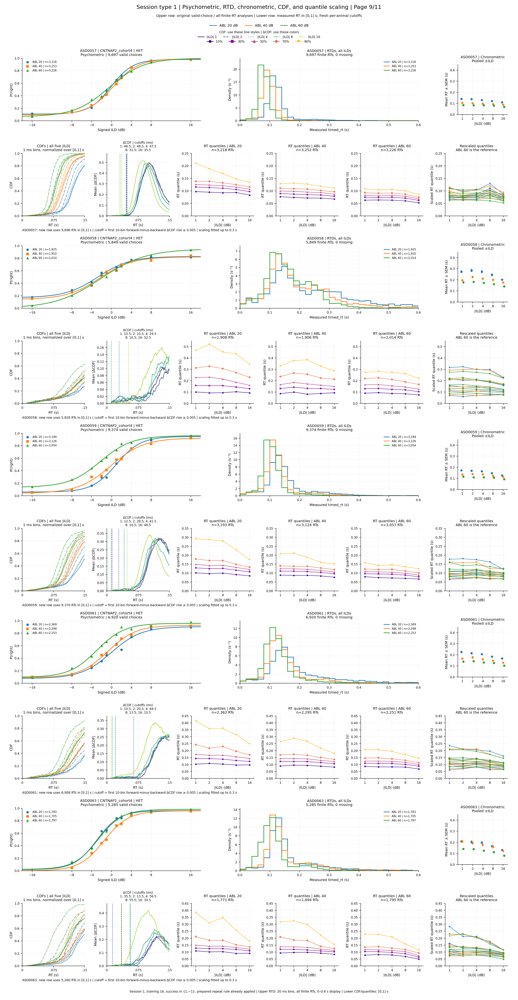

*Five animals per page, except the three-animal final page. Each animal has the original three panels above the six new CDF/quantile panels; only the new row uses RT in [0,1] seconds.*

#### Page 10: ASD0066, ASD0068, ASD0071, ASD0052, ASD0054

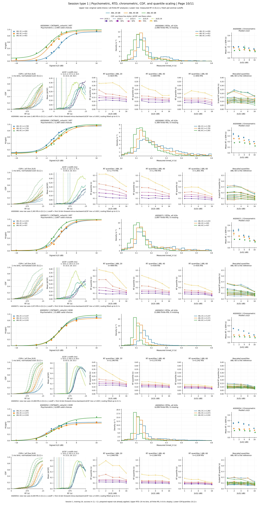

*Five animals per page, except the three-animal final page. Each animal has the original three panels above the six new CDF/quantile panels; only the new row uses RT in [0,1] seconds.*

#### Page 11: ASD0060, ASD0064, ASD0065

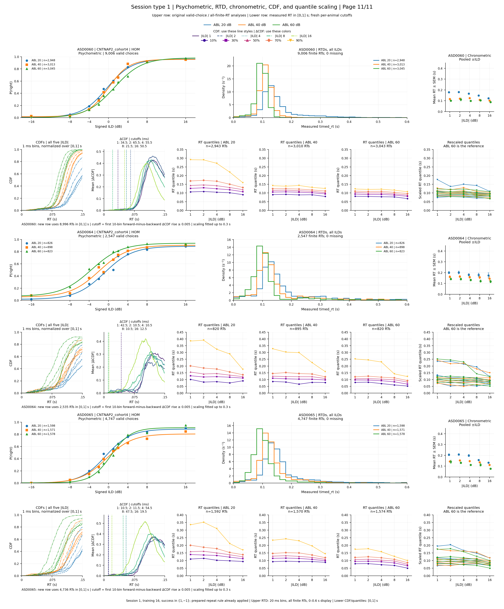

*Five animals per page, except the three-animal final page. Each animal has the original three panels above the six new CDF/quantile panels; only the new row uses RT in [0,1] seconds.*

## Figure 1-style JND and slope: signed deviations from animal means

Two new figures reproduce the Figure 1 arrangement: animal/ABL values
above, signed deviations below, and narrow gray summary bars on the right.
The **JND figure uses 50 complete-JND animals**; the **slope figure uses all
53 complete-slope animals**, as requested. Each figure independently sorts
animals by their unrounded mean across ABLs, with exact ties broken by
animal ID. Both panels within a figure use the same order. Labels identify
animal, cohort, and genotype.

### JND and signed ΔJND: 50 animals

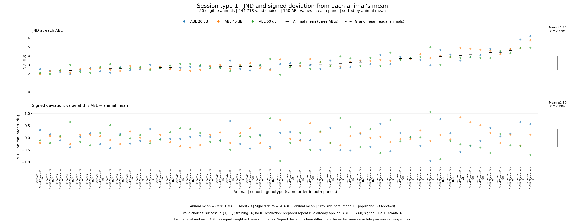

*Upper panel: JND at ABL 20 (blue), 40 (orange), and 60 (green), with a black
mark at each animal's arithmetic mean across the three ABLs. The dotted line
is the equally weighted grand mean across animals. Lower panel: each ABL's
JND minus that same animal's mean, with zero marked. Gray bars show mean
±1 population SD (`ddof=0`): across the 50 animal means above, and across
the 150 signed deviations below. All 150 values are shown in each main
panel. Axes include every estimate and bar endpoint.*

[Download JND/ΔJND PDF](../assets/results/2026-10-15/ASD_session_type_1_animal_jnd_and_delta_jnd.pdf) ·
[Full-size JND/ΔJND PNG](../assets/results/2026-10-15/ASD_session_type_1_animal_jnd_and_delta_jnd.png)

### Slope k and signed Δk: 53 animals

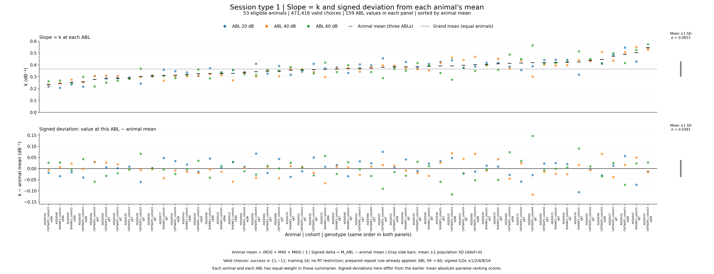

*Same arrangement for slope, defined as the fitted sigmoid parameter k in
dB⁻¹. All 53 animals have three available slope values, giving 159 values
in each main panel. The black marks, dotted grand mean, zero line, and gray
population-SD bars have the same definitions as in the JND figure. Each
animal contributes equally to the upper summary; each of the three ABLs
contributes equally to its animal mean and to the deviation summary.*

[Download slope/Δslope PDF](../assets/results/2026-10-15/ASD_session_type_1_animal_slope_and_delta_slope.pdf) ·
[Full-size slope/Δslope PNG](../assets/results/2026-10-15/ASD_session_type_1_animal_slope_and_delta_slope.png)

### Definitions, selection, and eligibility

Here **delta is signed and animal-centered**, matching the Figure 1 panel:

\[
\bar M_a=\frac{M_{a,20}+M_{a,40}+M_{a,60}}{3},
\qquad
\Delta M_{a,ABL}=M_{a,ABL}-\bar M_a.
\]

This differs from the **mean absolute pairwise difference** used in the
earlier five-animal ranking figure. These figures use no absolute value in
the delta calculation. Animals are sorted by their mean value, rather than
by their delta. JND and k retain their different units; the SD bars report
spread in the corresponding units.

Reuse the verified [October 13 individual-animal JND/k fits](2026-10-13.md)
without refitting. Keep session type 1, training level 16, valid choices
**`success in {1,-1}`**, ABL 59→60, ABL 20/40/60, and signed ILDs
±1/2/4/8/16. There is **no RT restriction**, including no propagation of the
[0,1]-second window used only for the new CDF/quantile row in the extended
PDF. The prepared repeat rule is not applied again. The existing
paper-defined JND thresholds and fitted k estimates are unchanged.

Eligibility requires finite positive values at **all three ABLs** for the
metric being shown. The JND figure omits ASD0035, ASD0044, and ASD0048 because
their JND sets are incomplete; it does not average incomplete sets. These
three animals remain in the slope figure and in the CSV. This is
metric-specific eligibility, unlike the common 50-animal set used for both
rankings in the earlier five-animal comparison.

| Figure | Animals | ABL values per panel | Valid choices represented |
| --- | ---: | ---: | ---: |
| JND / signed ΔJND | 50 | 150 | 444,718 |
| k / signed Δk | 53 | 159 | 471,416 |

The full 53-animal sample contains 241,539 right and 229,877 left choices.
Raw trial counts describe the fit populations; they do not weight the means
or SD bars in these plots. SD uses **`ddof=0`**, matching the source Figure 1
code. Each gray bar spans two SDs in total, centered at its summary mean.

| Metric | Grand mean of animal means | SD across animal means | SD across signed ABL deviations |
| --- | ---: | ---: | ---: |
| JND (dB) | 3.229148 | 0.770397 | 0.365155 |
| k (dB⁻¹) | 0.365666 | 0.065320 | 0.038319 |

Each animal's three deviations sum to zero within numerical precision;
the pooled signed-deviation means are therefore approximately zero.
The lower panels use symmetric limits around zero. Both figures are
26 × 10 inches, with matching 4680 × 1800 pixel PNGs and single-page PDFs.

### Sources, audits, and verification

Source: `asd_analysis/plot_session_type_1_animal_metric_deviations.py`.
Outputs: `asd_analysis/session_type_1_animal_metric_deviations/`.
Reference layout: `fit_animal_by_animal/make_fig1.py`, JND section starting
at line 437. Saved parameters come from
`asd_analysis/session_type_1_slope_jnd/slope_jnd_fits.csv`.

[Plotting script](../assets/results/2026-10-15/plot_session_type_1_animal_metric_deviations.py) ·
[Independent verifier](../assets/results/2026-10-15/verify_session_type_1_animal_metric_deviations.py) ·
[53-animal eligibility](../assets/results/2026-10-15/metric_deviation_animal_eligibility.csv) ·
[Animal means and sorted order](../assets/results/2026-10-15/metric_deviation_animal_means_order.csv) ·
[All 309 ABL values and signed deltas](../assets/results/2026-10-15/metric_deviation_animal_abl_deviations.csv) ·
[Summary statistics](../assets/results/2026-10-15/metric_deviation_summary_statistics.csv) ·
[Plotted data coordinates](../assets/results/2026-10-15/metric_deviation_plotted_points.csv) ·
[SD bar coordinates](../assets/results/2026-10-15/metric_deviation_plotted_summary_bars.csv) ·
[Validation manifest](../assets/results/2026-10-15/metric_deviation_validation.json) ·
[Independent validation](../assets/results/2026-10-15/metric_deviation_independent_validation.json)

Independent CSV parsing checks exact reuse of the source estimates,
metric-specific complete eligibility, all arithmetic means and signed
differences, ordering, population SDs with `statistics.pstdev`, and sample
totals. Saved-PDF checks locate **all 618 main-panel data dots** and all four
gray bars, including their endpoints, and verify colors, identities, full
limits, page counts, and PNG dimensions. Both figures were visually inspected.
Previous inputs, fits, figures, and the extended animal PDF remain unchanged
by hash. Direct image embeds, downloads, navigation, and the strict MkDocs
build were checked.
