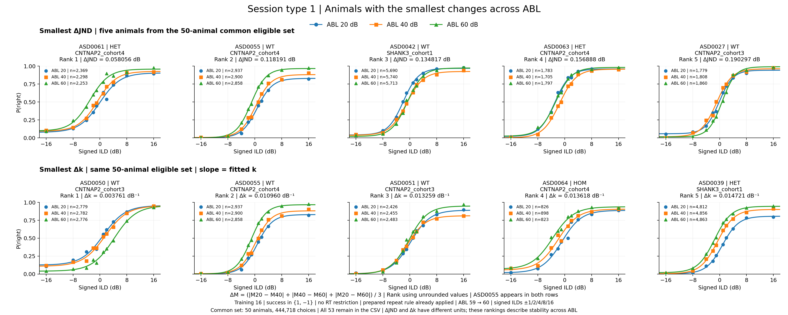

# Results — 2026-10-15

## Psychometrics for animals with the smallest changes across ABL



*Top row: the five smallest ΔJND values. Bottom row: the five smallest Δk
values, where slope means the fitted sigmoid parameter k. Both rankings use
the same 50 JND-eligible animals. Each panel shows the measured P(right)
points and existing fitted curves at ABL 20 (blue), 40 (orange), and 60
(green). Animal, cohort, genotype, rank, delta value, and per-ABL choice
counts are labeled. ASD0055 appears in both rows. Axes share −18–18 dB and
P(right) 0–1.*

[Download the single-page PDF](../assets/results/2026-10-15/ASD_session_type_1_low_delta_jnd_slope_psychometrics.pdf) ·
[Full-size PNG](../assets/results/2026-10-15/ASD_session_type_1_low_delta_jnd_slope_psychometrics.png)

This comparison reuses the verified individual-animal fits and measured
probabilities from the [October 13 slope/JND entry](2026-10-13.md).
It measures **stability across ABL**. ΔJND is in dB and Δk is in dB⁻¹;
their raw numerical sizes cannot be compared directly to decide which metric
better describes Weber's law. Small differences in JND or k do not require
the entire curves to overlap: fitted bias and asymptotes may also vary.

### Selection and common eligibility

Preserve the cleaned prepared session-type-1 selection: **training level 16**,
**`success in {1,-1}`**, **no measured-RT restriction**, ABL **20/40/60** after
mapping **59→60**, and signed ILDs **±1/2/4/8/16 dB**. The prepared CSV already
applies the confirmed next-trial repeat rule, with CNP/Fixation exceptions,
and removes the 807 flagged short-sound rows. Neither rule is applied again.
No new fitting or filtering of the CSV is performed.

The full sample remains **53 animals and 471,416 choices**, comprising
241,539 right and 229,877 left choices. Both rankings are restricted to
animals with **all three paper-defined JNDs available**. This common set
contains **50 animals and 444,718 choices**. The following animals are kept
in the CSV and 53-animal audit, but are ineligible for **both rankings**:

| Animal | ABL with unavailable JND | Reason |
| --- | --- | --- |
| ASD0035 | 20 | Lower JND target falls below the fitted lower asymptote |
| ASD0044 | 40 | Lower JND target falls below the fitted lower asymptote |
| ASD0048 | 40, 60 | Lower JND target falls below the fitted lower asymptote |

Their fitted k values remain available in the audit. An incomplete set of
JNDs is not filled or averaged over fewer ABLs.

### Delta calculation and selected animals

For each eligible animal, use the three fitted values at ABL 20, 40, and 60:

\[
\Delta M = \frac{|M_{20}-M_{40}|+|M_{40}-M_{60}|+|M_{20}-M_{60}|}{3},
\]

where M is either JND or k. This is also **two-thirds of the range** of the
three values. Rank each metric independently in ascending order, using
unrounded values and animal ID to break exact ties. The displayed values
below are rounded only for presentation.

| Rank | Smallest ΔJND: animal | ΔJND (dB) | Smallest Δk: animal | Δk (dB⁻¹) |
| ---: | --- | ---: | --- | ---: |
| 1 | ASD0061 | 0.058056 | ASD0050 | 0.003761 |
| 2 | ASD0055 | 0.118191 | ASD0055 | 0.010960 |
| 3 | ASD0042 | 0.134817 | ASD0051 | 0.013259 |
| 4 | ASD0063 | 0.156888 | ASD0064 | 0.013618 |
| 5 | ASD0027 | 0.190297 | ASD0039 | 0.014721 |

The top row contains **43,490 choices**; the bottom row contains **41,474**.
These are row totals, with ASD0055 contributing to both rows. The ten panels
represent nine distinct animals, **30 fitted curves and 300 measured points**.

### Reused psychometric fits and JND definition

P(right) is recorded right choices (`response_poke=1`) divided by all recorded
left/right choices at each signed ILD and ABL. Reuse the saved four-parameter
sigmoid:

```text
lower + (upper - lower) / (1 + exp(-k * (ILD - x0)))
```

The original fits used unweighted `curve_fit` on the ten ILD probability
points, parameter order `[upper,lower,x0,k]`, initial
`[max(P),min(P),median(ILD),0.1]`, asymptotes bounded to 0–1, unrestricted x0,
nonnegative k, and `maxfev=10000`. All displayed points and parameters are
reused without refitting.

Keep the existing paper-based JND definition:

```text
y_high = 0.75 * upper
y_low = 0.25 * (1 - lower)
JND = (inverse_sigmoid(y_high) - inverse_sigmoid(y_low)) / 2
```

Both thresholds must lie strictly within the fitted asymptotes. The lower
target is not changed to a fraction of the fitted dynamic range.

### Sources, audits, and validation

Source: `asd_analysis/plot_session_type_1_low_delta_psychometrics.py`.
Outputs: `asd_analysis/session_type_1_low_delta_psychometrics/`.

[Plotting script](../assets/results/2026-10-15/plot_session_type_1_low_delta_psychometrics.py) ·
[Independent verifier](../assets/results/2026-10-15/verify_session_type_1_low_delta_psychometrics.py) ·
[53-animal eligibility and metrics](../assets/results/2026-10-15/animal_eligibility_metrics.csv) ·
[Complete JND ranking](../assets/results/2026-10-15/jnd_ranking.csv) ·
[Complete k ranking](../assets/results/2026-10-15/k_ranking.csv) ·
[Selected-panel counts](../assets/results/2026-10-15/selected_panel_counts.csv) ·
[Measured points](../assets/results/2026-10-15/selected_psychometric_points.csv) ·
[Reused parameters and JND crossings](../assets/results/2026-10-15/selected_psychometric_fits.csv) ·
[Smooth fitted curves](../assets/results/2026-10-15/selected_sigmoid_curves.csv) ·
[Validation manifest](../assets/results/2026-10-15/validation.json) ·
[Independent validation](../assets/results/2026-10-15/independent_validation.json)

Independent checks reconstruct every pairwise difference and both rankings
from the saved source fits, verify the two-thirds-range identity, common
eligibility, all condition counts and probabilities, and exact reuse of
parameters. The exported PDF contains one 20 × 8-inch page, 300 measured
markers and 30 fitted curves with the specified colors; its matching PNG is
3600 × 1440 pixels. The figure was visually inspected. Hash checks preserve
the original/prepared CSVs, previous fits, figures, audits, and October
12–14 result entries. The direct image embed, PDF/audit downloads, navigation,
and strict MkDocs build were checked.
