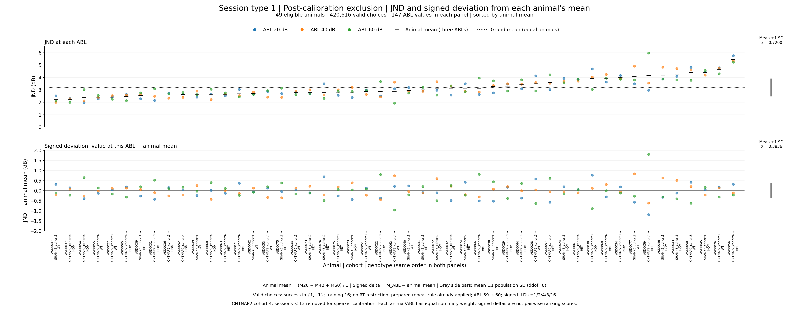
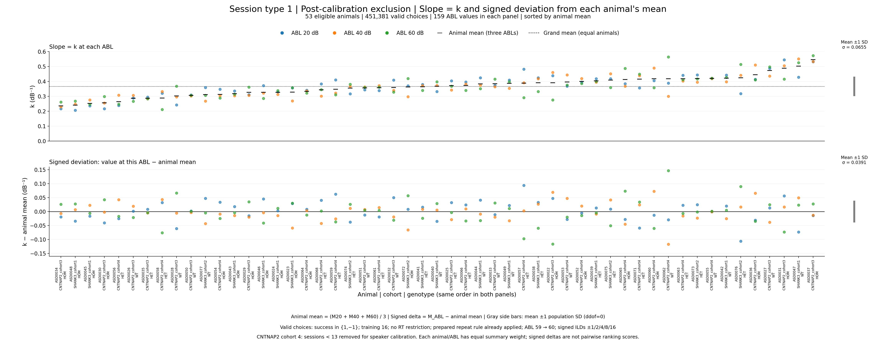

# Results — 2026-10-17

## Updated animal JND and slope after speaker-calibration exclusion

These two figures update the [October 15 Figure 1-style animal plots](2026-10-15.md#figure-1-style-jnd-and-slope-signed-deviations-from-animal-means)
using the cleaned prepared CSV. CNTNAP2 cohort 4 sessions below 13 are now
excluded because of speaker calibration. **All 159 animal/ABL psychometrics
were refitted** with the same model, bounds, initialization, and unweighted
objective. Historical fits and images remain unchanged.

### JND and signed ΔJND: 49 eligible animals

*Upper panel: each eligible animal's JND at ABL 20 (blue), 40 (orange), and
60 (green), with a black mark at its equal-ABL mean and a dotted line at the
equal-animal grand mean. Lower panel: signed JND minus that same animal's
mean. The gray upper bar is grand mean ±1 population SD across animal means;
the lower bar is mean ±1 population SD across all signed deviations, using
`ddof=0`. There are 49 animals, 147 values per main panel, and 420,616 valid
choices underlying these fits. Animals are sorted by their new unrounded
mean JND; labels identify animal, cohort, and genotype. ΔJND now spans
−2 to +2 dB to include the new largest deviation (+1.8031 dB); the earlier
plot spanned −1.2 to +1.2 dB. No valid points or bars are clipped.*

[Full-size JND/ΔJND PNG](../assets/results/2026-10-17/ASD_session_type_1_calibrated_animal_jnd_and_delta_jnd.png) ·
[Download JND/ΔJND PDF](../assets/results/2026-10-17/ASD_session_type_1_calibrated_animal_jnd_and_delta_jnd.pdf)

### Slope k and signed Δk: all 53 animals

*Same arrangement for the fitted sigmoid parameter k (dB⁻¹). All 53 animals
have complete positive k estimates at all three ABLs: 159 values per main
panel, representing 451,381 valid choices. Equal-animal and equal-ABL
summary weighting, ABL colors, mean marks, signed deviations, and population
SD bars match the JND figure. Animals are independently sorted by their new
mean k. The original k ranges (0–0.6 dB⁻¹ and signed Δk −0.16 to +0.16 dB⁻¹)
remain sufficient; no valid points or bars are clipped.*

[Full-size slope/Δslope PNG](../assets/results/2026-10-17/ASD_session_type_1_calibrated_animal_slope_and_delta_slope.png) ·
[Download slope/Δslope PDF](../assets/results/2026-10-17/ASD_session_type_1_calibrated_animal_slope_and_delta_slope.pdf)

### What changed compared with the earlier plots?

**Population means remain similar; some individual estimates changed more.**
Only 10 animals lose selected choices. The other 43 animals' 129 animal/ABL
fits match the earlier estimates within numerical precision. New sorting
can move an animal horizontally even when its estimates did not change.

The table compares the **same animals before and after**, avoiding a
population change when interpreting JND. Signed deltas average to zero by
construction, so their SD is used to compare the spread across ABL.

| Metric and fixed population | Mean before | Mean after | SD of signed Δ before | SD of signed Δ after | Change in Δ SD |
| --- | ---: | ---: | ---: | ---: | ---: |
| JND, same 49 animals (dB) | 3.188877 | 3.188179 | 0.363051 | 0.383571 | +5.65% |
| k, same 53 animals (dB⁻¹) | 0.365666 | 0.366198 | 0.038319 | 0.039098 | +2.03% |

- **Eligibility:** JND changes from 50 to 49 complete animals. ASD0058 is newly
  ineligible because its ABL-20 lower target is outside the fitted sigmoid's
  range: fitted lower asymptote ≈0.2377, lower target ≈0.1906. Its fitted k is
  still valid and shown. ASD0035, ASD0044, and ASD0048 remain JND-ineligible.
  No animal is removed from the CSV and unavailable JNDs are not imputed.
- **Largest JND estimate change:** ASD0059 at ABL 60 rises from 4.9661 to
  5.9660 dB (+0.9999 dB); its signed ΔJND rises from +1.0666 to +1.8031 dB.
- **Largest k estimate change:** ASD0056 at ABL 20 falls from 0.288175 to
  0.238565 dB⁻¹ (−0.049610 dB⁻¹); its signed Δk changes from +0.006036 to
  −0.025541 dB⁻¹.

If each figure's own eligible population is compared instead, JND's grand
mean changes from 3.229148 (50 animals) to 3.188179 dB (49 animals), and its
ΔJND SD from 0.365155 to 0.383571 dB (+5.04%). That comparison also includes
ASD0058 dropping out; the fixed-49 comparison above isolates changes among
animals with defined JNDs at both time points. These are descriptive changes,
not a test of significance or a direct numerical comparison of JND and k,
which have different units.

### Dataset, fitting, and delta definitions

The active prepared `asd_analysis/session_type_csvs/ASD_session_type_1.csv`
contains **610,603 rows and all 53 animals**, with SHA-256
`db95fc66fc434c81832cb460ed5fe28857b1aa25c639b6a31fbb1859d2ba4408`.
It already applies training level 16, the confirmed next-trial repeat rule
with CNP/Fixation exceptions, short-sound exclusion, and the new CNTNAP2
cohort 4 numeric `session >= 13` cutoff. Neither the repeat nor short-sound
filter is derived again in this plotting script.

Select **`success in {1,-1}`**, **no RT restriction**, ABL **20/40/60** after
mapping **59→60**, and signed ILDs **±1/2/4/8/16 dB**. Pool actual positive and
negative signed conditions separately across sessions when computing their
measured probabilities. P(right) is `response_poke == 1` divided by all
recorded right/left choices at that signed ILD. This gives **451,381 choices**:
**231,263 right and 220,118 left**, versus the earlier 471,416. Exactly
**20,035 previously selected choices** were removed by the calibration cutoff.
This is a subset of the 31,767 removed prepared rows; fixation aborts and
stimulus conditions outside this fitting domain account for the difference.

Fit each animal/ABL's ten probabilities with equal weight using
`lower + (upper - lower) / (1 + exp(-k * (ILD - x0)))`, parameter order
`[upper, lower, x0, k]`, initial `[max(P), min(P), median(ILD), 0.1]`,
asymptotes bounded to [0,1], unrestricted x0, nonnegative k, and
`maxfev=10000`. Slope means **k**. The same fitted curve supplies the original
paper-defined JND: half the ILD distance between inverse-sigmoid crossings at
`y_high = 0.75 * upper` and `y_low = 0.25 * (1 - lower)`. A target outside
its fitted asymptotes gives an unavailable JND, while a valid k remains.
All 159 fits are increasing; 154 individual animal/ABL JNDs are defined.

For each metric independently, require positive finite estimates at all
three ABLs. The animal mean is `(M20 + M40 + M60) / 3`, and the displayed
**signed delta is `M_ABL - animal_mean`**. This preserves the Figure 1-style
signed delta from the earlier pair of plots, rather than the separate mean
absolute pairwise score used for five-animal rankings. Animals and ABLs have
equal summary weight; trial counts determine measured probabilities within
an ILD, not the weight of an animal in the plotted means/SDs. Both figures
retain the earlier two stacked main panels and narrow SD bars on the right.

### Sources, audits, and verification

Source: `asd_analysis/plot_session_type_1_animal_metric_deviations_calibrated.py`.
Independent verifier: `asd_analysis/verify_session_type_1_animal_metric_deviations_calibrated.py`.
Outputs: `asd_analysis/session_type_1_animal_metric_deviations_calibrated/`.
Historical reference: `asd_analysis/session_type_1_slope_jnd/` and
`asd_analysis/session_type_1_animal_metric_deviations/`.

[Plotting source](../assets/results/2026-10-17/plot_session_type_1_animal_metric_deviations_calibrated.py) ·
[Independent verifier](../assets/results/2026-10-17/verify_session_type_1_animal_metric_deviations_calibrated.py) ·
[Complete audit ZIP](../assets/results/2026-10-17/ASD_calibrated_animal_metric_audits.zip)

[Condition counts and probabilities](../assets/results/2026-10-17/calibrated_slope_jnd_condition_counts.csv) ·
[All 159 fitted parameters and JND crossings](../assets/results/2026-10-17/calibrated_slope_jnd_fits.csv) ·
[Membership and choices](../assets/results/2026-10-17/calibrated_animal_membership.csv) ·
[53-animal eligibility](../assets/results/2026-10-17/calibrated_animal_eligibility.csv) ·
[Animal means and order](../assets/results/2026-10-17/calibrated_animal_means_order.csv) ·
[Values and signed deltas](../assets/results/2026-10-17/calibrated_animal_abl_deviations.csv) ·
[Summary statistics](../assets/results/2026-10-17/calibrated_summary_statistics.csv)

[Before/after condition counts](../assets/results/2026-10-17/calibrated_condition_count_comparison.csv) ·
[Before/after fits](../assets/results/2026-10-17/calibrated_fit_comparison.csv) ·
[Before/after animal means](../assets/results/2026-10-17/calibrated_animal_mean_comparison.csv) ·
[Before/after signed deltas](../assets/results/2026-10-17/calibrated_signed_delta_comparison.csv) ·
[All-eligible and common-animal comparisons](../assets/results/2026-10-17/calibrated_summary_comparison.csv) ·
[Comparison manifest](../assets/results/2026-10-17/calibrated_comparison.json)

[Validation manifest](../assets/results/2026-10-17/calibrated_validation.json) ·
[Independent validation](../assets/results/2026-10-17/calibrated_independent_validation.json) ·
[Plot point coordinates](../assets/results/2026-10-17/calibrated_plotted_points.csv) ·
[SD bar coordinates](../assets/results/2026-10-17/calibrated_plotted_summary_bars.csv) ·
[CSV cleanup audit](../assets/results/2026-10-17/speaker_calibration_cleanup.json) ·
[Independent cleanup verification](../assets/results/2026-10-17/speaker_calibration_independent_verification.json)

Independent verification reconstructs all current and archived choices,
checks all 1,590 probabilities and 159 refits, numerically solves 308 valid
JND crossings, and checks metric eligibility, equal-weight means, signed
deltas, ordering, population SDs, and all eight before/after summary rows.
It verifies all **612 saved-PDF data dots**, **four SD bars and their eight endpoints**, full
axis ranges, colors, labels, one page per PDF, and PNG size **4680 × 1800**.
Both images were visually inspected. Current CSVs, previous fits, and earlier
figure assets remain unchanged by hash. Direct PNG embeds, downloads,
navigation, and the strict MkDocs build are checked during publication.
