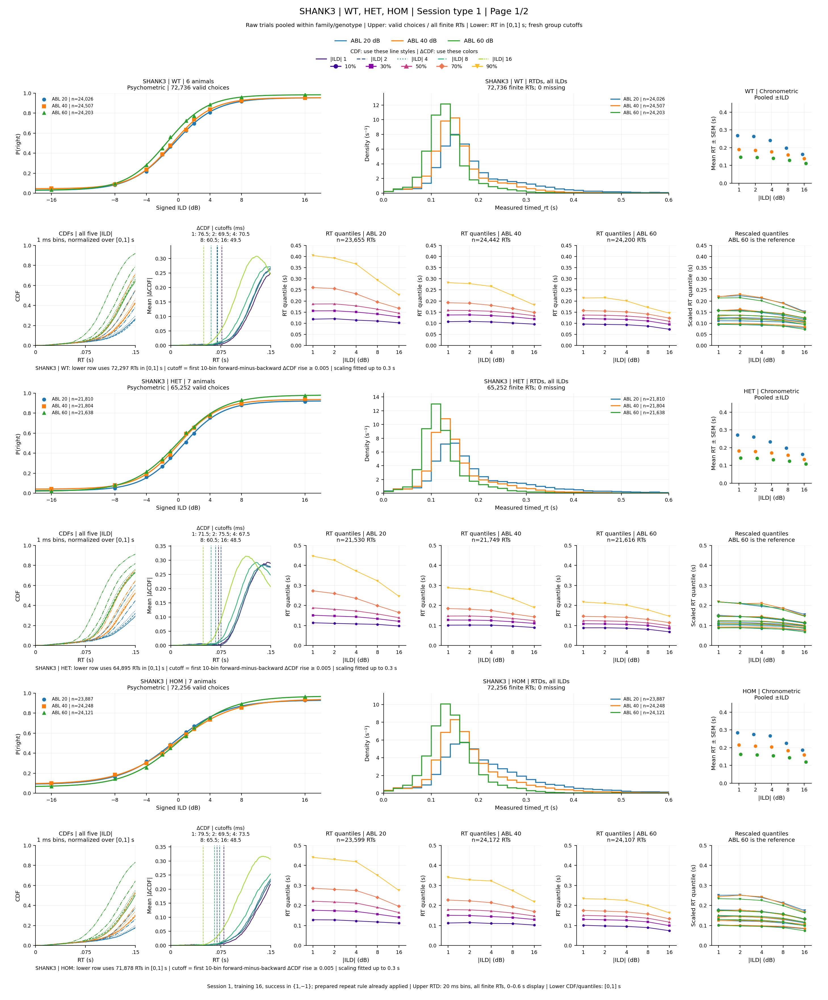
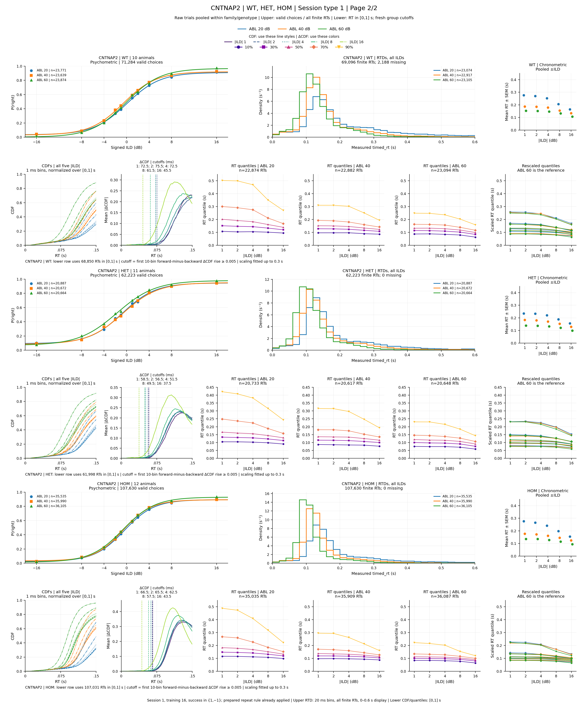

# Results — 2026-10-19

## Genotype-pooled psychometrics, RTDs, chronometrics, CDFs, and quantile scaling

[Download the two-page PDF](../assets/results/2026-10-19/ASD_session_type_1_family_genotype_psychometric_rtd_chronometric_scaling.pdf) ·
[Download the complete calculation/source audit ZIP](../assets/results/2026-10-19/ASD_family_genotype_psychometric_rt_quantile_audits.zip)

This adds a genotype-pooled counterpart to the [53-animal extended PDF](2026-10-15.md#all-53-animals-cdf-thresholds-and-quantile-scaling).
**SHANK3 and CNTNAP2 remain separate**. Cohorts, animals, and sessions are
combined within each family/genotype, using their actual eligible trials.
Every page contains WT, HET, and HOM in that order, each with two rows:
psychometric, RTD, and compact square chronometric above CDFs, ΔCDF/cutoffs,
three raw-quantile panels, and a rescaled-quantile overlay.

All calculations are newly obtained from the current, calibration-cleaned
CSV. The earlier animal PDF, its numerical audits, and the [October 17
JND/slope figures](2026-10-17.md) remain unchanged. Only the earlier panel
geometry and scientific calculation rules are reused.

### Page 1 — SHANK3: WT, HET, HOM

*SHANK3 cohorts 1 and 2 combined within genotype: WT 6 animals, HET 7, and
HOM 7. Upper row: valid-choice psychometrics with four-parameter fits;
20 ms RTD step curves normalized over all finite RTs and displayed from
0–0.6 s; arithmetic mean RT ± pooled-trial SEM versus |ILD|. Lower row:
condition-normalized 1 ms CDFs and mean absolute pairwise ΔCDF, marking the
five fresh cutoffs; empirical 10/30/50/70/90% RT quantiles separately at
ABL 20/40/60; Figure 1 rescaled quantile overlay. Only the lower row uses
RT in [0,1] seconds. Blue/orange/green identify ABL 20/40/60. Full row labels
and panel legends give contributing animals and relevant trial counts.*

[Full-size SHANK3 PNG](../assets/results/2026-10-19/ASD_family_genotype_cdf_quantile_scaling_page_01.png)

### Page 2 — CNTNAP2: WT, HET, HOM

*CNTNAP2 cohorts 3 and 4 combined within genotype: WT 10 animals, HET 11,
and HOM 12. Cohort 4 sessions below 13 remain excluded for speaker
calibration. The panels, colors, bins, pooling, and separate upper/lower RT
populations match the SHANK3 page. CNTNAP2 WT has 2,188 valid choices with
missing RT: these remain in the psychometric, while RT calculations use
only its 69,096 finite RTs. Chronometric panels preserve the compact
1.759-inch square shape and common 0–0.45 s y range.*

[Full-size CNTNAP2 PNG](../assets/results/2026-10-19/ASD_family_genotype_cdf_quantile_scaling_page_02.png)

### Selection, pooling, and counts

Read the current `asd_analysis/session_type_csvs/ASD_session_type_1.csv`:
**610,603 prepared rows, all 53 animals**, SHA-256
`db95fc66fc434c81832cb460ed5fe28857b1aa25c639b6a31fbb1859d2ba4408`.
Training level 16, the confirmed next-trial repeat rule with CNP/Fixation
exceptions, short-sound removal, and CNTNAP2 cohort 4 `session >= 13` are
already applied. Repeat eligibility is not derived or filtered again.

Select **`success in {1,-1}`**, ABL **20/40/60** after **59→60**, and signed
ILDs **±1/2/4/8/16 dB**. Include all 53 animals irrespective of JND eligibility.
Psychometrics have **no RT restriction**, including choices with missing RT.
RTDs and chronometrics use every finite recorded `timed_rt` in seconds;
CDFs and quantiles use only finite RTs in inclusive **[0,1] seconds**.

| Family | Genotype | Animals | Valid choices | Finite RTs | RTs in [0,1] s |
| --- | --- | ---: | ---: | ---: | ---: |
| SHANK3 | WT | 6 | 72,736 | 72,736 | 72,297 |
| SHANK3 | HET | 7 | 65,252 | 65,252 | 64,895 |
| SHANK3 | HOM | 7 | 72,256 | 72,256 | 71,878 |
| CNTNAP2 | WT | 10 | 71,284 | 69,096 | 68,850 |
| CNTNAP2 | HET | 11 | 62,223 | 62,223 | 61,998 |
| CNTNAP2 | HOM | 12 | 107,630 | 107,630 | 107,031 |
| **Total** | | **53** | **451,381** | **449,193** | **446,949** |

The choices comprise **231,263 right and 220,118 left**. There are **2,188
missing RTs** and **2,244 finite RTs above 1 second**. The RTD bins cover
**0–7.90 s**, including the largest observed RT of about 7.892 s. The 0–0.6 s
view is a display zoom; curves are not renormalized within that view.

**Pooling combines raw trials before computing every statistic.** Animals
with more eligible trials contribute more weight within each condition.
The genotype fit, CDF, thresholds, quantiles, and scaling factors are all
recalculated from those pooled data; animal curves, fitted parameters,
thresholds, and quantiles are not averaged. Signed ILDs remain separate for
psychometrics. Actual +ILD and −ILD trials are combined for each |ILD| in
the chronometric and lower row; the RTD combines all displayed ILDs per ABL.

### Calculations and visual conventions

- **Psychometric:** P(right) is `response_poke == 1` divided by all recorded
  right/left choices at each signed ILD. Each of the 18 family/genotype/ABL
  curves fits ten probability points with the existing unweighted
  `curve_fit` procedure: `lower + (upper-lower)/(1+exp(-k*(ILD-x0)))`, parameter
  order `[upper,lower,x0,k]`, initial `[max(P),min(P),median(ILD),0.1]`,
  asymptotes bounded to [0,1], unrestricted x0, nonnegative k, `maxfev=10000`.
  All 18 fits are increasing. A failed fit would retain its measured points
  and omit the fitted curve.
- **RTD:** 20 ms common bins; density is
  `bin_count / (finite_RT_count_for_this_group_and_ABL * 0.020)`.
  Every full-range curve integrates to 1. The curves are unfilled steps.
- **Chronometric:** arithmetic mean of pooled finite RTs. SEM is sample SD
  (`ddof=1`) divided by the square root of the pooled finite-trial count.
  It describes pooled-trial variability rather than between-animal means.
  Categories 1/2/4/8/16 have equal spacing; ABL offsets are −0.10/0/+0.10.
  Filled circular dots have SEM bars and no connecting lines. All 90
  mean ± SEM values fit inside the shared 0–0.45 s range.
- **CDF and threshold:** 1 ms bins on [0,1], normalized separately within
  each family/genotype/ABL/|ILD|. All 90 complete CDFs end at 1. The mean
  absolute pairwise difference is
  `D=(abs(F20-F40)+abs(F40-F60)+abs(F20-F60))/3`.
  Select the first bin i with
  `mean(D[i+1:i+11]) - mean(D[i-10:i]) >= 0.005`; the current bin is excluded,
  and the cutoff is its center. All **30 cutoffs** are available, ranging
  **37.5–79.5 ms**. Both CDF columns display 0–0.15 s. Cutoff lines appear
  only in the ΔCDF column, with all five times labeled in milliseconds.
- **Quantiles and rescaling:** use empirical linear interpolation. Raw
  panels show 10/30/50/70/90% quantiles with consistent quantile colors and
  markers, on logarithmically spaced |ILD| ticks. Fit scaling with fine
  1–99% quantiles, using ABL 60 as reference. For each genotype/|ILD|, retain
  reference quantiles from the new cutoff t0 through 0.3 s, set
  `x=Q60-t0`, `y=Q_ABL-Q60`, and calculate
  `m=sum(x*(y-y_first))/sum(x*x)`.
  For Q above t0, `Q_scaled=t0+(Q-t0)/(1+m)`; earlier quantiles stay unchanged.
  ABL 60 stays unchanged. All **60 scaling factors** are valid, ranging
  **1.28165–2.63176**. A missing cutoff or nonpositive factor would be
  recorded and affected scaled points omitted, with the raw plots retained.
  Four quantile panels share one complete y range within each genotype.

CDF line colors encode ABL and five line styles encode |ILD|. ΔCDF uses
five |ILD| colors; the overlay uses ABL colors and quantile marker shapes.
Each PDF page is **18.24 × 22 inches**, with three genotype blocks and six
PDF genotype bookmarks across the two pages. Matching PNGs are **2918 × 3520**.

### Sources, audits, and verification

Source: `asd_analysis/plot_family_genotype_psychometric_rtd_chronometric_scaling.py`.
Verifier: `asd_analysis/verify_family_genotype_psychometric_rtd_chronometric_scaling.py`.
Outputs: `asd_analysis/session_type_1_family_genotype_psychometric_rtd_chronometric_scaling/`.

[Plotting source](../assets/results/2026-10-19/plot_family_genotype_psychometric_rtd_chronometric_scaling.py) ·
[Independent verifier](../assets/results/2026-10-19/verify_family_genotype_psychometric_rtd_chronometric_scaling.py) ·
[Complete audit ZIP](../assets/results/2026-10-19/ASD_family_genotype_psychometric_rt_quantile_audits.zip)

[Group counts](../assets/results/2026-10-19/family_genotype_group_counts.csv) ·
[53-animal membership and contributions](../assets/results/2026-10-19/family_genotype_group_membership.csv) ·
[ABL counts](../assets/results/2026-10-19/family_genotype_abl_counts.csv) ·
[Psychometric points](../assets/results/2026-10-19/family_genotype_psychometric_points.csv) ·
[Psychometric fits/status](../assets/results/2026-10-19/family_genotype_psychometric_fits.csv) ·
[RTD bins](../assets/results/2026-10-19/family_genotype_rtd_histogram_bins.csv) ·
[Chronometric means, SDs, SEMs](../assets/results/2026-10-19/family_genotype_chronometric_points.csv) ·
[Lower-row condition counts](../assets/results/2026-10-19/family_genotype_condition_counts.csv)

[CDF bins](../assets/results/2026-10-19/family_genotype_histogram_cdf_bins.csv.gz) ·
[ΔCDF curves and window means](../assets/results/2026-10-19/family_genotype_delta_cdf_curves.csv.gz) ·
[Thresholds](../assets/results/2026-10-19/family_genotype_thresholds.csv) ·
[Raw quantiles](../assets/results/2026-10-19/family_genotype_raw_quantiles.csv) ·
[Fine quantiles](../assets/results/2026-10-19/family_genotype_fine_quantiles.csv.gz) ·
[Scaling-fit inputs](../assets/results/2026-10-19/family_genotype_scaling_fit_inputs.csv.gz) ·
[Scaling factors/status](../assets/results/2026-10-19/family_genotype_scaling_fits.csv) ·
[Scaled quantiles](../assets/results/2026-10-19/family_genotype_scaled_quantiles.csv)

[Panel layout](../assets/results/2026-10-19/family_genotype_panel_layout.csv) ·
[Plotted psychometric coordinates](../assets/results/2026-10-19/family_genotype_plotted_psychometric_points.csv) ·
[Plotted chronometric coordinates](../assets/results/2026-10-19/family_genotype_plotted_chronometric_points.csv) ·
[Plotted threshold coordinates](../assets/results/2026-10-19/family_genotype_plotted_thresholds.csv) ·
[Validation manifest](../assets/results/2026-10-19/family_genotype_validation.json) ·
[Independent validation](../assets/results/2026-10-19/family_genotype_independent_validation.json)

Independent verification parses the current CSV, reconstructs signed and
absolute-ILD trial pools, refits all 18 psychometrics, checks every RTD bin
and its unit area, and independently calculates all 90 means/SEMs. It
checks all **90,000 CDF bins**, **30,000 ΔCDF bins**, **30 first-onset cutoffs**,
**450 displayed raw quantiles**, **8,910 fine quantiles**, **60 scaling fits**,
and **450 transformed values**, including signed-trial and session pooling.
Synthetic checks exercise missing-onset, insufficient-fit-point, and
invalid-factor handling. Saved-PDF checks locate all **180 psychometric
points**, **90 chronometric dots and SEM bars**, and **30 cutoff lines**, and
verify page count, six bookmarks, colors, full limits, and compact square
chronometric panels. Both pages were visually inspected. Inputs and prior
figure exports remain unchanged by hash. Direct image embeds, downloads,
navigation, and the strict MkDocs build are verified during publication.
## Genotype RTD overlays: ABLs and ILDs pooled within each family

![Valid choices only (success 1 or -1), finite timed_rt in inclusive [0,1] seconds. SHANK3 and CNTNAP2 remain separate; WT blue, HOM green, HET orange. Raw trials pooled across all displayed ABLs and signed ILDs; 20 ms bins and area 1 per curve.](../assets/results/2026-10-19/ASD_session_type_1_family_genotype_ABL_ILD_pooled_rtds.png)

*Valid choices only (success 1 or -1), finite timed_rt in inclusive [0,1] seconds. SHANK3 and CNTNAP2 remain separate; WT blue, HOM green, HET orange. Raw trials pooled across all displayed ABLs and signed ILDs; 20 ms bins and area 1 per curve.*

Source: `asd_analysis/plot_session_type_1_genotype_overlaid_rtds.py`
Figure: `docs/assets/results/2026-10-19/ASD_session_type_1_family_genotype_ABL_ILD_pooled_rtds.png`

[Full-size PNG](../assets/results/2026-10-19/ASD_session_type_1_family_genotype_ABL_ILD_pooled_rtds.png) ·
[Plotting source](../assets/results/2026-10-19/plot_session_type_1_genotype_overlaid_rtds.py) ·
[Curve counts](../assets/results/2026-10-19/genotype_overlay_rtd_curve_counts.csv) ·
[Membership](../assets/results/2026-10-19/genotype_overlay_rtd_group_membership.csv) ·
[Histogram bins](../assets/results/2026-10-19/genotype_overlay_rtd_histogram_bins.csv) ·
[Validation](../assets/results/2026-10-19/genotype_overlay_rtd_validation.json)

This uses the same current, calibration-cleaned session-type-1 selection as
the family/genotype PDF above: training level 16, confirmed prepared repeat
and short-sound rules, and CNTNAP2 cohort 4 sessions below 13 excluded.
Retain **`success in {1,-1}`**, ABL **20/40/60** after **59→60**, and signed ILDs
**±1/2/4/8/16**, pooling all these stimulus conditions within each genotype.
For this figure, retain finite recorded **`timed_rt` in inclusive [0,1] s**.
All **53 animals contribute 446,949 window trials** across the six curves.

| Genotype | SHANK3: animals / RTs | CNTNAP2: animals / RTs |
| --- | ---: | ---: |
| WT — blue | 6 / 72,297 | 10 / 68,850 |
| HOM — green | 7 / 71,878 | 12 / 107,031 |
| HET — orange | 7 / 64,895 | 11 / 61,998 |

Each curve pools raw trials across ABL, signed ILD, sessions, animals, and
cohorts within its family/genotype. Trial counts determine contributions;
animal densities are not averaged. Density is
`bin_count / (curve_RT_count_in_[0,1] * 0.020 s)`, with **50 bins of 20 ms**
and **area 1 for every curve**. Both axes display the full 0–1 s window and
share one y-scale. Colors identify genotype; ABL is pooled.

Every one of the **300 histogram counts** was independently reconstructed
from the source CSV and also matched the existing pooled 1 ms CDF audits
summed into 20 ms bins across all ABL/|ILD| conditions. Sample counts and
memberships agree with the preceding family/genotype analysis. The
2800 × 1080 PNG was visually inspected; inputs and prior family/genotype
exports remain unchanged by hash.
