# Results — 2026-10-20

## Human RT-only TIED: 0–1.8 s trials and a 0–300 ms delay prior

**Selection:** `Condition == "RT"` and `0 <= RT_s <= 1.8`. Pool raw trials across participants and sessions within each group; keep correct and incorrect trials. Observed response side is ignored in fitting. SD and sequential CB are excluded.

| Group | Participants | All RT trials | Retained 0–1.8 s | Excluded >1.8 s |
|---|---:|---:|---:|---:|
| Control | 11 | 6,600 | 6,574 | 26 |
| ASD | 8 | 4,800 | 4,770 | 30 |

**All four RTs below 200 ms are retained.** The user rounded the pooled 99.5th percentile (1.792625 s) to **1.8 s**. This selection keeps 11,344 trials and excludes 56, rather than the 57 excluded by the exact percentile. Relative to the preceding 250-ms-prior analysis, the retained window changes from 0.25–1.5 to 0–1.8 s, adding eight responses below 250 ms and 109 responses between 1.5 and 1.8 s. Recorded RTs are not shifted.

### Requested prior and causal support

The fitted model uses **`t_E_aff ~ Uniform(0, 0.300 s)`**. The other four priors remain LogNormal(log(.2), 1.5) for `rate_lambda`, LogNormal(log(.001), 2) for `T_0` (seconds), LogNormal(log(30), 1.5) for `theta_E`, and Uniform(.05,.95) for `w`. LogNormal arguments use natural logarithms; the three positive parameters have no finite upper hard bound.

The likelihood is zero for a delay at or above any retained RT. The earliest retained RT is **111.1898 ms Control** and **181.6110 ms ASD**. These are data-imposed posterior support limits, distinct from the requested 300 ms prior ceiling and the RT data cutoff.

For numerical SVI, a separate guide-only prototype gives AutoMultivariateNormal a delay transform confined to the positive-likelihood interval. The actual SVI model still evaluates the Uniform(0,.300) prior with its original density. The prototype’s prior is used only to construct the guide transform. Independent checks verify the model/prototype log-density difference is exactly log(causal_upper/.300) at valid parameters, and that noncausal delays have zero likelihood despite lying inside the requested prior. No extra RTs are discarded to enlarge delay support.

### Five shared parameters and RT-only likelihood

Each group has five parameters shared across both ASLs and all ten signed differences: `rate_lambda`, `T_0`, `theta_E`, `w`, `t_E_aff`. Use the unchanged IPL/vanilla density and CDF primitives with `B = Mean_dB` and `D = Delta_dB` (right minus left). ASL plot labels are 20/40 cd/m²; model brightness coordinates are ≈10.892/15.089 visual dB.

```text
gamma = theta_E * tanh(rate_lambda * D / 17.37)
omega = 10**(rate_lambda * B / 20) * cosh(rate_lambda * D / 17.37) / (T_0 * theta_E**2)
Z_E = (w - 0.5) * 2 * theta_E
first-passage time = RT_s - t_E_aff
p(RT | B,D,retained) = [rho_right(RT) + rho_left(RT)] / Z(B,D)
Z(B,D) = F_right(1.8) + F_left(1.8) - F_right(0) - F_left(0)
```

This fits the trial-level RT likelihood conditional on stimulus and retention, marginalizing response side. No histogram-error or psychometric objective is fitted.

### Data and mean-parameter fit curves

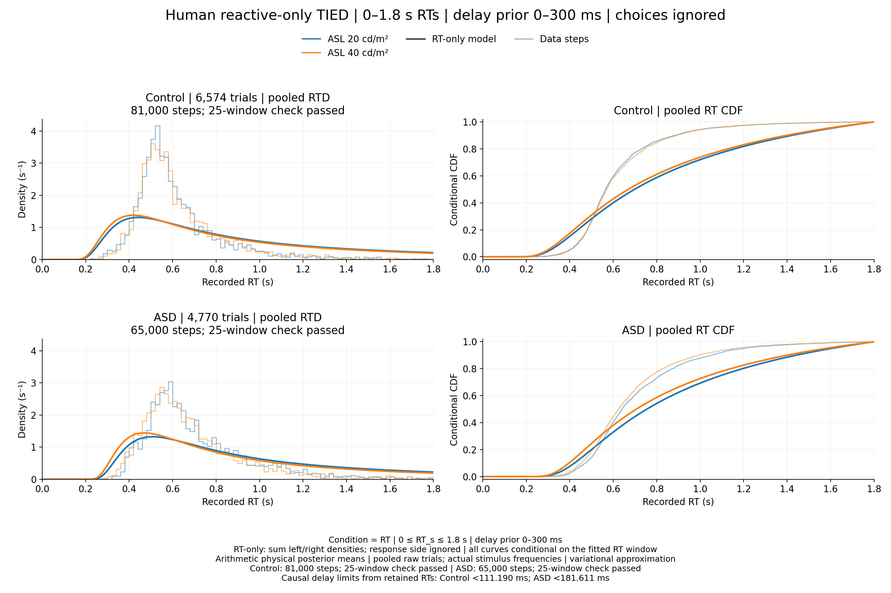

*Control above ASD; pooled RTD left and CDF right. Blue/orange denote ASL 20/40 cd/m². Steps show data; solid curves evaluate the model at arithmetic posterior means of the five physical parameters. Sum both response bounds and mix signed conditions using actual retained trial counts. Both data and predictions are conditional on 0–1.8 s. RTD bins are 20 ms; the model grid is 1 ms. Each panel retains its group’s recorded early RTs.*

[Full-size PNG](../assets/results/2026-10-20/human_tied_RT_only_delay300ms/human_RT_only_rtd_cdf_comparison_full_0_1p8s.png) · [PDF](../assets/results/2026-10-20/human_tied_RT_only_delay300ms/human_RT_only_rtd_cdf_comparison_full_0_1p8s.pdf) · [0–1.5 s display zoom](../assets/results/2026-10-20/human_tied_RT_only_delay300ms/human_RT_only_rtd_cdf_comparison_zoom_0_1p5s.png)

**Visual assessment:** At arithmetic physical posterior means, both model RTDs remain substantially broader than the data, with peaks that are too low and tails too heavy. The delay means are 102.04 ms Control and 170.65 ms ASD; neither posterior is near the requested 300-ms ceiling. The retained earliest RTs impose separate causal limits. Both groups pass the specified post-minimum and terminal-stability checks; movement at the selected minimum remains a diagnostic.

| Group | RT log likelihood at physical means | Mean condition CDF gap | Largest condition CDF gap |
|---|---:|---:|---:|
| Control | 358.431 | 0.327775 | 0.423724 |
| ASD | 185.053 | 0.255719 | 0.327416 |

The likelihood weights individual trials equally. The mean CDF gap is an equal-weight average over the 20 ASL × signed-difference cells. Pooled curves use actual retained stimulus frequencies. These scores use the current selection and are not directly comparable with training scores from the earlier truncated datasets.

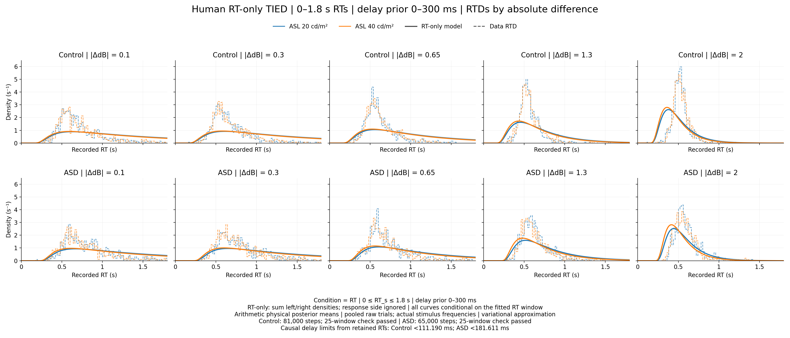

*Control above ASD; columns |ΔdB| = 0.1, 0.3, 0.65, 1.3, 2. Blue/orange identify ASL 20/40 cd/m². Dashed steps show empirical RTDs; solid lines show the model at the physical posterior means. Pool ±ΔdB with their actual retained frequencies. Full and zoomed views retain 0–1.8 s normalization, with common axes including all peaks.*

[Full-size PNG](../assets/results/2026-10-20/human_tied_RT_only_delay300ms/human_RT_only_rtd_by_delta_full_0_1p8s.png) · [PDF](../assets/results/2026-10-20/human_tied_RT_only_delay300ms/human_RT_only_rtd_by_delta_full_0_1p8s.pdf) · [0–1.5 s display zoom](../assets/results/2026-10-20/human_tied_RT_only_delay300ms/human_RT_only_rtd_by_delta_zoom_0_1p5s.png)

### Posterior parameters

| Group | Parameter | Mean | SD | Central 95% interval |
|---|---|---:|---:|---|
| Control | rate_lambda | 0.133155 | 0.019732 | [0.098577, 0.17509] |
| Control | T_0 (ms) | 0.0282623 | 0.0091799 | [0.01435, 0.049918] |
| Control | theta_E | 256.757 | 37.641 | [191.6, 339.7] |
| Control | w | 0.504394 | 0.0051354 | [0.49414, 0.51463] |
| Control | t_E_aff (ms) | 102.035 | 1.2059 | [99.427, 104.16] |
| ASD | rate_lambda | 0.231903 | 0.032616 | [0.1744, 0.30091] |
| ASD | T_0 (ms) | 0.107497 | 0.03527 | [0.05405, 0.19116] |
| ASD | theta_E | 136.045 | 19.157 | [102.74, 178.16] |
| ASD | w | 0.509886 | 0.0064771 | [0.49697, 0.52282] |
| ASD | t_E_aff (ms) | 170.65 | 1.6992 | [166.91, 173.58] |

These are **variational approximations** from 10,000 constrained draws per group. Pooled-trial posterior uncertainty does not represent participant-to-participant variability. The plots use arithmetic physical means rather than posterior-averaged predictions.

| Group | Causal delay limit (ms) | Draws within 1 ms of causal limit | Draws >299 ms |
|---|---:|---:|---:|
| Control | 111.18980 | 0.00% | 0.00% |
| ASD | 181.61100 | 0.00% | 0.00% |

| Group | Parameter pair | Posterior correlation |
|---|---|---:|
| Control | T_0, rate_lambda | +0.9641 |
| Control | theta_E, T_0 | -0.9309 |
| Control | theta_E, rate_lambda | -0.9039 |
| ASD | T_0, rate_lambda | +0.9512 |
| ASD | theta_E, T_0 | -0.9216 |
| ASD | theta_E, rate_lambda | -0.8665 |

### Initialization and stopping checks

One warm start per group uses the confirmed earlier joint fit `ASD_Human_Data/reactive_tied_rt_svi_rt_le_1p5s/`, which retained the same earliest responses. Later 200/250-ms RT-only fits have incompatible delay starting values. Map the delay’s latent center and local covariance to the causal guide interval, preserving its physical starting center. Reset Adam, RNG (seed 0), losses and patience for the new objective. CPU float64; full-batch AutoMultivariateNormal; one ELBO particle; ClippedAdam learning rate .0002, clip 1; minimum 50k and maximum 1M new updates.

**Stopping correction:** the earlier scripts additionally required backward-looking stability at the selected minimum itself. That extra gate can prevent stopping even after many post-minimum windows. This run follows the original requested rule: every lower 1,000-step mean loss resets patience; require at least 25 subsequent windows and terminal mean stability below 0.1 posterior SD over three checkpoints, then restore the minimum. The selected checkpoint’s own movement is recorded as a diagnostic. The Control optimizer/RNG/checkpoint trajectory was preserved when applying this correction; no additional statistical initialization was introduced. Earlier runs and their reported stopping rules are preserved.

**Checkpoint repair:** the interrupted original Control worker continued writing after the resumed fit stopped. That leftover worker was terminated, and its extra iterations were archived. The original saved initialization and RNG trajectory were replayed through the accepted stop. Every loss and checkpoint mean was checked, all 10,000 posterior draws were reproduced, and the best/latest checkpoints were restored. The accepted posterior and guide files are byte-identical to their pre-repair values. The repair record and archived traces are included in the audit bundle.

| Group | Selected best | Final checked | Later windows | Terminal stable | Selected checkpoint stable (diagnostic) | Status |
|---|---:|---:|---:|---|---|---|
| Control | 40,000 | 81,000 | 41 | True | False | Required checks passed |
| ASD | 40,000 | 65,000 | 25 | True | False | Required checks passed |

Passing these observed-window checks does not establish a global optimum or unique parameter estimates. Strong parameter correlations are shown above.

[Control corner](../assets/results/2026-10-20/human_tied_RT_only_delay300ms/control/parameter_corner.png) · [ASD corner](../assets/results/2026-10-20/human_tied_RT_only_delay300ms/asd/parameter_corner.png) · [Control convergence](../assets/results/2026-10-20/human_tied_RT_only_delay300ms/control/convergence.png) · [ASD convergence](../assets/results/2026-10-20/human_tied_RT_only_delay300ms/asd/convergence.png)

### Sources and audits

Fit root: `ASD_Human_Data/reactive_tied_rt_only_svi_0_1p8s_delay300ms/`.

[Configuration](../assets/results/2026-10-20/human_tied_RT_only_delay300ms/run_config.json) · [Protocol](../assets/results/2026-10-20/human_tied_RT_only_delay300ms/analysis_protocol.json) · [Prior/guide preflight](../assets/results/2026-10-20/human_tied_RT_only_delay300ms/prior_guide_preflight.json) · [Stopping correction](../assets/results/2026-10-20/human_tied_RT_only_delay300ms/stopping_rule_correction.json) · [Checkpoint repair](../assets/results/2026-10-20/human_tied_RT_only_delay300ms/checkpoint_repair.json) · [Selection counts](../assets/results/2026-10-20/human_tied_RT_only_delay300ms/selection_counts.csv) · [Excluded rows](../assets/results/2026-10-20/human_tied_RT_only_delay300ms/excluded_trials.csv) · [Participant counts](../assets/results/2026-10-20/human_tied_RT_only_delay300ms/participant_selection_counts.csv) · [Condition counts](../assets/results/2026-10-20/human_tied_RT_only_delay300ms/condition_selection_counts.csv) · [RT fit metrics](../assets/results/2026-10-20/human_tied_RT_only_delay300ms/RT_fit_quality.csv) · [Posterior summaries](../assets/results/2026-10-20/human_tied_RT_only_delay300ms/parameter_summary.csv) · [Delay support diagnostics](../assets/results/2026-10-20/human_tied_RT_only_delay300ms/delay_boundary_diagnostics.csv) · [Independent verification](../assets/results/2026-10-20/human_tied_RT_only_delay300ms/independent_validation.json) · [Full posterior/source/audit ZIP](../assets/results/2026-10-20/human_tied_RT_only_delay300ms/human_RT_only_delay300ms_audits.zip)

- `ASD_Human_Data/human_reactive_tied_rt_only_utils.py` ([source](../assets/results/2026-10-20/human_tied_RT_only_delay300ms/source/human_reactive_tied_rt_only_utils.py)).
- `ASD_Human_Data/human_reactive_tied_rt_only_support_utils.py` ([source](../assets/results/2026-10-20/human_tied_RT_only_delay300ms/source/human_reactive_tied_rt_only_support_utils.py)).
- `ASD_Human_Data/fit_human_reactive_tied_rt_only_delay300_svi.py` ([source](../assets/results/2026-10-20/human_tied_RT_only_delay300ms/source/fit_human_reactive_tied_rt_only_delay300_svi.py)).
- `ASD_Human_Data/plot_human_reactive_tied_rt_only_delay300_svi.py` ([source](../assets/results/2026-10-20/human_tied_RT_only_delay300ms/source/plot_human_reactive_tied_rt_only_delay300_svi.py)).
- `ASD_Human_Data/verify_human_reactive_tied_rt_only_delay300_svi.py` ([source](../assets/results/2026-10-20/human_tied_RT_only_delay300ms/source/verify_human_reactive_tied_rt_only_delay300_svi.py)).
- `ASD_Human_Data/publish_human_reactive_tied_rt_only_delay300_svi.py` ([source](../assets/results/2026-10-20/human_tied_RT_only_delay300ms/source/publish_human_reactive_tied_rt_only_delay300_svi.py)).
- `ASD_Human_Data/human_tied_independent_fpt.py` ([source](../assets/results/2026-10-20/human_tied_RT_only_delay300ms/source/human_tied_independent_fpt.py)).
- `ASD_Human_Data/human_reactive_tied_svi_utils.py` ([source](../assets/results/2026-10-20/human_tied_RT_only_delay300ms/source/human_reactive_tied_svi_utils.py)).

Independent checks verified all 11,344 retained and 56 excluded source identities, all four sub-200-ms responses, the actual 300-ms prior and causal guide supports, prior normalization, five free parameters, response-label invariance, finite gradients, K=40/80 series convergence, independent SciPy density/CDF agreement, conditional unit mass, posterior summaries, warm-start mapping, and every patience reset. Reconstructed 40 condition CDF comparisons, 2160 histogram bins and 80 mixture weights. Earlier fit/figure files were hash checked, prior documentation preserved, PNGs visually inspected, and PDF text bounds checked.


---

## Human RT-only TIED: 250 ms delay bound and 0.25–1.5 s trials

**Question:** does allowing a shared delay up to 250 ms improve the reactive model’s RT-distribution fit, with observed choices still ignored?

**Selection:** `Condition == "RT"` and `0.25 <= RT_s <= 1.5`. Pool raw trials across participants and sessions within each group. Retain correct and incorrect responses; observed response side does not enter the objective. SD and sequential CB are excluded.

| Group | Participants | Previous 0.2–1.5 s fit | New 0.25–1.5 s fit | Additional removals |
|---|---:|---:|---:|---:|
| Control | 11 | 6,528 | 6,524 | 4 |
| ASD | 8 | 4,703 | 4,703 | 0 |

The user approved the 250 ms cap after reviewing the current parameter means and the selection issue. Four additional Control responses (Participant 36, source rows 6418/6492/6987/6992; 226–243 ms) are excluded so that the full delay range is available. Relative to all 11,400 RT trials, 8 responses below 250 ms and 165 above 1.5 s are excluded. The fastest retained responses are 257.898 ms Control and 277.840 ms ASD. Recorded RTs are not shifted or imputed.

**Two changes from the previous RT-only fit:** the delay prior rises from 0–200 to 0–250 ms, and the retained lower RT increases from 200 to 250 ms. Comparisons below evaluate both saved parameter sets on the same new rows and with the same **0.25–1.5 s conditional normalization**.

### Model and RT-only objective

Keep exactly five free parameters shared across both ASLs and all ten signed differences within each group: `rate_lambda`, `T_0`, `theta_E`, `w`, `t_E_aff`. Use the unchanged vanilla/IPL TIED first-passage primitives. `B = Mean_dB` (≈10.892/15.089 visual dB), `D = Delta_dB` (right minus left); retain ASL 20/40 cd/m² as plot labels.

```text
gamma = theta_E * tanh(rate_lambda * D / 17.37)
omega = 10**(rate_lambda * B / 20) * cosh(rate_lambda * D / 17.37) / (T_0 * theta_E**2)
Z_E = (w - 0.5) * 2 * theta_E
first-passage time = RT_s - t_E_aff
p(RT | B,D,retained) = [rho_right(RT) + rho_left(RT)] / Z(B,D)
Z(B,D) = F_right(1.5) + F_left(1.5) - F_right(0.25) - F_left(0.25)
```

This is a trial-level RT likelihood conditional on the stimulus and retained window. Summing both response densities ignores observed choice; the objective does not fit histogram heights or psychometric probabilities.

| Parameter | Prior | Hard support |
|---|---|---|
| `rate_lambda` | LogNormal(log(0.2), 1.5) | >0; no finite upper bound |
| `T_0` (s) | LogNormal(log(0.001), 2) | >0; no finite upper bound |
| `theta_E` | LogNormal(log(30), 1.5) | >0; no finite upper bound |
| `w` | Uniform(0.05, 0.95) | 0.05–0.95 |
| `t_E_aff` (s) | Uniform(0, 0.250) | 0–250 ms |

LogNormal arguments use natural logarithms. All priors except the delay cap are unchanged.

### RTDs and CDFs

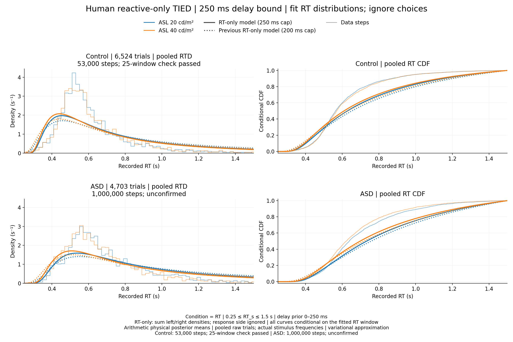

*Control above ASD; pooled RTD left and CDF right. Blue/orange denote ASL 20/40 cd/m². Solid curves use the new 250-ms-cap fit’s arithmetic physical posterior means; dotted curves use the previous 200-ms-cap RT-only means, recomputed with the new retention window. Thin steps show data. Signed conditions are mixed with their actual retained trial frequencies. Histograms use 20 ms bins with a final 10 ms bin from 1.49 to 1.5 s. Choices are not fitted.*

[Full-size PNG](../assets/results/2026-10-20/human_tied_RT_only_delay250ms/human_RT_only_rtd_cdf_comparison_full_0p25_1p5s.png) · [PDF](../assets/results/2026-10-20/human_tied_RT_only_delay250ms/human_RT_only_rtd_cdf_comparison_full_0p25_1p5s.pdf) · [0.25–1 s zoom](../assets/results/2026-10-20/human_tied_RT_only_delay250ms/human_RT_only_rtd_cdf_comparison_zoom_0p25_1s.png)

| Group | Common RT metric | Previous 200 ms cap | New 250 ms cap | Change |
|---|---|---:|---:|---:|
| Control | RT log likelihood (higher better) | 1761.51 | 2045.85 | +284.337 |
| Control | Mean signed-condition CDF gap | 0.260303 | 0.215502 | -0.0448012 |
| Control | Largest signed-condition CDF gap | 0.356754 | 0.307624 | -0.0491303 |
| ASD | RT log likelihood (higher better) | 742.836 | 945.342 | +202.506 |
| ASD | Mean signed-condition CDF gap | 0.237761 | 0.202302 | -0.0354588 |
| ASD | Largest signed-condition CDF gap | 0.330071 | 0.294057 | -0.0360141 |

The mean CDF gap weights each of the 20 ASL × signed-difference cells equally. The likelihood weights individual trials equally; pooled curves use actual trial frequencies. All model curves and scores use arithmetic means of the five physical parameters, rather than averaging predictions over the posterior.

**Visual assessment:** The 250-ms-cap curves improve common-window likelihoods and condition-wise CDF gaps in both groups, but their peaks remain too low and tails too heavy. Control passes the specified window/local-stability checks. ASD reaches the 1,000,000-step cap and remains provisional; its delay posterior is concentrated close to 250 ms.

### RTDs by absolute difference

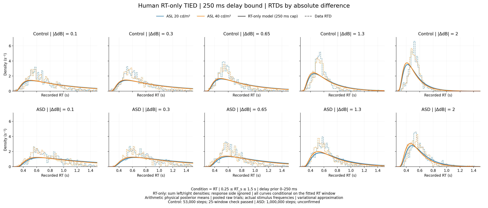

*Control above ASD; columns |ΔdB| = 0.1, 0.3, 0.65, 1.3, 2. Dashed steps are empirical RTDs; solid curves are the 250-ms-cap model at the physical posterior means on a 1 ms grid. Blue/orange identify ASL 20/40 cd/m². Pool ±ΔdB using actual retained counts. The zoom retains the full 0.25–1.5 s normalization. Matching axes include all peaks.*

[Full-size PNG](../assets/results/2026-10-20/human_tied_RT_only_delay250ms/human_RT_only_rtd_by_delta_full_0p25_1p5s.png) · [PDF](../assets/results/2026-10-20/human_tied_RT_only_delay250ms/human_RT_only_rtd_by_delta_full_0p25_1p5s.pdf) · [0.25–1 s zoom](../assets/results/2026-10-20/human_tied_RT_only_delay250ms/human_RT_only_rtd_by_delta_zoom_0p25_1s.png)

### Posterior parameters and delay boundary

| Group | Parameter | Mean | SD | Central 95% interval |
|---|---|---:|---:|---|
| Control | rate_lambda | 0.125268 | 0.0208 | [0.089349, 0.16993] |
| Control | T_0 (ms) | 0.0234064 | 0.0084722 | [0.010975, 0.043694] |
| Control | theta_E | 204.283 | 33.769 | [146.64, 279.25] |
| Control | w | 0.495921 | 0.0089388 | [0.47814, 0.51371] |
| Control | t_E_aff (ms) | 245.387 | 1.9736 | [240.53, 248.12] |
| ASD | rate_lambda | 0.212773 | 0.046006 | [0.13659, 0.31427] |
| ASD | T_0 (ms) | 0.0873242 | 0.045342 | [0.029479, 0.2014] |
| ASD | theta_E | 134.13 | 29.073 | [86.366, 200.6] |
| ASD | w | 0.503766 | 0.0067343 | [0.49038, 0.51722] |
| ASD | t_E_aff (ms) | 249.461 | 0.89285 | [247.28, 249.97] |

| Group | Delay draws >249 ms | Delay draws >245 ms |
|---|---:|---:|
| Control | 0.01% | 65.57% |
| ASD | 86.85% | 99.28% |

These are **variational approximations**, using 10,000 constrained draws per group. Uncertainty from pooled trials does not represent participant-to-participant variability. A delay posterior near 250 ms remains sensitive to the imposed cap.

| Group | Parameter pair | Posterior correlation |
|---|---|---:|
| Control | T_0, rate_lambda | +0.9629 |
| Control | theta_E, T_0 | -0.9215 |
| Control | theta_E, rate_lambda | -0.9061 |
| ASD | T_0, rate_lambda | +0.9572 |
| ASD | theta_E, rate_lambda | -0.8990 |
| ASD | theta_E, T_0 | -0.8710 |

### Optimization and confirmation

One warm start per group transfers the saved 200-ms RT-only full-rank guide, mapping the delay’s latent center and local covariance to 0–250 ms while preserving its physical center. Reset Adam, RNG (seed 0), losses and patience. CPU float64; AutoMultivariateNormal; full batches; one ELBO particle; ClippedAdam rate 0.0002, clip 1. Minimum 50,000 and maximum 1,000,000 new updates.

Every lower 1,000-step mean loss resets patience. Require at least 25 later windows and both terminal and selected-checkpoint local mean stability (<0.1 posterior SD over three checkpoints). Restore the selected checkpoint. These checks do not establish global optimality or unique parameter estimates.

| Group | Selected best step | Final checked step | Later windows | Status |
|---|---:|---:|---:|---|
| Control | 27,000 | 53,000 | 26 | Window and local-stability checks passed |
| ASD | 40,000 | 1,000,000 | 960 | **flagged / unconfirmed** |

**ASD remains provisional after 1,000,000 updates.**
Selected checkpoint at step 40,000: the largest three-checkpoint mean change was 0.1156 posterior SD in `w`, above the 0.1 criterion. The number of post-minimum windows and this parameter-stability test are separate requirements.
Terminal checkpoint at step 1,000,000: the largest three-checkpoint mean change was 0.1298 posterior SD in `w`, above the 0.1 criterion. The number of post-minimum windows and this parameter-stability test are separate requirements.

[Control corner](../assets/results/2026-10-20/human_tied_RT_only_delay250ms/control/parameter_corner.png) · [ASD corner](../assets/results/2026-10-20/human_tied_RT_only_delay250ms/asd/parameter_corner.png) · [Control convergence](../assets/results/2026-10-20/human_tied_RT_only_delay250ms/control/convergence.png) · [ASD convergence](../assets/results/2026-10-20/human_tied_RT_only_delay250ms/asd/convergence.png)

### Sources and independent verification

Fit root: `ASD_Human_Data/reactive_tied_rt_only_svi_0p25_1p5s_delay250ms/`. Previous RT-only fit: `ASD_Human_Data/reactive_tied_rt_only_svi_0p2_1p5s_delay200ms/`.

[Protocol](../assets/results/2026-10-20/human_tied_RT_only_delay250ms/analysis_protocol.json) · [Configuration](../assets/results/2026-10-20/human_tied_RT_only_delay250ms/run_config.json) · [Selection counts](../assets/results/2026-10-20/human_tied_RT_only_delay250ms/selection_counts.csv) · [Excluded rows](../assets/results/2026-10-20/human_tied_RT_only_delay250ms/excluded_trials.csv) · [Participant counts](../assets/results/2026-10-20/human_tied_RT_only_delay250ms/participant_selection_counts.csv) · [Condition counts](../assets/results/2026-10-20/human_tied_RT_only_delay250ms/condition_selection_counts.csv) · [Common-window metrics](../assets/results/2026-10-20/human_tied_RT_only_delay250ms/common_RT_fit_quality.csv) · [Posterior summaries](../assets/results/2026-10-20/human_tied_RT_only_delay250ms/parameter_summary.csv) · [Delay-boundary diagnostics](../assets/results/2026-10-20/human_tied_RT_only_delay250ms/delay_boundary_diagnostics.csv) · [Independent validation](../assets/results/2026-10-20/human_tied_RT_only_delay250ms/independent_validation.json) · [Full posterior/source/audit ZIP](../assets/results/2026-10-20/human_tied_RT_only_delay250ms/human_RT_only_delay250ms_audits.zip)

- `ASD_Human_Data/human_reactive_tied_rt_only_utils.py` ([source](../assets/results/2026-10-20/human_tied_RT_only_delay250ms/source/human_reactive_tied_rt_only_utils.py)).
- `ASD_Human_Data/fit_human_reactive_tied_rt_only_svi.py` ([source](../assets/results/2026-10-20/human_tied_RT_only_delay250ms/source/fit_human_reactive_tied_rt_only_svi.py)).
- `ASD_Human_Data/plot_human_reactive_tied_rt_only_delay250_svi.py` ([source](../assets/results/2026-10-20/human_tied_RT_only_delay250ms/source/plot_human_reactive_tied_rt_only_delay250_svi.py)).
- `ASD_Human_Data/verify_human_reactive_tied_rt_only_delay250_svi.py` ([source](../assets/results/2026-10-20/human_tied_RT_only_delay250ms/source/verify_human_reactive_tied_rt_only_delay250_svi.py)).
- `ASD_Human_Data/publish_human_reactive_tied_rt_only_delay250_svi.py` ([source](../assets/results/2026-10-20/human_tied_RT_only_delay250ms/source/publish_human_reactive_tied_rt_only_delay250_svi.py)).
- `ASD_Human_Data/human_tied_independent_fpt.py` ([source](../assets/results/2026-10-20/human_tied_RT_only_delay250ms/source/human_tied_independent_fpt.py)).
- `ASD_Human_Data/human_reactive_tied_svi_utils.py` ([source](../assets/results/2026-10-20/human_tied_RT_only_delay250ms/source/human_reactive_tied_svi_utils.py)).

Independent checks verified all 11,227 retained and 173 excluded source identities, the newly removed four Control rows, choice-label invariance, exactly five free parameters, the 250 ms support, posterior summaries/covariances, warm-start mapping, strict patience resets, finite gradients, K=40/80 convergence, independent SciPy PDF/CDF agreement, and unit conditional mass. Reconstructed 80 condition CDF comparisons, 1512 histogram bins and 160 mixture weights. Earlier fit/figure files were hash checked, prior documentation preserved, PNGs visually inspected, and PDF text bounds checked.


---

## Human RT-only TIED: 200 ms delay bound and 0.2–1.5 s trials

**Question:** can the reactive model match RT distributions when observed choices are ignored and the shared nondecision delay may reach 200 ms?

**Outcome:** Control's average condition-wise CDF gap changes from 0.292 to 0.260; ASD's changes from 0.220 to 0.238. At arithmetic physical posterior means, a substantial RTD shape mismatch remains. The delay posteriors are close to the requested 200 ms cap. 

**Selection:** `Condition == "RT"` and `0.2 <= RT_s <= 1.5`. Pool raw trials across participants and sessions, including correct and incorrect choices. **Observed response side does not enter the fit.** SD and sequential CB are excluded.

| Group | Participants | All RT trials | Prior ≤1.5 s analysis | New 0.2–1.5 s analysis |
|---|---:|---:|---:|---:|
| Control | 11 | 6,600 | 6,531 | 6,528 |
| ASD | 8 | 4,800 | 4,704 | 4,703 |

The user approved removing **four responses below 200 ms** (3 Control, 1 ASD) in addition to the 165 responses above 1.5 s already removed. Those early trials otherwise force a causal shared delay below 111/182 ms despite a wider prior. The fastest retained responses are 226.246 ms Control and 277.840 ms ASD; both groups now use **`t_E_aff ~ Uniform(0, 0.200 s)`**. There is no imputation or change to recorded RTs.

### RT-only objective and model

For each trial, retain its `Mean_dB` brightness and signed `Delta_dB` stimulus coordinates, and marginalize the unobserved response side by adding the existing left/right first-passage densities. This is a trial-level RT likelihood, conditional on the stimulus and retained RT window. It does not fit a histogram-error score.

```text
p(RT | B,D,retained) = [rho_right(RT) + rho_left(RT)] / Z(B,D)
Z(B,D) = F_right(1.5) + F_left(1.5) - F_right(0.2) - F_left(0.2)
first-passage time = RT_s - t_E_aff
```

Keep five parameters shared across both ASLs and all ten signed differences within each group: `rate_lambda`, `T_0`, `theta_E`, `w`, `t_E_aff`. The IPL/vanilla equations and other four priors are unchanged: lognormal λ/T₀/θ with natural-log means log(.2)/log(.001)/log(30) and log SDs 1.5/2/1.5; `w ~ Uniform(.05,.95)`. Plot ASL labels are 20/40 cd/m²; model levels are ≈10.892/15.089 visual dB.

**This run changes three things relative to the previous joint fit:** choices are marginalized, the four early trials are removed, and the delay prior is widened. A change in fit quality cannot be attributed to ignoring choices alone. All numerical comparisons below evaluate both parameter sets on the same new rows, with the same marginal RT likelihood and 0.2–1.5 s normalization.

### Optimization and saved posterior

One full-rank variational initialization per group transfers the previous joint-fit guide. Map the delay’s latent center and local covariance to its new 0–200 ms support, preserving the physical starting center; reset Adam, RNG (seed 0), losses and patience. CPU float64; AutoMultivariateNormal; full batches; one ELBO particle; ClippedAdam rate .0002, clip 1. Check K=40 against K=80.

At least 50,000 and at most 1,000,000 new updates. Every lower 1,000-step mean loss resets patience; require 25 subsequent windows and terminal/restored mean stability (<0.1 posterior SD over three checkpoints). Restore the selected best checkpoint. This checks recent windows and does not prove a unique/global optimum.

| Group | Selected best | Final checked | Later windows | Status |
|---|---:|---:|---:|---|
| Control | 83,000 | 108,000 | 25 | 25-window/local stability checks passed |
| ASD | 808,000 | 836,000 | 28 | 25-window/local stability checks passed |

### RTDs and CDFs

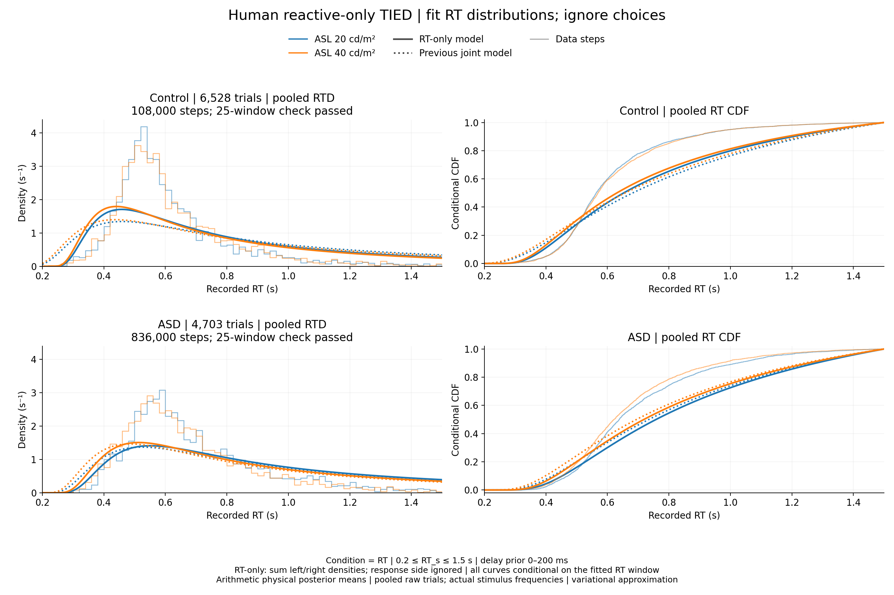

*Control above ASD; pooled RTD left and RT CDF right. Blue/orange: ASL 20/40 cd/m². Solid curves: RT-only fit at arithmetic physical posterior means; dotted curves: previous joint-fit parameters, recomputed on the same selected trials and RT window. Thin steps: data. Sum both response bounds and mix signed conditions with actual retained trial counts. No psychometric/choice score is used.*

[Full-size PNG](../assets/results/2026-10-20/human_tied_RT_only_delay200ms/human_RT_only_rtd_cdf_comparison_full_0p2_1p5s.png) · [PDF](../assets/results/2026-10-20/human_tied_RT_only_delay200ms/human_RT_only_rtd_cdf_comparison_full_0p2_1p5s.pdf) · [0.2–1 s display zoom](../assets/results/2026-10-20/human_tied_RT_only_delay200ms/human_RT_only_rtd_cdf_comparison_zoom_0p2_1s.png)

| Group | Common RT metric | Previous joint-fit parameters | RT-only fit | Change |
|---|---|---:|---:|---:|
| Control | Marginal RT log likelihood (higher better) | 943.905 | 1724.23 | +780.323 |
| Control | Mean signed-condition CDF gap | 0.291916 | 0.260092 | -0.0318237 |
| Control | Largest signed-condition CDF gap | 0.339956 | 0.351508 | +0.0115529 |
| ASD | Marginal RT log likelihood (higher better) | 642.321 | 742.832 | +100.511 |
| ASD | Mean signed-condition CDF gap | 0.219902 | 0.237761 | +0.0178591 |
| ASD | Largest signed-condition CDF gap | 0.291038 | 0.330071 | +0.0390328 |

The mean CDF gap is an equal-weight average over the 20 ASL × signed-difference cells. The likelihood gives each retained trial one contribution; RTD/CDF mixtures use actual retained stimulus frequencies.


### RTDs by absolute difference

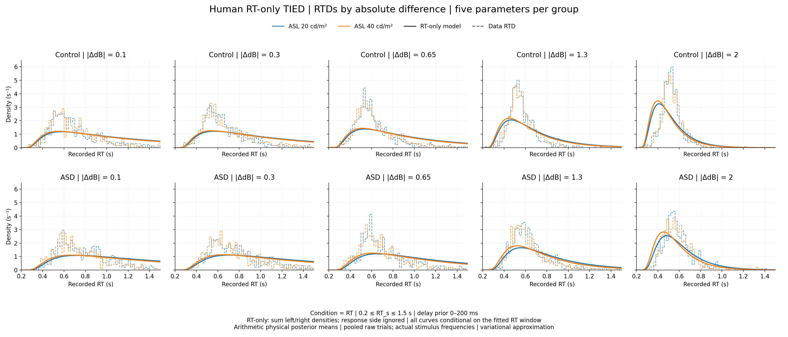

*Control above ASD; columns |ΔdB| = 0.1, 0.3, 0.65, 1.3, 2. Dashed steps are 20 ms empirical histograms; solid curves are the RT-only model on a 1 ms grid. Blue/orange identify ASL 20/40 cd/m². Pool ±ΔdB with actual retained counts; normalization remains 0.2–1.5 s in the display zoom. Matching axes include all peaks.*

[Full-size PNG](../assets/results/2026-10-20/human_tied_RT_only_delay200ms/human_RT_only_rtd_by_delta_full_0p2_1p5s.png) · [PDF](../assets/results/2026-10-20/human_tied_RT_only_delay200ms/human_RT_only_rtd_by_delta_full_0p2_1p5s.pdf) · [0.2–1 s display zoom](../assets/results/2026-10-20/human_tied_RT_only_delay200ms/human_RT_only_rtd_by_delta_zoom_0p2_1s.png)

### Delay posterior and the requested 200 ms bound

| Group | Delay mean (ms) | SD (ms) | Central 95% (ms) | Draws above 199 ms | Draws above 195 ms |
|---|---:|---:|---|---:|---:|
| Control | 199.72961 | 0.52054 | [198.43661, 199.99074] | 95.33% | 99.85% |
| ASD | 199.59695 | 0.75814 | [197.70726, 199.98546] | 91.34% | 99.47% |

A posterior concentrated near 200 ms is constrained by the requested prior cap. It should not be described as an unconstrained estimate of the nondecision delay. The cap is marked on the corner and parameter-trace figures.

### All five posterior parameters

| Group | Parameter | Mean | SD | Central 95% |
|---|---|---:|---:|---|
| Control | rate_lambda | 0.134294 | 0.020878 | [0.097926, 0.17885] |
| Control | T_0 (ms) | 0.024938 | 0.0085595 | [0.012173, 0.045287] |
| Control | theta_E | 232.382 | 35.962 | [170.51, 311.82] |
| Control | w | 0.49941 | 0.0056649 | [0.48811, 0.51066] |
| Control | t_E_aff (ms) | 199.73 | 0.52054 | [198.44, 199.99] |
| ASD | rate_lambda | 0.218036 | 0.04486 | [0.14309, 0.31647] |
| ASD | T_0 (ms) | 0.0889369 | 0.044311 | [0.031336, 0.19978] |
| ASD | theta_E | 152.761 | 32.24 | [99.565, 226.09] |
| ASD | w | 0.504985 | 0.006078 | [0.49288, 0.51715] |
| ASD | t_E_aff (ms) | 199.597 | 0.75814 | [197.71, 199.99] |

These are **variational approximations** from 10,000 constrained draws per group. Pooled-trial posterior uncertainty does not represent participant-to-participant variability.

| Group | Parameter pair | Posterior correlation |
|---|---|---:|
| Control | T_0, rate_lambda | +0.9632 |
| Control | theta_E, T_0 | -0.9270 |
| Control | theta_E, rate_lambda | -0.9059 |
| ASD | T_0, rate_lambda | +0.9579 |
| ASD | theta_E, rate_lambda | -0.8994 |
| ASD | theta_E, T_0 | -0.8775 |

[Control corner](../assets/results/2026-10-20/human_tied_RT_only_delay200ms/control/parameter_corner.png) · [ASD corner](../assets/results/2026-10-20/human_tied_RT_only_delay200ms/asd/parameter_corner.png) · [Control loss/parameter traces](../assets/results/2026-10-20/human_tied_RT_only_delay200ms/control/convergence.png) · [ASD loss/parameter traces](../assets/results/2026-10-20/human_tied_RT_only_delay200ms/asd/convergence.png)

The strong λ/T₀/θ correlations and gradual movement in their traces remain. Passing the recent-window checks does not establish unique parameter estimates or global optimality.

### Sources and independent checks

Fit root: `ASD_Human_Data/reactive_tied_rt_only_svi_0p2_1p5s_delay200ms/`. Previous joint fit: `ASD_Human_Data/reactive_tied_rt_svi_rt_le_1p5s/`.

[Selected/excluded counts](../assets/results/2026-10-20/human_tied_RT_only_delay200ms/selection_counts.csv) · [Excluded trial identities](../assets/results/2026-10-20/human_tied_RT_only_delay200ms/excluded_trials.csv) · [Participant counts](../assets/results/2026-10-20/human_tied_RT_only_delay200ms/participant_selection_counts.csv) · [Condition counts](../assets/results/2026-10-20/human_tied_RT_only_delay200ms/condition_selection_counts.csv) · [Common RT likelihood/CDF metrics](../assets/results/2026-10-20/human_tied_RT_only_delay200ms/common_RT_fit_quality.csv) · [Delay-boundary diagnostics](../assets/results/2026-10-20/human_tied_RT_only_delay200ms/delay_boundary_diagnostics.csv) · [Posterior summaries](../assets/results/2026-10-20/human_tied_RT_only_delay200ms/parameter_summary.csv) · [Independent validation](../assets/results/2026-10-20/human_tied_RT_only_delay200ms/independent_validation.json) · [Full posterior/source/audit ZIP](../assets/results/2026-10-20/human_tied_RT_only_delay200ms/human_RT_only_delay200ms_audits.zip)

- `ASD_Human_Data/human_reactive_tied_rt_only_utils.py` ([source](../assets/results/2026-10-20/human_tied_RT_only_delay200ms/source/human_reactive_tied_rt_only_utils.py)).
- `ASD_Human_Data/fit_human_reactive_tied_rt_only_svi.py` ([source](../assets/results/2026-10-20/human_tied_RT_only_delay200ms/source/fit_human_reactive_tied_rt_only_svi.py)).
- `ASD_Human_Data/plot_human_reactive_tied_rt_only_svi.py` ([source](../assets/results/2026-10-20/human_tied_RT_only_delay200ms/source/plot_human_reactive_tied_rt_only_svi.py)).
- `ASD_Human_Data/verify_human_reactive_tied_rt_only_svi.py` ([source](../assets/results/2026-10-20/human_tied_RT_only_delay200ms/source/verify_human_reactive_tied_rt_only_svi.py)).
- `ASD_Human_Data/publish_human_reactive_tied_rt_only_svi.py` ([source](../assets/results/2026-10-20/human_tied_RT_only_delay200ms/source/publish_human_reactive_tied_rt_only_svi.py)).
- `ASD_Human_Data/human_tied_independent_fpt.py` ([source](../assets/results/2026-10-20/human_tied_RT_only_delay200ms/source/human_tied_independent_fpt.py)).
- `ASD_Human_Data/human_reactive_tied_svi_utils.py` ([source](../assets/results/2026-10-20/human_tied_RT_only_delay200ms/source/human_reactive_tied_svi_utils.py)).

Independent checks matched all 11,231 retained and 169 excluded source identities; flipping/adding response labels left the RT likelihood and gradients unchanged. Checks verified the five free parameters and 200 ms support, posterior summaries/covariances, warm-start coordinate mapping, each patience reset, finite gradients, K=40/80 convergence, SciPy density/CDF agreement and unit conditional mass. Reconstructed 80 condition-wise CDF checks, 1560 histogram bins and 160 mixture weights. All 417 prior fit/asset files are byte-identical. PNGs were visually inspected and PDFs passed text-bound checks.


---

## Human RT: refit after removing responses above 1.5 s

**Question:** do the long responses explain the poor reactive-only TIED fits?

**Outcome:** removing the long tail does **not resolve the RTD shape mismatch** in this five-parameter pooled fit. Both groups improve their common-window joint likelihood and largest signed-condition CDF gap, but their average condition-wise CDF gaps increase. The model RTDs remain much broader and less peaked than the data.

**Selection:** `Condition == "RT"` and `RT_s <= 1.5`. This is a new trial filter, with likelihood and predictions conditional on **0–1.5 s**. Earlier figures used all 11,400 recorded RT trials and 0–3 s normalization; their 1.5 s view was only a display zoom. Correct and incorrect choices remain included, with raw trials pooled across participants and sessions. SD and sequential CB are excluded.

| Group | Participants | Original RT trials | Retained ≤1.5 s | Removed >1.5 s |
|---|---:|---:|---:|---:|
| Control | 11 | 6,600 | 6,531 | 69 |
| ASD | 8 | 4,800 | 4,704 | 96 |

Only **165/11,400 trials (1.45%)** are removed. All 19 participants, both ASLs and all ten signed differences remain. Cell counts are now unequal, so model mixtures use actual retained trial frequencies. The fastest trials are retained: delay support remains `0 < t_E_aff < 0.111188799848944 s` for Control and `0 < t_E_aff < 0.181610000094563 s` for ASD.

### Model and refitting

The same five parameters (`rate_lambda`, `T_0`, `theta_E`, `w`, `t_E_aff`) are shared across both ASLs and all signed differences within each group. The IPL/vanilla equations use `B = Mean_dB`, `D = Delta_dB`, `Choice = +1/-1` for right/left, and first-passage time `RT_s - t_E_aff`. Divide each choice density by the **either-bound mass** in 0–1.5 s. ASL 20/40 cd/m² are plot labels, with actual model levels ≈10.892/15.089 visual dB.

Priors are unchanged: lognormal λ/T₀/θ with natural-log means log(.2)/log(.001)/log(30) and log SDs 1.5/2/1.5; uniform w in (.05,.95) and delay below the group minimum RT minus 1 μs. One warm start per group uses the previous confirmed **full-rank guide**, then resets Adam, RNG (seed 0), loss history and patience because the target likelihood changed. The actual initial guide covariance is the saved covariance. This is a new fit, rather than an optimizer-state continuation.

CPU float64; NumPyro AutoMultivariateNormal; full batches, one ELBO particle; ClippedAdam learning rate .0002 and clip 1; K=40 checked against K=80. Check 1,000-step means, minimum 50,000 and cap 1,000,000 new updates. Every lower mean resets patience; require 25 later windows and terminal/restored mean stability (<0.1 posterior SD over three checkpoints), then restore the best checkpoint. This is observed-window confirmation, not proof of a global optimum.

| Group | Selected best step | Final checked step | Later windows | Status |
|---|---:|---:|---:|---|
| Control | 276,000 | 301,000 | 25 | confirmed; means stable |
| ASD | 40,000 | 65,000 | 25 | confirmed; means stable |

### Previous versus refitted model on the same selected trials

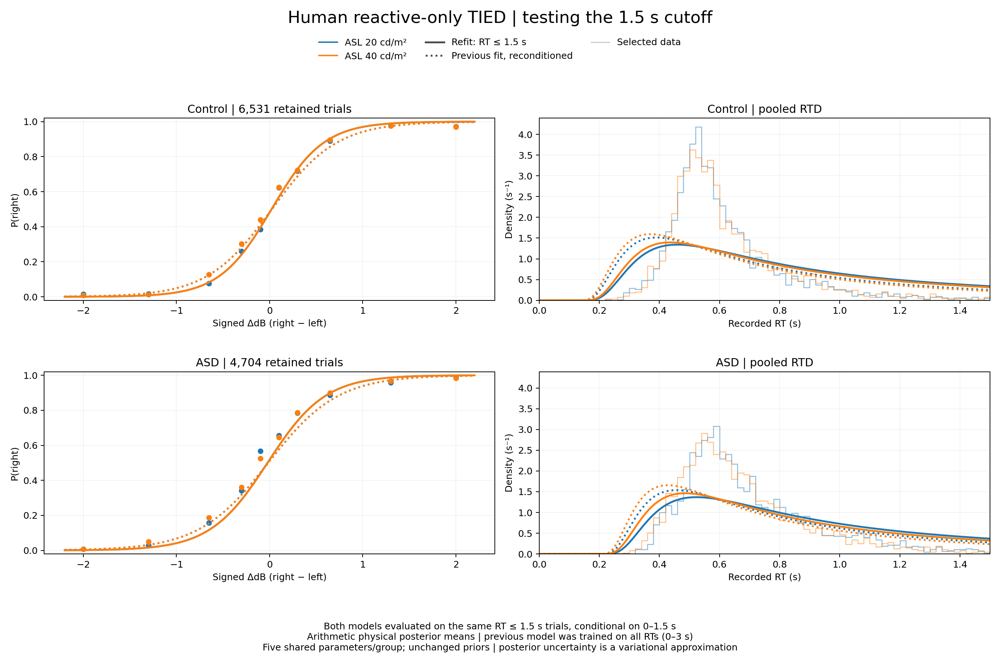

*Control above ASD; psychometric left and pooled RTD right. Solid curves: new fit. Dotted curves: previous confirmed full-RT fit, recomputed and reconditioned on 0–1.5 s. Blue/orange identify ASL 20/40 cd/m²; points/steps show the same retained data. Both predictions use arithmetic means of physical posterior parameters and actual retained condition frequencies.*

[Full-size PNG](../assets/results/2026-10-20/human_tied_rt_le_1p5s/human_tied_rt_cutoff_comparison.png) · [PDF](../assets/results/2026-10-20/human_tied_rt_le_1p5s/human_tied_rt_cutoff_comparison.pdf)

**Common-window comparison:** both models are evaluated on exactly the same selected rows with 0–1.5 s normalization. The original training losses on all trials cannot be compared directly with the new training losses.

| Group | Metric | Previous parameters, reconditioned | Refit | Change |
|---|---|---:|---:|---:|
| Control | Joint log likelihood at means (higher better) | -1656.37 | -1530.02 | +126.35 |
| Control | Psychometric RMSE | 0.0322991 | 0.0288927 | -0.0034065 |
| Control | Mean signed-condition RT CDF gap | 0.250921 | 0.291909 | +0.040988 |
| Control | Largest signed-condition RT CDF gap | 0.437899 | 0.34112 | -0.096779 |
| ASD | Joint log likelihood at means (higher better) | -1283.57 | -1213.56 | +70.006 |
| ASD | Psychometric RMSE | 0.0526354 | 0.0509981 | -0.0016372 |
| ASD | Mean signed-condition RT CDF gap | 0.182738 | 0.219948 | +0.03721 |
| ASD | Largest signed-condition RT CDF gap | 0.305221 | 0.291038 | -0.014182 |

### RTDs for each absolute difference

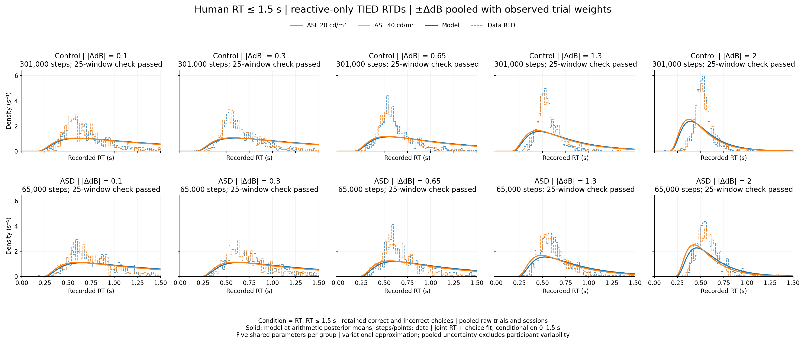

*Control above ASD; columns |ΔdB| = 0.1, 0.3, 0.65, 1.3, 2. Data: 20 ms histogram steps; model: 1 ms curves at arithmetic posterior means. Pool ±ΔdB with observed retained counts and sum both choices. Matching axes include all histogram and model peaks; histograms and model densities have unit area over the fitted 0–1.5 s window.*

[Full-size PNG](../assets/results/2026-10-20/human_tied_rt_le_1p5s/human_reactive_tied_rtd_by_delta_full_0_1p5s.png) · [PDF](../assets/results/2026-10-20/human_tied_rt_le_1p5s/human_reactive_tied_rtd_by_delta_full_0_1p5s.pdf) · [Refit psychometric/RTD PNG](../assets/results/2026-10-20/human_tied_rt_le_1p5s/human_reactive_tied_psychometric_rtd_full_0_1p5s.png) · [0–1 s display zoom](../assets/results/2026-10-20/human_tied_rt_le_1p5s/human_reactive_tied_psychometric_rtd_zoom_0_1s.png)

### Posterior parameters

| Group | Parameter | Mean | SD | Central 95% interval |
|---|---|---:|---:|---|
| Control | rate_lambda | 0.128653 | 0.01752 | [0.097651, 0.16562] |
| Control | T_0 (ms) | 0.0313894 | 0.0095638 | [0.016629, 0.053731] |
| Control | theta_E | 240.611 | 33.504 | [182.12, 314.11] |
| Control | w | 0.488758 | 0.003936 | [0.48093, 0.49659] |
| Control | t_E_aff (ms) | 101.825 | 1.2351 | [99.176, 104.04] |
| ASD | rate_lambda | 0.221532 | 0.028324 | [0.17107, 0.281] |
| ASD | T_0 (ms) | 0.119425 | 0.035719 | [0.063866, 0.20332] |
| ASD | theta_E | 126.682 | 16.391 | [98.085, 162.33] |
| ASD | w | 0.511031 | 0.0046747 | [0.50167, 0.52034] |
| ASD | t_E_aff (ms) | 169.672 | 1.8266 | [165.67, 172.88] |

These are **variational approximations**, from 10,000 constrained draws per group. Pooled-trial posterior uncertainty does not measure participant-to-participant variability.

| Group | Parameter pair | Posterior correlation |
|---|---|---:|
| Control | T_0, rate_lambda | +0.9633 |
| Control | theta_E, T_0 | -0.9405 |
| Control | theta_E, rate_lambda | -0.9181 |
| ASD | T_0, rate_lambda | +0.9493 |
| ASD | theta_E, T_0 | -0.9361 |
| ASD | theta_E, rate_lambda | -0.8852 |

[Control corner](../assets/results/2026-10-20/human_tied_rt_le_1p5s/control/parameter_corner.png) · [ASD corner](../assets/results/2026-10-20/human_tied_rt_le_1p5s/asd/parameter_corner.png) · [Control loss/parameter traces](../assets/results/2026-10-20/human_tied_rt_le_1p5s/control/convergence.png) · [ASD loss/parameter traces](../assets/results/2026-10-20/human_tied_rt_le_1p5s/asd/convergence.png)

λ, T₀ and θ remain strongly correlated; the traces show slow movement along this parameter tradeoff. The stopping checks assess recent windows and do not establish a unique/global minimum. The fastest retained responses still constrain the shared delay.

### Sources, selected rows and verification

Previous fit root: `ASD_Human_Data/reactive_tied_rt_svi_confirm25/`. New fit root: `ASD_Human_Data/reactive_tied_rt_svi_rt_le_1p5s/`.

[Selection counts](../assets/results/2026-10-20/human_tied_rt_le_1p5s/selection_counts.csv) · [Condition counts](../assets/results/2026-10-20/human_tied_rt_le_1p5s/condition_selection_counts.csv) · [Participant counts](../assets/results/2026-10-20/human_tied_rt_le_1p5s/participant_selection_counts.csv) · [Excluded trial identities](../assets/results/2026-10-20/human_tied_rt_le_1p5s/excluded_long_trials.csv) · [Common-window fit quality](../assets/results/2026-10-20/human_tied_rt_le_1p5s/common_window_fit_quality.csv) · [Parameter summaries](../assets/results/2026-10-20/human_tied_rt_le_1p5s/parameter_summary.csv) · [Independent validation](../assets/results/2026-10-20/human_tied_rt_le_1p5s/independent_validation.json) · [Full posterior/source/audit ZIP](../assets/results/2026-10-20/human_tied_rt_le_1p5s/human_tied_rt_le_1p5s_audits.zip)

- `ASD_Human_Data/human_reactive_tied_window_utils.py` ([source](../assets/results/2026-10-20/human_tied_rt_le_1p5s/source/human_reactive_tied_window_utils.py)).
- `ASD_Human_Data/fit_human_reactive_tied_window_svi.py` ([source](../assets/results/2026-10-20/human_tied_rt_le_1p5s/source/fit_human_reactive_tied_window_svi.py)).
- `ASD_Human_Data/plot_human_reactive_tied_window_svi.py` ([source](../assets/results/2026-10-20/human_tied_rt_le_1p5s/source/plot_human_reactive_tied_window_svi.py)).
- `ASD_Human_Data/compare_human_reactive_tied_window.py` ([source](../assets/results/2026-10-20/human_tied_rt_le_1p5s/source/compare_human_reactive_tied_window.py)).
- `ASD_Human_Data/verify_human_reactive_tied_window_svi.py` ([source](../assets/results/2026-10-20/human_tied_rt_le_1p5s/source/verify_human_reactive_tied_window_svi.py)).
- `ASD_Human_Data/publish_human_reactive_tied_window.py` ([source](../assets/results/2026-10-20/human_tied_rt_le_1p5s/source/publish_human_reactive_tied_window.py)).
- `ASD_Human_Data/human_reactive_tied_svi_utils.py` ([source](../assets/results/2026-10-20/human_tied_rt_le_1p5s/source/human_reactive_tied_svi_utils.py)).

Independent verification matched all 11,235 retained and 165 excluded source identities, verified both groups' posterior summaries/covariances and strict patience resets, checked finite gradients, K=40/80 series, SciPy density/CDF agreement and unit conditional mass. It reconstructed 40 probabilities, 1800 histogram bins and both parameter sets' common-window comparisons. All 265 previous fit/asset files are byte-identical. Figures were visually inspected and PDFs passed text-bound checks.


---

## Human RT: continuation with strict minimum confirmation

**Outcome:** the corrected continuation found lower variational losses and substantially different parameters in both groups. Improvements in the data fit are modest and mixed: the largest RT CDF gaps decrease (Control 0.471 → 0.437; ASD 0.347 → 0.310), but average signed-condition CDF gaps increase slightly. The major RTD shape mismatch remains.

This continues the original Control and ASD fits from their exact saved optimizer, guide, and RNG states. **Data, priors, likelihood and five shared parameters per group are unchanged.** Condition = RT only: 6,600 Control trials from 11 participants and 4,800 ASD trials from 8; all retained choices and RTs, both ASLs and all signed differences, with no additional filter.

Every lower **1,000-step mean negative ELBO** resets patience. Require **25 subsequent windows** without a new best, plus terminal and restored-best mean stability (<0.1 posterior SD over three checkpoints). Restore the lowest finite window checkpoint. The cap is 1,000,000 total updates per group; a capped unfinished confirmation remains flagged. This confirms the specified observed-window criterion, not a global optimum.

| Group | Original endpoint | Continued best | Final checked | Post-best windows | Status |
|---|---:|---:|---:|---:|---|
| Control | 150,000 | 514,000 | 539,000 | 25 | confirmed; means stable |
| ASD | 127,000 | 514,000 | 539,000 | 25 | confirmed; means stable |

### Original versus continued psychometrics and RTDs

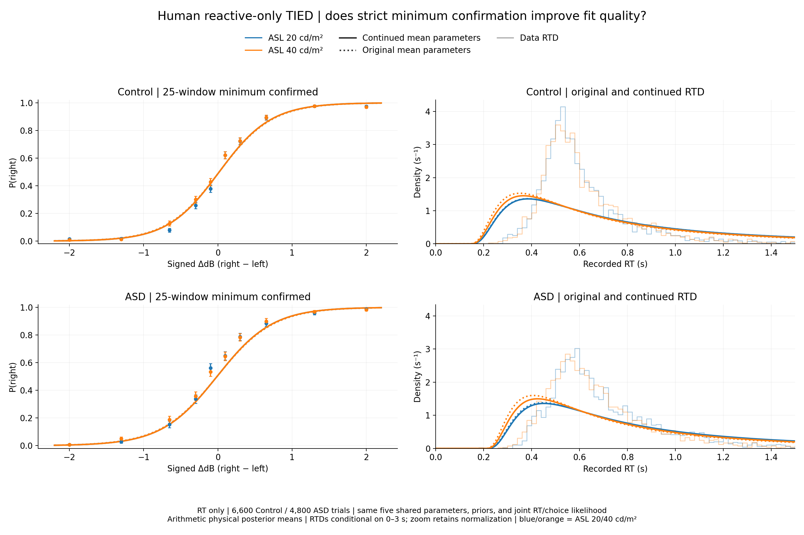

*Control above ASD. Solid model curves: continued fit; dotted model curves: original fit. Blue/orange identify ASL 20/40 cd/m²; points and light steps show the same empirical data. Both versions use arithmetic physical posterior means and the identical joint RT/choice likelihood conditional on 0–3 s. The 0–1.5 s view is a display zoom. Model brightness is `Mean_dB`; nominal `ASL_cd` remains the legend label.*

[Full-size comparison PNG](../assets/results/2026-10-20/human_tied_confirm25/comparison/human_tied_original_vs_continued_zoom_0_1p5s.png) · [Comparison PDF](../assets/results/2026-10-20/human_tied_confirm25/comparison/human_tied_original_vs_continued_zoom_0_1p5s.pdf) · [Full 0–3 s PNG](../assets/results/2026-10-20/human_tied_confirm25/comparison/human_tied_original_vs_continued_full_0_3s.png) · [Full 0–3 s PDF](../assets/results/2026-10-20/human_tied_confirm25/comparison/human_tied_original_vs_continued_full_0_3s.pdf)

### Did fit quality improve?

| Group | Metric | Original | Continued | Change |
|---|---|---:|---:|---:|
| Control | Joint log likelihood at means (higher better) | -2696.3 | -2687.2 | +9.0855 |
| Control | Psychometric RMSE (lower better) | 0.031982 | 0.030535 | -0.0014464 |
| Control | Largest choice-probability error | 0.064276 | 0.063372 | -0.00090355 |
| Control | Mean signed-condition RT CDF gap | 0.31725 | 0.32029 | +0.0030336 |
| Control | Largest signed-condition RT CDF gap | 0.47051 | 0.43666 | -0.033851 |
| ASD | Joint log likelihood at means (higher better) | -2145.4 | -2144.9 | +0.57576 |
| ASD | Psychometric RMSE (lower better) | 0.053716 | 0.053272 | -0.00044415 |
| ASD | Largest choice-probability error | 0.12022 | 0.12133 | +0.0011112 |
| ASD | Mean signed-condition RT CDF gap | 0.24665 | 0.25121 | +0.0045557 |
| ASD | Largest signed-condition RT CDF gap | 0.34687 | 0.31028 | -0.036586 |

The likelihood and curve discrepancies assess the same trial population. A lower variational loss need not improve every descriptive curve-error metric.

A separate evaluation uses **256 common random draws** per original/continued guide to compare expected negative ELBO without further training:

| Group | Original negative ELBO | Continued negative ELBO | Paired change ± MC SEM |
|---|---:|---:|---:|
| ASD | 2169.894 | 2161.245 | -8.649 ± 0.153 |
| Control | 2721.396 | 2707.185 | -14.211 ± 0.129 |

### Parameter changes

| Group | Parameter | Original mean | Continued mean | Continued central 95% |
|---|---|---:|---:|---|
| Control | rate_lambda | 0.24815 | 0.14628 | [0.11749, 0.1793] |
| Control | T_0 (ms) | 0.15505 | 0.046372 | [0.028148, 0.071687] |
| Control | theta_E | 98.686 | 170.54 | [136.72, 211.74] |
| Control | w | 0.48743 | 0.48709 | [0.47819, 0.496] |
| Control | t_E_aff (ms) | 104.48 | 104.57 | [102.86, 105.99] |
| ASD | rate_lambda | 0.31991 | 0.21241 | [0.16604, 0.26661] |
| ASD | T_0 (ms) | 0.30872 | 0.11771 | [0.06532, 0.19492] |
| ASD | theta_E | 71.211 | 109.23 | [85.167, 139.13] |
| ASD | w | 0.50721 | 0.50726 | [0.49655, 0.51787] |
| ASD | t_E_aff (ms) | 173.45 | 173.52 | [171.18, 175.44] |

*Intervals are variational approximations from 10,000 constrained draws per group. Pooled-trial uncertainty does not measure participant-to-participant variability. The continuation adds no new statistical initialization.*

### RTDs at each absolute difference

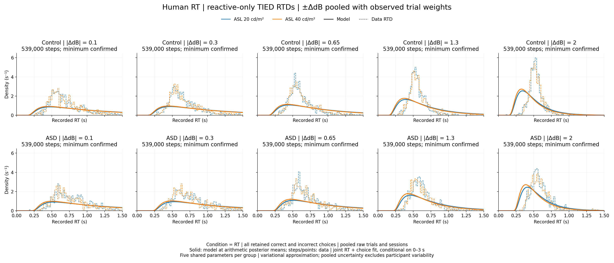

*Control above ASD; columns |ΔdB| = 0.1, 0.3, 0.65, 1.3, 2. Pool the two signs with observed trial frequencies, sum both choices, and retain 0–3 s normalization. Empirical 20 ms steps and model 1 ms curves use the same ASL colors and matching axes.*

[Full-size PNG](../assets/results/2026-10-20/human_tied_confirm25/human_reactive_tied_rtd_by_delta_zoom_0_1p5s.png) · [PDF](../assets/results/2026-10-20/human_tied_confirm25/human_reactive_tied_rtd_by_delta_zoom_0_1p5s.pdf) · [Full 0–3 s PNG](../assets/results/2026-10-20/human_tied_confirm25/human_reactive_tied_rtd_by_delta_full_0_3s.png) · [Full 0–3 s PDF](../assets/results/2026-10-20/human_tied_confirm25/human_reactive_tied_rtd_by_delta_full_0_3s.pdf)

### Minimum-confirmation evidence

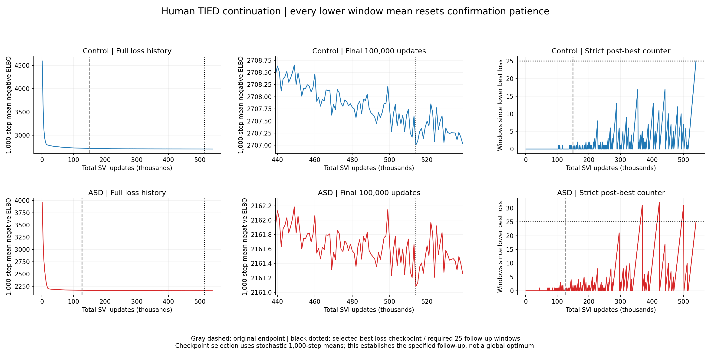

*Gray dashed lines mark the original endpoints; black dotted lines mark selected minima and the required 25-window counter. The saved convergence CSVs retain the entire original history and explicitly replay strict patience for every window.*

[Confirmation PDF](../assets/results/2026-10-20/human_tied_confirm25/comparison/human_tied_continuation_confirmation.pdf) · [Control corner](../assets/results/2026-10-20/human_tied_confirm25/control/parameter_corner.png) · [ASD corner](../assets/results/2026-10-20/human_tied_confirm25/asd/parameter_corner.png) · [Control parameter traces](../assets/results/2026-10-20/human_tied_confirm25/control/convergence.png) · [ASD parameter traces](../assets/results/2026-10-20/human_tied_confirm25/asd/convergence.png)

### Reproduction and audits

Source fit: `ASD_Human_Data/reactive_tied_rt_svi/`; continued fit: `ASD_Human_Data/reactive_tied_rt_svi_confirm25/`.

[Fit-quality changes](../assets/results/2026-10-20/human_tied_confirm25/comparison/fit_quality_changes.csv) · [Parameter changes](../assets/results/2026-10-20/human_tied_confirm25/comparison/parameter_changes.csv) · [Numerical/source-row verification](../assets/results/2026-10-20/human_tied_confirm25/independent_validation.json) · [Continuation verification](../assets/results/2026-10-20/human_tied_confirm25/continuation_validation.json) · [Full posterior/calculation/source audit ZIP](../assets/results/2026-10-20/human_tied_confirm25/human_tied_confirm25_audits.zip)

- `ASD_Human_Data/continue_human_reactive_tied_svi.py` ([source](../assets/results/2026-10-20/human_tied_confirm25/source/continue_human_reactive_tied_svi.py)).
- `ASD_Human_Data/compare_human_reactive_tied_continuation.py` ([source](../assets/results/2026-10-20/human_tied_confirm25/source/compare_human_reactive_tied_continuation.py)).
- `ASD_Human_Data/fit_human_reactive_tied_svi.py` ([source](../assets/results/2026-10-20/human_tied_confirm25/source/fit_human_reactive_tied_svi.py)).
- `ASD_Human_Data/verify_human_reactive_tied_continuation.py` ([source](../assets/results/2026-10-20/human_tied_confirm25/source/verify_human_reactive_tied_continuation.py)).
- `ASD_Human_Data/plot_human_reactive_tied_svi.py` ([source](../assets/results/2026-10-20/human_tied_confirm25/source/plot_human_reactive_tied_svi.py)).
- `ASD_Human_Data/verify_human_reactive_tied_svi.py` ([source](../assets/results/2026-10-20/human_tied_confirm25/source/verify_human_reactive_tied_svi.py)).
- `ASD_Human_Data/human_reactive_tied_svi_utils.py` ([source](../assets/results/2026-10-20/human_tied_confirm25/source/human_reactive_tied_svi_utils.py)).
- `ASD_Human_Data/publish_human_reactive_tied_continuation.py` ([source](../assets/results/2026-10-20/human_tied_confirm25/source/publish_human_reactive_tied_continuation.py)).

Verification matched all 11,400 source trial identities, retained the exact original raw-loss prefixes, replayed every patience reset, checked posterior summaries and covariances, and verified K=40/80 series, density/CDF agreement, conditional mass and finite gradients at initial/posterior values. All 66 original fit artifacts remain byte-identical. PNGs were visually inspected; PDFs passed text-bound checks.


---

## Human RT: reactive-only vanilla/IPL TIED, pooled Control and ASD

**Run status:** ASD met the stated loss-patience and parameter-mean stability checks at **127,000 steps**. Control reached the **150,000-step cap** with continued parameter-mean movement and is **flagged unstable**. Both returned their best finite loss-window checkpoint.

At these saved posterior means, the reactive-only model produces broad RTDs whose peaks are earlier than the data. The largest signed-condition RT CDF gaps are **0.471 Control** and **0.347 ASD**. These fits do not reproduce the observed RTD shapes well; Control's instability limits conclusions about its best achievable fit.

| Group | Completed steps | Restored best step | Last-three-checkpoint max mean change (SD) | Mean stability |
|---|---:|---:|---:|---|
| Control | 150,000 | 150,000 | 0.144 | **FAILED** |
| ASD | 127,000 | 127,000 | 0.097 | passed |

**Stopping-rule audit:** neither group has a confirmation period after its lowest observed loss window: the best and final checkpoints coincide (Control 150,000; ASD 127,000). ASD met the implemented threshold/stability rule, which is weaker than confirming a minimum with subsequent windows. See the [stopping-rule audit](#stopping-rule-audit).

### Selection and model

**Condition = RT only:** 6,600 Control trials from 11 participants and
4,800 ASD trials from 8 participants. Pool raw trials across participants
and both simultaneous sessions within group. Include every retained
correct and incorrect choice, with no JND eligibility exclusion, extra RT
cutoff, or input time shift. SD and sequential CB trials are excluded.

There is **one shared five-parameter model per group**, fit jointly across
both ASLs and all ten signed differences. This implements the agreed
group-wise fit rather than a separate parameter set for each ASL. Model
inputs are `B = Mean_dB = (Stim_left_dB + Stim_right_dB)/2` and
`D = Delta_dB = right - left`; the two B values are approximately 10.892
and 15.089 visual dB. **20/40 cd/m² are nominal ASL labels**, not the dB
inputs to the equations. `Choice = 1/-1` means right/left.

\[
\gamma=\theta_E\tanh(\lambda D/17.37),\qquad
\omega=\frac{10^{\lambda B/20}\cosh(\lambda D/17.37)}{T_0\theta_E^2}.
\]

The five free parameters are `rate_lambda`, `T_0`, `theta_E`, `w`, and a
scalar `t_E_aff`, with `Z_E = (w - 0.5)*2*theta_E`. The bound-specific
reactive density is evaluated at `RT_s - t_E_aff`. It is divided by the
probability of reaching **either bound** in the user-confirmed **0–3 s
retention window**. Exactly the same normalization is used in all
predictions, including zoomed RTD panels. There is no proactive process,
lapse mixture, or condition-specific delay in this baseline.

The minimum retained RT is 0.111189799848944 s for Control and
0.181611000094563 s for ASD. Subtracting 1 μs gives delay-support upper
limits of **0.111188799848944 s** and **0.181610000094563 s**. Thus a single
very early trial constrains the shared delay for its entire pooled group.

### Priors and execution

| Parameter | Prior (natural-log scale) | Initialization |
|---|---|---:|
| `rate_lambda` | LogNormal(log(0.2), 1.5) | 0.2 |
| `T_0` (s) | LogNormal(log(0.001), 2) | 0.001 |
| `theta_E` | LogNormal(log(30), 1.5) | 30 |
| `w` | Uniform(0.05, 0.95) | 0.5 |
| `t_E_aff` (s) | Uniform(0, minimum group RT − 1 μs) | 0.05 |

NumPyro `AutoMultivariateNormal`, CPU float64, full-batch joint RT/choice
likelihood, one ELBO particle, one initialization per group, seed 0.
ClippedAdam: learning rate 0.0002, clip 1; guide initialization scale 0.1.
Minimum 50,000 / maximum 150,000 steps, checking 1,000-step windows.
Restore the finite checkpoint with the smallest window-mean negative
ELBO. Stop after 12 windows without a ≥0.001 relative best improvement
only when posterior means also meet the stability threshold: largest
pairwise change over the last three checkpoints <0.1 posterior SD for
every parameter. Common 4,096-draw guide samples reduce Monte Carlo
noise in that check. Save 10,000 constrained draws from the restored guide.

All displayed model predictions use the **arithmetic posterior means of
the five physical parameters**. They are not posterior-averaged curves.
The posteriors are **variational approximations**. Pooled-trial posterior
uncertainty does not describe participant-to-participant variability, and
one initialization does not establish a global optimum.

### Reproduction

```bash
OPENBLAS_NUM_THREADS=1 OMP_NUM_THREADS=1 .venv/bin/python -u ASD_Human_Data/fit_human_reactive_tied_svi.py --group all
.venv/bin/python ASD_Human_Data/plot_human_reactive_tied_svi.py
.venv/bin/python ASD_Human_Data/verify_human_reactive_tied_svi.py
.venv/bin/python -m mkdocs build --strict
```

Output root: `ASD_Human_Data/reactive_tied_rt_svi/`. The fitter exposes
`--group`, `--seed`, `--min-steps`, `--max-steps`, and `--output-dir`.
Use a new output directory when rerunning a completed fit.

### Psychometric and pooled RTD comparisons

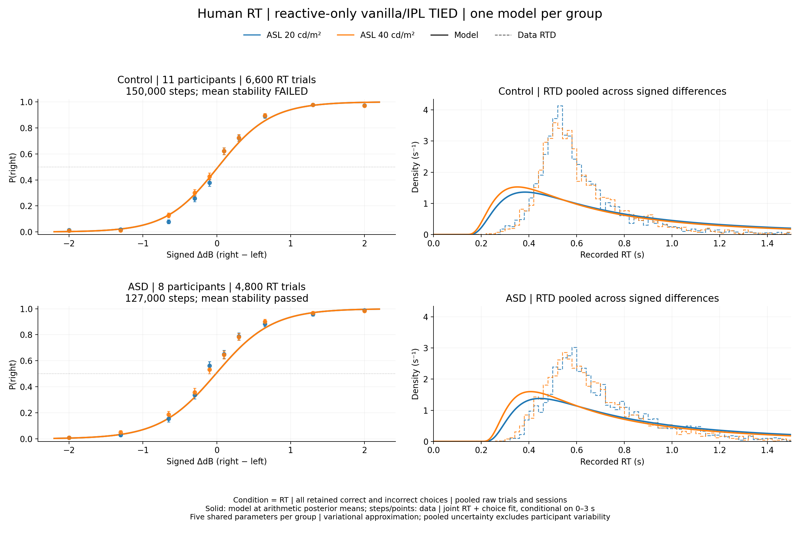

*Control above ASD; psychometric left, pooled RTD right. Blue/orange identify
ASL 20/40 cd/m². Points are pooled-choice probabilities ± binomial SEM;
dashed steps are 20 ms empirical RT densities; solid curves evaluate the
reactive-only TIED model at arithmetic physical-parameter posterior means.
Psychometric curves are conditional right-bound masses evaluated on a
fine signed-difference grid; the fit uses the ten observed differences.
RTDs mix signed-condition predictions with
their observed trial frequencies. The displayed 0–1.5 s zoom retains
0–3 s normalization and all selected trials. Run stability is shown in
each group row title.*

[Full-size zoom PNG](../assets/results/2026-10-20/human_reactive_tied_psychometric_rtd_zoom_0_1p5s.png) ·
[Zoom PDF](../assets/results/2026-10-20/human_reactive_tied_psychometric_rtd_zoom_0_1p5s.pdf) ·
[Full 0–3 s PNG](../assets/results/2026-10-20/human_reactive_tied_psychometric_rtd_full_0_3s.png) ·
[Full 0–3 s PDF](../assets/results/2026-10-20/human_reactive_tied_psychometric_rtd_full_0_3s.pdf)

### RTDs by absolute difference

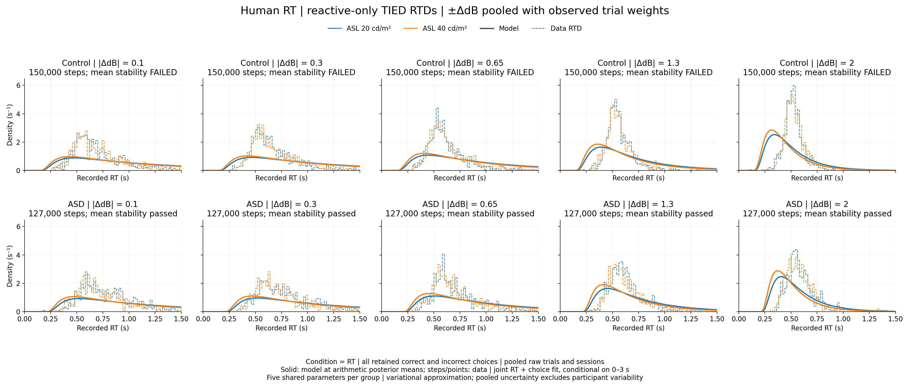

*Two groups × five absolute differences (0.1, 0.3, 0.65, 1.3, 2 dB).
Within each panel, pool +Δ and −Δ with their observed frequencies and sum
the two choices. Every ASL curve contains 660 Control or 480 ASD trials.
Data steps and model curves use the same 0–3 s conditional normalization;
only the display is zoomed. There is one shared parameter vector per
group, rather than a new fit per panel. Axes match across the ten panels.*

[Full-size zoom PNG](../assets/results/2026-10-20/human_reactive_tied_rtd_by_delta_zoom_0_1p5s.png) ·
[Zoom PDF](../assets/results/2026-10-20/human_reactive_tied_rtd_by_delta_zoom_0_1p5s.pdf) ·
[Full 0–3 s PNG](../assets/results/2026-10-20/human_reactive_tied_rtd_by_delta_full_0_3s.png) ·
[Full 0–3 s PDF](../assets/results/2026-10-20/human_reactive_tied_rtd_by_delta_full_0_3s.pdf)

### Parameter summaries and fit quality

| Group | Parameter | Mean | SD | 2.5% | 97.5% |
|---|---|---:|---:|---:|---:|
| Control | rate_lambda | 0.24815 | 0.012752 | 0.22403 | 0.27365 |
| Control | T_0 (ms) | 0.15505 | 0.017822 | 0.12227 | 0.19273 |
| Control | theta_E | 98.686 | 5.3842 | 88.547 | 109.88 |
| Control | w | 0.48743 | 0.0045605 | 0.47835 | 0.49645 |
| Control | t_E_aff (ms) | 104.48 | 0.79919 | 102.76 | 105.92 |
| ASD | rate_lambda | 0.31991 | 0.017036 | 0.28773 | 0.35402 |
| ASD | T_0 (ms) | 0.30872 | 0.037958 | 0.23964 | 0.38924 |
| ASD | theta_E | 71.211 | 4.0635 | 63.587 | 79.7 |
| ASD | w | 0.50721 | 0.0054368 | 0.49632 | 0.518 |
| ASD | t_E_aff (ms) | 173.45 | 1.0893 | 171.09 | 175.37 |

*Time parameters are displayed in ms here; the raw CSV stores seconds. Control summaries are flagged unstable.*

| Group | Joint log likelihood at means | Psychometric RMSE | Max probability error | Mean RT CDF gap | Max RT CDF gap |
|---|---:|---:|---:|---:|---:|
| Control | -2696.285 | 0.0320 | 0.0643 | 0.3173 | 0.4705 |
| ASD | -2145.434 | 0.0537 | 0.1202 | 0.2467 | 0.3469 |

Strong physical-parameter correlations: Control: `theta_E`/`T_0` r = -0.908, `T_0`/`rate_lambda` r = 0.845; ASD: `theta_E`/`T_0` r = -0.888, `T_0`/`rate_lambda` r = 0.826.

[Parameter means, SDs, and 95% intervals](../assets/results/2026-10-20/human_reactive_tied_parameter_summary.csv) ·
[Fit-quality table](../assets/results/2026-10-20/human_reactive_tied_fit_quality.csv) ·
[Signed-condition RT CDF discrepancies](../assets/results/2026-10-20/human_reactive_tied_condition_cdf_discrepancies.csv) ·
[Empirical and predicted choice probabilities](../assets/results/2026-10-20/human_reactive_tied_psychometric_comparison.csv)

The RT CDF discrepancy is the largest absolute empirical/model CDF gap at
the observed RT order statistics, evaluated separately for each
group × ASL × signed difference. The joint log likelihood includes both
RT and choice, conditional on retention. These are descriptive checks of
the saved mean parameters, not additional fitting objectives.

### Variational corners and convergence

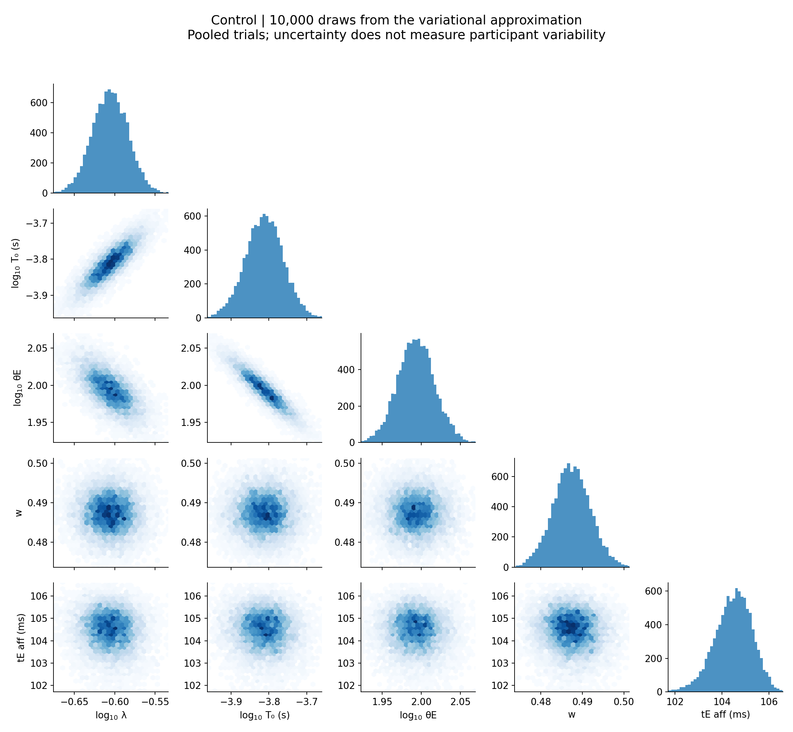

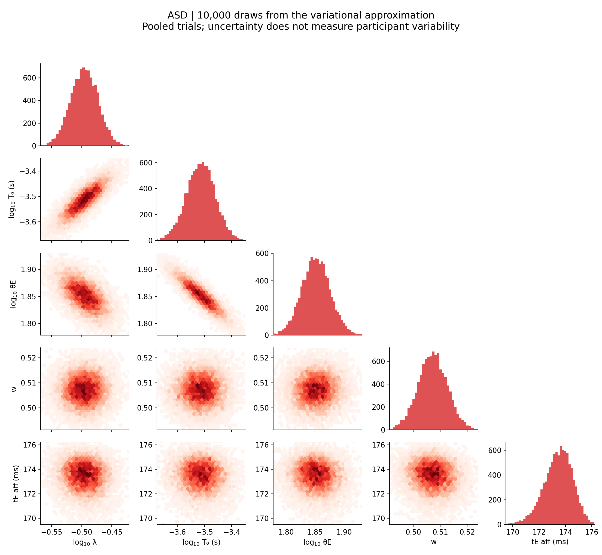

*10,000 constrained draws per group. The first three plotted coordinates
are log10 of the positive scale parameters; delay is displayed in ms.
Axes show the central 99.8% for readability; saved samples and physical
covariance/correlation tables retain every draw. These variational
posteriors describe pooled trials, not participant variability.*

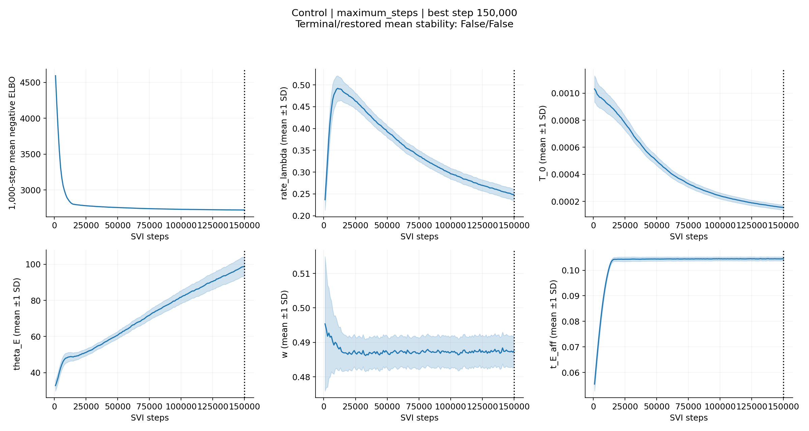

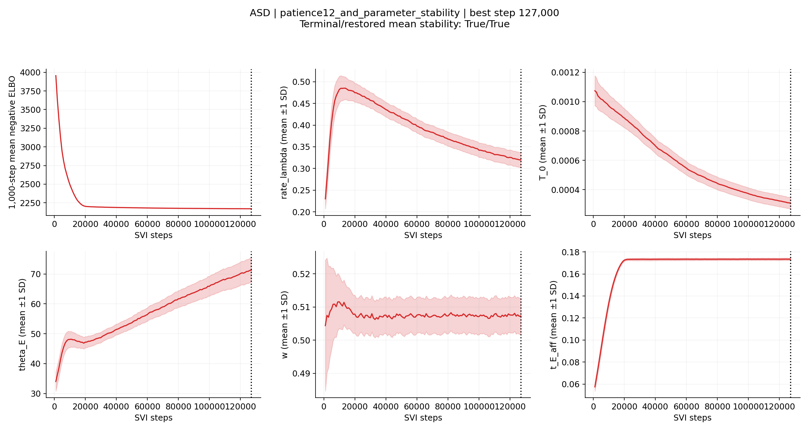

*Window-mean negative ELBO and physical posterior means ±1 SD. Dotted
vertical lines mark the restored best checkpoint. All checkpoint means
use common random draws. Terminal and restored stability are recorded
separately; a small loss-window change alone does not establish stability.*

### Sources and audits

- Likelihood adapter: `ASD_Human_Data/human_reactive_tied_svi_utils.py`
  ([source](../assets/results/2026-10-20/human_reactive_tied_svi_utils.py)).
- Fitter: `ASD_Human_Data/fit_human_reactive_tied_svi.py`
  ([source](../assets/results/2026-10-20/fit_human_reactive_tied_svi.py)).
- Figures: `ASD_Human_Data/plot_human_reactive_tied_svi.py`
  ([source](../assets/results/2026-10-20/plot_human_reactive_tied_svi.py)).
- Independent verification: `ASD_Human_Data/verify_human_reactive_tied_svi.py`
  ([source](../assets/results/2026-10-20/verify_human_reactive_tied_svi.py)).
- Existing vanilla primitives: `fit_animal_by_animal/numpyro_vanilla_condition_delay_svi_utils.py`
  ([source](../assets/results/2026-10-20/numpyro_vanilla_condition_delay_svi_utils.py)).
- [Independent numerical and source-row audit](../assets/results/2026-10-20/human_reactive_tied_independent_validation.json),
  [run configuration and priors](../assets/results/2026-10-20/human_reactive_tied_run_config.json),
  [complete posterior/calculation/source audit ZIP](../assets/results/2026-10-20/human_reactive_tied_rt_svi_audits.zip).

**Verification passed.** Independently decoded the 28,880-row MAT table and matched all 11,400 selected RT rows and stored numeric fields. Reconstructed 40 probability cells, 1,764 smooth model-choice points, 3,600 histogram bins and 40 signed-condition CDF comparisons. Verified all mixture weights, all 10,000 constrained draws per group, five free parameters, delay supports, sample summaries, covariance/correlation tables, restored checkpoints and mean-stability flags.

At 15 parameter points per group (initialization, posterior mean, median and 12 joint draws), gradients were finite, K=40 and K=80 agreed (maximum density difference 1.12×10⁻¹⁵), and the existing primitives matched an independent SciPy image-CDF/eigenfunction-density calculation (maximum density error 4.00×10⁻¹⁵; CDF error 9.22×10⁻¹⁵). Independent quadrature at initialization, means and medians gave maximum conditional-mass error 7.33×10⁻¹⁴. CDF-derivative/density agreement was within 6.56×10⁻⁹.

All eight PNGs were visually inspected; corresponding PDFs passed text-bound checks. The initial shared-axis clipping was corrected before publication. All 244 earlier analysis artifacts covered by the preservation audit remain byte-identical. [Visual inspection](../assets/results/2026-10-20/human_reactive_tied_visual_inspection.json) · [Runtime versions](../assets/results/2026-10-20/human_reactive_tied_environment.json).

**Result-book build:** `.venv/bin/python -m mkdocs build --strict` passed; `git diff --check` passed.

## Follow-up: are posterior bounds causing the poor RTD fit?

**The saved variational posteriors show no pileup against hard bounds.**
`rate_lambda`, `T_0`, and `theta_E` have positive LogNormal priors with
**no finite upper bounds**. Their posterior mean log values are all within
one prior log SD of the prior centres. `w` is far inside (0.05, 0.95).
No draw among the 20,000 saved draws lies in the outer 1% of a finite support.

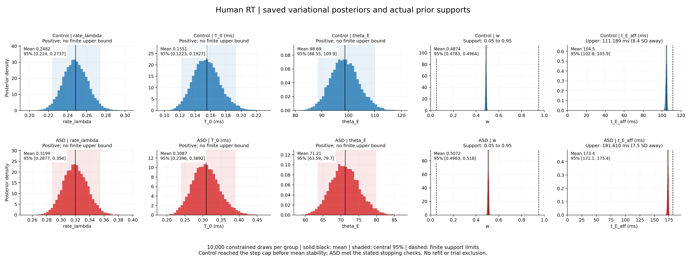

*Control above ASD. Solid black: mean; shaded: central 95%; dashed:
finite support limits. The first three parameters have no upper bounds.
Delay panels include the data-derived upper limit. Original fits and
trial selection are unchanged.*

[Full-size PNG](../assets/results/2026-10-20/human_reactive_tied_posterior_bounds.png) ·
[PDF](../assets/results/2026-10-20/human_reactive_tied_posterior_bounds.pdf) ·
[Posterior support table](../assets/results/2026-10-20/human_reactive_tied_diagnosis_posterior_support_audit.csv)

| Group | Delay mean (ms) | Central 95% (ms) | Upper support (ms) | Upper limit distance from mean |
|---|---:|---:|---:|---:|
| Control | 104.48 | 102.76–105.92 | 111.189 | 8.4 posterior SD |
| ASD | 173.45 | 171.09–175.37 | 181.610 | 7.5 posterior SD |

### Timing tension and remaining optimization uncertainty

The delay limit is required by the model and earliest retained RT.
Increasing it above an observed RT makes that trial's reactive decision
time negative and density zero. A 300 ms shared delay would make **33
Control and 4 ASD trials** impossible. Three Control and one ASD trials
are below 200 ms. The fastest Control response is P53, 111.190 ms, an
incorrect left choice at +2 dB; the fastest ASD response is P52, 181.611 ms,
a left choice at −0.1 dB. These remain included valid trials; this
diagnosis does not classify them as dataset errors.

The saved model spreads RT probability more broadly than observed.
At |ΔdB| = 2, pooling both ASLs/signs with observed frequencies:

| Group | Empirical 10–90% RT interval (s) | Model 10–90% RT interval (s) | Empirical SD (s) | Model SD (s) |
|---|---|---|---:|---:|
| Control | 0.422–0.647 | 0.259–0.754 | 0.100 | 0.217 |
| ASD | 0.432–0.761 | 0.323–0.831 | 0.144 | 0.224 |

This suggests tension between early responses, the shared delay, and the
observed distribution shapes under this reactive-only baseline. It does
not establish which model extension would resolve it. Pooling also
imposes shared dynamics on potentially different participants.

There is separate **optimization uncertainty**. Control's `rate_lambda`
continues decreasing as `theta_E` increases and `T_0` decreases; its
`theta_E`/`T_0` correlation is −0.908. ASD met the stated local stability
criterion, which does not establish global convergence. An extended
convergence check is warranted before claiming the best achievable fit.
The posterior audit provides no evidence that wider hard bounds are needed.

Averaging 256 joint posterior conditional CDFs instead of using arithmetic
physical means changes the CDF by at most **0.00560 Control / 0.00642 ASD**,
versus empirical/model gaps up to 0.471 / 0.347. Mean-parameter plotting
therefore cannot explain the large mismatch in these saved fits.

[Timing comparisons](../assets/results/2026-10-20/human_reactive_tied_diagnosis_empirical_model_timing.csv) ·
[Mean-parameter versus posterior-average CDFs](../assets/results/2026-10-20/human_reactive_tied_diagnosis_mean_parameter_vs_posterior_average_cdf.csv) ·
[Diagnostic audit bundle](../assets/results/2026-10-20/human_reactive_tied_posterior_diagnostics.zip) ·
[Validation](../assets/results/2026-10-20/human_reactive_tied_diagnosis_validation.json)

Source: `ASD_Human_Data/diagnose_human_reactive_tied_posteriors.py`
([source](../assets/results/2026-10-20/diagnose_human_reactive_tied_posteriors.py)).
All original fit artifacts covered by their manifest remain byte-identical.


## Stopping-rule audit

The current vanilla/IPL and NPL+alpha SVI reference code uses
**12 check windows of 1,000 updates** with a minimum relative improvement
threshold of **0.001**. The human fitter copied that rule and additionally
required local posterior-mean stability. The checked reference fitters do
not use 25 individual updates as their patience setting.

The important distinction is in the counter: every lower window mean
updates the saved best checkpoint, but only a single-window improvement
of at least 0.1% resets patience. Smaller improvements increment patience
even when a new minimum has just been recorded. Thus cumulative continued
descent can coexist with a large patience count.

| Group | Lowest-loss checkpoint | Final checked step | Updates after lowest checkpoint | New minima in last 25 windows |
|---|---:|---:|---:|---:|
| Control | 150,000 | 150,000 | 0 | 21 |
| ASD | 127,000 | 127,000 | 0 | 15 |

Over the final 25,000 updates, window-mean negative ELBO fell by 3.923
Control and 2.619 ASD. **Neither run demonstrated a minimum followed by a
confirmation period.** Control reached the cap; ASD passed the implemented
local threshold/stability criterion. That latter label does not establish
that loss had stopped improving.

A run intended to confirm a minimum must count follow-up windows from the
actual selected minimum (using an explicit noise/smoothing convention),
reset the count when that minimum improves, and restore the selected best
checkpoint. A capped run without the follow-up remains unconfirmed.
Changing patience from 12 to 25 alone would not correct the reset logic.
No additional fits were started during this audit.

Source: `ASD_Human_Data/fit_human_reactive_tied_svi.py:96-104,132-134`;
reference `fit_animal_by_animal/numpyro_svi_vanilla_condition_delay_single_animal.py:231-257`.

[Audit JSON](../assets/results/2026-10-20/human_reactive_tied_stopping_audit.json) ·
[Control window audit](../assets/results/2026-10-20/human_reactive_tied_stopping_control_window_audit.csv) ·
[ASD window audit](../assets/results/2026-10-20/human_reactive_tied_stopping_asd_window_audit.csv)

## Human RT: condition-wise Gamma–Omega–delay SVI, pooled Control and ASD

**Selection:** `Condition == "RT"`, `Valid == 1`, and **0 ≤ RT_s ≤ 1.8 s**. **Control: 6,574 trials from 11 participants; ASD: 4,770 trials from 8 participants.** All retained correct and incorrect choices are pooled as raw trials across participants and sessions. The four RTs below 200 ms are retained; 56 RTs above 1.8 s are excluded. SD and sequential CB are excluded.

**Model:** a reactive-only, descriptive two-bound DDM with **20 independent Gamma, 20 Omega, 20 effective nondecision delays, and one shared fractional starting bias `w` per group (61 parameters)**. This replaces the earlier shared-bound/shared-delay restriction with condition-specific time scales and delays. There is no proactive process or `del_go`. Gamma is dimensionless, Omega is in s⁻¹. `Choice=1/-1` is right/left; `Delta_dB` is right minus left visual dB. ASL labels are 20/40 cd/m².

The likelihood is the observed bound-specific RT density divided by the probability of reaching **either** bound within 0–1.8 s. Predictions use the same normalization. Fits keep all signed conditions distinct; only displayed RTDs pool ±Δ using actual retained-trial frequencies. This is not an equal-participant average.

### Data and mean-parameter fits

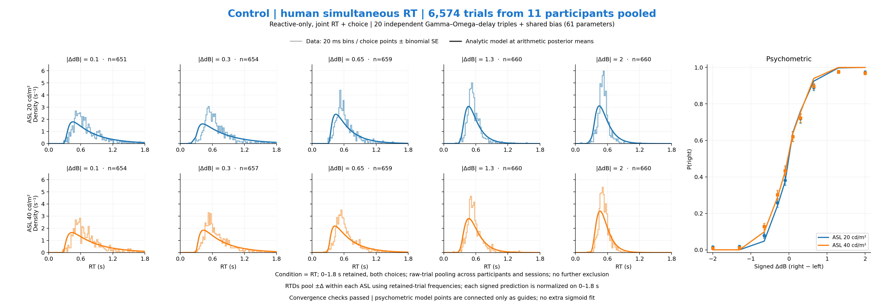

*Control: ASL 20/40 occupy the two RTD rows; columns are |ΔdB| = 0.1, 0.3, 0.65, 1.3, 2. Steps are data in 20 ms bins; curves use arithmetic posterior means of physical Gamma, Omega, delay, and bias. Each RTD has unit area on the full 0–1.8 s window. The right panel shows empirical P(right) ± binomial SE and conditional fitted probabilities at the ten observed signed differences; connecting segments are visual guides.*

[Full-size PNG](../assets/results/2026-10-20/human_gamma_omega_svi/human_control_gamma_omega_rtd_psychometric.png) · [PDF](../assets/results/2026-10-20/human_gamma_omega_svi/human_control_gamma_omega_rtd_psychometric.pdf)

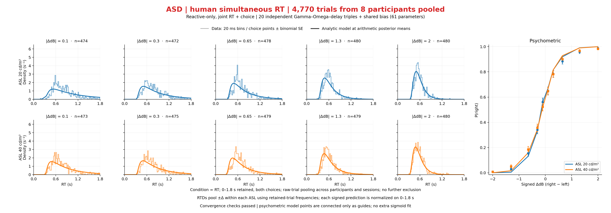

*ASD: ASL 20/40 occupy the two RTD rows; columns are |ΔdB| = 0.1, 0.3, 0.65, 1.3, 2. Steps are data in 20 ms bins; curves use arithmetic posterior means of physical Gamma, Omega, delay, and bias. Each RTD has unit area on the full 0–1.8 s window. The right panel shows empirical P(right) ± binomial SE and conditional fitted probabilities at the ten observed signed differences; connecting segments are visual guides.*

[Full-size PNG](../assets/results/2026-10-20/human_gamma_omega_svi/human_asd_gamma_omega_rtd_psychometric.png) · [PDF](../assets/results/2026-10-20/human_gamma_omega_svi/human_asd_gamma_omega_rtd_psychometric.pdf)

### Parameter comparison

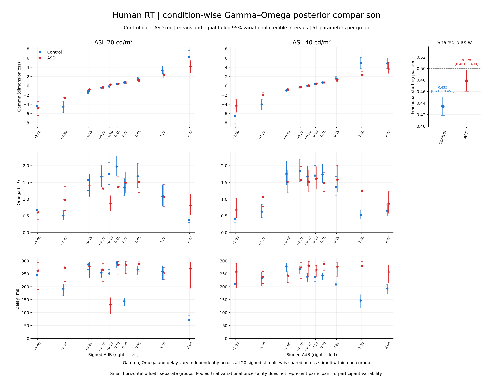

*Rows: Gamma, Omega, delay; columns: ASL 20/40. Control uses blue circles and ASD red stars. Points are posterior means and bars are equal-tailed **95% variational credible intervals**. Bias is shared across stimuli within each group. Small horizontal offsets separate group marks. These pooled-trial variational posteriors do not measure participant-to-participant variability.*

[Full-size PNG](../assets/results/2026-10-20/human_gamma_omega_svi/human_gamma_omega_parameter_comparison.png) · [PDF](../assets/results/2026-10-20/human_gamma_omega_svi/human_gamma_omega_parameter_comparison.pdf) · [All 122 parameter means, SDs, and intervals](../assets/results/2026-10-20/human_gamma_omega_svi/parameter_summary.csv)

### Fit quality on the identical retained trials

| Group / model | Parameters | Joint log likelihood | Psychometric RMSE | Mean signed-condition CDF gap | Maximum CDF gap |
|---|---:|---:|---:|---:|---:|
| Control: TIED joint MLE | 5 | -2027.63 | 0.0252 | 0.3001 | 0.3869 |
| Control: Shared-scale DDM joint MLE | 23 | -1846.81 | 0.0423 | 0.2652 | 0.3310 |
| Control: Free-scale DDM shared-delay joint MLE | 42 | -1386.66 | 0.0325 | 0.1772 | 0.2306 |
| Control: Gamma/Omega/delay SVI means | 61 | -341.36 | 0.0242 | 0.1377 | 0.1833 |
| ASD: TIED joint MLE | 5 | -1643.55 | 0.0490 | 0.2290 | 0.2947 |
| ASD: Shared-scale DDM joint MLE | 23 | -1543.99 | 0.0368 | 0.1984 | 0.2597 |
| ASD: Free-scale DDM shared-delay joint MLE | 42 | -1345.45 | 0.0289 | 0.1409 | 0.1988 |
| ASD: Gamma/Omega/delay SVI means | 61 | -869.01 | 0.0223 | 0.1140 | 0.1610 |

Allowing condition-specific delays changes the mean signed-condition RT CDF gap: **Control: 0.1772 → 0.1377**; **ASD: 0.1409 → 0.1140**. RTD agreement improves, but some fitted curves still underestimate the sharp empirical peaks. The remaining discrepancies are visible in the plots and maximum-gap column.

Likelihoods use the same rows and normalization. More flexible fits have more parameters; these in-sample scores do not establish predictive superiority. The earlier rows are maximum-likelihood diagnostics; the new SVI row is evaluated at arithmetic physical posterior means.

[Fit-quality table](../assets/results/2026-10-20/human_gamma_omega_svi/fit_quality.csv) · [Benchmark comparisons](../assets/results/2026-10-20/human_gamma_omega_svi/benchmark_comparison.csv) · [All signed-condition CDF gaps and probabilities](../assets/results/2026-10-20/human_gamma_omega_svi/condition_fit_quality.csv)

### Priors, initialization and convergence

| Parameter | Hard interval | Flat interval of trapezoidal prior |
|---|---:|---:|
| `gamma_positive` | [-1.0, 20.0] | [0.0, 12.0] |
| `gamma_negative` | [-20.0, 1.0] | [-12.0, 0.0] |
| `omega` | [0.01, 15.0] | [0.1, 12.0] |
| `t_E_aff` | [0.0, 0.3] | [0.01, 0.2] |
| `w` | [0.0, 1.0] | [0.4, 0.6] |

Linear tails connect each flat region to its hard limits. Gamma favors the stimulus-consistent sign but permits small reversals. The true delay prior remains 0–300 ms; each guide transform alone is confined below its condition’s earliest RT. All 40 causal limits are exported. Initialization uses the same-trial joint Gamma/Omega MLE with its shared delay copied into all conditions (Control 102.8 ms, ASD 173.4 ms).

NumPyro AutoMultivariateNormal; float64 CPU, full batch, one ELBO particle, seed 0, one initialization per group. ClippedAdam learning rate 0.0002, gradient clip 1, guide initial scale 0.1. Minimum 50,000 and maximum 1,000,000 updates. Any lower 1,000-update window mean resets patience; stopping requires 25 later windows and posterior-mean ranges below 0.1 posterior SD over the last three checkpoints for all 61 parameters. The selected best checkpoint is restored; 10,000 joint posterior samples are retained. ASD ran in parallel with Control’s continuation using separate CPU processes and checkpoints.

| Group | Final updates | Restored best | Later windows | Terminal max shift (SD) | Best checkpoint locally stable | Status |
|---|---:|---:|---:|---:|---|---|
| Control | 92,000 | 63,000 | 29 | 0.091 | False | Confirmation and terminal stability passed |
| ASD | 88,000 | 63,000 | 25 | 0.078 | True | Confirmation and terminal stability passed |

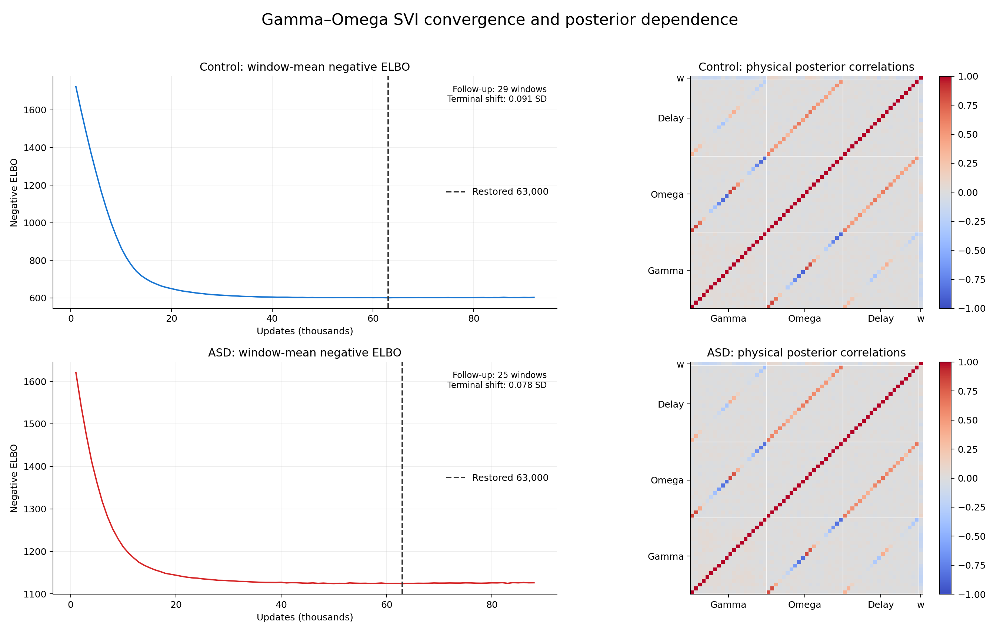

The mean-stability stopping gate applies to the final three checkpoints. The restored best checkpoint’s own local stability is recorded separately as a diagnostic. The checks establish observed-window confirmation, not a global minimum. [Diagnostic PDF](../assets/results/2026-10-20/human_gamma_omega_svi/human_gamma_omega_convergence_correlations.pdf) · [Strongest posterior correlations](../assets/results/2026-10-20/human_gamma_omega_svi/strongest_correlations.csv) · [Hard-bound and causal-limit proximity](../assets/results/2026-10-20/human_gamma_omega_svi/posterior_boundary_audit.csv)

[Control conditions and causal limits](../assets/results/2026-10-20/human_gamma_omega_svi/control/conditions.csv) · [ASD conditions and causal limits](../assets/results/2026-10-20/human_gamma_omega_svi/asd/conditions.csv) · [Control convergence record](../assets/results/2026-10-20/human_gamma_omega_svi/control/convergence_summary.json) · [ASD convergence record](../assets/results/2026-10-20/human_gamma_omega_svi/asd/convergence_summary.json) · [Parallel execution record](../assets/results/2026-10-20/human_gamma_omega_svi/execution_schedule.json)

### Boundary and dependence audit

6 of 122 parameters place at least 5% of posterior draws within the outer 1% of a hard prior interval. 6 condition delays meet that threshold near their causal upper limit. The support table separates prior limits from the data-implied causal limits.

| Group | Strongest physical posterior pair | Correlation |
|---|---|---:|
| Control | `gamma_09` / `omega_09` | -0.875 |
| Control | `gamma_19` / `omega_19` | -0.865 |
| Control | `gamma_18` / `omega_18` | -0.862 |
| ASD | `gamma_19` / `omega_19` | -0.842 |
| ASD | `gamma_10` / `omega_10` | 0.839 |
| ASD | `gamma_00` / `omega_00` | 0.834 |

Parameter suffixes are zero-based condition indices listed in each group’s condition table. Strong correlations describe posterior trade-offs; they do not measure between-participant associations.

### Sources and audit

Output root: `ASD_Human_Data/gamma_omega_rt_choice_svi_0_1p8s_delay300ms/`.

- `ASD_Human_Data/fit_human_gamma_omega_svi.py` ([source](../assets/results/2026-10-20/human_gamma_omega_svi/source/fit_human_gamma_omega_svi.py)).
- `ASD_Human_Data/human_gamma_omega_svi_utils.py` ([source](../assets/results/2026-10-20/human_gamma_omega_svi/source/human_gamma_omega_svi_utils.py)).
- `ASD_Human_Data/plot_human_gamma_omega_svi.py` ([source](../assets/results/2026-10-20/human_gamma_omega_svi/source/plot_human_gamma_omega_svi.py)).
- `ASD_Human_Data/verify_human_gamma_omega_svi.py` ([source](../assets/results/2026-10-20/human_gamma_omega_svi/source/verify_human_gamma_omega_svi.py)).
- `ASD_Human_Data/publish_human_gamma_omega_svi.py` ([source](../assets/results/2026-10-20/human_gamma_omega_svi/source/publish_human_gamma_omega_svi.py)).

[Complete posterior/checkpoint/calculation/source audit ZIP](../assets/results/2026-10-20/human_gamma_omega_svi/human_gamma_omega_svi_audits.zip) · [Run configuration and source hashes](../assets/results/2026-10-20/human_gamma_omega_svi/run_config.json) · [Independent verification](../assets/results/2026-10-20/human_gamma_omega_svi/independent_validation.json) · [Visual inspection](../assets/results/2026-10-20/human_gamma_omega_svi/visual_inspection.json)

Verification independently reconstructs all retained MAT row identities, 40 psychometric probabilities, 20 histograms and their signed mixtures, 122 posterior summaries, joint likelihoods, and CDF discrepancies. It checks true trapezoidal prior normalization, guide-only causal restrictions, finite gradients, K=40 versus K=80 accuracy, conditional unit mass, covariance/correlation matrices, and the stopping rule. Earlier human artifacts and unrelated modified tracked files are preserved.
