# Results — 2026-10-21

## Human RT debugging: plain DDM versus TIED

**Finding:** a standard plain DDM fits RT shape much better after freeing the stimulus drifts, but its RT-only fit implies nearly deterministic choices at the smallest difference. Including observed choices brings back broad RT distributions. The present evidence points to restrictions in the pooled, pure-reactive, shared-delay model; it does not establish a general failure of DDMs or a first-passage likelihood bug.

### Selection, normalization and fitting method

Use `Condition == "RT"` and **`0 <= RT_s <= 1.8`**: **6,574 Control trials from 11 participants** and **4,770 ASD trials from 8 participants**. Retain correct and incorrect trials, both simultaneous sessions, and **all four RTs below 200 ms**. Pool raw trials within group; exclude SD and sequential CB. No extra exclusions, shifts, or JND eligibility filter. The same 56 RTs above 1.8 s remain excluded.

Stimulus coordinates remain `B = Mean_dB` and signed `D = Delta_dB` (right minus left). ASL 20/40 cd/m² are plot labels. RT-only fits use `f_right(RT) + f_left(RT)`; joint fits use the density of the observed side. Both divide by the **either-bound mass on 0–1.8 s**, separately for each stimulus condition. Pooled curves use actual retained signed-condition frequencies.

**Interpretation of “pure DDM”:** the standard diagnostic fits 20 free stimulus drifts with one common boundary/noise time scale, one starting bias, and one delay per group. An additional diagnostic frees the time scale per condition. These are **direct maximum-likelihood fits without priors**, using multi-start L-BFGS-B and exact float64 gradients, to separate likelihood/model restrictions from SVI and prior effects. They are not new variational posteriors. The original SVI posterior and requested priors are preserved for comparison.

| Model | Free parameters per group | Shared quantities |
|---|---:|---|
| Original IPL/vanilla TIED | 5 | `rate_lambda`, `T_0`, `theta_E`, `w`, `t_E_aff` |
| Standard plain DDM | 23 | 20 free Γ; one common Ω, `w`, `t_E_aff` |
| DDM with free condition scales | 42 | 20 free Γ, 20 free Ω; common `w`, `t_E_aff` |

In unit-diffusion coordinates, the common-scale DDM has boundary magnitude `a = 1/sqrt(Ω)`, drift `v = Γ*sqrt(Ω)`, and start `(2w-1)*a`. Thus it has a common boundary and a free drift for every ASL × signed-difference condition. Γ direction is not identified by RT alone; the RT-only choice illustration uses the stimulus-consistent branch. Joint DDM fits allow either drift sign.

Delay bounds remain **0–300 ms**. Causality still requires a shared delay below the fastest retained RT: **111.1898 ms Control**, **181.6110 ms ASD**. The optimizer uses a 0.1 μs margin below that causal limit. Widening the nominal upper bound cannot remove this data-imposed restriction.

### RT-only fit comparison

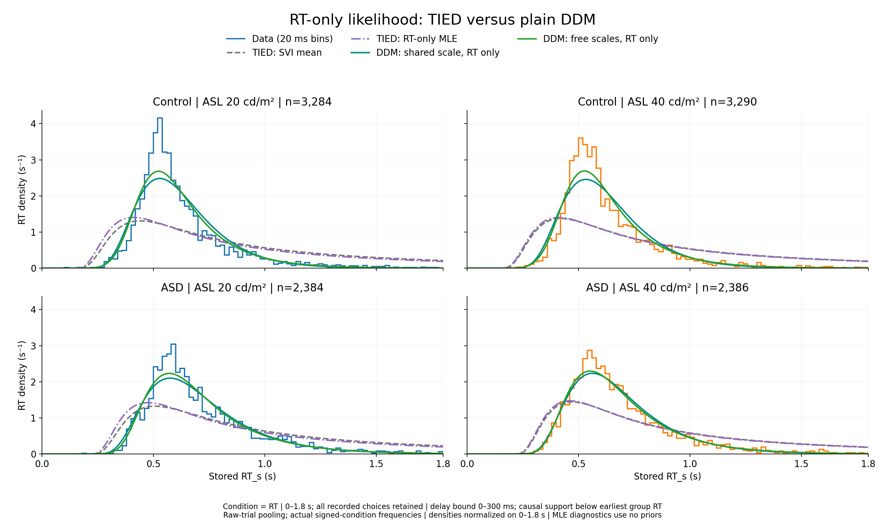

*Control above ASD; ASL 20 and 40 in separate columns. Steps are data in 20-ms bins. Gray dashed: original SVI physical means; purple: directly re-optimized five-parameter TIED; teal: standard plain DDM with a shared time scale; green: DDM with free condition scales. Every density integrates to one on the retained 0–1.8 s window. Plain DDMs improve shape substantially but still underestimate some sharp peaks.*

[Full-size PNG](../assets/results/2026-10-21/human_ddm_debug/human_rt_only_ddm_debug.png) · [PDF](../assets/results/2026-10-21/human_ddm_debug/human_rt_only_ddm_debug.pdf)

### Quantitative diagnostics

CDF error is the largest absolute empirical/model CDF difference within each condition, averaged **equally across the 20 signed stimulus conditions**. The fitted likelihood itself weights every retained trial. Psychometric RMSE averages the 20 retained-window probabilities. These are training-fit diagnostics with different parameter counts, not an out-of-sample model-selection result.

| Model | Parameters | Control mean CDF error | ASD mean CDF error | Control choice RMSE | ASD choice RMSE |
|---|---:|---:|---:|---:|---:|
| TIED: original SVI physical means | 5 | 0.3278 | 0.2557 | 0.0310 | 0.0579 |
| TIED: posterior predictive | 5 | 0.3180 | 0.2439 | 0.0292 | 0.0564 |
| TIED: RT-only MLE | 5 | 0.3167 | 0.2445 | 0.0297 | 0.0572 |
| Plain DDM: shared scale, RT only | 23 | 0.0988 | 0.0631 | 0.2216 | 0.2511 |
| Plain DDM: free scales, RT only | 42 | 0.0724 | 0.0530 | 0.2216 | 0.2460 |
| TIED: RT + choice MLE | 5 | 0.3001 | 0.2290 | 0.0252 | 0.0490 |
| Plain DDM: shared scale, RT + choice | 23 | 0.2652 | 0.1984 | 0.0423 | 0.0368 |
| Plain DDM: free scales, RT + choice | 42 | 0.1772 | 0.1409 | 0.0325 | 0.0289 |

The five-parameter TIED fit improves only modestly after direct likelihood optimization. Five starts were tried per group; all five Control starts and four ASD starts reached the best TIED basin. The other ASD start reached a poorer local result. Free-scale DDM RT fits also have multiple local results, all retained in the audit. No global-optimum claim is made.

Control's TIED MLE approaches the small-λ limit: λ reaches the diagnostic computational lower limit `1e-4`. Reducing λ to `1e-6` while preserving the effective drift slope and reference time scale changes log likelihood by only **0.003604** and the largest CDF value by **1.95e-05**. This numerical limit does not explain the large fit discrepancy. These are MLE computational bounds, not new priors; see the protocol for all ranges.

### Why RT-only success is insufficient

At **|ΔdB| = 0.1**, the standard RT-only DDM uses strong drift magnitudes to obtain narrow RT distributions. Interpreting those drifts in the natural stimulus direction gives:

| Group | Trials at absolute ΔdB = 0.1 | Observed accuracy | RT-only DDM predicted accuracy |
|---|---:|---:|---:|
| Control | 1,305 | 60.69% | 100.00000% |
| ASD | 947 | 55.33% | 99.99930% |

The observed choices are much less deterministic. This is a timing–choice trade-off: a strong reactive drift narrows RTs but predicts high accuracy. With weak drift, decision times are broader; a larger common nondecision delay could shorten the decision-time component, but the earliest responses constrain that delay. This is a model-based explanation of these fits, not proof that all human responses follow one mechanism.

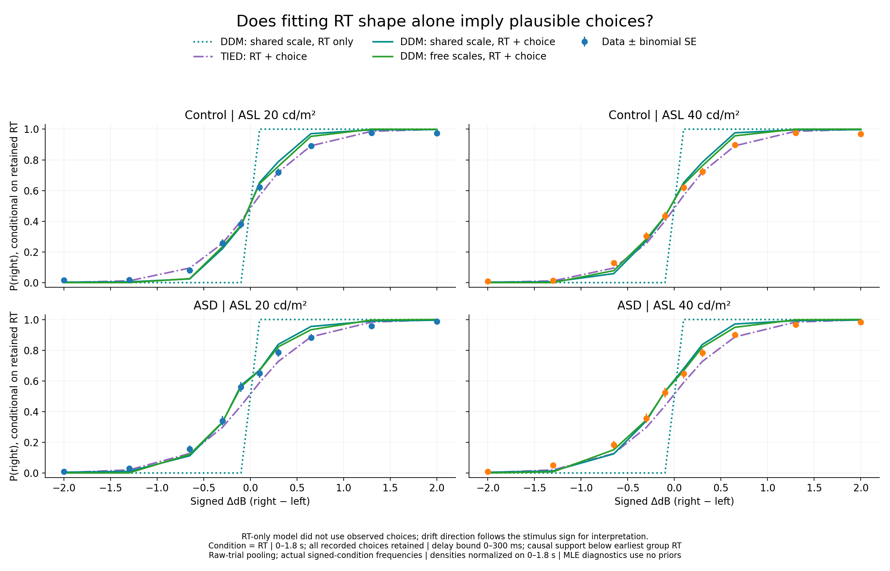

*Data show retained-window P(right) with binomial sample SE. Dotted teal is the RT-only standard DDM, which did not fit choices. Other curves are joint RT-and-choice fits. Conditional probabilities are integrated right-bound mass divided by either-bound retained mass. Joint fits recover graded choices; RT-only drift direction is not identifiable from RT observations alone.*

[Full-size PNG](../assets/results/2026-10-21/human_ddm_debug/human_ddm_choice_debug.png) · [PDF](../assets/results/2026-10-21/human_ddm_debug/human_ddm_choice_debug.pdf)

### Adding choice to the likelihood

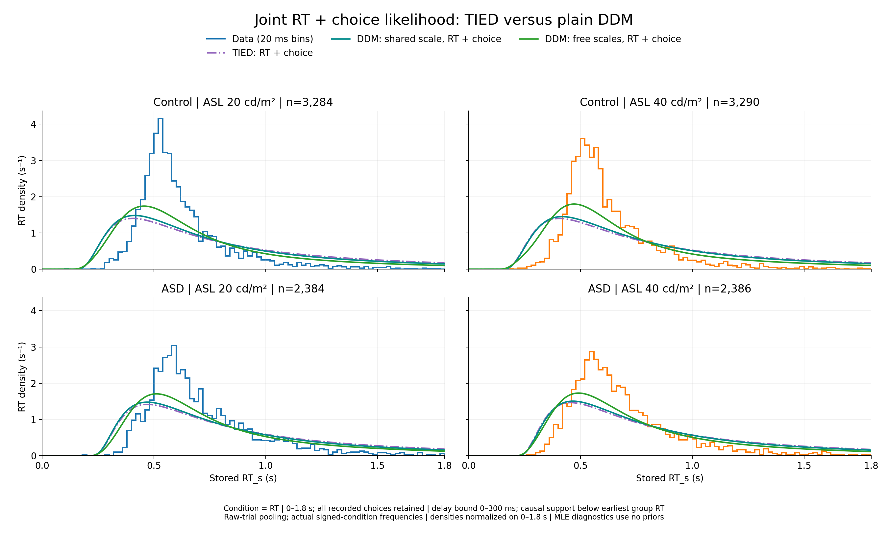

*Same rows, window and group pooling, now optimizing the joint RT-and-observed-choice likelihood. Purple: TIED; teal: standard DDM with a shared scale; green: free condition scales. Accommodating the observed error rates broadens the fitted RTDs again. Free condition scales help but do not recover the sharp data peaks completely.*

[Full-size PNG](../assets/results/2026-10-21/human_ddm_debug/human_joint_ddm_debug.png) · [PDF](../assets/results/2026-10-21/human_ddm_debug/human_joint_ddm_debug.pdf)

### Stimulus mapping versus distribution shape

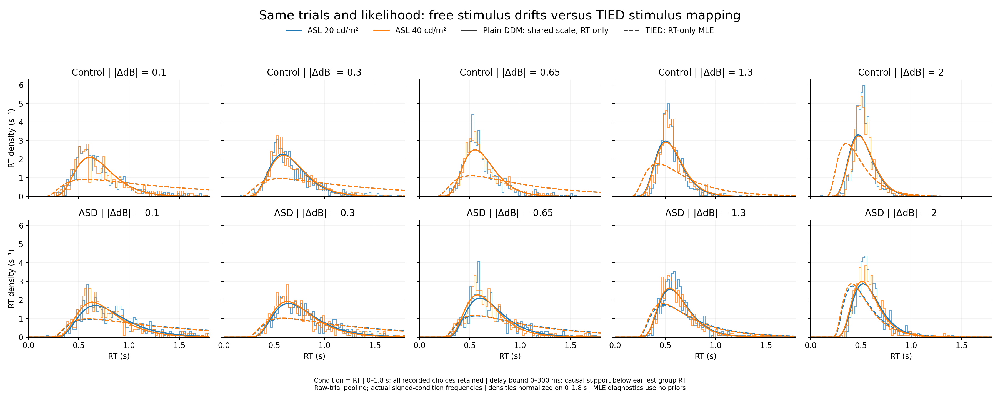

*Two rows: Control then ASD; columns are the five absolute differences. Blue/orange are ASL 20/40. Steps show pooled ±D data, solid curves show the standard RT-only DDM and dashed curves the RT-only TIED MLE. Fits themselves used all 20 signed conditions; only display mixtures pool signs.*

[Full-size PNG](../assets/results/2026-10-21/human_ddm_debug/human_ddm_rt_by_delta_debug.png) · [PDF](../assets/results/2026-10-21/human_ddm_debug/human_ddm_rt_by_delta_debug.pdf)

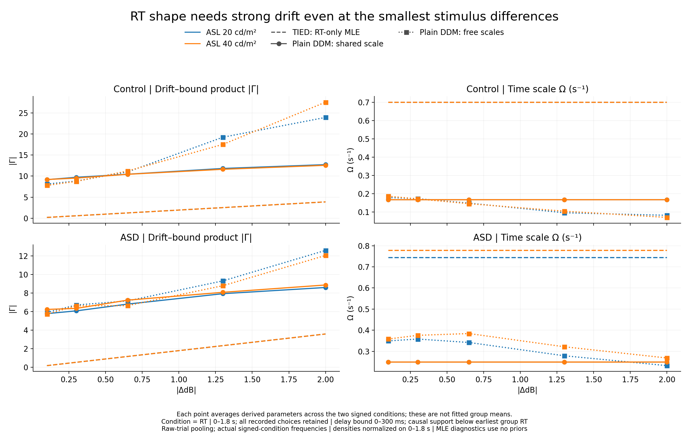

*Derived |Γ| and Ω averaged across the two signed conditions at each absolute difference. TIED links drift strength tightly to stimulus difference, while successful RT-only plain-DDM fits need strong drift even at small differences. The plotted averages are parameter summaries, not an additional fitting objective.*

[Full-size PNG](../assets/results/2026-10-21/human_ddm_debug/human_ddm_parameter_constraints_debug.png) · [PDF](../assets/results/2026-10-21/human_ddm_debug/human_ddm_parameter_constraints_debug.pdf)

### Posterior-mean plotting check

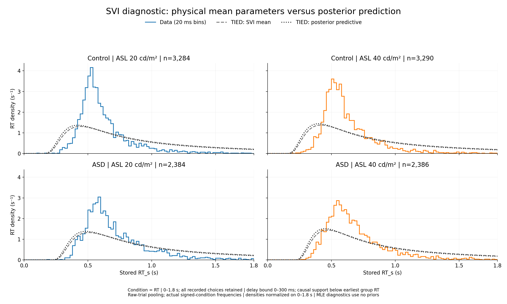

*Gray dashed curves use arithmetic means of the original five physical parameters. Black dotted curves average complete model predictions across 128 reproducibly selected joint variational posterior draws, preserving parameter correlations. Averaging predictions does not rescue the original RT shape. Variational uncertainty in this pooled model does not describe between-participant variability.*

[Full-size PNG](../assets/results/2026-10-21/human_ddm_debug/human_svi_predictive_ddm_debug.png) · [PDF](../assets/results/2026-10-21/human_ddm_debug/human_svi_predictive_ddm_debug.pdf)

### Paper-code comparison and remaining hypotheses

The human adapter, the direct Γ/Ω primitives, an independent SciPy image/eigenfunction calculation, and the original paper-code evidence kernels agree at corresponding parameter values. The original paper's `time_vary_norm_utils.py` also contains the proactive/reactive race. After summing choices, its RT density has the form

```text
f_RT(t) = f_A(t) * [1 - F_E(t)] + f_E(t) * [1 - F_A(t)]
```

with the appropriate timing offsets. This adds proactive responses and suppresses late reactive responses, so removing it can materially change RT shape. The local condition-delay animal fitter also has a separate `t_E_aff` for each stimulus condition; the current human baseline has one scalar delay per group. Therefore the successful animal model and the present five-parameter pure-reactive baseline impose different timing restrictions. The mechanistic constraint and race interpretation are described in the [2019 TIED paper](https://www.nature.com/articles/s41593-019-0439-7) and [2021 proactive/reactive paper](https://www.nature.com/articles/s41467-021-27302-8).

The results justify a controlled proactive-plus-reactive fit as the next model check. Alternative timing explanations include a small fast-response component, variable nondecision time, and participant/session heterogeneity. These alternatives were not fitted here; no new trials were removed. A better free-DDM fit alone does not imply a likelihood bug, because freeing the stimulus parameters removes TIED's cross-condition constraints.

### Sources and audit

Sources: `ASD_Human_Data/debug_human_reactive_ddm.py`, `debug_human_ddm_shared_scale.py`, `debug_human_ddm_joint.py`, `human_plain_ddm_diagnostics_utils.py`, `analyze_human_reactive_ddm_debug.py`, `verify_human_reactive_ddm_debug.py` and `publish_human_reactive_ddm_debug.py` under `ASD_Human_Data/`.

[RT-only fitter](../assets/results/2026-10-21/human_ddm_debug/source/ASD_Human_Data/debug_human_reactive_ddm.py) · [Standard DDM control](../assets/results/2026-10-21/human_ddm_debug/source/ASD_Human_Data/debug_human_ddm_shared_scale.py) · [Joint fitter](../assets/results/2026-10-21/human_ddm_debug/source/ASD_Human_Data/debug_human_ddm_joint.py) · [Diagnostic kernels](../assets/results/2026-10-21/human_ddm_debug/source/ASD_Human_Data/human_plain_ddm_diagnostics_utils.py) · [Analysis and plots](../assets/results/2026-10-21/human_ddm_debug/source/ASD_Human_Data/analyze_human_reactive_ddm_debug.py) · [Verifier](../assets/results/2026-10-21/human_ddm_debug/source/ASD_Human_Data/verify_human_reactive_ddm_debug.py) · [Paper-code kernels](../assets/results/2026-10-21/human_ddm_debug/source/fit_animal_by_animal/time_vary_norm_utils.py)

[Fit-quality table](../assets/results/2026-10-21/human_ddm_debug/fit_quality.csv) · [Condition parameters](../assets/results/2026-10-21/human_ddm_debug/condition_parameters.csv) · [Condition diagnostics](../assets/results/2026-10-21/human_ddm_debug/condition_fit_quality.csv) · [Small-difference choice check](../assets/results/2026-10-21/human_ddm_debug/low_delta_choice_check.csv) · [Original trial identities](../assets/results/2026-10-21/human_ddm_debug/selected_trials.csv) · [Protocol and bounds](../assets/results/2026-10-21/human_ddm_debug/protocol.json) · [Independent verification](../assets/results/2026-10-21/human_ddm_debug/verification.json) · [Visual inspection](../assets/results/2026-10-21/human_ddm_debug/visual_inspection.json) · [Source hashes](../assets/results/2026-10-21/human_ddm_debug/source_audit.json) · [Complete audit bundle](../assets/results/2026-10-21/human_ddm_debug/human_ddm_debug_audits.zip)

The audit bundle includes every optimization start and trace, fitted vectors, derived curves and metrics, source scripts, original MAT/CSV provenance, and the baseline variational draws used for posterior prediction. Verification checks all 11,344 original MAT identities, group membership, preserved early trials, column mapping, finite gradients, K=40/80 agreement, CDF/PDF consistency, conditional unit mass, old paper kernels, empirical histograms and probabilities, likelihood scores, six PNG/PDF pairs, PDF text bounds, and unchanged baseline fit hashes.


## Human RT: Gamma–Omega SVI with delay prior widened to 500 ms

**Selection:** `Condition == "RT"`, `Valid == 1`, and **0 ≤ RT_s ≤ 1.8 s**. **Control: 6,574 trials from 11 participants; ASD: 4,770 trials from 8 participants.** All retained correct and incorrect choices are pooled as raw trials across participants and sessions. The four RTs below 200 ms are retained; 56 RTs above 1.8 s are excluded. SD and sequential CB are excluded.

**Model:** a reactive-only, descriptive two-bound DDM with **20 independent Gamma, 20 Omega, 20 effective nondecision delays, and one shared fractional starting bias `w` per group (61 parameters)**. The model and all fit settings match the 300 ms fit; only the delay hard upper prior changes to 500 ms. There is no proactive process or `del_go`. Gamma is dimensionless, Omega is in s⁻¹. `Choice=1/-1` is right/left; `Delta_dB` is right minus left visual dB. ASL labels are 20/40 cd/m².

The likelihood is the observed bound-specific RT density divided by the probability of reaching **either** bound within 0–1.8 s. Predictions use the same normalization. Fits keep all signed conditions distinct; only displayed RTDs pool ±Δ using actual retained-trial frequencies. This is not an equal-participant average.

### Why widen the bound?

The 300 ms posteriors show upper 95% endpoints above 295 ms in **2 Control and 8 ASD conditions**, reaching 298.95 and 298.87 ms. The largest posterior means were 292.26 and 290.05 ms. This is pressure near the old prior cap; the continuous prior does not put point mass exactly at 300 ms. The flat part of the trapezoid remains **10–200 ms**.

With all trials retained, each delay must remain below its own condition’s fastest RT. Widening creates additional causal support for **5 Control and 16 ASD conditions**. The largest new effective limits are **347.71 ms Control and 391.00 ms ASD**; the 500 ms prior does not override these data-implied limits. No RT selection or response coding changes.

[Original boundary audit](../assets/results/2026-10-21/human_gamma_omega_delay500_svi/delay300_boundary_audit.csv) · [Configuration and initialization comparison](../assets/results/2026-10-21/human_gamma_omega_delay500_svi/delay300_boundary_diagnosis.json)

### Direct comparison with the 300 ms fits

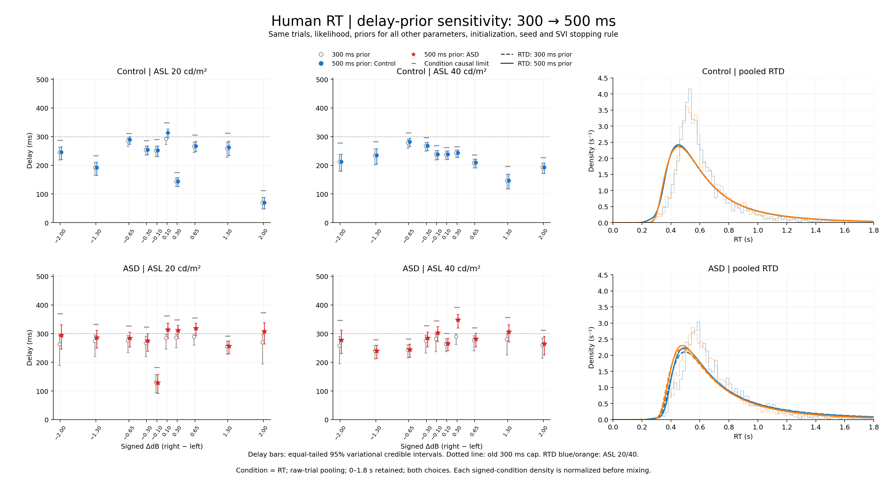

*Rows are Control and ASD. The left two columns compare delay posterior means and 95% variational intervals at ASL 20/40; gray open circles are the 300 ms fit, group-colored marks the 500 ms fit. Short gray marks give the condition-specific causal limits. The right panels pool all stimulus differences using actual trial counts: blue/orange are ASL 20/40, dashed curves use the 300 ms prior and solid curves the 500 ms prior. Each signed density is normalized on 0–1.8 s before mixing.*

[Full-size comparison](../assets/results/2026-10-21/human_gamma_omega_delay500_svi/human_gamma_omega_delay_prior_comparison.png) · [PDF](../assets/results/2026-10-21/human_gamma_omega_delay500_svi/human_gamma_omega_delay_prior_comparison.pdf) · [All parameter changes](../assets/results/2026-10-21/human_gamma_omega_delay500_svi/delay_bound_parameter_comparison.csv) · [Delay shifts and probability above 300 ms](../assets/results/2026-10-21/human_gamma_omega_delay500_svi/delay_bound_delay_comparison.csv)

Comparison source: `ASD_Human_Data/compare_human_gamma_omega_delay_bounds.py` ([source](../assets/results/2026-10-21/human_gamma_omega_delay500_svi/source/compare_human_gamma_omega_delay_bounds.py)).

### Delay posteriors after widening

| Group | Delay means above 300 ms | Largest delay mean | Largest upper 95% endpoint | Closest sampled delay to a causal cap |
|---|---:|---:|---:|---:|
| Control | 1 / 20 | 313.74 ms | 327.00 ms | 5.45 ms below |
| ASD | 7 / 20 | 348.27 ms | 367.53 ms | 7.49 ms below |

No new posterior sample is within 5 ms of its condition’s causal limit. The 500 ms hard prior is above every condition’s causal support. For ASD at ASL 40, ΔdB = +0.3, the delay moves from a 290.05 ms mean to **348.27 ms [320.10, 367.53]**, with 99.93% of draws above 300 ms. These are equal-tailed variational credible intervals.

### Data and mean-parameter fits with the 500 ms prior

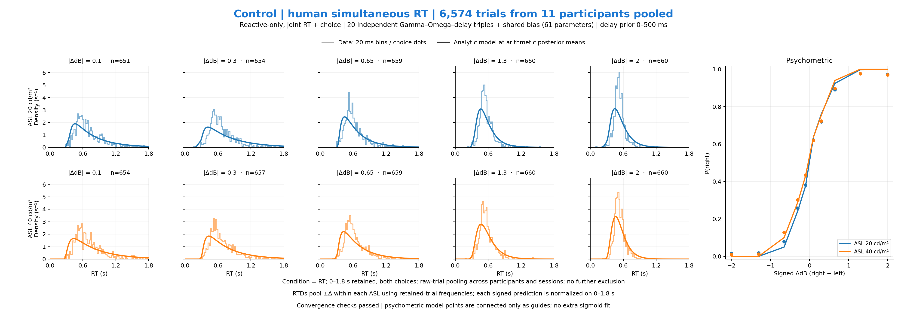

*Control: ASL 20/40 occupy the two RTD rows; columns are |ΔdB| = 0.1, 0.3, 0.65, 1.3, 2. Steps are data in 20 ms bins; curves use arithmetic posterior means of physical Gamma, Omega, delay, and bias. Each RTD has unit area on the full 0–1.8 s window. The right panel shows empirical P(right) as dots without error bars and conditional fitted probabilities at the ten observed signed differences; connecting segments are visual guides.*

[Full-size PNG](../assets/results/2026-10-21/human_gamma_omega_delay500_svi/human_control_gamma_omega_rtd_psychometric.png) · [PDF](../assets/results/2026-10-21/human_gamma_omega_delay500_svi/human_control_gamma_omega_rtd_psychometric.pdf)

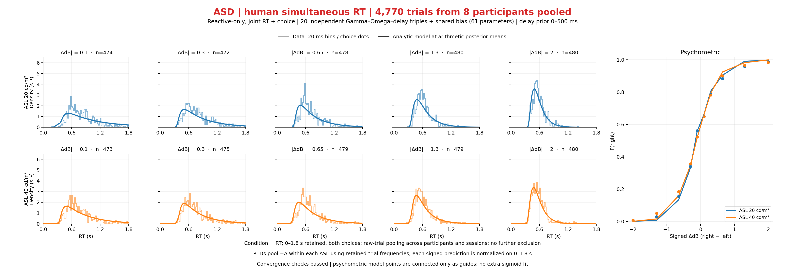

*ASD: ASL 20/40 occupy the two RTD rows; columns are |ΔdB| = 0.1, 0.3, 0.65, 1.3, 2. Steps are data in 20 ms bins; curves use arithmetic posterior means of physical Gamma, Omega, delay, and bias. Each RTD has unit area on the full 0–1.8 s window. The right panel shows empirical P(right) as dots without error bars and conditional fitted probabilities at the ten observed signed differences; connecting segments are visual guides.*

[Full-size PNG](../assets/results/2026-10-21/human_gamma_omega_delay500_svi/human_asd_gamma_omega_rtd_psychometric.png) · [PDF](../assets/results/2026-10-21/human_gamma_omega_delay500_svi/human_asd_gamma_omega_rtd_psychometric.pdf)

### Parameter comparison

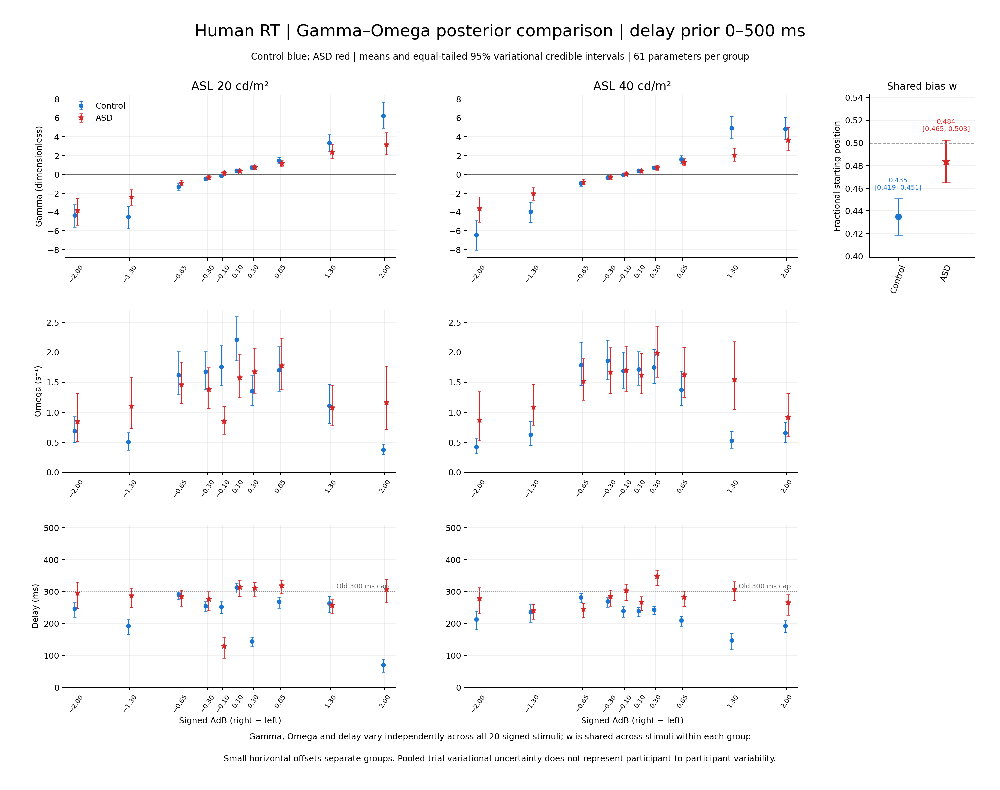

*Rows: Gamma, Omega, delay; columns: ASL 20/40. Control uses blue circles and ASD red stars. Points are posterior means and bars are equal-tailed **95% variational credible intervals**. Bias is shared across stimuli within each group. Small horizontal offsets separate group marks. These pooled-trial variational posteriors do not measure participant-to-participant variability.*

[Full-size PNG](../assets/results/2026-10-21/human_gamma_omega_delay500_svi/human_gamma_omega_parameter_comparison.png) · [PDF](../assets/results/2026-10-21/human_gamma_omega_delay500_svi/human_gamma_omega_parameter_comparison.pdf) · [All 122 parameter means, SDs, and intervals](../assets/results/2026-10-21/human_gamma_omega_delay500_svi/parameter_summary.csv)

### Fit quality on the identical retained trials

| Group / model | Parameters | Joint log likelihood | Psychometric RMSE | Mean signed-condition CDF gap | Maximum CDF gap |
|---|---:|---:|---:|---:|---:|
| Control: Gamma/Omega/delay SVI means — 300 ms prior | 61 | -341.36 | 0.0242 | 0.1377 | 0.1833 |
| Control: TIED joint MLE | 5 | -2027.63 | 0.0252 | 0.3001 | 0.3869 |
| Control: Shared-scale DDM joint MLE | 23 | -1846.81 | 0.0423 | 0.2652 | 0.3310 |
| Control: Free-scale DDM shared-delay joint MLE | 42 | -1386.66 | 0.0325 | 0.1772 | 0.2306 |
| Control: Gamma/Omega/delay SVI means — 500 ms prior | 61 | -334.24 | 0.0237 | 0.1379 | 0.1834 |
| ASD: Gamma/Omega/delay SVI means — 300 ms prior | 61 | -869.01 | 0.0223 | 0.1140 | 0.1610 |
| ASD: TIED joint MLE | 5 | -1643.55 | 0.0490 | 0.2290 | 0.2947 |
| ASD: Shared-scale DDM joint MLE | 23 | -1543.99 | 0.0368 | 0.1984 | 0.2597 |
| ASD: Free-scale DDM shared-delay joint MLE | 42 | -1345.45 | 0.0289 | 0.1409 | 0.1988 |
| ASD: Gamma/Omega/delay SVI means — 500 ms prior | 61 | -818.06 | 0.0183 | 0.1128 | 0.1616 |

Widening the delay prior changes the mean signed-condition RT CDF gap: **Control: 0.1377 → 0.1379**; **ASD: 0.1140 → 0.1128**. Control RTDs are essentially unchanged; ASD improves modestly on this average CDF metric, and its psychometric RMSE decreases. Maximum CDF gaps do not improve. The sharp empirical RTD peaks remain underfit: relaxing the delay prior does not resolve the main shape mismatch.

Likelihoods use the same rows and normalization. More flexible fits have more parameters; these in-sample scores do not establish predictive superiority. The 5/23/42-parameter rows are maximum-likelihood diagnostics; both 61-parameter SVI rows are evaluated at arithmetic physical posterior means.

[Fit-quality table](../assets/results/2026-10-21/human_gamma_omega_delay500_svi/fit_quality.csv) · [Benchmark comparisons](../assets/results/2026-10-21/human_gamma_omega_delay500_svi/benchmark_comparison.csv) · [All signed-condition CDF gaps and probabilities](../assets/results/2026-10-21/human_gamma_omega_delay500_svi/condition_fit_quality.csv) · [300 versus 500 ms fit metrics](../assets/results/2026-10-21/human_gamma_omega_delay500_svi/delay_bound_fit_comparison.csv)

### Priors, initialization and convergence

| Parameter | Hard interval | Flat interval of trapezoidal prior |
|---|---:|---:|
| `gamma_positive` | [-1.0, 20.0] | [0.0, 12.0] |
| `gamma_negative` | [-20.0, 1.0] | [-12.0, 0.0] |
| `omega` | [0.01, 15.0] | [0.1, 12.0] |
| `t_E_aff` | [0.0, 0.5] | [0.01, 0.2] |
| `w` | [0.0, 1.0] | [0.4, 0.6] |

Linear tails connect each flat region to its hard limits. Gamma favors the stimulus-consistent sign but permits small reversals. The true delay prior remains 0–500 ms; each guide transform alone is confined below its condition’s earliest RT. All 40 causal limits are exported. Initialization uses the same-trial joint Gamma/Omega MLE with its shared delay copied into all conditions (Control 102.8 ms, ASD 173.4 ms).

NumPyro AutoMultivariateNormal; float64 CPU, full batch, one ELBO particle, seed 0, one initialization per group. ClippedAdam learning rate 0.0002, gradient clip 1, guide initial scale 0.1. Minimum 50,000 and maximum 1,000,000 updates. Any lower 1,000-update window mean resets patience; stopping requires 25 later windows and posterior-mean ranges below 0.1 posterior SD over the last three checkpoints for all 61 parameters. Fresh optimizer/RNG runs use the same physical initialization as the 300 ms fit. The selected best checkpoint is restored; 10,000 joint posterior samples are retained. Control and ASD ran in parallel using separate CPU processes and checkpoints.

| Group | Final updates | Restored best | Later windows | Terminal max shift (SD) | Best checkpoint locally stable | Status |
|---|---:|---:|---:|---:|---|---|
| Control | 92,000 | 63,000 | 29 | 0.091 | False | Confirmation and terminal stability passed |
| ASD | 109,000 | 83,000 | 26 | 0.099 | False | Confirmation and terminal stability passed |

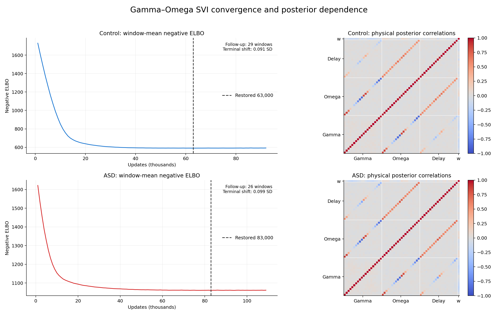

The mean-stability stopping gate applies to the final three checkpoints. The restored best checkpoint’s own local stability is recorded separately as a diagnostic. The checks establish observed-window confirmation, not a global minimum. [Diagnostic PDF](../assets/results/2026-10-21/human_gamma_omega_delay500_svi/human_gamma_omega_convergence_correlations.pdf) · [Strongest posterior correlations](../assets/results/2026-10-21/human_gamma_omega_delay500_svi/strongest_correlations.csv) · [Hard-bound and causal-limit proximity](../assets/results/2026-10-21/human_gamma_omega_delay500_svi/posterior_boundary_audit.csv)

[Control conditions and causal limits](../assets/results/2026-10-21/human_gamma_omega_delay500_svi/control/conditions.csv) · [ASD conditions and causal limits](../assets/results/2026-10-21/human_gamma_omega_delay500_svi/asd/conditions.csv) · [Control convergence record](../assets/results/2026-10-21/human_gamma_omega_delay500_svi/control/convergence_summary.json) · [ASD convergence record](../assets/results/2026-10-21/human_gamma_omega_delay500_svi/asd/convergence_summary.json) · [Parallel execution record](../assets/results/2026-10-21/human_gamma_omega_delay500_svi/execution_schedule.json)

### Boundary and dependence audit

0 of 122 parameters place at least 5% of posterior draws within the outer 1% of a hard prior interval. 0 condition delays meet that threshold near their causal upper limit. The support table separates prior limits from the data-implied causal limits.

| Group | Strongest physical posterior pair | Correlation |
|---|---|---:|
| Control | `gamma_09` / `omega_09` | -0.875 |
| Control | `gamma_19` / `omega_19` | -0.865 |
| Control | `gamma_18` / `omega_18` | -0.862 |
| ASD | `gamma_19` / `omega_19` | -0.868 |
| ASD | `gamma_10` / `omega_10` | 0.864 |
| ASD | `gamma_00` / `omega_00` | 0.864 |

Parameter suffixes are zero-based condition indices listed in each group’s condition table. Strong correlations describe posterior trade-offs; they do not measure between-participant associations.

### Sources and audit

Output root: `ASD_Human_Data/gamma_omega_rt_choice_svi_0_1p8s_delay500ms/`.

- `ASD_Human_Data/fit_human_gamma_omega_delay500_svi.py` ([source](../assets/results/2026-10-21/human_gamma_omega_delay500_svi/source/fit_human_gamma_omega_delay500_svi.py)).
- `ASD_Human_Data/human_gamma_omega_delay500_svi_utils.py` ([source](../assets/results/2026-10-21/human_gamma_omega_delay500_svi/source/human_gamma_omega_delay500_svi_utils.py)).
- `ASD_Human_Data/plot_human_gamma_omega_delay500_svi.py` ([source](../assets/results/2026-10-21/human_gamma_omega_delay500_svi/source/plot_human_gamma_omega_delay500_svi.py)).
- `ASD_Human_Data/verify_human_gamma_omega_delay500_svi.py` ([source](../assets/results/2026-10-21/human_gamma_omega_delay500_svi/source/verify_human_gamma_omega_delay500_svi.py)).
- `ASD_Human_Data/publish_human_gamma_omega_delay500_svi.py` ([source](../assets/results/2026-10-21/human_gamma_omega_delay500_svi/source/publish_human_gamma_omega_delay500_svi.py)).

[Complete posterior/checkpoint/calculation/source audit ZIP](../assets/results/2026-10-21/human_gamma_omega_delay500_svi/human_gamma_omega_svi_audits.zip) · [Run configuration and source hashes](../assets/results/2026-10-21/human_gamma_omega_delay500_svi/run_config.json) · [Independent verification](../assets/results/2026-10-21/human_gamma_omega_delay500_svi/independent_validation.json) · [Visual inspection](../assets/results/2026-10-21/human_gamma_omega_delay500_svi/visual_inspection.json)

Verification independently reconstructs all retained MAT row identities, 40 psychometric probabilities, 20 histograms and their signed mixtures, 122 posterior summaries, joint likelihoods, and CDF discrepancies. It checks true trapezoidal prior normalization, guide-only causal restrictions, finite gradients, K=40 versus K=80 accuracy, conditional unit mass, covariance/correlation matrices, and the stopping rule. Earlier human artifacts and unrelated modified tracked files are preserved.
