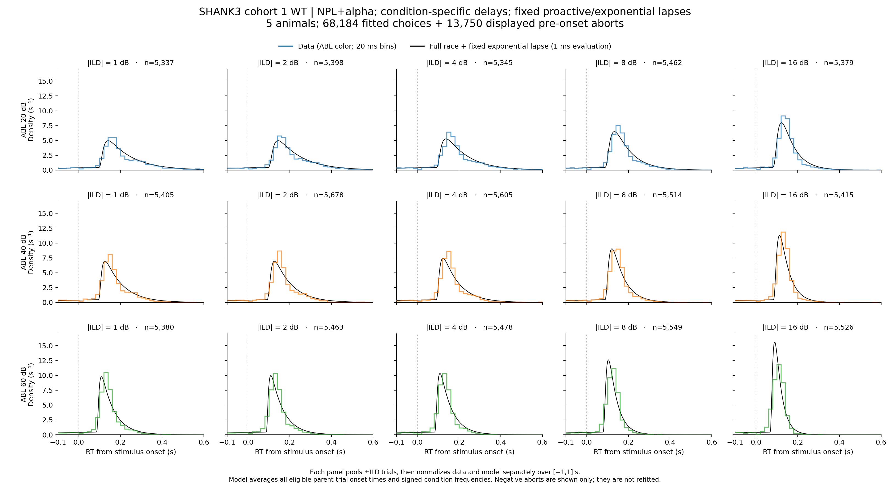
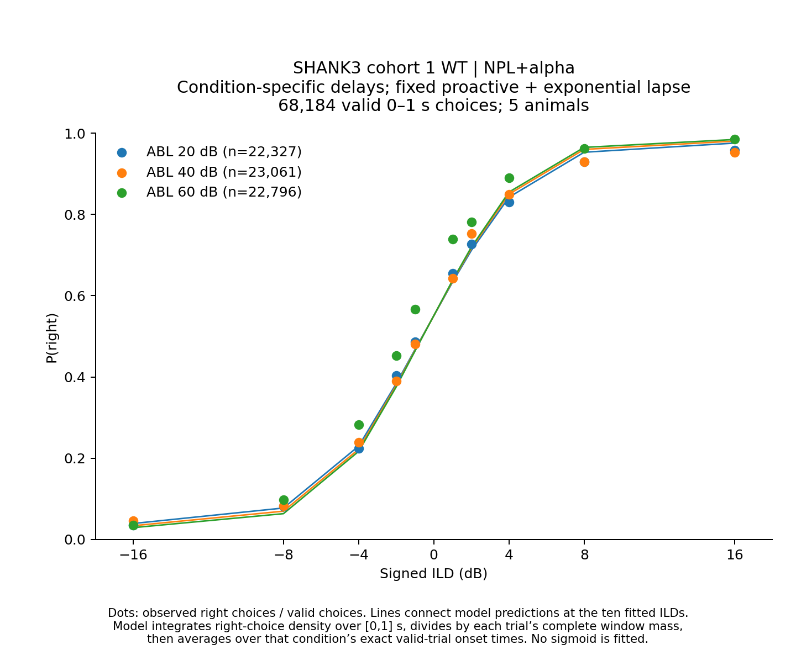
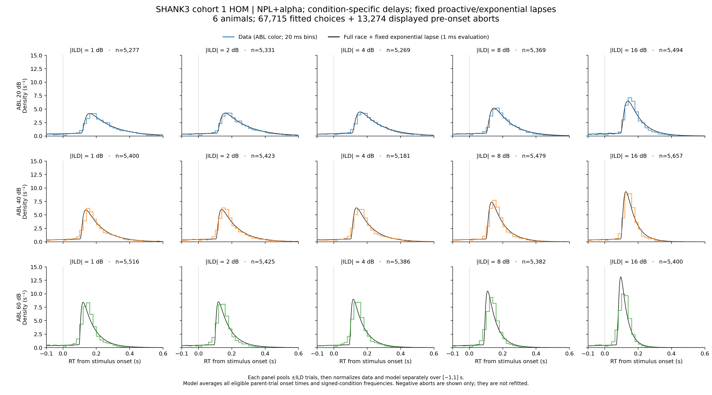
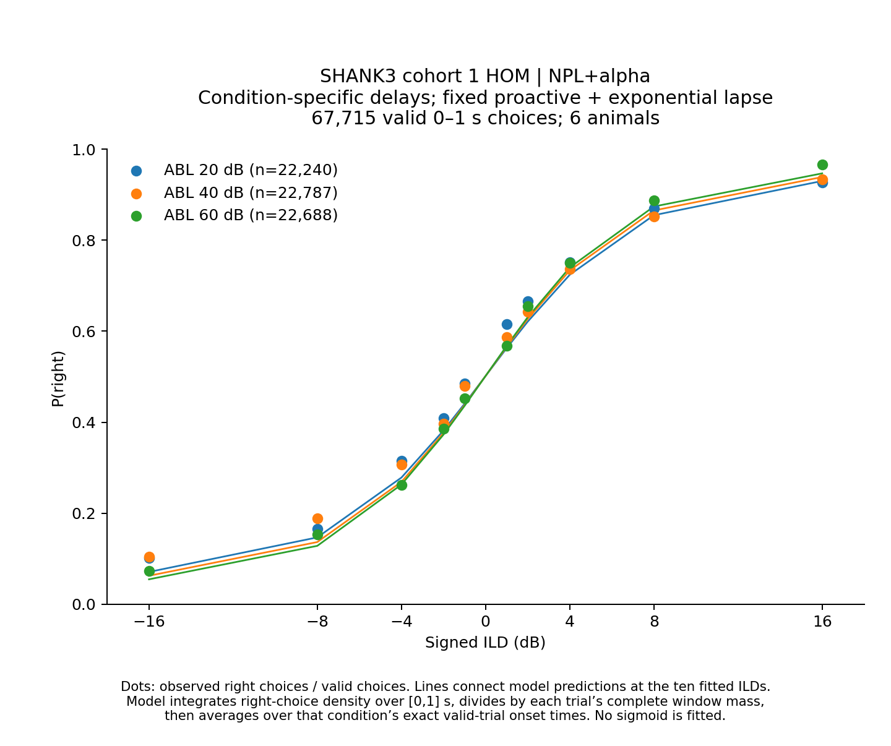
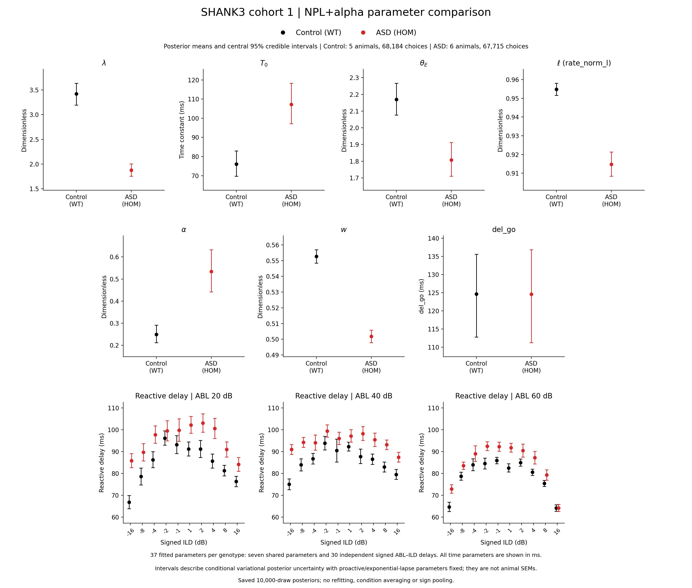

# Results: 2026-11-04

Add result entries below this line.

<!-- shank3-wt-npl-alpha:start -->
## SHANK3 cohort 1 WT: NPL+alpha with condition-specific delays and fixed exponential lapses

Five WT animals from `SHANK3_cohort1.csv` are pooled by actual trial counts. The objective uses **68,184 choices** (37,482 right and 30,702 left), `success` in {1,-1}, finite recorded `timed_rt` in inclusive **[0,1] s**, session type 1, training level 16, ABL 20/40/60 after 59→60, and signed ILDs ±1/2/4/8/16. The 373 valid choices above 1 s are excluded. Prepared repeat, short-sound and calibration rules are preserved without applying them again.

The five WT seed-0 proactive/exponential-lapse posterior means remain fixed. This fit estimates **37 parameters**: seven shared NPL+alpha parameters and 30 independent signed-condition reactive delays. Gamma/Omega are determined by NPL+alpha rather than sampled separately. Each condition uses a fixed delay point. Exponential lapses start at fixation onset and choose left/right with equal probability; there is no additional uniform or reactive-specific lapse. The complete joint RT/choice mixture is normalized together over the valid window at each trial's exact onset, using absolute response time `intended_fix_time/1000 + timed_rt`.

### RT distributions: model and data

*SHANK3 cohort 1 WT, five animals pooled by observed trial counts. Colored steps are 20 ms data bins; thin black curves are the NPL+alpha proactive/reactive race with fixed exponential lapses, evaluated at 1 ms. Each panel pools actual signed ILDs before separately normalizing data and model over [-1,1] s; the displayed range is -0.1 to 0.6 s. The 81,934 displayed observations include 68,184 fitted valid choices and 13,750 diagnostic-only pre-onset fixation aborts. Model RTDs average all 83,921 parent trials at their exact planned onsets. Negative abort RT is `fix_time/1000 - intended_fix_time/1000`; late fixation-labelled trials are not shown as pre-onset aborts. These aborts are diagnostic only and do not enter the reactive-fit objective. ABL 20 is blue, 40 orange and 60 green.*

### Psychometric: model and data

*Dots show measured P(right); lines join the model predictions at the ten signed ILDs, with ABL colors matching the RTDs. Each prediction integrates right-choice density over [0,1] s, divides by the corresponding trial's complete window probability, then averages over that condition's fitted-trial onset times. No additional sigmoid is fitted.*

### Fit and validation

GPU float64, full-batch, full-rank NumPyro SVI used one fresh seed-0 start, clipped Adam 0.0002 and 1,000-update windows. Status: **converged**; restored-best update **130,000**, final checked update **155,000**. The stopping rule requires at least 50,000 updates and 25 consecutive windows without a strictly lower mean loss; parameter stability is diagnostic only. Central 95% intervals describe conditional variational uncertainty with the proactive/lapse values frozen. One-start initialization sensitivity is untested.

The following comparison is **in-sample** on identical trials, using physical posterior means. Differences do not establish held-out performance.

| Model | Parameters | Joint log likelihood | Psychometric RMSE | Mean RT-CDF maximum gap |
|---|---:|---:|---:|---:|
| Direct Gamma/Omega; 92 parameters | 92 | 69,305.087 | 0.01300 | 0.05790 |
| NPL+alpha; 37 parameters | 37 | 68,220.303 | 0.03811 | 0.07262 |

Independent checks reproduce the selection, frozen values, NPL mapping, prior multiplicities, SciPy likelihood, normalization, finite gradients, loss resets, checkpoint restoration and posterior draws. All 15 RTD panels and 30 psychometric predictions are audited; source CSVs and previous fits retain their recorded hashes.

[RTD full-size PNG](../assets/results/2026-11-04/SHANK3_cohort1_WT_npl_alpha_RTDs.png) · [Psychometric full-size PNG](../assets/results/2026-11-04/SHANK3_cohort1_WT_npl_alpha_psychometric.png) · [Complete numerical audits and source](../assets/results/2026-11-04/shank3_wt_npl_alpha/shank3_wt_npl_alpha_audits.zip) · [Parameter summaries](../assets/results/2026-11-04/shank3_wt_npl_alpha/posterior_summary.csv) · [Independent validation](../assets/results/2026-11-04/shank3_wt_npl_alpha/independent_validation.json) · [Convergence](../assets/results/2026-11-04/shank3_wt_npl_alpha/convergence.csv)

Source: `asd_analysis/plot_shank3_wt_npl_alpha.py` ([download](../assets/results/2026-11-04/shank3_wt_npl_alpha/plot_shank3_wt_npl_alpha.py)); [fitter](../assets/results/2026-11-04/shank3_wt_npl_alpha/fit_shank3_wt_npl_alpha.py), [likelihood adapter](../assets/results/2026-11-04/shank3_wt_npl_alpha/shank3_wt_npl_alpha_utils.py), [independent verifier](../assets/results/2026-11-04/shank3_wt_npl_alpha/verify_shank3_wt_npl_alpha.py). Outputs: `asd_analysis/shank3_cohort1_wt_npl_alpha_condition_delay/`.

Reference: [WT condition-specific Gamma/Omega fit](2026-10-22.md#shank3-cohort-1-wt-shared-versus-condition-specific-reactive-delays).
<!-- shank3-wt-npl-alpha:end -->

<!-- shank3-hom-npl-alpha:start -->
## SHANK3 cohort 1 HOM: NPL+alpha with condition-specific delays and fixed exponential lapses

Six HOM animals from `SHANK3_cohort1.csv` are pooled by actual trial counts. The objective uses **67,715 choices** (35,320 right and 32,395 left), `success` in {1,-1}, finite recorded `timed_rt` in inclusive **[0,1] s**, session type 1, training level 16, ABL 20/40/60 after 59→60, and signed ILDs ±1/2/4/8/16. The 357 valid choices above 1 s are excluded. Prepared repeat, short-sound and calibration rules are preserved without applying them again.

The five HOM seed-0 proactive/exponential-lapse posterior means remain fixed. This fit estimates **37 parameters**: seven shared NPL+alpha parameters and 30 independent signed-condition reactive delays. Gamma/Omega are determined by NPL+alpha rather than sampled separately. Each condition uses a fixed delay point. Exponential lapses start at fixation onset and choose left/right with equal probability; there is no additional uniform or reactive-specific lapse. The complete joint RT/choice mixture is normalized together over the valid window at each trial's exact onset, using absolute response time `intended_fix_time/1000 + timed_rt`.

### RT distributions: model and data

*SHANK3 cohort 1 HOM, six animals pooled by observed trial counts. Colored steps are 20 ms data bins; thin black curves are the NPL+alpha proactive/reactive race with fixed exponential lapses, evaluated at 1 ms. Each panel pools actual signed ILDs before separately normalizing data and model over [-1,1] s; the displayed range is -0.1 to 0.6 s. The 80,989 displayed observations include 67,715 fitted valid choices and 13,274 diagnostic-only pre-onset fixation aborts. Model RTDs average all 81,721 parent trials at their exact planned onsets. Negative abort RT is `fix_time/1000 - intended_fix_time/1000`; late fixation-labelled trials are not shown as pre-onset aborts. These aborts are diagnostic only and do not enter the reactive-fit objective. ABL 20 is blue, 40 orange and 60 green.*

### Psychometric: model and data

*Dots show measured P(right); lines join the model predictions at the ten signed ILDs, with ABL colors matching the RTDs. Each prediction integrates right-choice density over [0,1] s, divides by the corresponding trial's complete window probability, then averages over that condition's fitted-trial onset times. No additional sigmoid is fitted.*

### Fit and validation

GPU float64, full-batch, full-rank NumPyro SVI used one fresh seed-0 start, clipped Adam 0.0002 and 1,000-update windows. Status: **converged**; restored-best update **102,000**, final checked update **127,000**. The stopping rule requires at least 50,000 updates and 25 consecutive windows without a strictly lower mean loss; parameter stability is diagnostic only. Central 95% intervals describe conditional variational uncertainty with the proactive/lapse values frozen. One-start initialization sensitivity is untested.

The following comparison is **in-sample** on identical trials, using physical posterior means. Differences do not establish held-out performance.

| Model | Parameters | Joint log likelihood | Psychometric RMSE | Mean RT-CDF maximum gap |
|---|---:|---:|---:|---:|
| Direct Gamma/Omega; 92 parameters | 92 | 49,060.513 | 0.01043 | 0.04112 |
| NPL+alpha; 37 parameters | 37 | 48,607.069 | 0.02745 | 0.05135 |

Independent checks reproduce the selection, frozen values, NPL mapping, prior multiplicities, SciPy likelihood, normalization, finite gradients, loss resets, checkpoint restoration and posterior draws. All 15 RTD panels and 30 psychometric predictions are audited; source CSVs and previous fits retain their recorded hashes.

[RTD full-size PNG](../assets/results/2026-11-04/SHANK3_cohort1_HOM_npl_alpha_RTDs.png) · [Psychometric full-size PNG](../assets/results/2026-11-04/SHANK3_cohort1_HOM_npl_alpha_psychometric.png) · [Complete numerical audits and source](../assets/results/2026-11-04/shank3_hom_npl_alpha/shank3_hom_npl_alpha_audits.zip) · [Parameter summaries](../assets/results/2026-11-04/shank3_hom_npl_alpha/posterior_summary.csv) · [Independent validation](../assets/results/2026-11-04/shank3_hom_npl_alpha/independent_validation.json) · [Convergence](../assets/results/2026-11-04/shank3_hom_npl_alpha/convergence.csv)

Source: `asd_analysis/plot_shank3_hom_npl_alpha.py` ([download](../assets/results/2026-11-04/shank3_hom_npl_alpha/plot_shank3_hom_npl_alpha.py)); [fitter](../assets/results/2026-11-04/shank3_hom_npl_alpha/fit_shank3_hom_npl_alpha.py), [likelihood adapter](../assets/results/2026-11-04/shank3_hom_npl_alpha/shank3_hom_npl_alpha_utils.py), [independent verifier](../assets/results/2026-11-04/shank3_hom_npl_alpha/verify_shank3_hom_npl_alpha.py). Outputs: `asd_analysis/shank3_cohort1_hom_npl_alpha_condition_delay/`.

Reference: [HOM condition-specific Gamma/Omega fit](2026-10-23.md#shank3-cohort-1-hom-condition-specific-reactive-delays). Matching analysis: [WT NPL+alpha fit](#shank3-cohort-1-wt-nplalpha-with-condition-specific-delays-and-fixed-exponential-lapses).
<!-- shank3-hom-npl-alpha:end -->

<!-- shank3-wt-hom-npl-alpha-parameters:start -->
## SHANK3 cohort 1 WT vs HOM: NPL+alpha posterior parameters

*Black = Control (WT); red = ASD (HOM). Dots are posterior means and capped bars are central 2.5th–97.5th percentile credible intervals from 10,000 saved draws per genotype. The first seven panels show shared fitted parameters; the bottom 1×3 row shows reactive delays separately at ABL 20/40/60 against the ten signed ILDs, without pooling signs. All time parameters are displayed in ms. Every plotting area is a 2.8-inch square; all delay panels share a y-scale. These are conditional variational-posterior intervals with proactive/exponential-lapse parameters fixed, rather than across-animal SEMs.*

This single composite covers **all 37 fitted parameters per genotype (74 estimates)**: `rate_lambda`, `T_0`, `theta_E`, `rate_norm_l`, `alpha`, `w`, `del_go`, and 30 signed-condition `t_E_aff` delays. Control pools five WT animals and 68,184 valid choices; ASD pools six HOM animals and 67,715 valid choices. Both fits use session type 1, training level 16, success ±1, inclusive measured RT [0,1] s, ABL 59→60 and the existing stimulus selection and preparation exclusions. Actual trial counts determine the pooled fits. No fitting or new inference was performed for this figure.

The five proactive/exponential-lapse values were fixed in these fits and are not included among the 37 fitted parameters. The displayed intervals do not propagate uncertainty from those earlier abort fits. Delays remain distinct for positive/negative ILDs and use small horizontal genotype offsets for readability; the values and intervals are unchanged. `T_0`, `del_go` and `t_E_aff` are converted from seconds to milliseconds; other parameters are dimensionless.

[Full-size PNG](../assets/results/2026-11-04/SHANK3_cohort1_WT_HOM_NPL_alpha_parameter_comparison.png) · [Single-page PDF](../assets/results/2026-11-04/SHANK3_cohort1_WT_HOM_NPL_alpha_parameter_comparison.pdf) · [All 74 estimates (CSV)](../assets/results/2026-11-04/shank3_wt_hom_npl_alpha_parameters/parameter_estimates.csv) · [Numerical/source audit ZIP](../assets/results/2026-11-04/shank3_wt_hom_npl_alpha_parameters/shank3_wt_hom_npl_alpha_parameter_audits.zip) · [Independent validation](../assets/results/2026-11-04/shank3_wt_hom_npl_alpha_parameters/independent_validation.json)

Source: `asd_analysis/plot_shank3_wt_hom_npl_alpha_parameters.py` ([download](../assets/results/2026-11-04/shank3_wt_hom_npl_alpha_parameters/plot_shank3_wt_hom_npl_alpha_parameters.py)); independent verifier: `asd_analysis/verify_shank3_wt_hom_npl_alpha_parameters.py` ([download](../assets/results/2026-11-04/shank3_wt_hom_npl_alpha_parameters/verify_shank3_wt_hom_npl_alpha_parameters.py)). Output folder: `asd_analysis/shank3_cohort1_wt_hom_npl_alpha_comparison/`.

Sources are the completed [WT NPL+alpha fit](#shank3-cohort-1-wt-nplalpha-with-condition-specific-delays-and-fixed-exponential-lapses) and [HOM NPL+alpha fit](#shank3-cohort-1-hom-nplalpha-with-condition-specific-delays-and-fixed-exponential-lapses). The independent checks reconstruct all estimates from saved draws, verify signed-condition mappings, colors, actual error-bar endpoints, square geometry, unclipped limits and the single PDF page. Existing data, posterior files and diagnostic figures retain their recorded hashes.
<!-- shank3-wt-hom-npl-alpha-parameters:end -->
