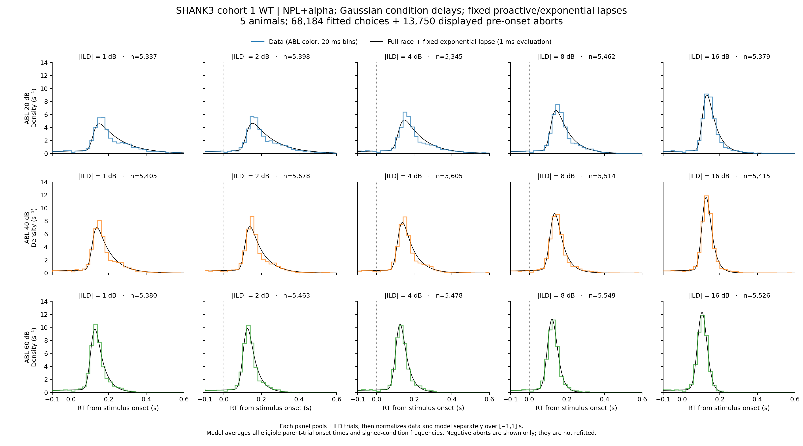
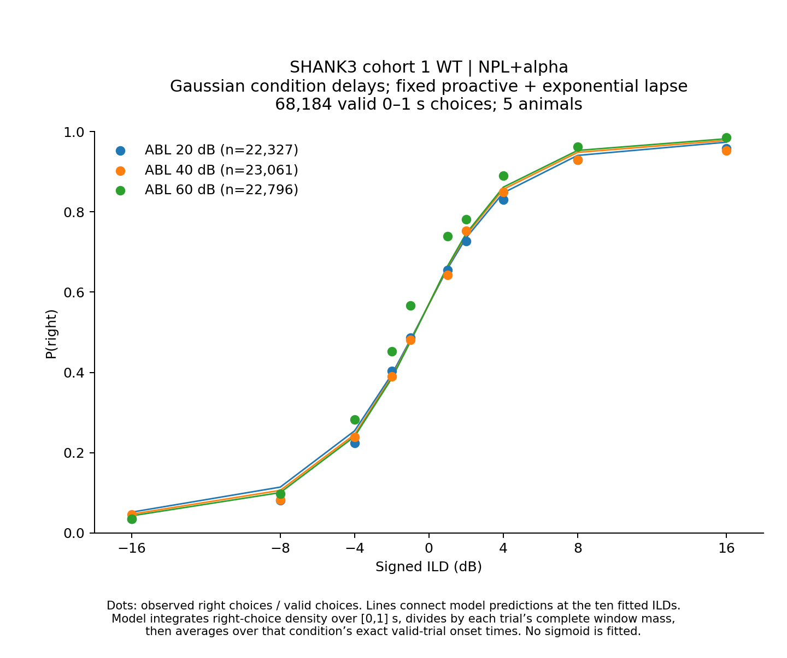
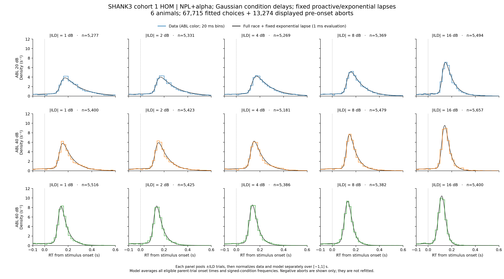
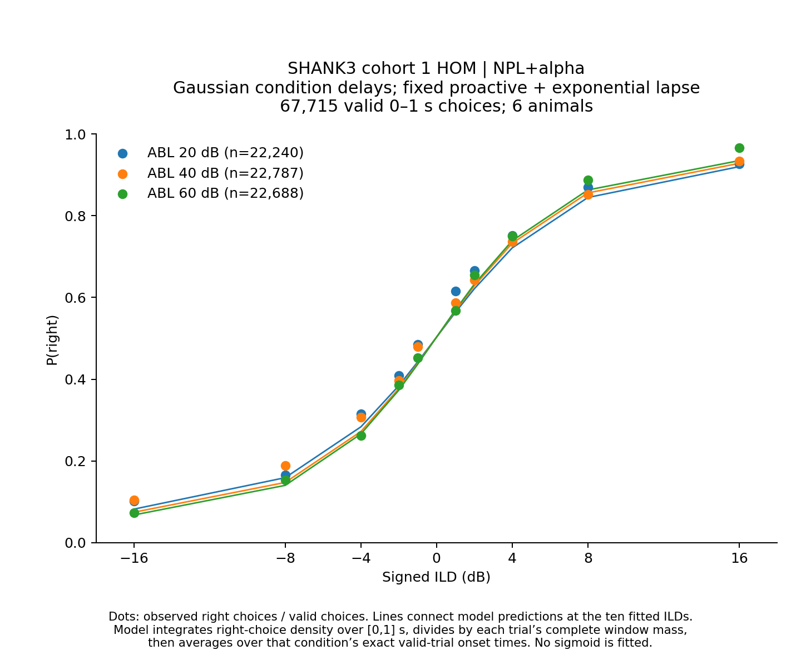
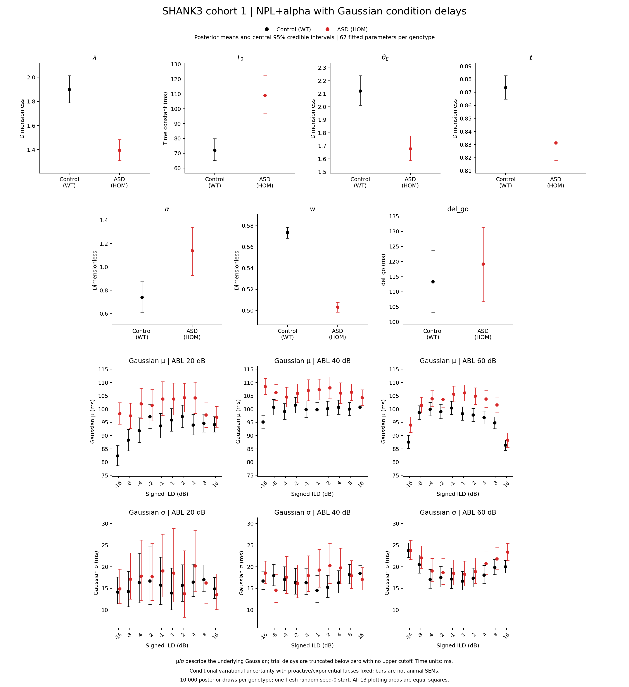

# Results: 2026-11-05

Add result entries below this line.

<!-- shank3-npl-alpha-gaussian:start -->
## SHANK3 cohort 1 WT/HOM: NPL+alpha with Gaussian condition delays

WT and HOM are fitted separately, pooling actual trial counts across five WT or six HOM animals. The model fits **67 parameters per genotype**: seven shared NPL+alpha parameters plus Gaussian μ/σ for each of 30 signed ABL–ILD conditions. Gamma/Omega follow the NPL+alpha mapping. Each trial draws an independent delay from its condition’s Normal(μ,σ²), truncated below zero with no upper cutoff. The Gaussian construction follows the human reference; the earlier rat reference used point delays.

**Selection:** cleaned session type 1, training level 16, success ±1, finite recorded RT in inclusive [0,1] s, ABL 59→60 then 20/40/60, and signed ILDs ±1/2/4/8/16. WT: **68,184 choices (37,482 right; 30,702 left)**. HOM: **67,715 (35,320 right; 32,395 left)**. Preparation exclusions are preserved without reapplying repeat eligibility.

The five genotype-specific proactive/exponential-lapse posterior means remain fixed. The exponential lapse starts at fixation onset and contributes half its density to each choice as an alternative to the full race. There is no added uniform or reactive-specific lapse. Random delays are integrated out **before** the complete mixture is normalized over the valid window for each exact onset. Valid absolute response time is planned onset plus recorded timed_rt.

Gaussian variability affects the reactive afferent delay and the proactive evidence readout. Proactive and exponential-lapse clocks retain their fixation-time definitions. The readout integrates the complete delay distribution, including its mass beyond the observed RT.

Delay marginalization uses a 0.5 ms grid through 1.2 s, adaptive FFT refinement and positive rescaled quadrature safeguards. Independent checks compare finer grids, longer series and SciPy quadrature. A verified execution optimization skips unused refinement checks; both fits resume from their 8,000-update checkpoints with optimizer/RNG states retained. Earlier source/configuration and checkpoints, plus likelihood/gradient equivalence checks, are included in the audits.

### Priors, initialization and convergence

Seven shared NPL+alpha trapezoidal priors are unchanged. Gaussian μ: hard 0–500 ms, flat 10–200 ms; σ: hard 5–300 ms, flat 10–150 ms. All 67 initial values are fresh independent uniform draws within prior flat regions, resetting NumPy seed 0 for each genotype. One start per genotype leaves initialization sensitivity untested.

Float64, full-batch, full-rank NumPyro SVI on RTX 4090; clipped Adam 0.0002, clip 1, guide scale 0.1. Loss windows contain 1,000 updates; minimum 50,000; stop after 25 windows without a strictly lower loss and restore the absolute-best checkpoint. Parameter stability is diagnostic only.

| Genotype | Final updates | Restored best | Confirmation windows | Status |
|---|---:|---:|---:|---|
| WT | 116,000 | 91,000 | 25 | converged |
| HOM | 116,000 | 91,000 | 25 | converged |

### WT model and data

*RTDs use 20 ms data bins and 1 ms model evaluation, normalized separately over [−1,1] s; only the display is −0.1–0.6 s. They pool actual ±ILD trials and all exact eligible parent onset times, before normalization. WT displays 81,934 observations (68,184 choices + 13,750 pre-onset aborts); HOM displays 80,989 (67,715 + 13,274). Aborts do not enter the new fit. Data steps use ABL blue/orange/green and sit above a thin 0.9 pt black model. Psychometric dots are measured P(right); lines connect predictions at the ten measured signed ILDs, normalizing per valid-trial onset before averaging. No extra sigmoid is fitted.*

### HOM model and data

*RTDs use 20 ms data bins and 1 ms model evaluation, normalized separately over [−1,1] s; only the display is −0.1–0.6 s. They pool actual ±ILD trials and all exact eligible parent onset times, before normalization. WT displays 81,934 observations (68,184 choices + 13,750 pre-onset aborts); HOM displays 80,989 (67,715 + 13,274). Aborts do not enter the new fit. Data steps use ABL blue/orange/green and sit above a thin 0.9 pt black model. Psychometric dots are measured P(right); lines connect predictions at the ten measured signed ILDs, normalizing per valid-trial onset before averaging. No extra sigmoid is fitted.*

### Posterior parameter comparison

*Black Control/WT; red ASD/HOM. All 134 means and central 95% credible intervals come from 10,000 draws per genotype. Seven shared panels and two 1×3 ABL rows for μ and σ use 13 equally sized square axes without grids. Time parameters are shown in ms. μ/σ describe the underlying Gaussian; actual zero-truncated-delay moments before RT-window selection are exported separately. Bars describe conditional variational uncertainty with proactive/lapse parameters frozen, rather than animal-to-animal SEM.*

[Parameter PDF](../assets/results/2026-11-05/shank3_npl_alpha_gaussian/SHANK3_cohort1_WT_HOM_NPL_alpha_gaussian_parameter_comparison.pdf) · [All parameter estimates](../assets/results/2026-11-05/shank3_npl_alpha_gaussian/parameter_estimates.csv) · [Actual truncated-delay moments](../assets/results/2026-11-05/shank3_npl_alpha_gaussian/actual_truncated_delay_moments.csv) · [Posterior/checkpoint/numerical/source audits](../assets/results/2026-11-05/shank3_npl_alpha_gaussian/shank3_npl_alpha_gaussian_audits.zip) · [Figure verification](../assets/results/2026-11-05/shank3_npl_alpha_gaussian/figure_validation.json)

Comparisons to the saved deterministic-delay NPL+alpha and 92-parameter Gamma/Omega fits use identical retained trials and physical posterior means. Likelihood, psychometric errors and RT-CDF discrepancies are **in-sample** diagnostics, without a model-selection or global-optimum claim.

[WT in-sample comparison](../assets/results/2026-11-05/shank3_npl_alpha_gaussian/wt_in_sample_comparison.csv) · [HOM in-sample comparison](../assets/results/2026-11-05/shank3_npl_alpha_gaussian/hom_in_sample_comparison.csv)

### In-sample comparison

| Genotype | Model | Parameters | Joint log likelihood | Psychometric RMSE | Mean max RT-CDF gap |
|---|---|---:|---:|---:|---:|
| WT | Gamma/Omega point delays | 92 | 69,305.09 | 0.01300 | 0.05790 |
| WT | NPL+alpha point delays | 37 | 68,220.30 | 0.03811 | 0.07262 |
| WT | NPL+alpha Gaussian delays | 67 | 71,741.23 | 0.03015 | 0.04068 |
| HOM | Gamma/Omega point delays | 92 | 49,060.51 | 0.01043 | 0.04112 |
| HOM | NPL+alpha point delays | 37 | 48,607.07 | 0.02745 | 0.05135 |
| HOM | NPL+alpha Gaussian delays | 67 | 50,926.52 | 0.02543 | 0.02550 |

Compare models within genotype. Log likelihood sums all fitted trials; psychometric RMSE and mean maximum RT-CDF gap weight the 30 signed conditions equally. The Gaussian model improves these RT-CDF gaps and likelihoods in-sample; the direct Gamma/Omega reference retains the lowest psychometric RMSE.

Sources: [shank3_npl_alpha_gaussian_utils.py](../assets/results/2026-11-05/shank3_npl_alpha_gaussian/shank3_npl_alpha_gaussian_utils.py) · [prepare_shank3_npl_alpha_gaussian.py](../assets/results/2026-11-05/shank3_npl_alpha_gaussian/prepare_shank3_npl_alpha_gaussian.py) · [fit_shank3_npl_alpha_gaussian.py](../assets/results/2026-11-05/shank3_npl_alpha_gaussian/fit_shank3_npl_alpha_gaussian.py) · [verify_shank3_npl_alpha_gaussian.py](../assets/results/2026-11-05/shank3_npl_alpha_gaussian/verify_shank3_npl_alpha_gaussian.py) · [plot_shank3_npl_alpha_gaussian.py](../assets/results/2026-11-05/shank3_npl_alpha_gaussian/plot_shank3_npl_alpha_gaussian.py) · [plot_shank3_npl_alpha_gaussian_parameters.py](../assets/results/2026-11-05/shank3_npl_alpha_gaussian/plot_shank3_npl_alpha_gaussian_parameters.py) · [verify_shank3_npl_alpha_gaussian_figures.py](../assets/results/2026-11-05/shank3_npl_alpha_gaussian/verify_shank3_npl_alpha_gaussian_figures.py) · [run_shank3_npl_alpha_gaussian_pipeline.py](../assets/results/2026-11-05/shank3_npl_alpha_gaussian/run_shank3_npl_alpha_gaussian_pipeline.py) · [publish_shank3_npl_alpha_gaussian.py](../assets/results/2026-11-05/shank3_npl_alpha_gaussian/publish_shank3_npl_alpha_gaussian.py).

Output folder: `asd_analysis/shank3_cohort1_wt_hom_npl_alpha_gaussian_delay/`. See the [November 4 point-delay fits and parameter comparison](2026-11-04.md).
<!-- shank3-npl-alpha-gaussian:end -->
