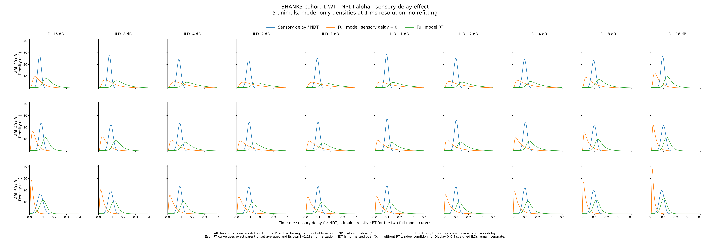
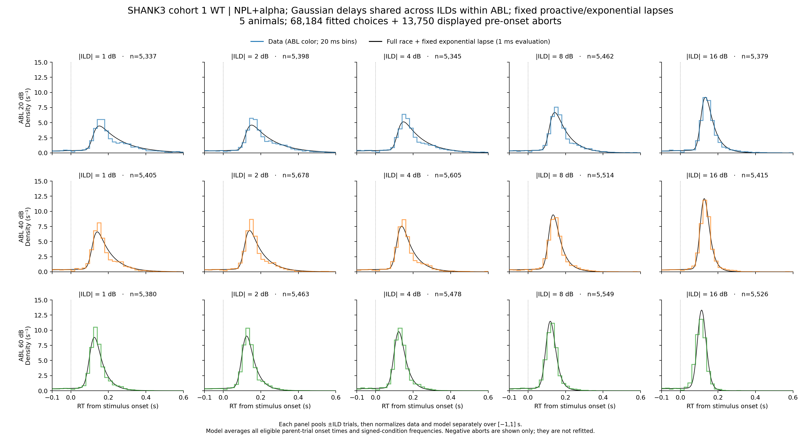
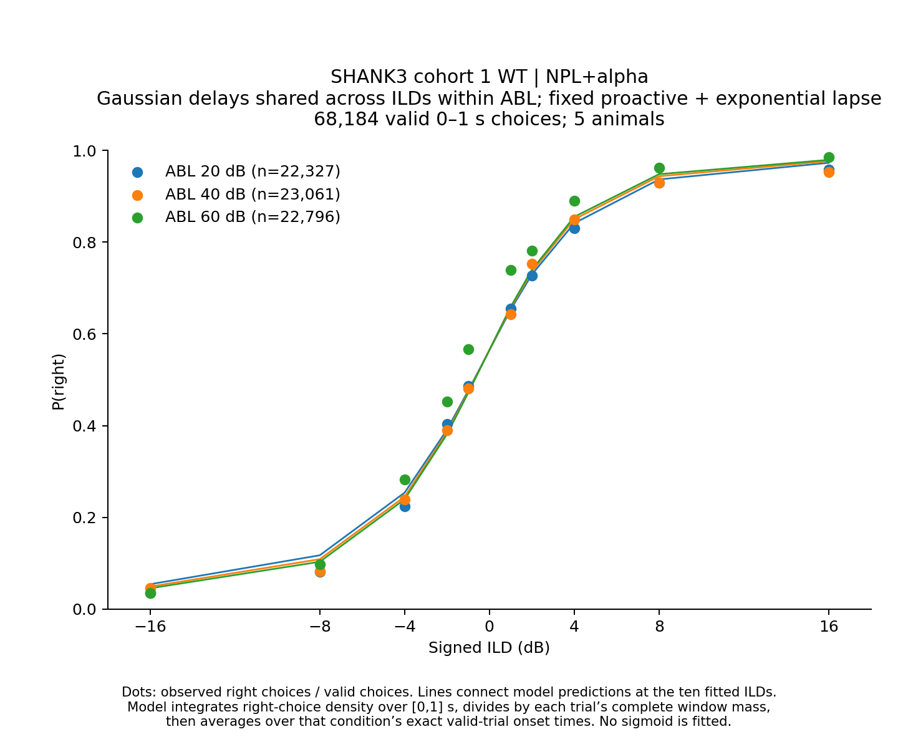
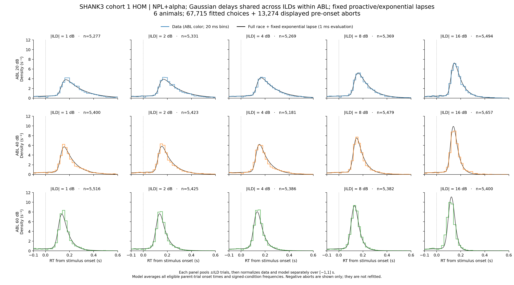
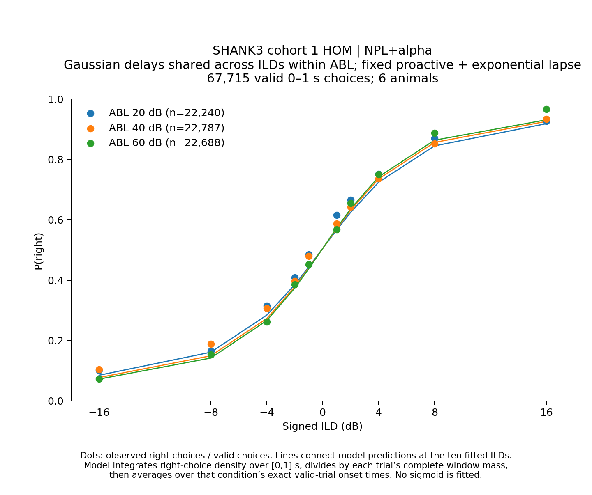
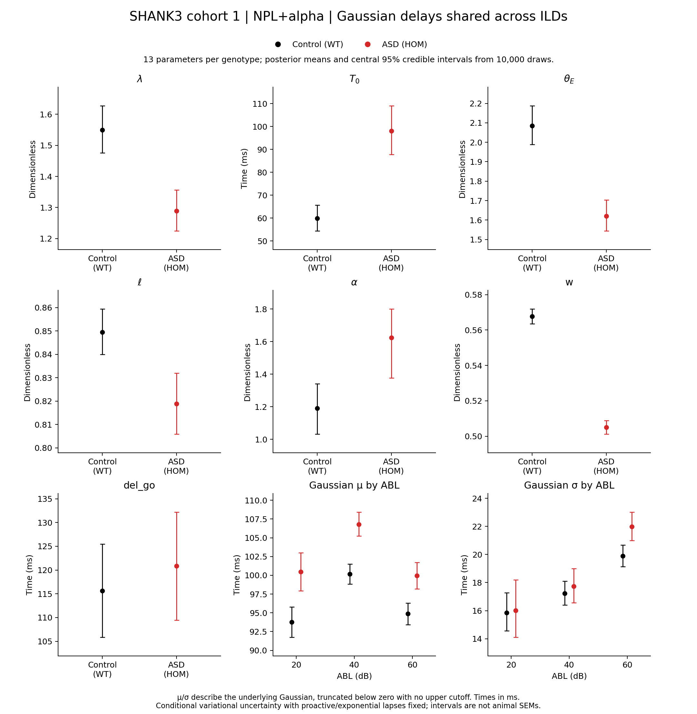

# Results: 2026-11-07

Add result entries below this line.

## SHANK3 cohort 1 WT: sensory delay and RT with versus without sensory delay

*WT only, five SHANK3 cohort 1 animals. Three ABL rows (20/40/60 dB) × ten signed ILD columns (−16, −8, −4, −2, −1, +1, +2, +4, +8, +16 dB). Each panel overlays three continuous model densities evaluated every **1 ms**: **blue = sensory delay / NDT; orange = full model with sensory delay exactly zero; green = fitted full model RT with Gaussian sensory delay**. All three curves are model predictions; no empirical data or histogram bins are plotted. Positive and negative ILDs remain separate.*

The saved physical posterior means are used without refitting. Only the orange curve bypasses the Gaussian sensory-delay convolution; proactive timing, exponential lapses and all NPL+alpha evidence/readout parameters stay fixed. It sums the complete right/left choice densities and therefore retains proactive and lapse contributions. The green curve is the full fitted model, rather than observed data.

Both RT curves retain exact parent-onset averaging over all **83,921 eligible parent trials** and independent normalization over **[−1,1] s**. The NDT is the underlying zero-truncated Gaussian normalized over **[0,∞)**, without RT-window conditioning. All panels display **0 to 0.4 s** with common density limits. This display zoom leaves the numerical predictions and normalization unchanged.

[Full-size PNG](../assets/results/2026-11-07/wt_sensory_delay_overlay_1ms/SHANK3_cohort1_WT_sensory_delay_model_overlay_3x10_1ms.png) · [Single-page PDF](../assets/results/2026-11-07/wt_sensory_delay_overlay_1ms/SHANK3_cohort1_WT_sensory_delay_model_overlay_3x10_1ms.pdf) · [Numerical/source audits](../assets/results/2026-11-07/wt_sensory_delay_overlay_1ms/WT_sensory_delay_overlay_1ms_audits.zip) · [Independent verification](../assets/results/2026-11-07/wt_sensory_delay_overlay_1ms/validation.json)

Sources: [Plotting script](../assets/results/2026-11-07/wt_sensory_delay_overlay_1ms/plot_shank3_sensory_delay_effect.py) · [Independent verifier](../assets/results/2026-11-07/wt_sensory_delay_overlay_1ms/verify_shank3_sensory_delay_effect.py).

The reference fit used **68,184 valid choices from five WT animals** (success ±1, measured RT in [0,1] s); these are the [November 5 NPL+alpha Gaussian-delay fits](2026-11-05.md). Input and fit hashes remain unchanged. Before RT-window normalization, negative-RT abort density is identical with and without sensory delay. The separate normalization constants can slightly change the displayed negative density.

Source: `asd_analysis/plot_shank3_sensory_delay_effect.py`.
Output: `asd_analysis/shank3_cohort1_wt_hom_npl_alpha_gaussian_delay/wt/sensory_delay_effect/overlay_1ms/`.

Earlier 10-row × 3-column histogram layout: [PNG](../assets/results/2026-11-07/SHANK3_cohort1_WT_signed_ILD_sensory_delay_effect.png) · [PDF](../assets/results/2026-11-07/SHANK3_cohort1_WT_signed_ILD_sensory_delay_effect.pdf).

<!-- shank3-gaussian-abl-delay:start -->
## SHANK3 cohort 1 WT/HOM: NPL+alpha with Gaussian delays shared across ILDs

WT and HOM are fitted independently, pooling observed trials across five WT or six HOM animals. **13 parameters per genotype:** seven shared NPL+alpha parameters and three Gaussian means plus three Gaussian SDs, one μ/σ pair per ABL 20/40/60. Each pair is shared across all ten signed ILDs. The evidence process retains all 30 signed ABL–ILD conditions; Gamma/Omega are derived from NPL+alpha rather than fitted independently.

**Selection is unchanged:** cleaned session type 1, training 16, success ±1, finite recorded RT in inclusive [0,1] s, ABL 59→60 then 20/40/60 and signed ILDs ±1/2/4/8/16. WT: **68,184 choices, 37,482 right and 30,702 left, five animals**. HOM: **67,715 choices, 35,320 right and 32,395 left, six animals**. No preparation/repeat exclusions are reapplied.

The same five genotype-specific proactive/exponential-lapse posterior means remain frozen. Trial delays are independent Gaussian draws truncated below zero, without an upper cutoff; μ/σ describe the underlying Gaussian. Delays are integrated before the complete joint RT/choice mixture is normalized over [0,1] s separately for each exact planned onset. The proactive readout and fixation-referenced exponential lapse are retained; no additional reactive or uniform lapse is added.

The seven shared priors are unchanged. Gaussian μ: hard 0–500 ms, flat 10–200 ms; σ: hard 5–300 ms, flat 10–150 ms. Each prior is applied once per free parameter. All 13 initial values are fresh uniform draws within flat prior intervals, resetting seed 0 between genotypes. One initialization leaves initialization sensitivity untested.

Float64 full-batch, full-rank NumPyro SVI; clipped Adam 0.0002, clip 1, guide scale 0.1. Loss windows contain 1,000 updates; minimum 50,000; stop after 25 consecutive windows without strict improvement, restoring the absolute-best checkpoint. Parameter stability is diagnostic only.

WT resumed its saved 33,000-update checkpoint using a batched FFT refinement implementation, with optimizer, guide, RNG, losses and stopping history preserved. The grids, refinement factors and direct quadrature are unchanged. Likelihood/gradient comparisons passed, and an entire SVI update produced identical loss and updated guide parameters. HOM completed with the original kernel and was preserved. Original source/configuration/checkpoints and equivalence checks are archived.

| Group | Final updates | Restored best | Confirmation windows | Status |
|---|---:|---:|---:|---|
| WT | 108,000 | 83,000 | 25 | converged |
| HOM | 108,000 | 83,000 | 25 | converged |

### WT data and model

*RTDs: 3 ABL rows × 5 |ILD| columns; 20 ms empirical bins and 1 ms model curves. Data and model normalize separately over [−1,1] s; display is −0.1–0.6 s. Actual ±ILD trials and parent-weighted unnormalized model predictions are pooled before normalization. Each model uses every exact eligible parent onset. WT displays 81,934 observations (68,184 choices + 13,750 pre-onset aborts); HOM displays 80,989 (67,715 + 13,274). Aborts are diagnostic only. ABL-colored 1.4 pt data steps sit above thin 0.9 pt black model curves.*

*Psychometrics: ABL-colored measured P(right) points and model lines at the ten signed ILDs. Right-choice density is integrated over [0,1] s and divided by each fitted trial’s complete window mass before averaging over exact onsets. No sigmoid fit is added.*

### HOM data and model

*RTDs: 3 ABL rows × 5 |ILD| columns; 20 ms empirical bins and 1 ms model curves. Data and model normalize separately over [−1,1] s; display is −0.1–0.6 s. Actual ±ILD trials and parent-weighted unnormalized model predictions are pooled before normalization. Each model uses every exact eligible parent onset. WT displays 81,934 observations (68,184 choices + 13,750 pre-onset aborts); HOM displays 80,989 (67,715 + 13,274). Aborts are diagnostic only. ABL-colored 1.4 pt data steps sit above thin 0.9 pt black model curves.*

*Psychometrics: ABL-colored measured P(right) points and model lines at the ten signed ILDs. Right-choice density is integrated over [0,1] s and divided by each fitted trial’s complete window mass before averaging over exact onsets. No sigmoid fit is added.*

### Posterior parameter comparison

*WT black; HOM red. All 26 means and central 95% credible intervals come from 10,000 draws per genotype. Nine equal square panels show seven shared parameters, Gaussian μ versus ABL and Gaussian σ versus ABL. Time units are ms; no grids. Intervals describe conditional variational uncertainty with proactive/lapse estimates frozen, not across-animal SEM. Actual truncated-delay moments before RT-window selection are exported separately.*

[Parameter PDF](../assets/results/2026-11-07/shank3_npl_alpha_gaussian_abl_delay/SHANK3_cohort1_WT_HOM_NPL_alpha_gaussian_ABL_delay_parameter_comparison.pdf) · [Parameter estimates](../assets/results/2026-11-07/shank3_npl_alpha_gaussian_abl_delay/parameter_estimates.csv) · [Actual truncated-delay moments](../assets/results/2026-11-07/shank3_npl_alpha_gaussian_abl_delay/actual_truncated_delay_moments.csv) · [Complete posterior/checkpoint/numerical/source audits](../assets/results/2026-11-07/shank3_npl_alpha_gaussian_abl_delay/shank3_npl_alpha_gaussian_abl_delay_audits.zip) · [Figure verification](../assets/results/2026-11-07/shank3_npl_alpha_gaussian_abl_delay/figure_validation.json)

### In-sample comparison with the 67-parameter Gaussian-delay reference

| Group | Model | Parameters | Joint log likelihood | Psychometric RMSE | Mean max RT-CDF gap |
|---|---|---:|---:|---:|---:|
| WT | Gaussian μ/σ per signed condition | 67 | 71,741.23 | 0.03015 | 0.04068 |
| WT | Gaussian μ/σ per ABL | 13 | 71,348.53 | 0.03207 | 0.05669 |
| HOM | Gaussian μ/σ per signed condition | 67 | 50,926.52 | 0.02543 | 0.02550 |
| HOM | Gaussian μ/σ per ABL | 13 | 50,633.22 | 0.02432 | 0.03642 |

Comparisons use identical trials, frozen values and physical posterior means. Likelihood sums trials; psychometric RMSE and mean maximum RT-CDF gap weight the 30 signed conditions equally. These are in-sample diagnostics, without a held-out model-selection claim.

[WT numerical comparison](../assets/results/2026-11-07/shank3_npl_alpha_gaussian_abl_delay/wt_in_sample_comparison.csv) · [HOM numerical comparison](../assets/results/2026-11-07/shank3_npl_alpha_gaussian_abl_delay/hom_in_sample_comparison.csv)

Sources: [shank3_npl_alpha_gaussian_abl_delay_utils.py](../assets/results/2026-11-07/shank3_npl_alpha_gaussian_abl_delay/shank3_npl_alpha_gaussian_abl_delay_utils.py) · [prepare_shank3_npl_alpha_gaussian_abl_delay.py](../assets/results/2026-11-07/shank3_npl_alpha_gaussian_abl_delay/prepare_shank3_npl_alpha_gaussian_abl_delay.py) · [fit_shank3_npl_alpha_gaussian_abl_delay.py](../assets/results/2026-11-07/shank3_npl_alpha_gaussian_abl_delay/fit_shank3_npl_alpha_gaussian_abl_delay.py) · [verify_shank3_npl_alpha_gaussian_abl_delay.py](../assets/results/2026-11-07/shank3_npl_alpha_gaussian_abl_delay/verify_shank3_npl_alpha_gaussian_abl_delay.py) · [plot_shank3_npl_alpha_gaussian_abl_delay.py](../assets/results/2026-11-07/shank3_npl_alpha_gaussian_abl_delay/plot_shank3_npl_alpha_gaussian_abl_delay.py) · [plot_shank3_npl_alpha_gaussian_abl_delay_parameters.py](../assets/results/2026-11-07/shank3_npl_alpha_gaussian_abl_delay/plot_shank3_npl_alpha_gaussian_abl_delay_parameters.py) · [verify_shank3_npl_alpha_gaussian_abl_delay_figures.py](../assets/results/2026-11-07/shank3_npl_alpha_gaussian_abl_delay/verify_shank3_npl_alpha_gaussian_abl_delay_figures.py) · [run_shank3_npl_alpha_gaussian_abl_delay_pipeline.py](../assets/results/2026-11-07/shank3_npl_alpha_gaussian_abl_delay/run_shank3_npl_alpha_gaussian_abl_delay_pipeline.py) · [publish_shank3_npl_alpha_gaussian_abl_delay.py](../assets/results/2026-11-07/shank3_npl_alpha_gaussian_abl_delay/publish_shank3_npl_alpha_gaussian_abl_delay.py) · [shank3_gaussian_batched_refinement.py](../assets/results/2026-11-07/shank3_npl_alpha_gaussian_abl_delay/shank3_gaussian_batched_refinement.py) · [shank3_npl_alpha_gaussian_abl_delay_batched_utils.py](../assets/results/2026-11-07/shank3_npl_alpha_gaussian_abl_delay/shank3_npl_alpha_gaussian_abl_delay_batched_utils.py) · [fit_shank3_npl_alpha_gaussian_abl_delay_batched.py](../assets/results/2026-11-07/shank3_npl_alpha_gaussian_abl_delay/fit_shank3_npl_alpha_gaussian_abl_delay_batched.py).

Output: `asd_analysis/shank3_cohort1_wt_hom_npl_alpha_gaussian_delay_by_abl/`. Reference: [November 5 Gaussian condition-delay fits](2026-11-05.md).
<!-- shank3-gaussian-abl-delay:end -->
