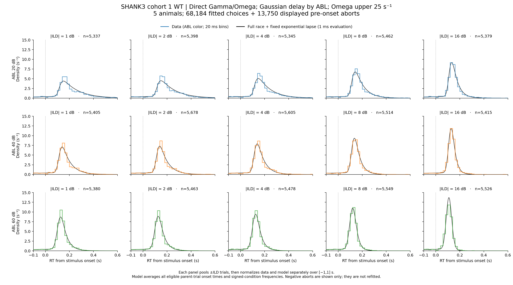
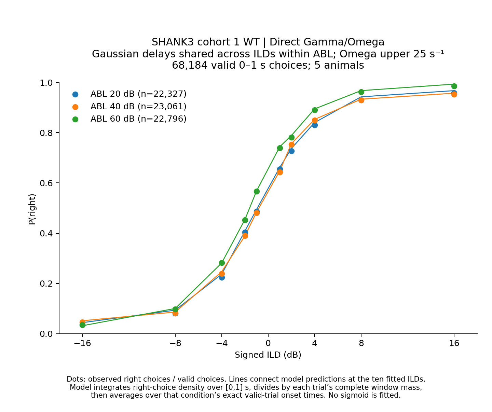
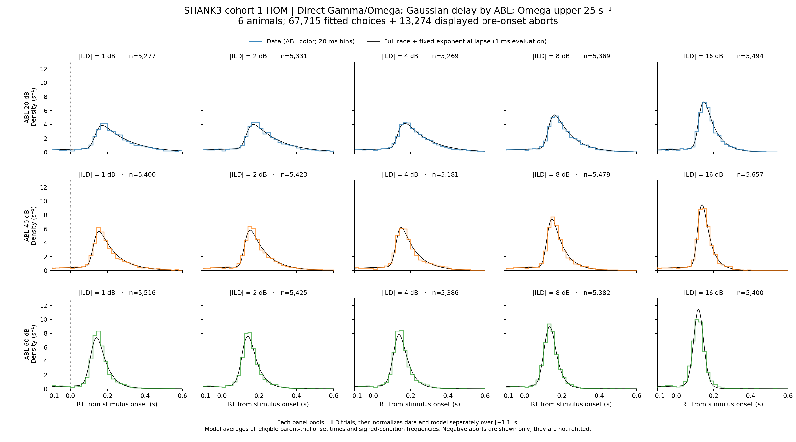
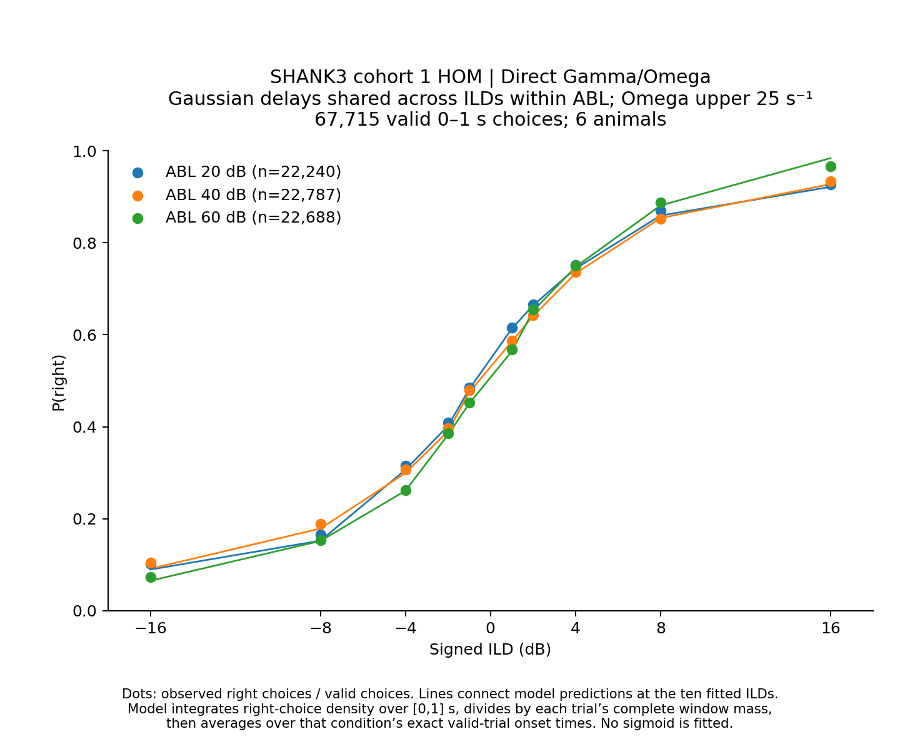
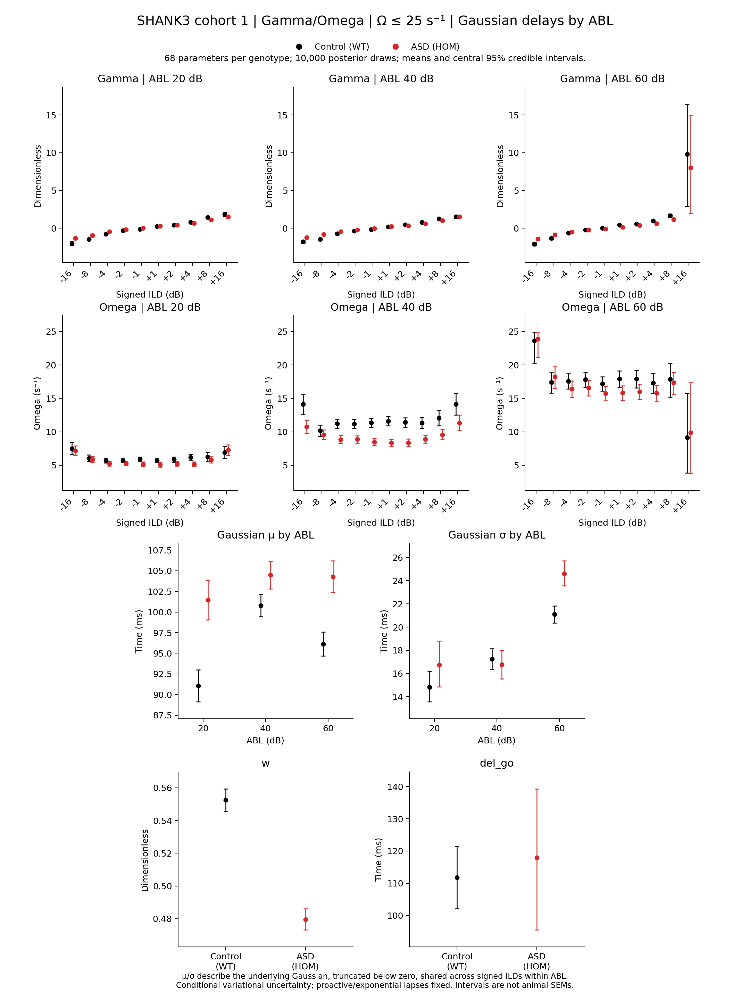
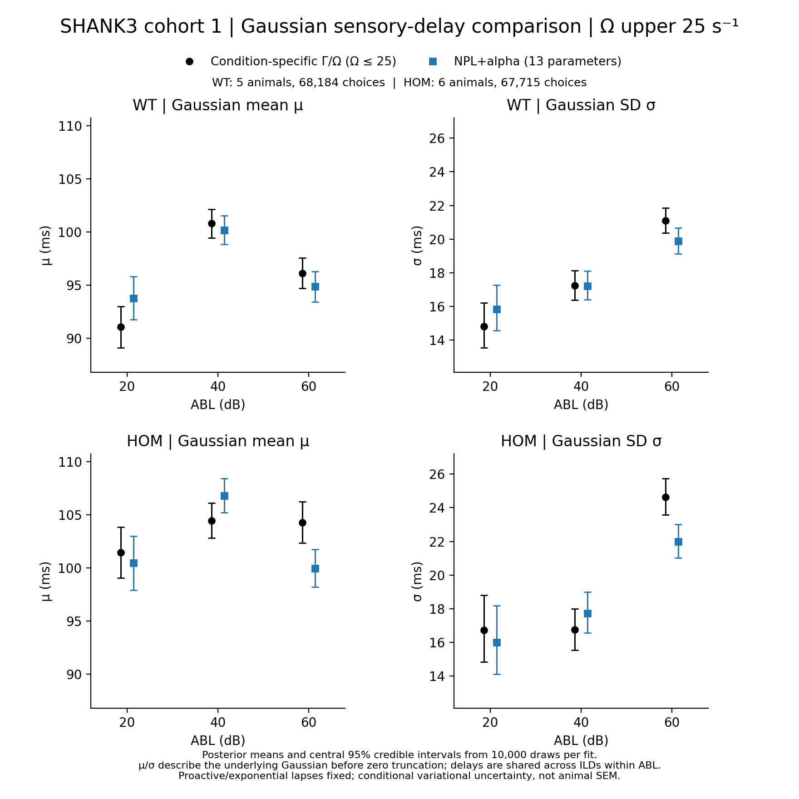
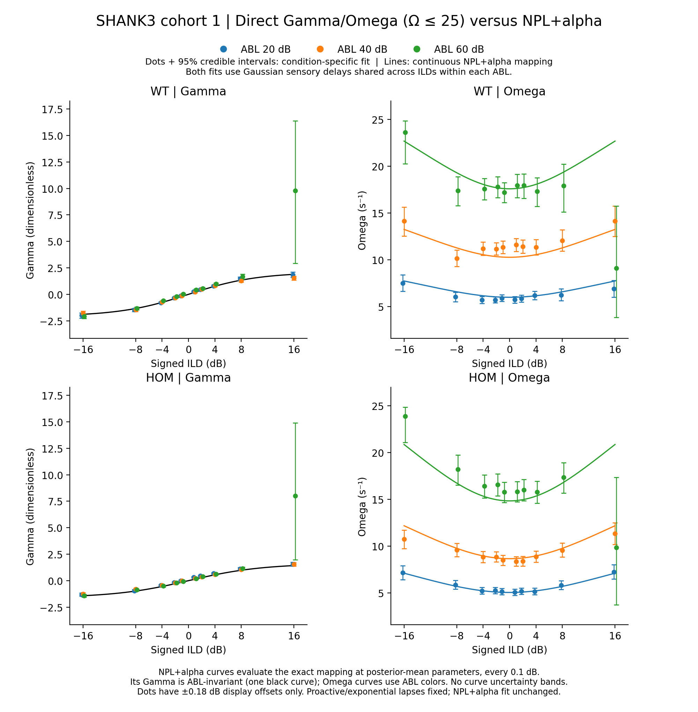

# Results: 2026-11-08

<!-- shank3-direct-gaussian-abl-omega25:start -->

## SHANK3 cohort 1 WT/HOM: Gamma/Omega refits with Omega upper bound 25

WT and HOM are fitted independently, pooling actual trials across five WT or six HOM animals. **68 free parameters per genotype:** 30 Gamma, 30 Omega, three Gaussian delay means and three SDs, shared w and shared del_go. Gamma/Omega are fitted directly at each signed ABL–ILD condition; the NPL+alpha evidence mapping is not imposed. Only Gaussian μ/σ are shared across the ten signed ILDs within each ABL 20/40/60.

**Unchanged selection:** cleaned session type 1, training 16, success ±1, finite measured RT in inclusive [0,1] s, ABL 59→60, ABL 20/40/60 and signed ILDs ±1/2/4/8/16. WT: **68,184 choices (37,482 right; 30,702 left), five animals**. HOM: **67,715 choices (35,320 right; 32,395 left), six animals**. Saved identities match the earlier direct and NPL+alpha fits exactly; preparation/repeat filters are not reapplied.

The same five genotype-specific proactive/exponential-lapse posterior means remain frozen. Independent trial delays follow a Gaussian truncated below zero with no upper cutoff. μ/σ describe its underlying Gaussian. Delay marginalization precedes complete-mixture RT/choice normalization over [0,1] s for each exact planned onset, retaining proactive evidence readout. The fixation-referenced exponential lapse contributes equally to both choices; no new uniform or reactive-specific lapse is added.

| Parameter | Hard bounds | Flat interval |
|---|---|---|
| Gamma, positive ILD | −1 to 20 | 0 to 12 |
| Gamma, negative ILD | −20 to 1 | −12 to 0 |
| Omega (s⁻¹) | 0.01 to 25 | 0.1 to 12 |
| Gaussian μ (ms) | 0 to 500 | 10 to 200 |
| Gaussian σ (ms) | 5 to 300 | 10 to 150 |
| w | 0 to 1 | 0.4 to 0.6 |
| del_go (ms) | 0 to 200 | 20 to 199 |

Priors apply once per free parameter. All 68 starts are independent uniform draws within flat intervals; seed 0 is reset between groups so starting values match. Float64, full-batch full-rank NumPyro SVI on GPU; clipped Adam 0.0002, clip norm 1 and guide scale 0.1. Losses are checked in 1,000-update windows, with a 50,000 minimum, then 25 consecutive windows without strict improvement and absolute-best checkpoint restoration. Parameter stability remains diagnostic only. A limit hit without confirmation is inconclusive.

| Group | Final updates | Restored best | Confirmation windows | Status |
|---|---:|---:|---:|---|
| WT | 135,000 | 110,000 | 25 | converged |
| HOM | 135,000 | 110,000 | 25 | converged |

### WT data and model

*Three ABL rows × five |ILD| columns. Actual ±ILD trials and parent-weighted unnormalized model predictions are pooled before data/model area-one normalization over [−1,1] s. Display: −0.1–0.6 s. 20 ms data bins; 1 ms model evaluation. ABL-colored 1.4 pt data steps are drawn above 0.9 pt black model curves. Model timing averages every exact eligible parent onset. WT shows 81,934 observations (68,184 valid + 13,750 pre-onset aborts); HOM shows 80,989 (67,715 + 13,274). Aborts are diagnostic only.*

*Measured P(right) dots and ABL-colored model lines at the ten signed ILDs. Each fitted trial’s right-choice window probability is divided by its complete [0,1] s mass before averaging over exact onsets. No sigmoid or interpolation beyond the measured-condition joins is fitted.*

### HOM data and model

*Three ABL rows × five |ILD| columns. Actual ±ILD trials and parent-weighted unnormalized model predictions are pooled before data/model area-one normalization over [−1,1] s. Display: −0.1–0.6 s. 20 ms data bins; 1 ms model evaluation. ABL-colored 1.4 pt data steps are drawn above 0.9 pt black model curves. Model timing averages every exact eligible parent onset. WT shows 81,934 observations (68,184 valid + 13,750 pre-onset aborts); HOM shows 80,989 (67,715 + 13,274). Aborts are diagnostic only.*

*Measured P(right) dots and ABL-colored model lines at the ten signed ILDs. Each fitted trial’s right-choice window probability is divided by its complete [0,1] s mass before averaging over exact onsets. No sigmoid or interpolation beyond the measured-condition joins is fitted.*

### Posterior parameter comparison

*WT black; HOM red. Ten equal square panels: three Gamma and three Omega panels by ABL, μ and σ versus ABL, w and del_go. All 136 means and central 95% credible intervals use 10,000 draws per genotype. Delays are in milliseconds, Omega in s⁻¹, Gamma and w dimensionless. No grids. Intervals represent conditional variational uncertainty with proactive/lapse values frozen, not across-animal SEM. Actual truncated-delay moments before valid-window selection are exported separately.*

[Parameter PDF](../assets/results/2026-11-08/shank3_gamma_omega_gaussian_abl_delay_omega25/SHANK3_cohort1_WT_HOM_Gamma_Omega_gaussian_ABL_delay_parameter_comparison.pdf) · [Parameter estimates](../assets/results/2026-11-08/shank3_gamma_omega_gaussian_abl_delay_omega25/parameter_estimates.csv) · [Actual truncated-delay moments](../assets/results/2026-11-08/shank3_gamma_omega_gaussian_abl_delay_omega25/actual_truncated_delay_moments.csv) · [Complete posterior/checkpoint/numerical/source audits](../assets/results/2026-11-08/shank3_gamma_omega_gaussian_abl_delay_omega25/shank3_gamma_omega_gaussian_abl_delay_omega25_audits.zip) · [Figure verification](../assets/results/2026-11-08/shank3_gamma_omega_gaussian_abl_delay_omega25/figure_validation.json) · [Posterior boundary audit](../assets/results/2026-11-08/shank3_gamma_omega_gaussian_abl_delay_omega25/posterior_boundary_audit.csv) · [Reference Gamma/Omega ranges](../assets/results/2026-11-08/shank3_gamma_omega_gaussian_abl_delay_omega25/reference_evidence_parameter_ranges.csv)

### In-sample comparison on identical trials

| Group | Model | Parameters | Joint log likelihood | Psychometric RMSE | Mean max RT-CDF gap |
|---|---|---:|---:|---:|---:|
| WT | Direct Gamma/Omega; fixed condition delays | 92 | 69,305.09 | 0.01300 | 0.05790 |
| WT | NPL+alpha; Gaussian delays by condition | 67 | 71,741.23 | 0.03015 | 0.04068 |
| WT | NPL+alpha; Gaussian delays by ABL | 13 | 71,348.53 | 0.03207 | 0.05669 |
| WT | Direct Gamma/Omega; Gaussian delays by ABL | 68 | 71,742.52 | 0.00660 | 0.04165 |
| HOM | Direct Gamma/Omega; fixed condition delays | 92 | 49,060.51 | 0.01043 | 0.04112 |
| HOM | NPL+alpha; Gaussian delays by condition | 67 | 50,926.52 | 0.02543 | 0.02550 |
| HOM | NPL+alpha; Gaussian delays by ABL | 13 | 50,633.22 | 0.02432 | 0.03642 |
| HOM | Direct Gamma/Omega; Gaussian delays by ABL | 68 | 50,795.30 | 0.00716 | 0.02887 |

Likelihood sums identical fitted trials at physical posterior means. Psychometric RMSE and mean maximum RT-CDF gap weight signed conditions equally. These are in-sample diagnostics, not held-out model selection. The direct Omega prior has a hard upper bound of 25 s⁻¹, whereas the Gaussian-by-ABL NPL+alpha reference derives values up to 22.68 (WT) and 20.86 (HOM). This raises only the previous hard ceiling of 15 to 25 s⁻¹; the Omega flat prior remains 0.1–12 s⁻¹ and all other settings and seed-0 physical initial values are unchanged. Single-start optimization and variational approximation remain relevant. Posterior uncertainty is conditional on frozen proactive/lapse parameters; one random initialization per genotype leaves initialization sensitivity untested.

[WT comparison](../assets/results/2026-11-08/shank3_gamma_omega_gaussian_abl_delay_omega25/wt_in_sample_comparison.csv) · [HOM comparison](../assets/results/2026-11-08/shank3_gamma_omega_gaussian_abl_delay_omega25/hom_in_sample_comparison.csv)

Sources: [shank3_gamma_omega_gaussian_abl_delay_omega25_utils.py](../assets/results/2026-11-08/shank3_gamma_omega_gaussian_abl_delay_omega25/shank3_gamma_omega_gaussian_abl_delay_omega25_utils.py) · [prepare_shank3_gamma_omega_gaussian_abl_delay_omega25.py](../assets/results/2026-11-08/shank3_gamma_omega_gaussian_abl_delay_omega25/prepare_shank3_gamma_omega_gaussian_abl_delay_omega25.py) · [fit_shank3_gamma_omega_gaussian_abl_delay_omega25.py](../assets/results/2026-11-08/shank3_gamma_omega_gaussian_abl_delay_omega25/fit_shank3_gamma_omega_gaussian_abl_delay_omega25.py) · [verify_shank3_gamma_omega_gaussian_abl_delay_omega25.py](../assets/results/2026-11-08/shank3_gamma_omega_gaussian_abl_delay_omega25/verify_shank3_gamma_omega_gaussian_abl_delay_omega25.py) · [plot_shank3_gamma_omega_gaussian_abl_delay_omega25.py](../assets/results/2026-11-08/shank3_gamma_omega_gaussian_abl_delay_omega25/plot_shank3_gamma_omega_gaussian_abl_delay_omega25.py) · [plot_shank3_gamma_omega_gaussian_abl_delay_omega25_parameters.py](../assets/results/2026-11-08/shank3_gamma_omega_gaussian_abl_delay_omega25/plot_shank3_gamma_omega_gaussian_abl_delay_omega25_parameters.py) · [verify_shank3_gamma_omega_gaussian_abl_delay_omega25_figures.py](../assets/results/2026-11-08/shank3_gamma_omega_gaussian_abl_delay_omega25/verify_shank3_gamma_omega_gaussian_abl_delay_omega25_figures.py) · [run_shank3_gamma_omega_gaussian_abl_delay_omega25_pipeline.py](../assets/results/2026-11-08/shank3_gamma_omega_gaussian_abl_delay_omega25/run_shank3_gamma_omega_gaussian_abl_delay_omega25_pipeline.py) · [publish_shank3_gamma_omega_gaussian_abl_delay_omega25.py](../assets/results/2026-11-08/shank3_gamma_omega_gaussian_abl_delay_omega25/publish_shank3_gamma_omega_gaussian_abl_delay_omega25.py).

References: [Gaussian delays per condition](2026-11-05.md) · [Gaussian delays per ABL](2026-11-07.md) · [Earlier direct Gamma/Omega fits](2026-10-23.md).

Output: `asd_analysis/shank3_cohort1_wt_hom_gamma_omega_gaussian_delay_by_abl_omega25/`.
<!-- shank3-direct-gaussian-abl-omega25:end -->

<!-- shank3-omega25-comparisons:start -->
### Comparisons with the unchanged NPL+alpha fits

Only the direct-fit Omega hard upper bound changed, from **15 to 25 s⁻¹**. Its flat prior interval remains **0.1–12 s⁻¹**. Trial identities, physical seed-0 initialization, all other priors, frozen proactive/lapse values, likelihood conventions and loss-confirmation stopping settings match the original direct fits. The NPL+alpha fits are reused without refitting. The 25-bound direct fits are the current result-book view; superseded 15-bound figures are not displayed.

#### Gaussian delay comparison: condition-specific versus NPL+alpha

*WT top, HOM bottom; underlying Gaussian mean μ versus ABL left, SD σ right. Black circles: new condition-specific Gamma/Omega fits with Omega upper bound 25 s⁻¹; blue squares: the unchanged 13-parameter NPL+alpha fits. Both share one Gaussian delay distribution across all signed ILDs within ABL. Dots and capped bars show posterior means and central 95% variational credible intervals from 10,000 draws; times are milliseconds. These are underlying Gaussian parameters before zero truncation, not animal SEMs.*

[PDF](../assets/results/2026-11-08/shank3_gamma_omega_gaussian_abl_delay_omega25/shank3_cohort1_wt_hom_gaussian_delay_model_comparison_omega25/SHANK3_cohort1_WT_HOM_gaussian_ABL_delay_model_comparison_omega25_2x2.pdf) · [Plotting source](../assets/results/2026-11-08/shank3_gamma_omega_gaussian_abl_delay_omega25/shank3_cohort1_wt_hom_gaussian_delay_model_comparison_omega25/plot_shank3_gaussian_abl_delay_model_comparison_omega25.py) · [Independent verifier](../assets/results/2026-11-08/shank3_gamma_omega_gaussian_abl_delay_omega25/shank3_cohort1_wt_hom_gaussian_delay_model_comparison_omega25/verify_shank3_gaussian_abl_delay_model_comparison_omega25.py) · [Numerical/provenance audits](../assets/results/2026-11-08/shank3_gamma_omega_gaussian_abl_delay_omega25/shank3_cohort1_wt_hom_gaussian_delay_model_comparison_omega25/shank3_cohort1_wt_hom_gaussian_delay_model_comparison_omega25_audits.zip)

#### Gamma/Omega comparison: condition-specific versus continuous NPL+alpha

*WT top, HOM bottom; Gamma left, Omega right. ABL 20 blue, 40 orange, 60 green. Dots and capped central 95% credible intervals are the new condition-specific posterior estimates with Omega upper bound 25 s⁻¹. Lines use the unchanged NPL+alpha mapping at physical posterior-mean parameters, on signed ILD −16 to +16 in 0.1 dB steps. NPL+alpha Gamma is independent of ABL, so its common curve is black; Omega has three ABL-colored curves. Dot offsets ±0.18 dB are display-only. No curve uncertainty bands.*

[PDF](../assets/results/2026-11-08/shank3_gamma_omega_gaussian_abl_delay_omega25/shank3_cohort1_wt_hom_gamma_omega_model_comparison_omega25/SHANK3_cohort1_WT_HOM_Gamma_Omega_direct_vs_NPL_alpha_omega25_2x2.pdf) · [Plotting source](../assets/results/2026-11-08/shank3_gamma_omega_gaussian_abl_delay_omega25/shank3_cohort1_wt_hom_gamma_omega_model_comparison_omega25/plot_shank3_gamma_omega_model_comparison_omega25.py) · [Independent verifier](../assets/results/2026-11-08/shank3_gamma_omega_gaussian_abl_delay_omega25/shank3_cohort1_wt_hom_gamma_omega_model_comparison_omega25/verify_shank3_gamma_omega_model_comparison_omega25.py) · [Numerical/provenance audits](../assets/results/2026-11-08/shank3_gamma_omega_gaussian_abl_delay_omega25/shank3_cohort1_wt_hom_gamma_omega_model_comparison_omega25/shank3_cohort1_wt_hom_gamma_omega_model_comparison_omega25_audits.zip)

### Current-fit checks and interpretation

| Group | Model | Joint log likelihood | Psychometric RMSE | Mean max RT-CDF gap |
|---|---|---:|---:|---:|
| WT | Direct Γ/Ω; Ω ≤ 25 | 71,742.52 | 0.00660 | 0.04165 |
| WT | NPL+alpha; unchanged | 71,348.53 | 0.03207 | 0.05669 |
| HOM | Direct Γ/Ω; Ω ≤ 25 | 50,795.30 | 0.00716 | 0.02887 |
| HOM | NPL+alpha; unchanged | 50,633.22 | 0.02432 | 0.03642 |

**ABL-60 Omega boundary pressure:**

| Group | Omega ceiling | Conditions with mean within 1 s⁻¹ of ceiling | Largest condition mean | Highest upper 95% limit |
|---|---:|---:|---:|---:|
| WT | 25 | 0/10 | 23.628 | 24.831 |
| HOM | 25 | 0/10 | 23.886 | 24.854 |

Some ABL-60 condition posteriors still approach the new ceiling. Raising the bound therefore reduces the old restriction but does not establish that every estimate is free of boundary influence. See the draw-fraction audit for the degree of pressure.

**Selected posterior means, current 25-bound fits:**

| Group | ABL-60 Gaussian μ (ms) | ABL-60 Gaussian σ (ms) | Shared del_go (ms) |
|---|---:|---:|---:|
| WT | 96.11 | 21.10 | 111.75 |
| HOM | 104.28 | 24.63 | 117.95 |

The readout interval del_go is separate from the Gaussian sensory delay. Both fits use one initialization, so parameter tradeoffs and alternative solutions remain possible. At ABL 60 and +16 dB, Gamma remains high and broadly uncertain in both groups; increasing Omega’s ceiling does not eliminate every condition-specific mismatch. The parameter-estimate download retains all interval endpoints.

These are in-sample posterior-mean comparisons on identical trials; they do not establish held-out performance or initialization robustness. The changed hard bound also changes the trapezoidal prior taper above 12 s⁻¹. Posterior intervals remain conditional on frozen proactive/exponential-lapse parameters.

[Current Omega boundary pressure by ABL](../assets/results/2026-11-08/shank3_gamma_omega_gaussian_abl_delay_omega25/current_omega_boundary_by_ABL.csv) · [Current in-sample metrics](../assets/results/2026-11-08/shank3_gamma_omega_gaussian_abl_delay_omega25/current_in_sample_comparison.csv) · [Preservation/settings verification](../assets/results/2026-11-08/shank3_gamma_omega_gaussian_abl_delay_omega25/sensitivity_validation.json)
<!-- shank3-omega25-comparisons:end -->
