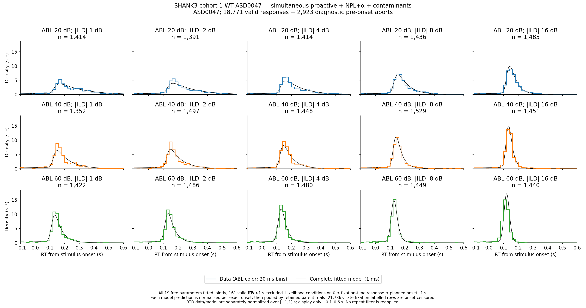
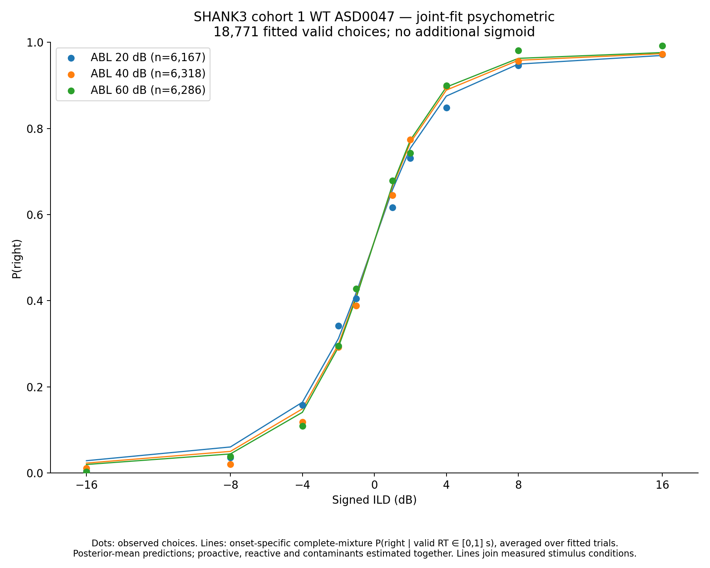
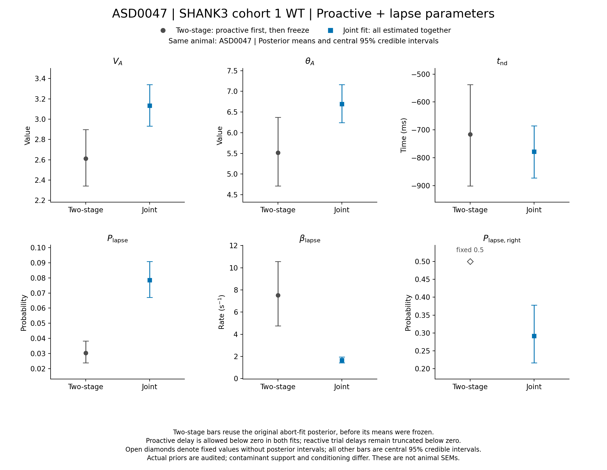
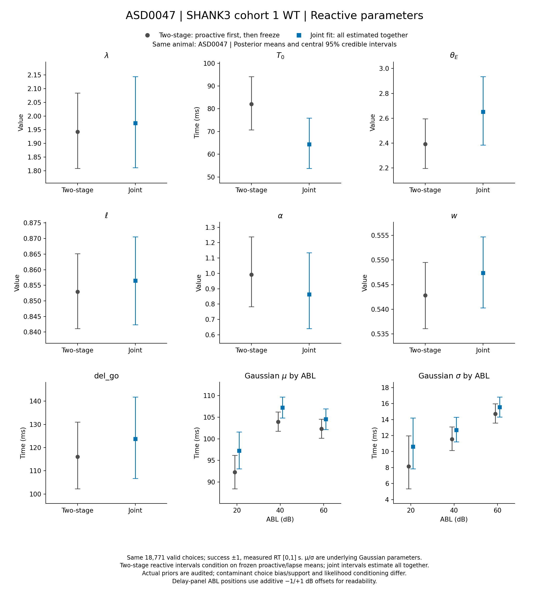
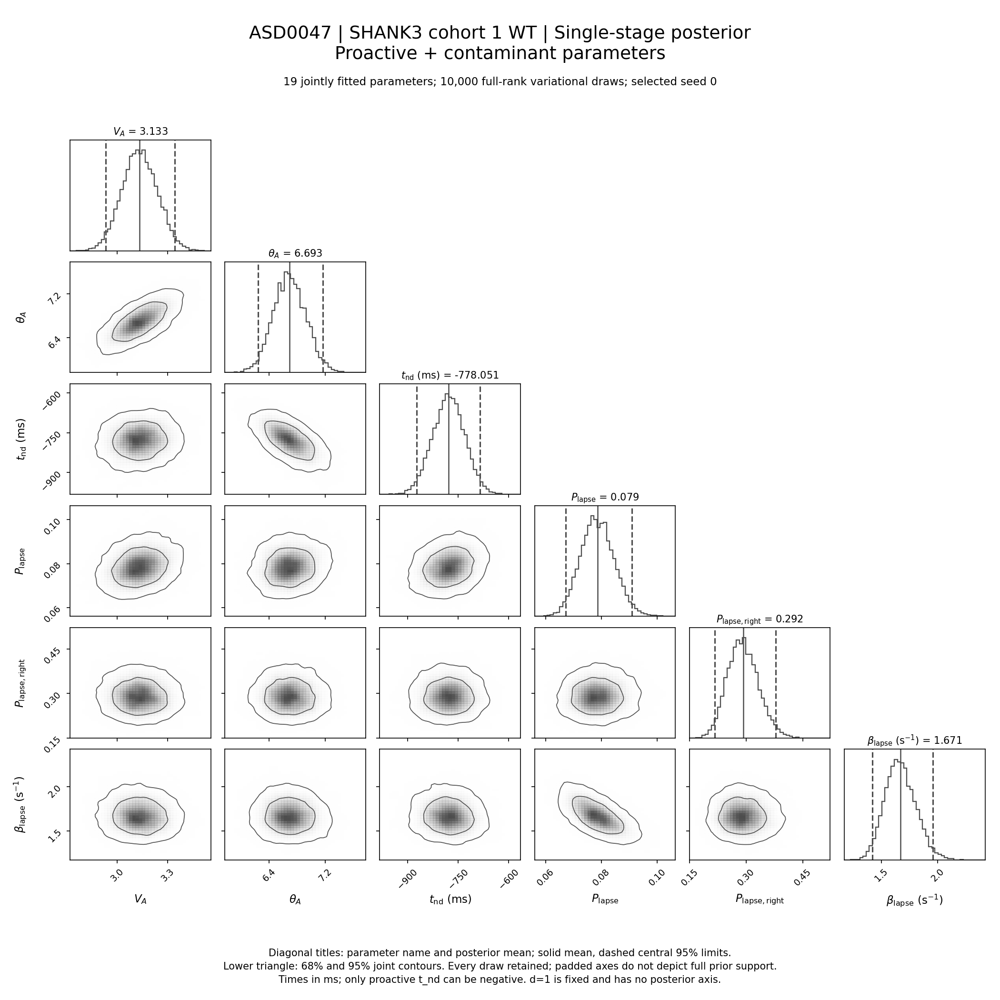

# Results: 2026-11-12

<!-- shank3-ASD0047-joint:start -->
## SHANK3 cohort 1 ASD0047: joint proactive, NPL+alpha and contaminants

This is **ASD0047 alone**, the SHANK3 cohort 1 WT animal whose earlier two-stage proactive delay was **-715.55 ms**. Its proactive, reactive NPL+alpha and contaminant parameters are now fitted in **one joint likelihood**, without freezing the proactive or lapse estimates. There is no cross-animal pooling or hierarchy.

The new proactive delay is **-778.05 ms**, central 95% variational credible interval **[-872.40, -685.27] ms**. A change in this estimate does not by itself establish that the earlier value was caused by two-stage estimation: contaminant support/choice bias and likelihood conditioning also change, as described below.

**Initialization sensitivity:** proactive delay by completed start is start 0: -778.05 [-872.40, -685.27] ms; start 1: -573.36 [-666.45, -483.97] ms. Both starts and all parameter estimates remain available in [the start-by-start table](../assets/results/2026-11-12/shank3_ASD0047_joint/all_start_parameter_estimates.csv). The selected corner does not establish a unique solution. In particular, similar losses with separated delay posteriors indicate weak identification or different variational solutions; they must not be hidden by quoting only the selected interval.

### Model and exact population

The reactive model retains seven shared NPL+alpha/readout parameters and three underlying Gaussian μ/σ pairs, one per ABL 20/40/60 shared across all ten signed ILDs. Reactive trial delays are Gaussian truncated below zero, without an upper cutoff. The proactive delay alone may be negative. All shared parameter priors initially match this animal’s final two-stage priors, including proactive **t_nd ∈ [−3,0.3] s**; the old −700 ms value is not ruled out by the new prior. Any adaptive hard/flat prior changes are exported explicitly. No unresolved artificial-bound, physical-domain or prior-taper flag remains in the selected posterior.

The initial exponential/uniform contaminant fit gave d=0.8351 [0.3003, 0.9957]. Under the user-authorized exponential-tendency simplification, the model was refitted with **d=1**, removing the uniform branch. The selected reduced model fits **19 parameters jointly**. d is fixed, has no posterior interval and is omitted from corner axes. The tendency check includes a posterior mean ≥0.95, or upper-edge pressure with mode ≥0.95 and median ≥0.90. The mode/median extension was added after inspecting the first completed start, because a long lower tail can pull a bounded posterior mean away from its upper-edge peak. The broad mixture posterior does not rule out a uniform contribution. This is an exploratory nested simplification, not a predeclared model-selection or Bayes-factor test; the original mixture fit and its flags remain preserved. The reduced model uses both corresponding mixture-start posterior means as distinct warm starts, with fresh guides and optimizers.

| Observation | Count |
|---|---:|
| Valid RT [0,1] s choices | 18,771 |
| Right / left choices | 9,592 / 9,179 |
| Pre-onset aborts entering fitting | 3,004 |
| Late fixation-labelled onset-censored trials | 11 |
| Retained joint observations | 21,786 |
| Valid RT >1 s excluded | 161 |
| RTD observations: valid choices + aborts in [−1,0) s | 21,694 |

Session type 1, training level 16, success ±1 for valid choices, ABL 59→60 then 20/40/60, and signed ILDs ±1/2/4/8/16 remain unchanged. The same 18,771 valid trial identities and recorded values are independently matched to the prepared CSV and earlier animal fit. Prepared exclusions are retained without reapplying repeat filtering. All 3,004 pre-onset aborts enter fitting; no early-abort cutoff is imposed.

The complete joint mixture conditions on **no response before fixation** and the selected fixation-time window **[0,planned onset+1] s**, after Gaussian delay marginalization. Actual valid RT is planned onset plus recorded `timed_rt`. Late fixation-labelled rows retain onset-censoring semantics within that selected window. Contaminants use a common fixation-time **[0,3.3] s** support and a fitted right-choice probability. Abort choices are unobserved and summed out. There is no additional reactive lapse component.

Two starts use the old animal’s physical posterior means and a distinct near-zero proactive-delay initialization. Float64 full-batch full-rank variational inference uses 1,000-update mean-loss windows, minimum 50,000 updates, 25 subsequent windows without strict improvement and absolute-best checkpoint restoration. Parameter stability is diagnostic only. Each completed start retains 10,000 posterior draws and resumable states. The selected run is `asd_analysis/shank3_cohort1_ASD0047_joint_npl_alpha_gaussian_abl_contaminants/exponential_only/round_00/seed_0`.

### Joint-fit RTDs and psychometric

*3×5 ABL × |ILD| panels: 20 ms empirical steps above thin 0.9 pt black model curves evaluated at 1 ms. Data and model pool actual signed trials and are separately area-one normalized over **[−1,1] s**; only the display is zoomed to **−0.1–0.6 s**. Model predictions use each retained parent trial’s exact planned onset and normalization before pooling. The 81 aborts before −1 s and 11 onset-censored rows enter fitting but are not observed RTD points.*

*Measured P(right) dots and complete-mixture conditional model probabilities use the same fitted valid choices. ABL 20 blue, 40 orange, 60 green; actual numeric signed ILD positions. Predictions are normalized per exact onset over valid RT [0,1] s before trial-weighted averaging. Lines join measured ILDs; no sigmoid is fitted.*

### Two-stage versus joint parameter comparisons

*Gray circles: this animal’s original two-stage fit; blue squares: the selected joint fit. Dots are posterior means and bars central 95% credible intervals from 10,000 saved draws. Open diamonds show fixed constants without intervals. The original right-lapse probability was fixed 0.5; it is estimated in the new joint fit. Underlying Gaussian μ/σ are shown in ms, with numeric ABL positions and additive −1/+1 dB offsets for readability. These are variational intervals, not across-animal SEMs. Two-stage reactive intervals omit uncertainty in the frozen proactive/lapse parameters; the joint fit estimates them together.*

**Comparison limits:** the original proactive fit used all 21,947 event-or-onset-censored trials, including the 161 long valid responses as onset-censored information. Its reactive stage used the same 18,771 valid choices with a complete-mixture valid-window normalization. It retained the original unconditioned proactive approximation and untruncated exponential with fixed right-choice probability 0.5. The new fit excludes those 161 long choices, uses entry and upper-window conditioning, and fits the contaminant right bias on finite support. Actual priors and any expansions are included in [the comparison table](../assets/results/2026-11-12/shank3_ASD0047_joint/posterior_parameter_comparison.csv). This is not a controlled experiment changing only estimation order.

### Corner plots and PDF downloads

*Every diagonal title gives the **parameter name and posterior mean**, with times in ms. Solid lines mark means, dashed lines central 95% limits; pairwise panels show 68%/95% joint contours. All 10,000 draws are retained inside padded display limits. These limits are not prior endpoints; actual hard/flat ranges are exported separately.*

- **[Diagnostics PDF, four pages](../assets/results/2026-11-12/shank3_ASD0047_joint/SHANK3_cohort1_ASD0047_joint_diagnostics.pdf):** 3×5 RTDs; psychometric; abort/convergence/parameter summary; proactive+contaminant corner.
- **[Full and focused posterior-corner PDF, two pages](../assets/results/2026-11-12/shank3_ASD0047_joint/SHANK3_cohort1_ASD0047_joint_posterior_corners.pdf)** · [Full-corner PNG](../assets/results/2026-11-12/shank3_ASD0047_joint/SHANK3_cohort1_ASD0047_joint_corner_all_parameters.png).
- [Abort and convergence PNG](../assets/results/2026-11-12/shank3_ASD0047_joint/SHANK3_cohort1_ASD0047_joint_abort_and_convergence.png) · [Posterior summaries](../assets/results/2026-11-12/shank3_ASD0047_joint/posterior_summary.csv) · [Selected bound audit](../assets/results/2026-11-12/shank3_ASD0047_joint/selected_boundary_audit.csv) · [Independent deliverable verification](../assets/results/2026-11-12/shank3_ASD0047_joint/deliverable_validation.json) · [Light audits and sources](../assets/results/2026-11-12/shank3_ASD0047_joint/SHANK3_cohort1_ASD0047_joint_light_audits_and_sources.zip).

The abort summary uses fixation-time coordinates and scales counts by all retained trials × bin width, so its area represents the abort fraction rather than one. Model predictions apply each exact onset censor and selection normalizer. Independent checks cover the likelihood, normalization, finite gradients, checkpoint restoration, loss-tail replay, reproducible restart, all posterior summaries/correlations, all 15 RTD histograms/unit areas, 30 psychometric probabilities and unchanged prior files. Every delivered PNG and PDF page has been visually inspected. These are in-sample diagnostics; variational convergence is not a guarantee of global identifiability or predictive validity.

**Visible residual:** the single-exponential model underpredicts the earliest fixation-abort peak and smooths the subsequent dip. A similar integrated abort fraction does not imply that it captures that early-time shape exactly. The observed data remain visible in the diagnostics PDF.

Sources: `asd_analysis/run_shank3_asd0047_joint.py`, `asd_analysis/plot_shank3_asd0047_joint.py`, `asd_analysis/plot_shank3_asd0047_joint_comparison.py`, `asd_analysis/export_shank3_asd0047_joint_corners_and_report.py`.

<!-- shank3-ASD0047-joint:end -->
